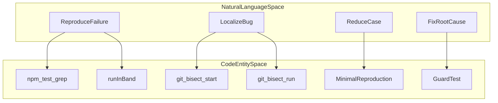
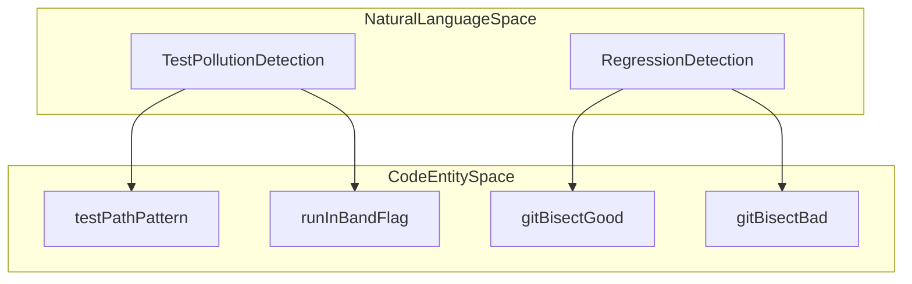
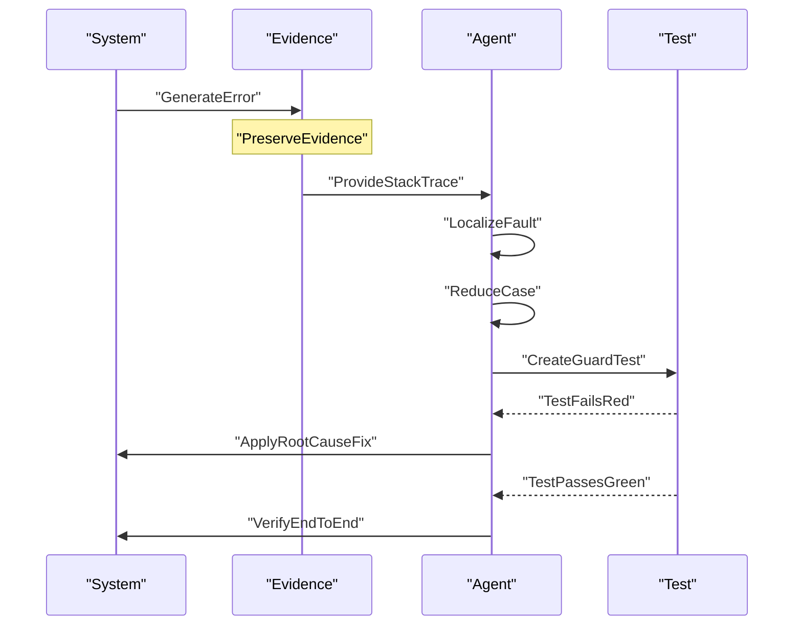

<!-- source: DeepWiki mcp.deepwiki.com · repo addyosmani/agent-skills · extra page Debugging & Error Recovery · fetched 2026-10-30 -->

# Debugging & Error Recovery

<details>
<summary>Relevant source files</summary>

The following files were used as context for generating this wiki page:

- [evals/cases/git-workflow-and-versioning.json](evals/cases/git-workflow-and-versioning.json)
- [evals/fixtures/debugging-and-error-recovery/pagination.js](evals/fixtures/debugging-and-error-recovery/pagination.js)
- [skills/debugging-and-error-recovery/SKILL.md](skills/debugging-and-error-recovery/SKILL.md)
- [skills/git-workflow-and-versioning/SKILL.md](skills/git-workflow-and-versioning/SKILL.md)

</details>


The **debugging-and-error-recovery** skill (`debugging-and-error-recovery`) provides a systematic framework for root-cause analysis, failure triage, and error recovery. Its core purpose is to replace speculative "guessing" with a rigorous, repeatable six-step triage pipeline governed by the **Stop-the-Line** rule [skills/debugging-and-error-recovery/SKILL.md:1-10]().

## Purpose and Scope

When tests fail, builds break, or runtime behavior deviates from expectations, this skill establishes the mandatory protocol for preserving evidence, isolating faults, identifying root causes rather than symptoms, and guarding against recurrence [skills/debugging-and-error-recovery/SKILL.md:10-20]().

Sources: [skills/debugging-and-error-recovery/SKILL.md:1-20]()

## The Stop-the-Line Rule

The foundational operational rule during any unexpected failure is the **Stop-the-Line** principle. Development and feature addition must halt immediately to prevent error compounding [skills/debugging-and-error-recovery/SKILL.md:21-35]().

| Step | Action | Description |
| :--- | :--- | :--- |
| 1 | **STOP** | Cease adding new features or making unrelated code modifications [skills/debugging-and-error-recovery/SKILL.md:26-26](). |
| 2 | **PRESERVE** | Capture error output, console logs, and environment context [skills/debugging-and-error-recovery/SKILL.md:27-27](). |
| 3 | **DIAGNOSE** | Execute the structured triage pipeline [skills/debugging-and-error-recovery/SKILL.md:28-28](). |
| 4 | **FIX** | Address the underlying root cause, not just the surface symptom [skills/debugging-and-error-recovery/SKILL.md:29-29](). |
| 5 | **GUARD** | Write regression tests to prevent recurrence [skills/debugging-and-error-recovery/SKILL.md:30-30](). |
| 6 | **RESUME** | Continue development only after full verification passes [skills/debugging-and-error-recovery/SKILL.md:31-31](). |

Sources: [skills/debugging-and-error-recovery/SKILL.md:21-35]()

## The Six-Step Triage Pipeline

The triage process is structured into six sequential phases. Skipping steps leads to superficial patches that leave underlying defects intact [skills/debugging-and-error-recovery/SKILL.md:36-39]().

### 1. Reproduce
Establish a reliable method to trigger the failure [skills/debugging-and-error-recovery/SKILL.md:40-43](). For test failures, isolate execution to rule out environment pollution:
```bash
npm test -- --grep "test name"
npm test -- --verbose
npm test -- --testPathPattern="specific-file" --runInBand
```
Sources: [skills/debugging-and-error-recovery/SKILL.md:75-85]()

### 2. Localize
Determine the failing layer (UI, API, Database, Build tooling, or External service) [skills/debugging-and-error-recovery/SKILL.md:87-99](). For regressions, use `git bisect` to locate the faulty commit:
```bash
git bisect start
git bisect bad
git bisect good <known-good-sha>
git bisect run npm test -- --grep "failing test"
```
Sources: [skills/debugging-and-error-recovery/SKILL.md:87-109]()

### 3. Reduce
Strip away unrelated code, configuration, and inputs until the smallest possible failing test case remains [skills/debugging-and-error-recovery/SKILL.md:111-119]().

### 4. Fix the Root Cause
Distinguish surface symptoms from systemic causes. Ask "Why does this happen?" iteratively until the underlying defect is reached [skills/debugging-and-error-recovery/SKILL.md:121-136]().

### 5. Guard Against Recurrence
Implement an automated test that fails in the absence of the fix and passes when applied [skills/debugging-and-error-recovery/SKILL.md:138-153]().

### 6. Verify End-to-End
Run focused tests, execute the full suite, perform a production build, and spot-check runtime behavior [skills/debugging-and-error-recovery/SKILL.md:154-171]().

Sources: [skills/debugging-and-error-recovery/SKILL.md:36-171]()

## Triage Implementation Mapping

### Triage Implementation Mapping Diagram

Sources: [skills/debugging-and-error-recovery/SKILL.md:75-85](), [skills/debugging-and-error-recovery/SKILL.md:101-109](), [skills/debugging-and-error-recovery/SKILL.md:142-150]()

## Test Pollution & Isolation Mapping

### Test Pollution & Isolation Mapping Diagram

Sources: [skills/debugging-and-error-recovery/SKILL.md:83-85](), [skills/debugging-and-error-recovery/SKILL.md:101-109]()

## Error-Specific Patterns

### Test and Build Failure Triage

| Error Type | Diagnostic Indicators | Corrective Action |
| :--- | :--- | :--- |
| **Test Failure** | Side effects, shared state, modified unrelated code | Run with `--runInBand` and `--verbose` [skills/debugging-and-error-recovery/SKILL.md:81-85]() |
| **Build Failure** | TypeScript type errors, missing module exports, broken `package.json` | Inspect compiler output and run `npm run build` [skills/debugging-and-error-recovery/SKILL.md:188-197]() |

Sources: [skills/debugging-and-error-recovery/SKILL.md:172-197]()

## Data Flow: From Error to Verification

### Error Recovery Sequence Diagram

Sources: [skills/debugging-and-error-recovery/SKILL.md:21-32](), [skills/debugging-and-error-recovery/SKILL.md:101-109](), [skills/debugging-and-error-recovery/SKILL.md:142-150](), [skills/debugging-and-error-recovery/SKILL.md:154-171]()

---

