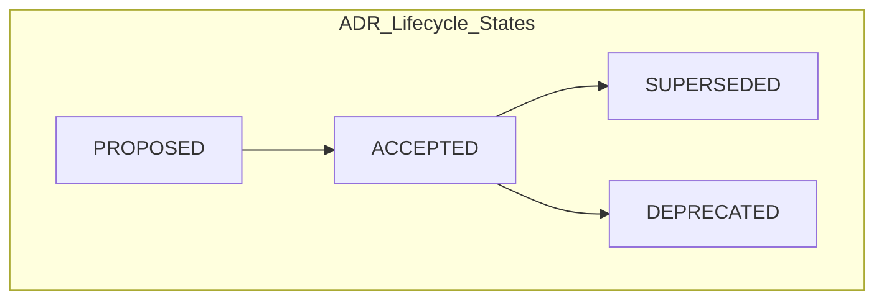
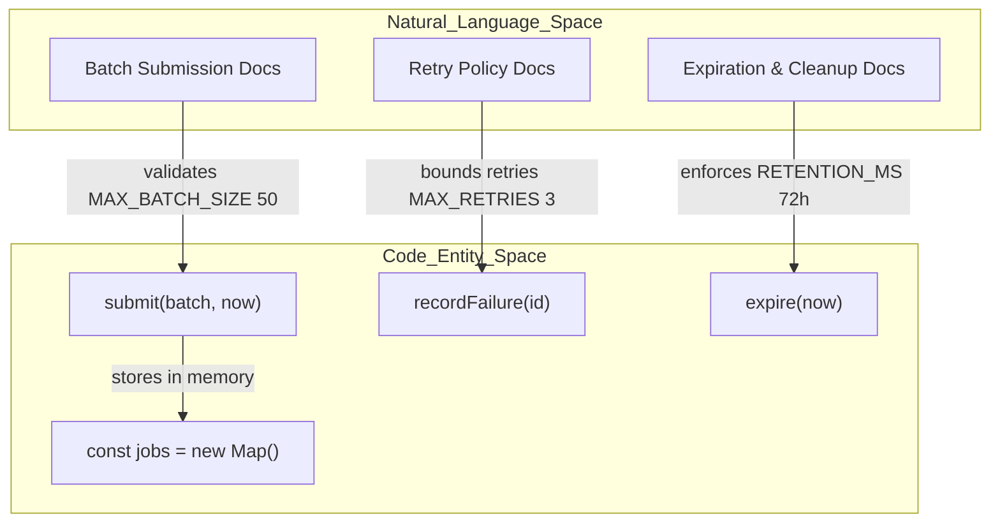
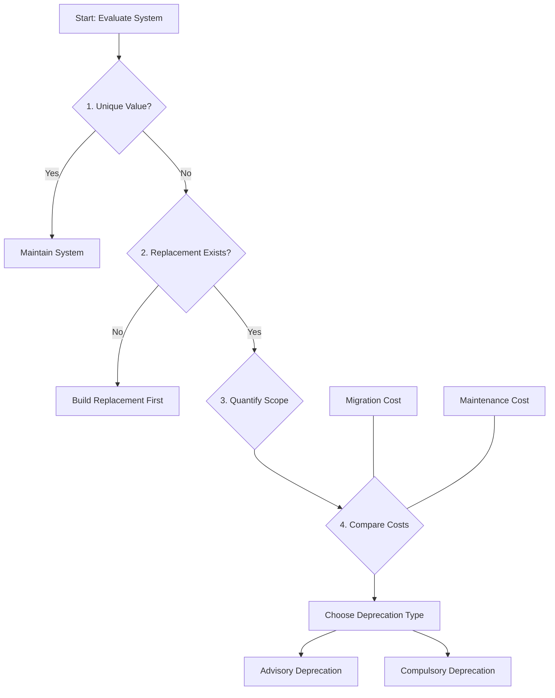
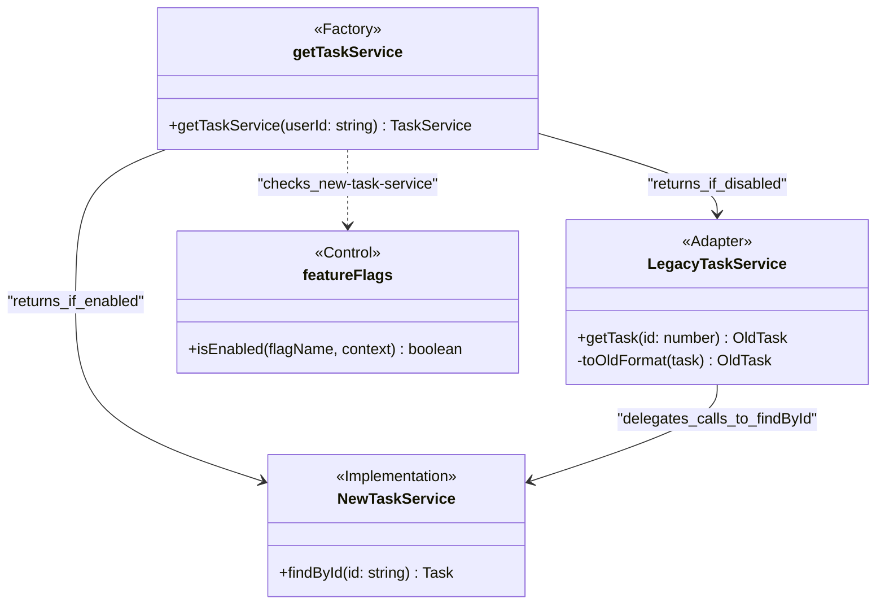

<!-- source: DeepWiki mcp.deepwiki.com · repo addyosmani/agent-skills · extra page Documentation, ADRs & Deprecation · fetched 2026-10-30 -->

# Documentation, ADRs & Deprecation

Relevant source files

The following files were used as context for generating this wiki page:

- [evals/cases/deprecation-and-migration.json](evals/cases/deprecation-and-migration.json)
- [evals/cases/documentation-and-adrs.json](evals/cases/documentation-and-adrs.json)
- [evals/cases/security-and-hardening.json](evals/cases/security-and-hardening.json)
- [evals/fixtures/documentation-and-adrs/prose-review/README.md](evals/fixtures/documentation-and-adrs/prose-review/README.md)
- [evals/fixtures/documentation-and-adrs/prose-review/queue.js](evals/fixtures/documentation-and-adrs/prose-review/queue.js)
- [skills/deprecation-and-migration/SKILL.md](skills/deprecation-and-migration/SKILL.md)
- [skills/documentation-and-adrs/SKILL.md](skills/documentation-and-adrs/SKILL.md)

This section covers the final stages of the software lifecycle focused on long-term maintainability: capturing the "why" behind technical choices through Architecture Decision Records (ADRs) and safely removing or transitioning away from legacy code through structured deprecation and migration strategies.

Sources: [skills/documentation-and-adrs/SKILL.md:1-12](), [skills/deprecation-and-migration/SKILL.md:1-13]()

---

## Documentation and ADRs

The `documentation-and-adrs` skill shifts the focus from documenting *what* was built to documenting *why* it was built [skills/documentation-and-adrs/SKILL.md:2-3](). While code expresses implementation, documentation must capture the context, constraints, and trade-offs that led to a decision [skills/documentation-and-adrs/SKILL.md:8-10](). This context is essential for both future humans and agents working in the codebase [skills/documentation-and-adrs/SKILL.md:10-10]().

### Architecture Decision Records (ADRs)

ADRs are the primary mechanism for recording significant technical decisions that would be expensive to reverse, such as choosing frameworks, designing data models, or selecting authentication strategies [skills/documentation-and-adrs/SKILL.md:25-34](). They are stored as sequentially numbered Markdown files in `docs/decisions/` [skills/documentation-and-adrs/SKILL.md:38-40]().

**ADR Lifecycle State Machine**
The status of a decision evolves over time, but records are never deleted to preserve historical context [skills/documentation-and-adrs/SKILL.md:99-99](). When a decision changes, a new ADR is written that references and supersedes the old one [skills/documentation-and-adrs/SKILL.md:100-101]().

Sources: [skills/documentation-and-adrs/SKILL.md:93-101]()

### Documentation Strategy by Entity

The system enforces different documentation patterns based on the code entity being described:

| Entity | Documentation Pattern | Location |
| :--- | :--- | :--- |
| **Architecture** | ADR (Context, Decision, Alternatives, Consequences) | `docs/decisions/ADR-XXX.md` |
| **Public APIs** | TSDoc/JSDoc with `@param`, `@returns`, and `@throws` | Inline in `.ts`/`.js` files |
| **REST Endpoints** | OpenAPI / Swagger Specifications | `openapi.yaml` or similar |
| **Logic/Intent** | "Why" comments (explaining non-obvious intent) | Inline above logic blocks |
| **Project** | README (Quick Start, Commands, Architecture) | `README.md` |
| **Shipped Features**| Changelog (Added, Fixed, Changed) | `CHANGELOG.md` |

Sources: [skills/documentation-and-adrs/SKILL.md:38-81](), [skills/documentation-and-adrs/SKILL.md:102-120](), [skills/documentation-and-adrs/SKILL.md:152-174](), [skills/documentation-and-adrs/SKILL.md:190-219](), [skills/documentation-and-adrs/SKILL.md:221-237]()

---

## API Documentation & Prose Grounding

Public APIs require precise inline typing or OpenAPI specifications to bridge natural language usage instructions with underlying code entities. When auditing operational prose (such as a README reviewing a batch queue implementation), agents must ground documentation claims strictly in runtime functions such as `submit`, `recordFailure`, and `expire` defined in modules like `evals/fixtures/documentation-and-adrs/prose-review/queue.js`.

**Natural Language to Code Entity Space: Queue Operations**

Sources: [evals/fixtures/documentation-and-adrs/prose-review/queue.js:1-32](), [evals/fixtures/documentation-and-adrs/prose-review/README.md:1-19]()

---

## Deprecation and Migration

The `deprecation-and-migration` skill treats code as a liability rather than an asset [skills/deprecation-and-migration/SKILL.md:2-3](). Every line of code has ongoing maintenance costs—bugs, dependency updates, and mental overhead [skills/deprecation-and-migration/SKILL.md:27-27](). Deprecation is the discipline of removing code that no longer "earns its keep" [skills/deprecation-and-migration/SKILL.md:10-10]().

### The Deprecation Decision Pipeline

Before initiating a deprecation, the agent must evaluate the system against specific criteria to determine if removal is justified [skills/deprecation-and-migration/SKILL.md:37-56]().

**Decision Flow: Code as a Liability**

Sources: [skills/deprecation-and-migration/SKILL.md:37-65]()

### Migration Patterns

The codebase utilizes three primary patterns for moving users from old implementations to new ones:

1.  **Strangler Pattern**: Running old and new systems in parallel and routing traffic incrementally (e.g., 10% canary -> 50% -> 100%) [skills/deprecation-and-migration/SKILL.md:122-132]().
2.  **Adapter Pattern**: Creating an adapter that translates calls from the old interface to the new implementation [skills/deprecation-and-migration/SKILL.md:134-149]().
3.  **Feature Flag Migration**: Using conditional logic (e.g., via `featureFlags.isEnabled`) to switch between `LegacyTaskService` and `NewTaskService` based on user context [skills/deprecation-and-migration/SKILL.md:151-162]().

Sources: [skills/deprecation-and-migration/SKILL.md:120-163]()

---

## Implementation Detail: The Migration Interface

The following diagram maps the conceptual migration process to the specific code patterns used to implement it.

**Code Entity Mapping: Migration Logic**

Sources: [skills/deprecation-and-migration/SKILL.md:140-149](), [skills/deprecation-and-migration/SKILL.md:156-162]()

### The Churn Rule
The `deprecation-and-migration` skill enforces the **Churn Rule**: The owner of the infrastructure being deprecated is responsible for migrating the users or providing backward-compatible updates that require no migration [skills/deprecation-and-migration/SKILL.md:106-106](). Deprecation cannot be announced without providing the necessary tooling, documentation, and support for the transition [skills/deprecation-and-migration/SKILL.md:65-65]().

Sources: [skills/deprecation-and-migration/SKILL.md:1-174](), [skills/documentation-and-adrs/SKILL.md:1-237]()

---

