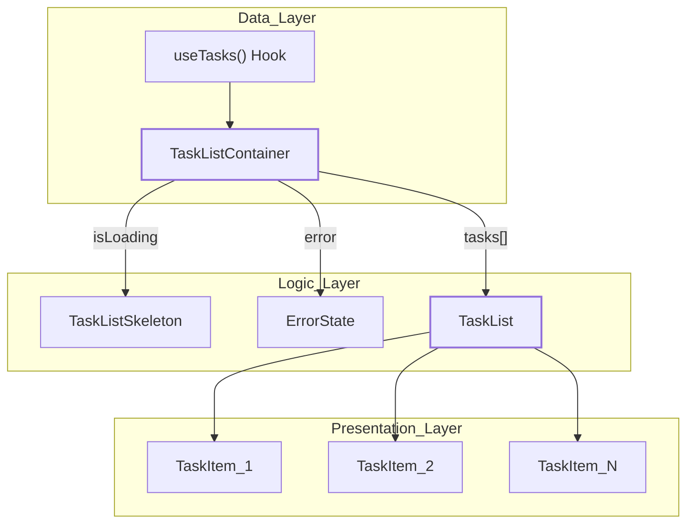
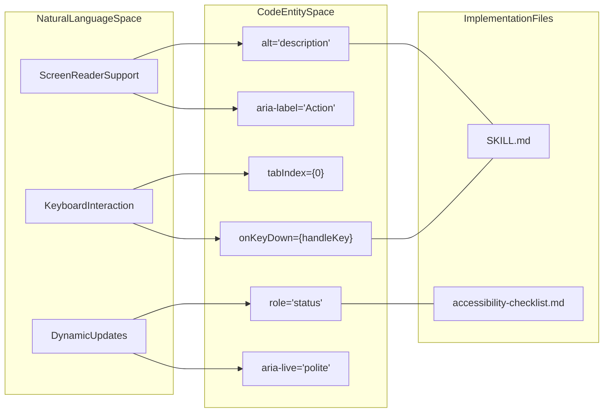
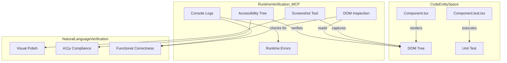

<!-- source: DeepWiki mcp.deepwiki.com · repo addyosmani/agent-skills · extra page Frontend UI Engineering · fetched 2026-10-30 -->

# Frontend UI Engineering

Relevant source files

The following files were used as context for generating this wiki page:

- [evals/cases/code-simplification.json](evals/cases/code-simplification.json)
- [evals/cases/doubt-driven-development.json](evals/cases/doubt-driven-development.json)
- [evals/cases/frontend-ui-engineering.json](evals/cases/frontend-ui-engineering.json)
- [evals/cases/planning-and-task-breakdown.json](evals/cases/planning-and-task-breakdown.json)
- [evals/cases/using-agent-skills.json](evals/cases/using-agent-skills.json)
- [references/observability-checklist.md](references/observability-checklist.md)
- [skills/frontend-ui-engineering/SKILL.md](skills/frontend-ui-engineering/SKILL.md)
- [skills/observability-and-instrumentation/SKILL.md](skills/observability-and-instrumentation/SKILL.md)

The `frontend-ui-engineering` skill defines the standards for building production-quality user interfaces that are accessible, performant, and visually polished [skills/frontend-ui-engineering/SKILL.md:1-10](). This skill is invoked when building new UI components, modifying existing interfaces, implementing responsive layouts, managing client-side state, or ensuring accessibility compliance [skills/frontend-ui-engineering/SKILL.md:12-18]().

The primary objective is to avoid the "AI aesthetic"—characterized by generic palettes, excessive gradients, oversized padding, and placeholder content—in favor of design-system-adherent, content-first layouts [skills/frontend-ui-engineering/SKILL.md:118-132]().

Sources: [skills/frontend-ui-engineering/SKILL.md:1-18]()

## Component Architecture

### File Structure and Colocation
Components are organized using a colocation pattern where implementation, tests, stories, custom hooks, and types reside in a single directory to maintain high cohesion [skills/frontend-ui-engineering/SKILL.md:22-34]().

**Standard Directory Layout:**
- `TaskList.tsx`: Component implementation [skills/frontend-ui-engineering/SKILL.md:29]()
- `TaskList.test.tsx`: Tests [skills/frontend-ui-engineering/SKILL.md:30]()
- `TaskList.stories.tsx`: Storybook stories (if using) [skills/frontend-ui-engineering/SKILL.md:31]()
- `use-task-list.ts`: Custom hook (if complex state) [skills/frontend-ui-engineering/SKILL.md:32]()
- `types.ts`: Component-specific types (if needed) [skills/frontend-ui-engineering/SKILL.md:33]()

### Design Patterns
The codebase enforces **composition over configuration** to prevent over-configured components with excessive props [skills/frontend-ui-engineering/SKILL.md:38-58]().

| Pattern | Implementation Strategy | Source |
| :--- | :--- | :--- |
| **Composition** | Use children and sub-components (e.g., `<CardHeader>`, `<CardBody>`) to build complex UI | [skills/frontend-ui-engineering/SKILL.md:42-49]() |
| **Single Responsibility** | Components should focus on one task (e.g., a `TaskItem` handles only row rendering and item actions) | [skills/frontend-ui-engineering/SKILL.md:60-75]() |
| **Container/Presenter** | Separate data fetching logic (`TaskListContainer`) from rendering logic (`TaskList`) | [skills/frontend-ui-engineering/SKILL.md:77-98]() |

### Component Data Flow

Title: Data Flow: Container to Presenter

Sources: [skills/frontend-ui-engineering/SKILL.md:80-98]()

Sources: [skills/frontend-ui-engineering/SKILL.md:22-98]()

## State Management and Optimistic Mutations

State should be managed using the simplest approach that meets the requirement, following a strict hierarchy to avoid unnecessary complexity [skills/frontend-ui-engineering/SKILL.md:101-112]().

| State Type | Recommended Tool | Use Case | Source |
| :--- | :--- | :--- | :--- |
| **Local UI** | `useState` | Component-specific toggles or inputs | [skills/frontend-ui-engineering/SKILL.md:106]() |
| **Shared UI** | Lifted State | Shared between 2-3 sibling components | [skills/frontend-ui-engineering/SKILL.md:107]() |
| **Global/Static** | Context API | Theme, Auth, or Locale (read-heavy, write-rare) | [skills/frontend-ui-engineering/SKILL.md:108]() |
| **Navigational** | URL `searchParams` | Filters, pagination, shareable state | [skills/frontend-ui-engineering/SKILL.md:109]() |
| **Server Data** | React Query / SWR | Remote data with caching, revalidation, and optimistic mutation hooks | [skills/frontend-ui-engineering/SKILL.md:110]() |
| **Complex Global** | Zustand / Redux | App-wide complex client state | [skills/frontend-ui-engineering/SKILL.md:111]() |

**Constraint:** Prop drilling deeper than 3 levels is prohibited; use Context or restructure the tree instead [skills/frontend-ui-engineering/SKILL.md:114-115]().

Sources: [skills/frontend-ui-engineering/SKILL.md:101-115]()

## Design System Adherence vs 'AI Aesthetic'

Engineers must adhere strictly to design system tokens rather than raw hex values or arbitrary spacing [skills/frontend-ui-engineering/SKILL.md:135-143]().

### Avoiding the AI Aesthetic
AI-generated UI often exhibits recognizable anti-patterns that must be actively avoided:

| AI Default | Why It Is a Problem | Production Quality | Source |
|---|---|---|---|
| Purple/indigo everything | Models default to visually safe palettes, making every app look identical | Use the project's actual color palette | [skills/frontend-ui-engineering/SKILL.md:135]() |
| Excessive gradients | Adds visual noise and clashes with design systems | Flat or subtle gradients matching the system | [skills/frontend-ui-engineering/SKILL.md:136]() |
| Rounded everything (`rounded-2xl`) | Maximum rounding ignores real design corner hierarchy | Consistent border-radius from design system | [skills/frontend-ui-engineering/SKILL.md:137]() |
| Lorem ipsum-style copy | Hides layout and text wrapping issues | Realistic placeholder content | [skills/frontend-ui-engineering/SKILL.md:139]() |
| Oversized padding | Destroys visual hierarchy and wastes screen space | Consistent spacing scale | [skills/frontend-ui-engineering/SKILL.md:140]() |
| Heavy shadows | Competes with content and slows rendering | Subtle or no shadows unless specified | [skills/frontend-ui-engineering/SKILL.md:142]() |

### Typography and Spacing
- **Spacing:** Use 0.25rem increments consistent with the project scale (e.g., `padding: 1rem`, `gap: 0.75rem`) [skills/frontend-ui-engineering/SKILL.md:146-154]().
- **Typography:** Respect the type hierarchy (`h1` for page titles down to `small` text); do not skip heading levels or style non-heading elements as headings [skills/frontend-ui-engineering/SKILL.md:156-168]().
- **Color Tokens:** Use semantic tokens (`text-primary`, `bg-surface`, `border-default`) and maintain contrast ratios of at least 4.5:1 for normal text and 3:1 for large text [skills/frontend-ui-engineering/SKILL.md:170-174]().

Sources: [skills/frontend-ui-engineering/SKILL.md:118-174]()

## Accessibility (WCAG 2.1 AA)

Every component must meet WCAG 2.1 AA standards, backed by the accessibility checklist [skills/frontend-ui-engineering/SKILL.md:176-177]().

### Keyboard Navigation and ARIA
- **Interactive Elements:** Semantic tags like `<button>` and `<a>` must be used. If custom widgets are built on `
`, they require appropriate ARIA attributes and keyboard event handlers.
- **Labels and ARIA:** Icon-only buttons and form inputs must have explicit labels or `aria-label` attributes.
- **Live Regions:** Dynamic updates should leverage `aria-live="polite"` or `role="status"`.

### Accessibility Implementation Mapping
This diagram maps Natural Language requirements to specific Code Entities and ARIA attributes used in the codebase.

Title: Requirement to Code Mapping

Sources: [skills/frontend-ui-engineering/SKILL.md:1-177]()

Sources: [skills/frontend-ui-engineering/SKILL.md:1-177]()

## Verification and Browser Testing

UI changes must be verified through component testing, automated checks, and runtime inspection:
1. **Component Testing:** Test behavior using React Testing Library rather than implementation details.
2. **Automated Audits:** Use accessibility scanning tools.
3. **Runtime Verification:** Use Chrome DevTools MCP or browser testing tools to inspect the DOM, network activity, performance, and accessibility trees.

### Browser Verification Workflow
The following diagram demonstrates how the agent bridges the gap between code and the browser using verification mechanisms.

Title: Code-to-Browser Verification Loop

Sources: [skills/frontend-ui-engineering/SKILL.md:1-177]()

Sources: [skills/frontend-ui-engineering/SKILL.md:1-177]()

---

