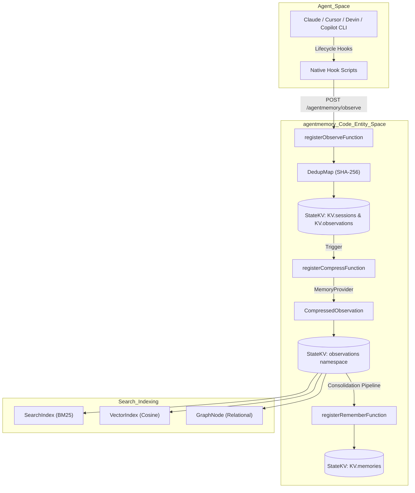

<!-- source: DeepWiki mcp.deepwiki.com · repo rohitg00/agentmemory · page 1 Overview · fetched 2026-10-30 -->

# Overview

<details>
<summary>Relevant source files</summary>

The following files were used as context for generating this wiki page:

- [AGENTS.md](AGENTS.md)
- [CHANGELOG.md](CHANGELOG.md)
- [README.md](README.md)
- [READMEs/README.de-DE.md](READMEs/README.de-DE.md)
- [READMEs/README.es-ES.md](READMEs/README.es-ES.md)
- [READMEs/README.fr-FR.md](READMEs/README.fr-FR.md)
- [READMEs/README.hi-IN.md](READMEs/README.hi-IN.md)
- [READMEs/README.ja-JP.md](READMEs/README.ja-JP.md)
- [READMEs/README.ko-KR.md](READMEs/README.ko-KR.md)
- [READMEs/README.pt-BR.md](READMEs/README.pt-BR.md)
- [READMEs/README.ru-RU.md](READMEs/README.ru-RU.md)
- [READMEs/README.tr-TR.md](READMEs/README.tr-TR.md)
- [READMEs/README.zh-CN.md](READMEs/README.zh-CN.md)
- [package.json](package.json)
- [packages/mcp/package.json](packages/mcp/package.json)
- [plugin/.claude-plugin/plugin.json](plugin/.claude-plugin/plugin.json)
- [plugin/.codex-plugin/plugin.json](plugin/.codex-plugin/plugin.json)
- [plugin/plugin.json](plugin/plugin.json)
- [src/cli.ts](src/cli.ts)
- [src/functions/export-import.ts](src/functions/export-import.ts)
- [src/index.ts](src/index.ts)
- [src/triggers/api.ts](src/triggers/api.ts)
- [src/types.ts](src/types.ts)
- [src/version.ts](src/version.ts)
- [src/viewer/index.html](src/viewer/index.html)
- [test/export-import.test.ts](test/export-import.test.ts)

</details>


**agentmemory** is a persistent, searchable, and versioned memory database designed specifically for AI coding agents. It solves the "amnesia" problem where agents lose context between sessions, forcing users to re-explain architectures, coding standards, and past bug fixes.

By providing a unified memory layer, agentmemory allows different tools—such as **Claude Code**, **Cursor**, **Windsurf**, **Cline**, **GitHub Copilot CLI**, **Devin**, and **Warp**—to share a single, evolving intelligence base for a project [README.md:10-11](). It is built on the **iii-engine**, utilizing three core primitives: HTTP Triggers, KV State, and Streams [package.json:4-5]().

## Key Capabilities

| Capability | Technical Implementation |
|---|---|
| **Automatic Capture** | Silently records tool uses, file edits, and test runs via 12 lifecycle hooks [plugin/.claude-plugin/plugin.json:4](). |
| **Triple-Stream Retrieval** | Combines **BM25** (keyword), **Vector** (semantic), and **Knowledge Graph** (relational) search [src/types.ts:274-282](). |
| **Memory Consolidation** | Automatically compresses raw observations into structured facts and episodic narratives [src/types.ts:64-83](). |
| **Multi-Agent Coordination** | Orchestration primitives like **Leases**, **Actions**, and **Signals** for team collaboration [src/types.ts:327-400](). |
| **Self-Healing Infrastructure** | Circuit-breaker pattern (3-failure threshold) and fallback chains for LLM providers [src/types.ts:239-244](). |

**Sources:** [README.md:1-50](), [src/types.ts:1-300](), [package.json:1-15]()

---

## Subsystem Relationship

The system bridges raw agent interactions to long-term intelligence through a structured pipeline. The diagram below illustrates how raw agent events flow through the system to become long-term memory.

### Data Flow: Hook to Memory

**Sources:** [src/index.ts:24-50](), [src/types.ts:139-160](), [src/state/schema.ts:1-50](), [src/functions/export-import.ts:61-164](), [src/index.ts:94-96]()

---

## Major Components

### 1. Memory Pipeline
The pipeline manages the lifecycle of data from a raw `HookPayload` [src/types.ts:153-160]() to a long-term `Memory` [src/types.ts:102-125](). It handles privacy scrubbing, deduplication via `DedupMap` [src/index.ts:100](), and LLM-driven summarization.
*   For details, see **[Core Memory Pipeline](#2)**.

### 2. Retrieval Engine
agentmemory does not just "grep" files. It uses a `HybridSearch` [src/index.ts:26]() class to fuse results from three different streams—BM25, Vector, and Graph—using Reciprocal Rank Fusion (RRF).
*   For details, see **[Search & Retrieval](#3)**.

### 3. Integration Interfaces
The system exposes its functionality through three primary interfaces:
*   **REST API**: Standard endpoints (e.g., `/agentmemory/livez` [src/triggers/api.ts:190]()) for session and memory management.
*   **MCP Server**: Over 54 tools (e.g., `memory_recall`, `memory_save`) for Model Context Protocol clients [plugin/.claude-plugin/plugin.json:4]().
*   **Native Hooks**: Integration scripts for agent lifecycles mapping 12 event types [src/types.ts:139-151]().
*   For details, see **[API & Integration Interfaces](#4)**.

### 4. Coordination & Mesh
For complex environments, agentmemory supports P2P mesh networking to sync memories across different machines via `registerMeshFunction` [src/index.ts:74](), alongside a "Frontier" priority queue for managing task leases [src/index.ts:68-69]().
*   For details, see **[Multi-Agent Coordination](#5)**.

---

## System Architecture Overview

The following diagram bridges the functional concepts to the specific TypeScript classes and functions that implement them.

### Code Entity Mapping
```mermaid
graph LR
    subgraph "Natural_Language_Space"
        direction TB
        "Context_Injection"
        "Semantic_Search"
        "Memory_Aging"
        "Entity_Relations"
    end

    subgraph "Code_Entity_Space"
        direction TB
        "registerContextFunction" --> "StateKV"
        "HybridSearch" --> "VectorIndex"
        "HybridSearch" --> "SearchIndex"
        "registerAutoForgetFunction" --> "Ebbinghaus_Decay"
        "registerGraphFunction" --> "GraphNode/GraphEdge"
    end

    "Context_Injection" -.-> "registerContextFunction"
    "Semantic_Search" -.-> "HybridSearch"
    "Memory_Aging" -.-> "registerAutoForgetFunction"
    "Entity_Relations" -.-> "registerGraphFunction"
```
**Sources:** [src/index.ts:24-93](), [src/types.ts:196-202](), [src/types.ts:274-282](), [src/functions/export-import.ts:62-164]()

---

## Navigation
*   **[Getting Started](#1.1)**: Installation via `npm install -g @agentmemory/agentmemory` [README.md:110]() and connecting to your favorite editor using `agentmemory connect` [src/cli.ts:173]().
*   **[Architecture Overview](#1.2)**: Deep dive into the `iii-engine` primitives and the worker model.
*   **[Core Memory Pipeline](#2)**: How `RawObservation` [src/types.ts:47-62]() objects become `Memory` [src/types.ts:102-125]() entities.
*   **[Search & Retrieval](#3)**: Details on BM25, Vectors, and RRF Fusion.
*   **[API & Integration Interfaces](#4)**: REST, MCP, and Hook documentation.
*   **[Providers & Resilience](#6)**: Configuring `MemoryProvider` [src/types.ts:172-177]() and `EmbeddingProvider` [src/types.ts:258-264]() with circuit breakers.
*   **[State Layer & Data Model](#8)**: Type definitions in `src/types.ts` and the KV namespace schema in `src/state/schema.ts`.

---

