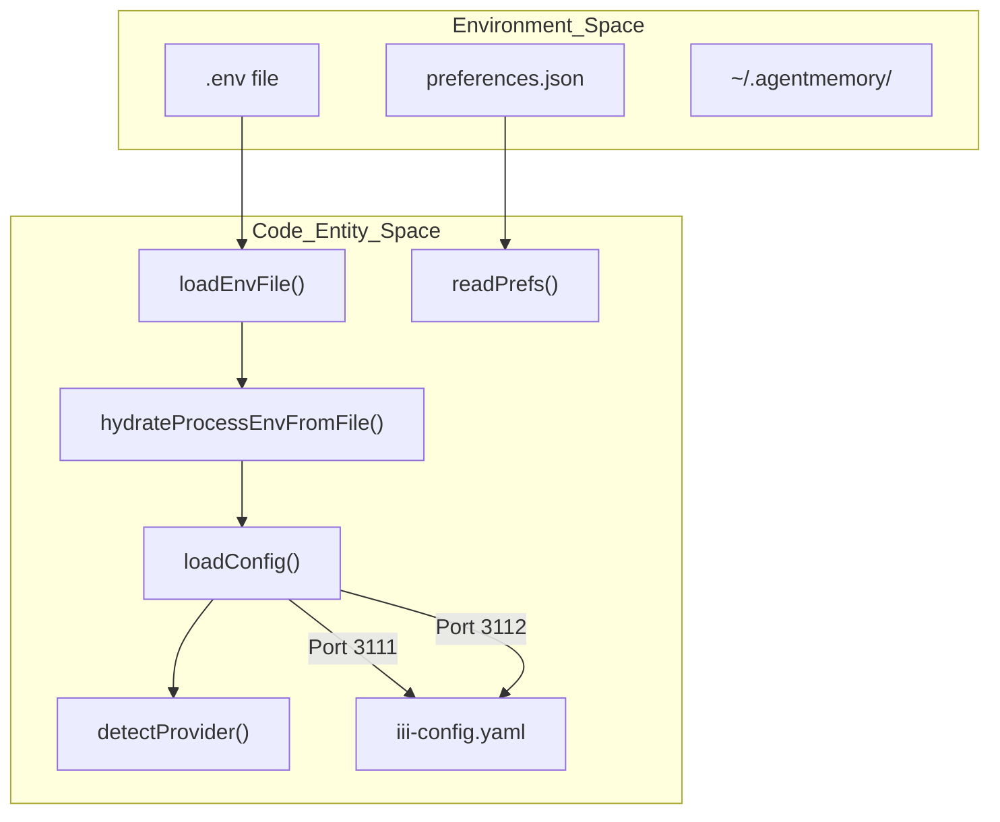
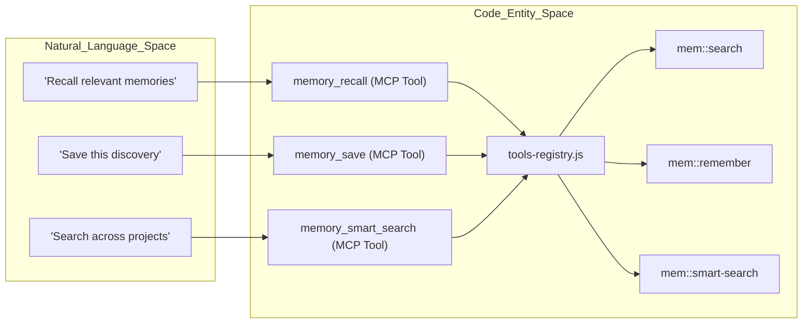

<!-- source: DeepWiki mcp.deepwiki.com · repo rohitg00/agentmemory · page 1.1 Getting Started · fetched 2026-10-30 -->

# Getting Started

<details>
<summary>Relevant source files</summary>

The following files were used as context for generating this wiki page:

- [.env.example](.env.example)
- [.gitignore](.gitignore)
- [INSTALL_FOR_AGENTS.md](INSTALL_FOR_AGENTS.md)
- [iii-config.docker.yaml](iii-config.docker.yaml)
- [iii-config.yaml](iii-config.yaml)
- [scripts/backfill-imported-sessions.sh](scripts/backfill-imported-sessions.sh)
- [src/cli/connect/continue.ts](src/cli/connect/continue.ts)
- [src/cli/connect/copilot-cli.ts](src/cli/connect/copilot-cli.ts)
- [src/cli/connect/index.ts](src/cli/connect/index.ts)
- [src/cli/connect/opencode.ts](src/cli/connect/opencode.ts)
- [src/cli/onboarding.ts](src/cli/onboarding.ts)
- [src/cli/preferences.ts](src/cli/preferences.ts)
- [src/cli/splash.ts](src/cli/splash.ts)
- [src/config.ts](src/config.ts)
- [src/functions/smart-search.ts](src/functions/smart-search.ts)
- [src/logger.ts](src/logger.ts)
- [src/prompts/summary.ts](src/prompts/summary.ts)
- [test/cli-connect.test.ts](test/cli-connect.test.ts)
- [test/env-loader.test.ts](test/env-loader.test.ts)
- [test/preferences.test.ts](test/preferences.test.ts)
- [test/tool-count-consistency.test.ts](test/tool-count-consistency.test.ts)
- [website/components/Install.tsx](website/components/Install.tsx)

</details>


This page provides the technical details for installing, configuring, and integrating `agentmemory` into your AI-assisted development workflow. It covers the environment setup, port layout, and the runtime configuration required to connect the memory system to agents like Claude Code, Cursor, Windsurf, or Copilot CLI.

## Installation & Environment

`agentmemory` relies on a centralized data directory located at `~/.agentmemory/` [src/config.ts:20-21](). This directory houses the persistence layer, CLI preferences, and the primary environment configuration.

### Installation Commands
The system can be installed globally via npm or run directly using npx:
```bash
npm install -g @agentmemory/agentmemory   # Installs the `agentmemory` command
agentmemory                               # Starts the memory server on :3111
agentmemory connect claude-code           # Wires MCP into your agent
```
[INSTALL_FOR_AGENTS.md:23-29]()

### Interactive Onboarding
The CLI includes an interactive onboarding flow managed by `runOnboarding` [src/cli/onboarding.ts:164](). This process wakes up when `isFirstRun()` is true (preferences are missing or `firstRunAt` is null) [src/cli/preferences.ts:139-146](). The flow handles:
1.  **Agent Selection:** A multi-select picker using `ADAPTERS` as the single source of truth [src/cli/onboarding.ts:30-41]().
2.  **Provider Selection:** Choice of LLM provider (Anthropic, OpenAI, Gemini, OpenRouter, MiniMax) or a "Skip — BM25-only" mode [src/cli/onboarding.ts:51-58]().
3.  **Environment Seeding:** Automatically copies `.env.example` to `~/.agentmemory/.env` or creates a minimal skeleton [src/cli/onboarding.ts:106-137]().

### The .env Configuration
The system loads configuration from `~/.agentmemory/.env` [src/config.ts:21](). Values are memoized in `envFileCache` to prevent redundant disk reads during a process lifetime [src/config.ts:31-34]().

| Variable | Description | Default |
| :--- | :--- | :--- |
| `III_REST_PORT` | Port for the REST API | `3111` [src/config.ts:166]() |
| `III_STREAMS_PORT` | Port for WebSockets/Live Stream | `3112` [src/config.ts:167]() |
| `AGENTMEMORY_SECRET` | Bearer token for API authentication | - [src/triggers/api.ts:41]() |
| `EMBEDDING_PROVIDER` | Provider for vector search (`local`, `openai`, `gemini`, etc.) | `local` [src/config.ts:193-206]() |
| `AGENTMEMORY_AGENT_SCOPE` | Isolation mode for multi-agent environments | `shared` [src/config.ts:233]() |
| `MAX_TOKENS` | Max tokens for LLM provider calls | `4096` [src/config.ts:87]() |

**Sources:** [src/config.ts:1-233](), [src/cli/onboarding.ts:1-186](), [src/cli/preferences.ts:1-146]()

## Port Layout & Data Flow

`agentmemory` operates across three primary ports to separate concerns between command execution, real-time updates, and visualization.

1.  **3111 (REST API):** The primary entry point for memory ingestion (`mem::observe`) and retrieval. Configured via `III_REST_PORT` [src/config.ts:166]().
2.  **3112 (Streams):** Provides the `mem-live` WebSocket stream for real-time updates [iii-config.yaml:29-37]().
3.  **3113 (Viewer):** A proxy server serving the `agentmemory` dashboard [src/triggers/api.ts:169]().

### Connection Logic Diagram

This diagram illustrates how the `config.ts` loaders interact with the environment to establish the memory service.

Title: agentmemory Initialization Flow

**Sources:** [src/config.ts:33-186](), [src/cli/preferences.ts:88-97](), [iii-config.yaml:1-37]()

## Runtime Configuration

The system runs on the `iii-engine`, which manages the underlying HTTP, state, and stream workers.

*   **Worker Layout:** Defined in `iii-config.yaml`. It includes `iii-http` for REST, `iii-state` using a file-based SQLite adapter (`state_store.db`), and `iii-stream` for pub/sub events [iii-config.yaml:1-37]().
*   **Observability:** The engine samples logs and metrics at a `sampling_ratio` of 0.1 to prevent feedback loops in log subscribers [iii-config.yaml:38-55]().
*   **Process Hydration:** `hydrateProcessEnvFromFile()` copies `.env` keys into `process.env` at boot, ensuring `process.env["KEY"]` access works for all modules [src/config.ts:80-84]().

**Sources:** [iii-config.yaml:1-61](), [src/config.ts:80-84]()

## Agent Integration

Integration is achieved via the `agentmemory connect` command, which uses specific adapters for each agent [src/cli/connect/index.ts:28-50]().

### 1. Adapter System
Each agent has a dedicated adapter (e.g., `claudeCode`, `cursor`, `opencode`) that implements `detect()` and `install()` [src/cli/connect/index.ts:86-134]().
*   **MCP Wiring:** Most adapters (like `opencode`) write a local MCP entry pointing to `npx -y @agentmemory/mcp` [src/cli/connect/opencode.ts:29-33]().
*   **Environment Passthrough:** The `claude-code` adapter writes an `env` block that honors `AGENTMEMORY_URL` and `AGENTMEMORY_SECRET` from the shell, defaulting to localhost [test/cli-connect.test.ts:162-174]().

### 2. MCP Tool Surface
The MCP server exposes 54 tools by default [test/tool-count-consistency.test.ts:12]().
*   **Core Tools:** A subset of 8 essential tools (`memory_save`, `memory_smart_search`, etc.) can be selected via `AGENTMEMORY_TOOLS=core` [INSTALL_FOR_AGENTS.md:130-132]().
*   **Smart Search:** The `mem::smart-search` function provides a unified retrieval interface, supporting both `compact` (preview) and `expanded` (full) result modes [src/functions/smart-search.ts:80-176]().

Title: MCP Tool to Code Mapping

**Sources:** [src/mcp/tools-registry.ts:9](), [src/functions/smart-search.ts:75-80](), [src/cli/connect/index.ts:28-50](), [INSTALL_FOR_AGENTS.md:73-83]()

## LLM Provider Detection

`agentmemory` uses `detectProvider()` to select the LLM backend based on the environment [src/config.ts:86]().

*   **Priority Chain:** OpenAI → MiniMax → Anthropic → Gemini → OpenRouter [src/config.ts:90-157]().
*   **Cost Awareness:** The system warns users if an expensive model (e.g., Claude 3.5 Sonnet) is selected for background compression on OpenRouter, suggesting cheaper alternatives like `deepseek-v3` [src/config.ts:136-151]().
*   **Zero-LLM Fallback:** If no keys are found, the system runs in `noop` mode for LLM tasks but maintains BM25 and on-device embedding capabilities [src/config.ts:160-173]().

**Sources:** [src/config.ts:86-186]()

---

