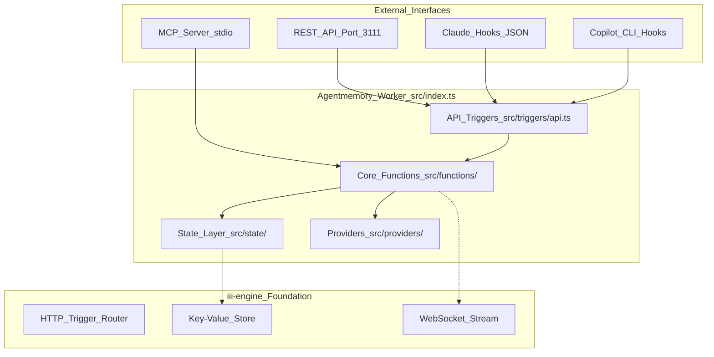
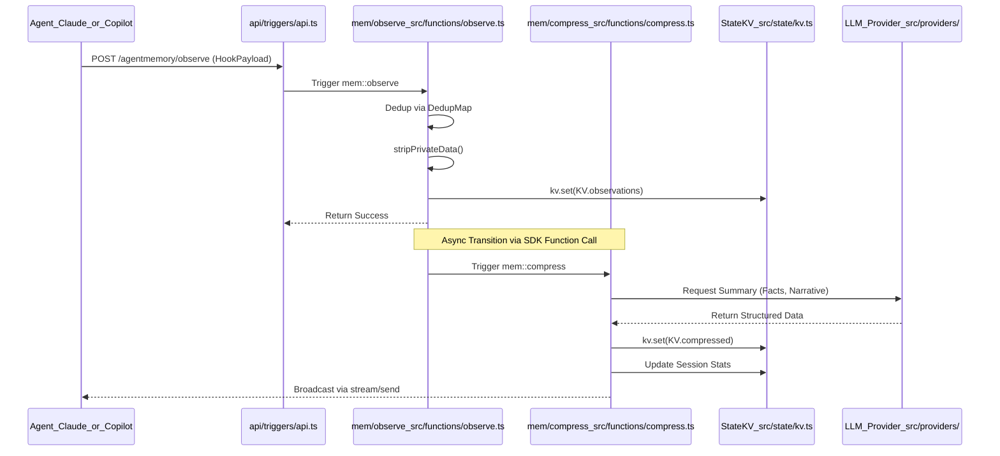
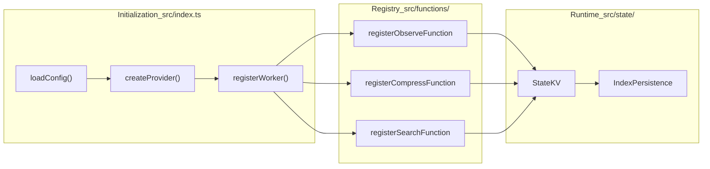

<!-- source: DeepWiki mcp.deepwiki.com · repo rohitg00/agentmemory · page 1.2 Architecture Overview · fetched 2026-10-30 -->

# Architecture Overview

Relevant source files

The following files were used as context for generating this wiki page:

- [AGENTS.md](AGENTS.md)
- [CHANGELOG.md](CHANGELOG.md)
- [README.md](README.md)
- [package.json](package.json)
- [packages/mcp/package.json](packages/mcp/package.json)
- [plugin/.claude-plugin/plugin.json](plugin/.claude-plugin/plugin.json)
- [plugin/.codex-plugin/plugin.json](plugin/.codex-plugin/plugin.json)
- [plugin/plugin.json](plugin/plugin.json)
- [src/cli.ts](src/cli.ts)
- [src/config.ts](src/config.ts)
- [src/functions/export-import.ts](src/functions/export-import.ts)
- [src/functions/smart-search.ts](src/functions/smart-search.ts)
- [src/index.ts](src/index.ts)
- [src/triggers/api.ts](src/triggers/api.ts)
- [src/types.ts](src/types.ts)
- [src/version.ts](src/version.ts)
- [src/viewer/index.html](src/viewer/index.html)
- [test/env-loader.test.ts](test/env-loader.test.ts)
- [test/export-import.test.ts](test/export-import.test.ts)

The `agentmemory` system is built on a modular, worker-based architecture designed to transform ephemeral agent interactions into structured long-term memory. It utilizes the **iii-engine** (Intelligence Interface Infrastructure) foundation, which provides three core primitives: **HTTP Triggers**, **KV State**, and **Streams**.

## The iii-Engine Foundation

The system operates as a worker process that connects to an `iii-engine` instance via the `iii-sdk` [src/index.ts:1-1](). This foundation allows the memory system to remain decoupled from specific agents (e.g., Claude, Cursor, Copilot CLI) while providing high-performance persistence and real-time updates. The CLI manages the engine lifecycle, pinning it to version `0.11.2` to ensure architectural compatibility with the current worker model [src/cli.ts:103-104]().

| Primitive | Implementation in `agentmemory` | Role |
| :--- | :--- | :--- |
| **HTTP Triggers** | `registerApiTriggers` [src/triggers/api.ts:140-146]() | Exposes the REST API and internal function endpoints to external agents. |
| **KV State** | `StateKV` [src/state/kv.ts:29-29]() | Provides namespaced persistence for sessions, observations, and graphs. |
| **Streams** | `STREAM` [src/state/schema.ts:135-141]() | Real-time broadcasting of observations to the dashboard via `stream::send`. |

### System Architecture Diagram
The following diagram illustrates the relationship between the external interfaces, the core logic layers, and the iii-engine primitives.

Title: Agentmemory Component Architecture

Sources: [src/index.ts:1-103](), [src/triggers/api.ts:140-146](), [package.json:1-4](), [src/cli.ts:103-104]()

---

## Major Layers

### 1. API & Trigger Layer
This layer maps external requests to internal memory functions.
*   **REST API**: Registered via `registerApiTriggers` [src/triggers/api.ts:140-146](), providing endpoints like `/agentmemory/livez` [src/triggers/api.ts:181-186]() and `/agentmemory/observe`.
*   **MCP Server**: Implements the Model Context Protocol, exposing tools directly to LLMs. It is registered via `registerMcpEndpoints` [src/index.ts:96-96]() and serves tools defined in the `tools-registry.ts` [src/mcp/tools-registry.ts:1-10]().
*   **Authentication**: Secured via `middleware::api-auth` [src/triggers/api.ts:147-166]() using `timingSafeCompare` [src/triggers/api.ts:11-11]() for Bearer tokens.

### 2. Core Function Layer (`mem::*`)
The business logic is encapsulated in registered functions. Each function handles a specific stage of the memory lifecycle:
*   `mem::observe`: Ingests raw data, performs deduplication via `DedupMap`, and scrubs private data [src/index.ts:29-29]().
*   `mem::compress`: Uses LLMs to extract facts, narratives, and concepts from raw observations [src/index.ts:34-34]().
*   `mem::search`: Executes hybrid retrieval (BM25 + Vector + Graph) [src/index.ts:36-43]().
*   `mem::consolidate`: Merges short-term observations into long-term memories [src/index.ts:48-48]().
*   `mem::export` / `mem::import`: Handles full database portability with version-checked schemas [src/functions/export-import.ts:62-164]().

### 3. State & Persistence Layer
Data is managed through the `StateKV` wrapper [src/state/kv.ts:29-29]().
*   **Namespacing**: The system uses distinct KV scopes (e.g., `sessions`, `observations`, `memories`, `graphNodes`) defined in `KV` [src/state/schema.ts:100-133]().
*   **Search Indices**: Managed by `IndexPersistence` [src/index.ts:27-27](), which handles loading indices on startup and periodic flushing to disk.
*   **Concurrency**: Uses `withKeyedLock` [src/state/keyed-mutex.ts:3-3]() to prevent race conditions during concurrent session updates [src/triggers/api.ts:3-3]().

### 4. Provider Layer
Abstracts interactions with LLMs and Embeddings [src/index.ts:17-22]().
*   **Resiliency**: Implements circuit breakers (Closed, Open, Half-Open) to handle provider failures [src/types.ts:239-244]().
*   **Fallbacks**: Supports a chain of providers (Anthropic, Gemini, OpenRouter, MiniMax, OpenAI) to ensure high availability [src/types.ts:170-170]().

Sources: [src/index.ts:1-103](), [src/state/schema.ts:100-133](), [src/types.ts:239-244](), [CHANGELOG.md:15-15]()

---

## Data Flow: From Hook to Memory

The path an event takes from the moment an agent performs an action to its storage in long-term memory follows a strictly defined pipeline.

Title: Data Flow - Hook Event to Long-Term Memory

Sources: [src/types.ts:153-160](), [src/triggers/api.ts:140-146](), [src/index.ts:29-34]()

### Key Data Entities
The flow involves three primary data transformations:
1.  **`HookPayload`**: Raw JSON received from the agent containing `hookType`, `sessionId`, `project`, and `data` [src/types.ts:153-160]().
2.  **`RawObservation`**: The deduplicated and scrubbed version of the payload, including metadata like `toolName` and `modality` [src/types.ts:47-62]().
3.  **`CompressedObservation`**: The LLM-distilled semantic representation containing `facts`, `narrative`, `concepts`, and `importance` [src/types.ts:64-83]().

---

## The Worker Model & Lifecycle

The worker is initialized in `src/index.ts`, which orchestrates the startup sequence:

1.  **Config Loading**: Reads environment variables and `iii-config.yaml` to determine provider settings and port layouts [src/index.ts:2-16]().
2.  **Provider Initialization**: Sets up LLM and Embedding providers (e.g., Xenova for local embeddings, or cloud providers like Anthropic/OpenAI) [src/index.ts:17-22]().
3.  **SDK Connection**: Connects to the `iii-engine` using `registerWorker` [src/index.ts:1-1]().
4.  **Registration**: Hooks all `mem::*` and `api::*` functions into the engine router [src/index.ts:28-94]().
5.  **Index Rebuild**: `rebuildIndex` is called to load existing data into BM25 and Vector indices [src/index.ts:37-37]().
6.  **Health Monitoring**: Starts `registerHealthMonitor` to track CPU, memory, and KV connectivity [src/index.ts:101-101]().
7.  **PID Management**: Writes a `worker.pid` file to `~/.agentmemory/` to allow the CLI to cleanly stop the process [src/index.ts:115-126]().

Title: Worker Startup & Registry

Sources: [src/index.ts:1-128](), [src/cli.ts:103-104](), [src/version.ts:1-1]()

---

