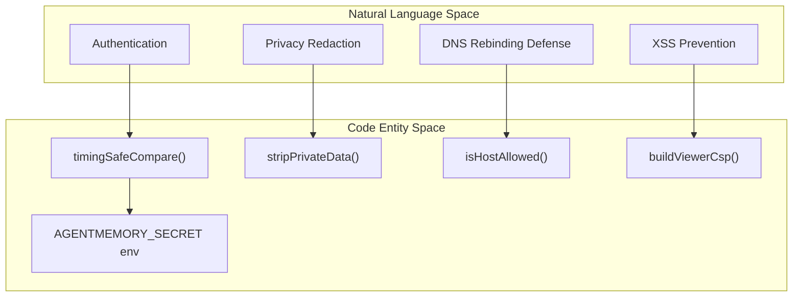
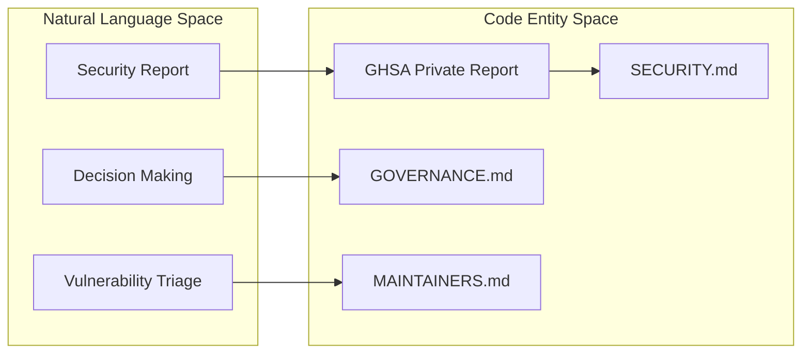

<!-- source: DeepWiki mcp.deepwiki.com · repo rohitg00/agentmemory · page 10 Security & Governance · fetched 2026-10-30 -->

# Security & Governance

Relevant source files

The following files were used as context for generating this wiki page:

- [CODE_OF_CONDUCT.md](CODE_OF_CONDUCT.md)
- [CONTRIBUTING.md](CONTRIBUTING.md)
- [GOVERNANCE.md](GOVERNANCE.md)
- [MAINTAINERS.md](MAINTAINERS.md)
- [SECURITY.md](SECURITY.md)
- [src/auth.ts](src/auth.ts)
- [src/viewer/favicon.svg](src/viewer/favicon.svg)
- [src/viewer/server.ts](src/viewer/server.ts)
- [test/viewer-security.test.ts](test/viewer-security.test.ts)

This section provides an overview of the security architecture, vulnerability management process, and the project's governance model. `agentmemory` is designed as a local-first memory runtime where data privacy and security are foundational requirements.

## Security Model & Hardening

The security model of `agentmemory` centers on local execution and data containment. By default, the system binds to loopback interfaces and requires an `AGENTMEMORY_SECRET` for all API and Mesh operations to prevent unauthorized access from network-adjacent actors [src/viewer/server.ts:67-74]().

### Core Security Primitives

*   **Authentication:** All REST endpoints and Mesh synchronization requests are protected by the `checkAuth` middleware, which validates a `Bearer` token using `timingSafeCompare` [src/auth.ts:6-10](). The viewer also requires this bearer for upstream proxying when bound to non-loopback addresses [src/viewer/server.ts:122-130]().
*   **Privacy Scrubbing:** The `stripPrivateData` function uses `SECRET_PATTERN_SOURCES` to redact API keys (including OpenAI `sk-proj-*`), GitHub tokens (`ghs_*`, `ghu_*`), Bearer tokens, and content wrapped in `<private>` tags before storage.
*   **Path Containment:** File operations, such as Obsidian exports, are restricted to a resolved `AGENTMEMORY_EXPORT_ROOT` using `resolveVaultDir` to prevent path traversal attacks.
*   **Viewer Protection:** The web dashboard implements a per-response script nonce and a strict Content Security Policy (CSP) to mitigate XSS by removing inline handlers and enforcing `script-src 'nonce-<random>'` and `script-src-attr 'none'` [src/auth.ts:16-30](). The viewer also self-hosts its favicon to avoid `data:` URI allowances in the CSP [src/viewer/server.ts:13-30]().
*   **DNS Rebinding Defense:** The viewer server implements a `Host` header allowlist via `buildAllowedHosts` and `isHostAllowed` to prevent malicious websites from proxying requests to the local memory server [src/viewer/server.ts:76-115]().

### Natural Language to Code Entity Space: Security Controls

The following diagram maps security concepts to the specific code entities that enforce them.

"Security Controls Mapping"

Sources: [src/auth.ts:6-10](), [src/auth.ts:16-30](), [src/viewer/server.ts:107-115](), [src/viewer/server.ts:122-130]()

For a detailed breakdown of historical vulnerabilities and specific hardening implementations, see **[Security Advisories & Hardening](#10.1)**.

---

## Governance & Contributing

`agentmemory` prioritizes transparency and a clear path for community maintainership. The project maintains a formal security policy for coordinated disclosure [SECURITY.md:1-25]().

### Project Roles & Policies
*   **Maintainership:** Maintainers have commit access and are responsible for reviewing PRs and triaging vulnerabilities [MAINTAINERS.md:1-10](). The project currently operates under a single-maintainer model with a plan to diversify [GOVERNANCE.md:1-6]().
*   **Supported Versions:** The project provides security fixes for the latest minor version (currently `0.9.x`) and provides 90 days of support for critical issues in the previous minor version [SECURITY.md:27-33]().
*   **Vulnerability Reporting:** Security vulnerabilities should **never** be reported via public issues. Reporters should use **GitHub Security Advisories** or encrypted email to the maintainer [SECURITY.md:3-10]().
*   **Decision Making:** The project follows a "lazy consensus" model for PRs, where silence for 72 hours is considered assent [GOVERNANCE.md:50-53]().

### Supply Chain Stance
The project ships pre-built artifacts in the npm tarball. While no lockfile is committed to the repository to allow SemVer-compatible patches to reach users, CI runs use a generated lockfile to ensure test consistency [SECURITY.md:57-70](). Every commit requires a Developer Certificate of Origin (DCO) sign-off [CONTRIBUTING.md:43-53]().

### Project Management Entity Mapping

"Governance and Security Reporting Flow"

Sources: [SECURITY.md:9-11](), [GOVERNANCE.md:50-60](), [MAINTAINERS.md:1-10]()

For details on the maintainer list, the DCO requirement, and the full disclosure policy, see **[Project Governance & Contributing](#10.2)**.

---

## Related Child Pages

*   **[Security Advisories & Hardening](#10.1)**: Technical details on the six major security advisories (XSS in viewer, curl-sh RCE, default bind 0.0.0.0, mesh unauthenticated access, Obsidian export path traversal, and incomplete privacy redaction) and their resolutions.
*   **[Project Governance & Contributing](#10.2)**: Detailed documentation on the `GOVERNANCE.md`, `CONTRIBUTING.md`, and `SECURITY.md` policies, including the supported version window and reporting channels.

---

