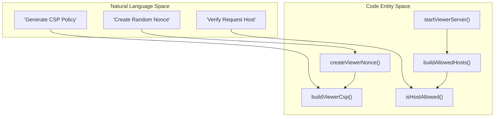
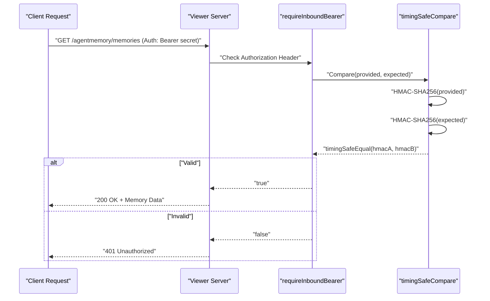

<!-- source: DeepWiki mcp.deepwiki.com · repo rohitg00/agentmemory · page 10.1 Security Advisories & Hardening · fetched 2026-10-30 -->

# Security Advisories & Hardening

Relevant source files

The following files were used as context for generating this wiki page:

- [CODE_OF_CONDUCT.md](CODE_OF_CONDUCT.md)
- [CONTRIBUTING.md](CONTRIBUTING.md)
- [GOVERNANCE.md](GOVERNANCE.md)
- [MAINTAINERS.md](MAINTAINERS.md)
- [SECURITY.md](SECURITY.md)
- [src/auth.ts](src/auth.ts)
- [src/viewer/favicon.svg](src/viewer/favicon.svg)
- [src/viewer/server.ts](src/viewer/server.ts)
- [test/viewer-security.test.ts](test/viewer-security.test.ts)

This page documents the security posture of `agentmemory`, focusing on the six major vulnerabilities addressed in version `0.8.2`, the architectural fixes applied, and the ongoing hardening measures designed to protect user data and execution environments.

## Security Overview

The `agentmemory` security model is designed around "Privacy First" principles, ensuring that sensitive data captured from agent interactions (tool outputs, file contents, etc.) is redacted before persistence. Hardening measures include strict path containment, authenticated mesh federation, and a robust Content Security Policy (CSP) for the web dashboard.

### Vulnerability Remediation History (v0.8.2)

The following table summarizes the security advisories addressed in the `0.8.2` hardening sprint.

| ID | Title | Severity | Primary Fix |
|:---|:---|:---|:---|
| 01 | Stored XSS in Viewer | Critical | Per-response CSP Nonce & delegated events |
| 02 | curl\|sh RCE in CLI | Critical | Removal of remote script execution |
| 03 | Default Bind 0.0.0.0 | High | Restriction to `127.0.0.1` by default |
| 04 | Unauth Mesh Sync | High | Bearer token enforcement for P2P sync |
| 05 | Obsidian Path Traversal | Medium | Lexical path containment check |
| 06 | Incomplete Redaction | Medium | Expanded regex for modern token formats |

Sources: [SECURITY.md:79-82]()

---

## Hardening Implementations

### 1. Web Viewer Hardening (XSS & DNS Rebinding)

To mitigate Stored XSS (Advisory #01), the viewer utilizes a dynamic Content Security Policy. The system generates a cryptographically secure nonce for every request via `createViewerNonce` [src/auth.ts:12-14]().

*   **CSP Generation**: The `buildViewerCsp` function constructs a policy that forbids inline scripts (`'unsafe-inline'`) and inline event handlers (`script-src-attr 'none'`), requiring the `nonce-<value>` for all `<script>` tags [src/auth.ts:16-30]().
*   **Event Delegation**: Inline `on*=` handlers (e.g., `onclick`) were removed from the viewer HTML. They were replaced with delegated event handling using `data-action` attributes to prevent arbitrary JavaScript execution [test/viewer-security.test.ts:46-54]().
*   **Favicon Isolation**: The viewer uses a self-hosted `/favicon.svg` instead of an inline `data:` URI [src/viewer/server.ts:13-30](). This allows the `img-src` directive to remain restricted to `'self'`, preventing potential data URI-based bypasses [test/viewer-security.test.ts:25-38]().
*   **DNS Rebinding Protection**: The `startViewerServer` validates the `Host` header using `isHostAllowed` [src/viewer/server.ts:107-115](). It rejects rebound attacker hostnames pointing at loopback and requires the exact listening port to match the allowed origins [test/viewer-security.test.ts:78-93]().

**Code-to-Entity Mapping: Viewer Security Entities**

Sources: [src/auth.ts:12-30]() | [src/viewer/server.ts:76-115]() | [test/viewer-security.test.ts:11-55]() | [src/viewer/favicon.svg:1-35]()

### 2. Authentication & Timing Attack Protection

Authentication is enforced via the `timingSafeCompare` function, which uses HMAC-SHA256 to prevent timing attacks when validating the `AGENTMEMORY_SECRET` [src/auth.ts:6-10]().

*   **HMAC Comparison**: The function creates a `sha256` HMAC of both the provided secret and the expected secret using a session-random `hmacKey` [src/auth.ts:3-9]().
*   **Constant-Time Validation**: The final comparison is performed via `timingSafeEqual` to ensure execution time does not leak information about the secret content [src/auth.ts:9-9]().
*   **Viewer Proxy Auth**: When the viewer is bound to a non-loopback address, `requireInboundBearer` ensures that every request forwarding to the REST API carries a valid token [src/viewer/server.ts:122-130]().

**Data Flow: Authenticated Request Processing**

Sources: [src/auth.ts:1-10]() | [src/viewer/server.ts:122-130]()

### 3. Supply Chain Security

`agentmemory` adopts a hardened stance on dependencies to minimize the attack surface:

*   **Small Dependency Footprint**: The core runtime is limited to 6 production dependencies, including `@anthropic-ai/sdk` and `zod` [SECURITY.md:55-55]().
*   **Optional Dependency Guarding**: Heavy dependencies like `@huggingface/transformers` are marked as `optionalDependencies` and are loaded via dynamic `import()` wrapped in try-catch blocks to prevent runtime failures if a package is missing or compromised [SECURITY.md:75-75]().
*   **Bundled Artifacts**: The npm tarball ships pre-built `dist/` artifacts, ensuring that users do not need to compile from source, which avoids execution of arbitrary build scripts during installation [SECURITY.md:55-55]().

Sources: [SECURITY.md:53-78]()

## Reporting Vulnerabilities

Security reports should be submitted privately via **GitHub Security Advisories** [SECURITY.md:9-9](). Alternatively, encrypted email can be sent to the maintainer using the PGP keys published on GitHub [SECURITY.md:10-10]().

*   **Response Window**: The maintainers acknowledge reports within 72 hours and target a fix/disclosure window of 30 to 90 days [SECURITY.md:21-24]().
*   **Supported Versions**: Security fixes are provided for the latest minor release and the previous minor release for 90 days [SECURITY.md:29-33]().

Sources: [SECURITY.md:3-35]() | [GOVERNANCE.md:86-86]()

---

