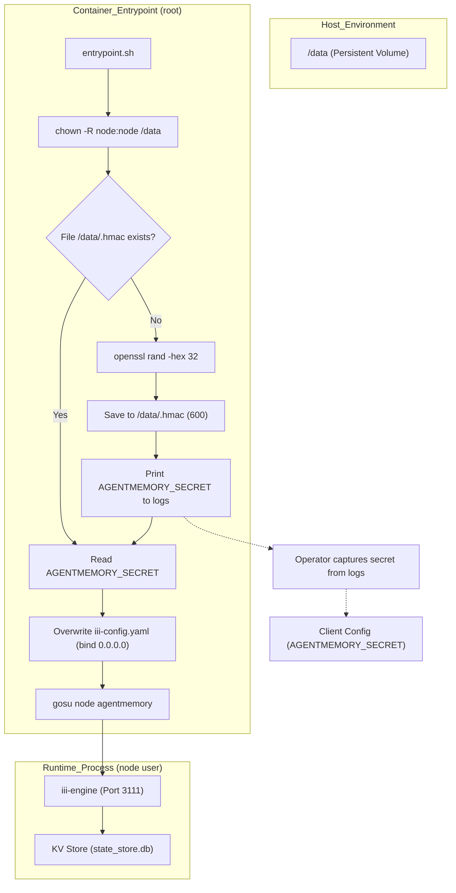
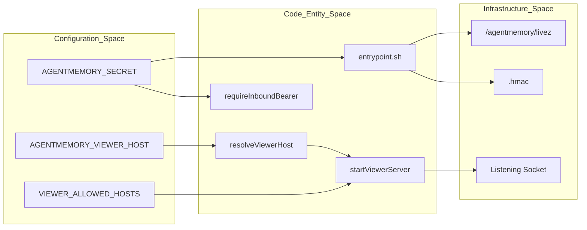
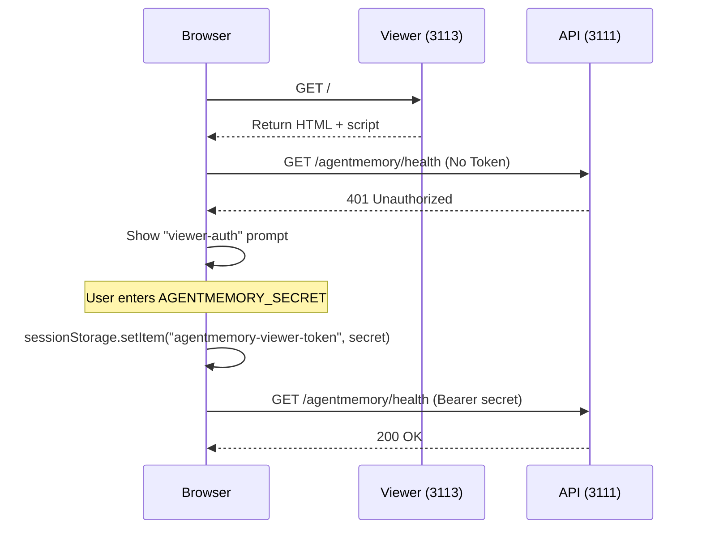

<!-- source: DeepWiki mcp.deepwiki.com · repo rohitg00/agentmemory · page 11.1 Cloud Platform Deployments · fetched 2026-10-30 -->

# Cloud Platform Deployments

Relevant source files

The following files were used as context for generating this wiki page:

- [deploy/README.md](deploy/README.md)
- [deploy/coolify/Dockerfile](deploy/coolify/Dockerfile)
- [deploy/coolify/README.md](deploy/coolify/README.md)
- [deploy/coolify/docker-compose.yml](deploy/coolify/docker-compose.yml)
- [deploy/coolify/entrypoint.sh](deploy/coolify/entrypoint.sh)
- [deploy/fly/Dockerfile](deploy/fly/Dockerfile)
- [deploy/fly/README.md](deploy/fly/README.md)
- [deploy/fly/entrypoint.sh](deploy/fly/entrypoint.sh)
- [deploy/fly/fly.toml](deploy/fly/fly.toml)
- [deploy/railway/Dockerfile](deploy/railway/Dockerfile)
- [deploy/render/Dockerfile](deploy/render/Dockerfile)
- [deploy/render/render.yaml](deploy/render/render.yaml)
- [test/viewer-host.test.ts](test/viewer-host.test.ts)
- [test/viewer-session-id.test.ts](test/viewer-session-id.test.ts)

This page documents the deployment architecture for running `agentmemory` on managed cloud infrastructure. The project provides four official one-click deployment templates designed to provide a production-ready environment with persistent storage, automated security, and minimal configuration overhead.

### Purpose and Scope
The deployment system is designed to abstract away the complexity of the underlying `iii-engine` while maintaining strict security guarantees. Each template utilizes a shared Docker architecture that ensures data persistence across restarts, generates unique authentication secrets on first boot, and exposes only the necessary API surface to the public internet.

---

## Shared Deployment Architecture

All cloud templates (Fly.io, Railway, Render, and Coolify) share a common foundation centered around a specialized `Dockerfile` and a first-boot `entrypoint.sh`.

### 1. Volume Persistence (`/data`)
Every template mounts a persistent volume at `/data`. This directory is the authoritative store for:
*   **KV State**: The SQLite-backed state store (`state_store.db`) containing all memories, sessions, and graph data [deploy/fly/entrypoint.sh:46]().
*   **Search Indices**: The BM25 inverted index and vector metadata.
*   **Streams**: The `iii-stream` backlog for real-time updates [deploy/fly/entrypoint.sh:67]().
*   **Security Credentials**: The generated HMAC secret file (`.hmac`) [deploy/fly/entrypoint.sh:19]().

### 2. Automated HMAC Secret Generation
To prevent default-password vulnerabilities, the `entrypoint.sh` script checks for the existence of `/data/.hmac` on boot [deploy/fly/entrypoint.sh:80]().
*   **First Boot**: If missing, it generates a 64-character hex string via `openssl rand -hex 32` [deploy/fly/entrypoint.sh:81]().
*   **Persistence**: The secret is saved with `chmod 600` and owned by the `node` user [deploy/fly/entrypoint.sh:84-85]().
*   **Disclosure**: The secret is printed to `stdout` exactly once during the first boot sequence [deploy/fly/entrypoint.sh:88-89](). Operators must capture this from platform logs to configure their clients.

### 3. Network Isolation and TLS
*   **Public API (Port 3111)**: Only the REST API port is exposed to the platform's edge proxy.
*   **Internal Viewer (Port 3113)**: The dashboard remains bound to `127.0.0.1` by default to prevent unauthorized access.
*   **Upstream TLS**: All templates assume TLS termination occurs at the platform edge. The engine is configured to bind to `0.0.0.0` within the container to receive forwarded traffic [deploy/fly/entrypoint.sh:31]().

### Deployment Data Flow
The following diagram illustrates how a deployment transitions from the raw container image to a running, secured instance.

**Container Initialization & Security Flow**

Sources: [deploy/fly/entrypoint.sh:1-112](), [deploy/fly/Dockerfile:1-35]()

---

## Platform-Specific Implementations

### 1. Fly.io (Lowest Idle Cost)
Fly.io is the recommended platform for individual users due to its "scale-to-zero" capability.
*   **Auto-Stop**: The configuration supports `auto_stop_machines = "stop"`, meaning the instance shuts down when not in use [deploy/fly/README.md:12]().
*   **Cold Start**: Requests trigger an automatic wake-up, typically taking ~9 seconds to pass health checks [deploy/fly/README.md:161-163]().
*   **Viewer Proxying**: Users access the internal viewer via `fly proxy 3113:3113`. The entrypoint detects Fly environment variables (`FLY_APP_NAME`) and adjusts `AGENTMEMORY_VIEWER_HOST` to `::` to allow the WireGuard proxy to connect [deploy/fly/entrypoint.sh:106-110]().

### 2. Railway (Dashboard-Centric)
Railway offers a streamlined UI-driven flow with flat billing options.
*   **Provisioning**: Uses a specialized `Dockerfile` that pins the `iii-sdk` version via `overrides` in `package.json` to ensure compatibility with the bundled engine [deploy/railway/Dockerfile:24-25]().

### 3. Render (Blueprint-Driven)
Render uses a "set it and forget it" Blueprint model via `render.yaml`.
*   **Disk Snapshots**: The `render.yaml` defines a 1 GB persistent disk mounted at `/data` [deploy/render/render.yaml:10-13]().
*   **Health Monitoring**: Configured to use the `/agentmemory/livez` endpoint for readiness checks [deploy/render/render.yaml:8]().

### 4. Coolify (Self-Hosted VPS)
Coolify provides a Heroku-like experience on user-owned hardware.
*   **Docker Compose**: Deploys via a standard `docker-compose.yml` that defines the `agentmemory-data` volume [deploy/coolify/docker-compose.yml:1-30]().
*   **Networking**: The container port `3111` is exposed to the proxy network only and never bound to the host [deploy/coolify/README.md:12-14]().

---

## Configuration & Environment Variables

| Variable | Source File | Purpose |
| :--- | :--- | :--- |
| `AGENTMEMORY_SECRET` | [deploy/fly/entrypoint.sh:96]() | The Bearer token used for API and Viewer authentication. |
| `AGENTMEMORY_VIEWER_HOST` | [test/viewer-host.test.ts:26]() | Controls the bind address for the dashboard (default: `127.0.0.1`). |
| `VIEWER_ALLOWED_HOSTS` | [test/viewer-host.test.ts:73]() | Comma-separated allowlist for Host header validation (DNS rebinding protection). |
| `AGENTMEMORY_DATA_DIR` | [deploy/fly/entrypoint.sh:18]() | Overrides the default `/data` storage path. |

### Code-to-Entity Mapping
The following diagram maps the deployment configuration symbols to the operational entities they control.

**Deployment Entity Mapping**

Sources: [test/viewer-host.test.ts:5-11](), [deploy/fly/entrypoint.sh:80-110]()

---

## Maintenance Operations

### Secret Rotation
To rotate the HMAC secret, the operator must delete the `.hmac` file from the persistent volume and restart the service.
1.  **Delete**: `rm /data/.hmac` via SSH or platform console [deploy/fly/README.md:116]().
2.  **Restart**: Trigger a machine restart or redeploy [deploy/fly/README.md:118]().
3.  **Capture**: Capture the new secret from the logs [deploy/fly/README.md:119]().

### Backup and Restore
Since all state is contained within `/data`, backups are performed by archiving that directory.
*   **Backup**: `fly ssh console -C "tar czf - /data" > backup.tar.gz` [deploy/fly/README.md:128]().
*   **Restore**: `cat backup.tar.gz | fly ssh console -C "tar xzf - -C /"` [deploy/fly/README.md:134]().

### Viewer Authentication
When the viewer is accessed via a non-loopback address (e.g., via `fly proxy`), it enforces bearer authentication. The browser UI captures the `AGENTMEMORY_SECRET` and stores it in `sessionStorage` for subsequent proxied API calls.

**Viewer Auth Interaction**

Sources: [test/viewer-session-id.test.ts:180-208](), [deploy/fly/README.md:98-102]()

---

