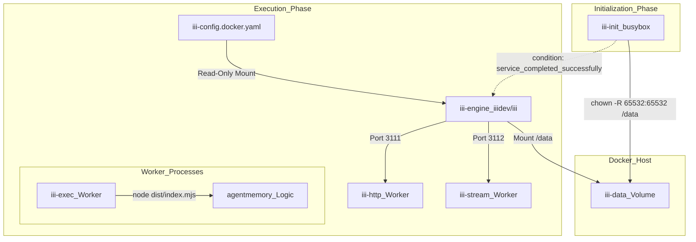
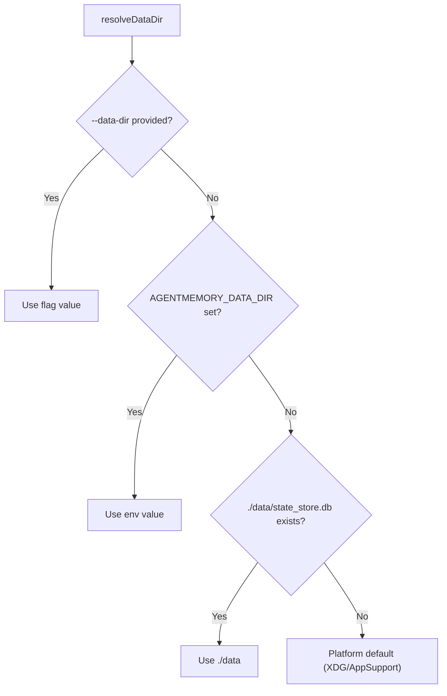
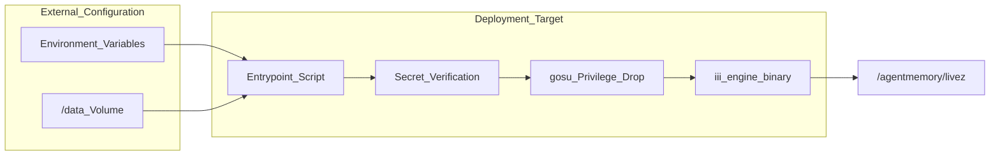

<!-- source: DeepWiki mcp.deepwiki.com · repo rohitg00/agentmemory · page 11.2 Local Docker & Self-Hosted Setup · fetched 2026-10-30 -->

# Local Docker & Self-Hosted Setup

Relevant source files

The following files were used as context for generating this wiki page:

- [docker-compose.yml](docker-compose.yml)
- [docs/recipes/pairings.md](docs/recipes/pairings.md)
- [iii-config.docker.yaml](iii-config.docker.yaml)
- [iii-config.yaml](iii-config.yaml)
- [plugin/skills/agentmemory-config/REFERENCE.md](plugin/skills/agentmemory-config/REFERENCE.md)
- [src/cli-data-dir.ts](src/cli-data-dir.ts)
- [test/cli-data-dir.test.ts](test/cli-data-dir.test.ts)

The `agentmemory` system is designed for high portability, supporting local development via Docker Compose and self-hosted production instances on various infrastructure providers. This setup utilizes the `iii-engine` (Triple-I) as the underlying execution environment, providing the necessary primitives for HTTP triggers, KV state persistence, and event streaming.

## Docker Architecture & Orchestration

The local setup is orchestrated via a `docker-compose.yml` file that manages two primary containers: an initialization container and the core engine.

### Data Flow and Initialization

When starting the stack, the `iii-init` container runs first to resolve permission mismatches between Docker's default volume creation and the distroless `iii-engine` image.

1.  **Permission Correction**: Docker creates named volumes (like `iii-data`) as `root:root` mode `755` [docker-compose.yml:1-7]().
2.  **User Mapping**: The `iii-engine` runs as UID `65532` [docker-compose.yml:27](). Without the init step, the `/data` directory remains unwritable, causing the engine to buffer state in RAM and lose data on restart [docker-compose.yml:4-7]().
3.  **One-Shot Execution**: `iii-init` uses a `busybox:1.36` image to `chown` and `chmod` the volume before exiting [docker-compose.yml:8-14]().

### Service Configuration

| Service | Image | Role |
| :--- | :--- | :--- |
| `iii-init` | `busybox:1.36` | Corrects volume permissions for UID `65532` [docker-compose.yml:8-13](). |
| `iii-engine` | `iiidev/iii:0.11.2` | Runs the `agentmemory` worker and provides API/State/Stream services [docker-compose.yml:16-26](). |

**Component Relationship Diagram**

Sources: [docker-compose.yml:1-39](), [iii-config.docker.yaml:1-53]()

## Worker Configuration (`iii-config.docker.yaml`)

The `iii-config.docker.yaml` file defines the internal worker model for the self-hosted instance. It configures the behavior of the `iii-engine` primitives.

*   **iii-http**: Listens on port `3111` and accepts connections from `0.0.0.0` to allow container networking [iii-config.docker.yaml:2-5](). It defines CORS policies to allow the local dashboard (`3113`) and the API itself to interact [iii-config.docker.yaml:7-9]().
*   **iii-state**: Configured with a `file_based` KV adapter pointing to `/data/state_store.db` [iii-config.docker.yaml:10-16]().
*   **iii-stream**: Manages real-time event distribution on port `3112` [iii-config.docker.yaml:29-37]().
*   **iii-observability**: Configured with a `sampling_ratio` of `0.1` and `logs_console_output: false` to prevent log-feedback loops that can consume excessive disk space [iii-config.docker.yaml:38-47]().
*   **iii-exec**: Monitors the codebase and executes the compiled entrypoint `node dist/index.mjs` [iii-config.docker.yaml:48-53]().

Sources: [iii-config.docker.yaml:1-53](), [iii-config.yaml:43-48]()

## Data Directory Resolution

The system uses a flexible resolution logic for the data directory, which is critical for persistence in both Docker and non-Docker self-hosted environments. This is handled by `resolveDataDir` in `src/cli-data-dir.ts`.

1. **Precedence**: The system prefers the `--data-dir` flag, followed by the `AGENTMEMORY_DATA_DIR` environment variable, and finally a platform-specific default [src/cli-data-dir.ts:98-112]().
2. **Platform Defaults**:
   - **macOS**: `~/Library/Application Support/agentmemory` [src/cli-data-dir.ts:50-52]().
   - **Linux**: `~/.local/share/agentmemory` or `XDG_DATA_HOME` [src/cli-data-dir.ts:59-63]().
   - **Windows**: `%APPDATA%\agentmemory` [src/cli-data-dir.ts:53-58]().
3. **Legacy Adoption**: If a `./data` directory exists in the current working directory containing `state_store.db` or `iii-config.yaml`, it is adopted to maintain backward compatibility [src/cli-data-dir.ts:114-120]().

**Data Resolution Logic**

Sources: [src/cli-data-dir.ts:86-139](), [test/cli-data-dir.test.ts:7-58]()

## Production Deployment & Entrypoints

For cloud-based self-hosting (Fly.io, Railway, Render, Coolify), `agentmemory` uses specialized configurations to manage secrets and runtime environments.

### HMAC Secret & Persistence
A secure `AGENTMEMORY_SECRET` is required for timing-safe HMAC authentication. In self-hosted environments, this secret must be persisted to ensure that agents can reconnect after a container restart. This is typically managed via the environment variables or a persisted `.env` file in the data directory [plugin/skills/agentmemory-config/REFERENCE.md:35]().

### Deployment Data Flow

Sources: [docker-compose.yml:1-39](), [iii-config.docker.yaml:1-53]()

## Environment Configuration

For a self-hosted instance, LLM and Embedding providers are configured via environment variables. These are passed to the `iii-engine` container or defined in `~/.agentmemory/.env` [plugin/skills/agentmemory-config/REFERENCE.md:6]().

### Key Variables

| Variable | Purpose |
| :--- | :--- |
| `AGENTMEMORY_URL` | The base URL of the self-hosted instance (e.g., `http://localhost:3111`) [plugin/skills/agentmemory-config/REFERENCE.md:40](). |
| `AGENTMEMORY_SECRET` | The HMAC secret used for Bearer authentication [plugin/skills/agentmemory-config/REFERENCE.md:35](). |
| `AGENTMEMORY_DATA_DIR` | Path to the persistence directory [plugin/skills/agentmemory-config/REFERENCE.md:15](). |
| `AGENTMEMORY_III_VERSION` | Allows overriding the pinned engine version (default `0.11.2`) [docker-compose.yml:25-26](). |
| `AGENTMEMORY_PROVIDER` | Defines the LLM provider (e.g., `anthropic`, `openai`) [plugin/skills/agentmemory-config/REFERENCE.md:32](). |

### Security & Privilege Management
The Docker setup ensures security through:
*   **Privilege Drop**: The engine runs as a non-root user (`65532`) in local compose [docker-compose.yml:27]().
*   **CORS Protection**: The `iii-http` worker restricts `allowed_origins` to known local and loopback addresses by default [iii-config.docker.yaml:7-9]().
*   **Resource Limits**: Docker logging is capped at 10MB per file with a 3-file rotation to prevent disk exhaustion [docker-compose.yml:40-44]().

Sources: [docker-compose.yml:25-44](), [iii-config.docker.yaml:7-9](), [plugin/skills/agentmemory-config/REFERENCE.md:1-45]()

---

