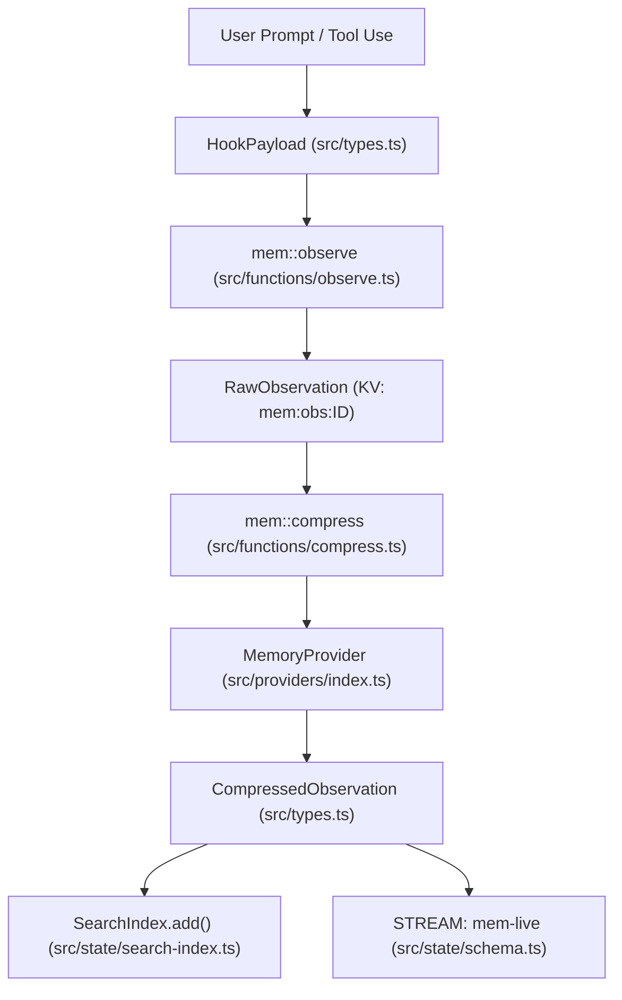
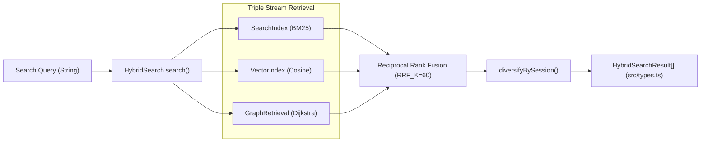

<!-- source: DeepWiki mcp.deepwiki.com · repo rohitg00/agentmemory · page 12 Glossary · fetched 2026-10-30 -->

# Glossary

Relevant source files

The following files were used as context for generating this wiki page:

- [AGENTS.md](AGENTS.md)
- [CHANGELOG.md](CHANGELOG.md)
- [README.md](README.md)
- [READMEs/README.de-DE.md](READMEs/README.de-DE.md)
- [READMEs/README.es-ES.md](READMEs/README.es-ES.md)
- [READMEs/README.fr-FR.md](READMEs/README.fr-FR.md)
- [READMEs/README.hi-IN.md](READMEs/README.hi-IN.md)
- [READMEs/README.ja-JP.md](READMEs/README.ja-JP.md)
- [READMEs/README.ko-KR.md](READMEs/README.ko-KR.md)
- [READMEs/README.pt-BR.md](READMEs/README.pt-BR.md)
- [READMEs/README.ru-RU.md](READMEs/README.ru-RU.md)
- [READMEs/README.tr-TR.md](READMEs/README.tr-TR.md)
- [READMEs/README.zh-CN.md](READMEs/README.zh-CN.md)
- [package.json](package.json)
- [packages/mcp/package.json](packages/mcp/package.json)
- [plugin/.claude-plugin/plugin.json](plugin/.claude-plugin/plugin.json)
- [plugin/.codex-plugin/plugin.json](plugin/.codex-plugin/plugin.json)
- [plugin/plugin.json](plugin/plugin.json)
- [src/cli.ts](src/cli.ts)
- [src/config.ts](src/config.ts)
- [src/functions/export-import.ts](src/functions/export-import.ts)
- [src/functions/graph.ts](src/functions/graph.ts)
- [src/functions/remember.ts](src/functions/remember.ts)
- [src/functions/search.ts](src/functions/search.ts)
- [src/functions/smart-search.ts](src/functions/smart-search.ts)
- [src/index.ts](src/index.ts)
- [src/mcp/server.ts](src/mcp/server.ts)
- [src/mcp/tools-registry.ts](src/mcp/tools-registry.ts)
- [src/state/hybrid-search.ts](src/state/hybrid-search.ts)
- [src/state/memory-utils.ts](src/state/memory-utils.ts)
- [src/state/schema.ts](src/state/schema.ts)
- [src/state/search-index.ts](src/state/search-index.ts)
- [src/triggers/api.ts](src/triggers/api.ts)
- [src/types.ts](src/types.ts)
- [src/version.ts](src/version.ts)
- [src/viewer/index.html](src/viewer/index.html)
- [test/env-loader.test.ts](test/env-loader.test.ts)
- [test/export-import.test.ts](test/export-import.test.ts)
- [test/graph.test.ts](test/graph.test.ts)
- [test/hybrid-search.test.ts](test/hybrid-search.test.ts)
- [test/search-index.test.ts](test/search-index.test.ts)
- [test/search.test.ts](test/search.test.ts)

This glossary defines the core technical terms, domain-specific concepts, and architectural primitives used within the `agentmemory` codebase. It serves as a reference for onboarding engineers to understand how natural language interactions are transformed into structured, searchable, and versioned memory.

## Core Domain Concepts

### Observation
An **Observation** is the fundamental unit of data in `agentmemory`. It represents a single event or action taken by an AI agent during a session.
*   **Raw Observation**: The initial data captured from a hook (e.g., tool input/output, terminal command). Defined as `RawObservation` in `src/types.ts` [[src/types.ts:47-62]]().
*   **Compressed Observation**: A structured version of a raw observation, processed by an LLM to extract facts, concepts, and importance scores. Defined as `CompressedObservation` in `src/types.ts` [[src/types.ts:64-83]]().
*   **Implementation**: Captured via `mem::observe` [[src/functions/observe.ts:133]]() and transformed via `mem::compress` [[src/functions/compress.ts:71]]().

### Memory
A **Memory** is a high-level, synthesized insight derived from multiple observations. Unlike observations, which are tied to a specific point in time, Memories represent patterns, preferences, or architectural facts that persist across sessions.
*   **Attributes**: Includes `strength` (importance), `version`, and `isLatest` flags for lifecycle management [[src/types.ts:102-125]]().
*   **Types**: Categorized as `pattern`, `preference`, `architecture`, `bug`, `workflow`, or `fact` [[src/types.ts:106]]().
*   **Consolidation**: Created via the `mem::consolidate` function [[src/functions/consolidate.ts:70]]().

### Session
A **Session** represents a continuous block of agent activity (e.g., a single execution of Claude Code or a Cursor chat).
*   **Scope**: Observations are grouped by `sessionId` [[src/state/schema.ts:5]]().
*   **Lifecycle**: Tracked via the `Session` interface from `active` to `completed` or `abandoned` [[src/types.ts:1-15]]().

**Sources**: [[src/types.ts:1-125]](), [[src/state/schema.ts:1-10]](), [[src/functions/observe.ts:133]](), [[src/functions/compress.ts:71]]().

---

## Technical Components & Classes

### HybridSearch
The primary retrieval engine that combines three distinct search streams to find relevant context.
*   **Triple Stream**: Fuses results from **BM25** (keyword), **Vector** (semantic), and **Knowledge Graph** (relational) [[src/state/hybrid-search.ts:73-77]]().
*   **RRF (Reciprocal Rank Fusion)**: A ranking algorithm used to merge scores from different search methods using a constant `RRF_K = 60` [[src/state/hybrid-search.ts:17-214]]().

### SearchIndex (BM25)
A custom implementation of the BM25 algorithm for full-text search.
*   **Persistence**: The index is rebuilt on startup and persisted to the KV store under the `mem:index:bm25` key [[src/state/schema.ts:12]]().
*   **Implementation**: Defined in the `SearchIndex` class [[src/state/search-index.ts:38]]().

### VectorIndex
Handles high-dimensional vector similarity search.
*   **Provider Support**: Supports multiple backends including Xenova (local), OpenAI, Gemini, Voyage, Cohere, and OpenRouter [[src/types.ts:258-264]]().
*   **Storage**: Embeddings are stored in KV mapped to observation IDs under the `mem:vec:` scope [[src/state/schema.ts:11]]().

### StateKV
An abstraction layer over the `iii-engine` Key-Value store.
*   **Namespacing**: Uses 33+ distinct prefixes (e.g., `mem:obs:`, `mem:graph:`, `mem:actions:`) to organize data [[src/state/schema.ts:3-41]]().

**Sources**: [[src/state/hybrid-search.ts:17-214]](), [[src/state/search-index.ts:38]](), [[src/state/schema.ts:3-41]](), [[src/types.ts:258-264]]().

---

## Multi-Agent Coordination Primitives

| Term | Definition | Code Pointer |
| :--- | :--- | :--- |
| **Action** | A discrete task or goal that can be shared between agents. | [[src/types.ts:311]]() |
| **Lease** | A concurrency lock that prevents multiple agents from working on the same resource. | [[src/types.ts:333]]() |
| **Signal** | An asynchronous message sent between agents for coordination. | [[src/types.ts:354]]() |
| **Mesh** | A P2P synchronization layer for sharing memory across agent instances. | [[src/functions/mesh.ts:1]]() |
| **Crystal** | A stable, distilled digest of project state or patterns. | [[src/types.ts:411]]() |
| **Sentinel** | An automated event watcher that triggers routines. | [[src/types.ts:382]]() |
| **Lesson** | A confidence-weighted rule derived from a correction. | [[src/types.ts:446]]() |
| **Origin** | Immutable write-time provenance (user, agent, tool, import, shared). | [[src/types.ts:32-36]]() |

**Sources**: [[src/types.ts:32-446]](), [[src/functions/mesh.ts:1]](), [[CHANGELOG.md:20-26]]().

---

## System Data Flow Diagrams

### Natural Language to Code Entity Mapping (Capture)
This diagram shows how a user interaction is transformed into specific code entities and stored in the `StateKV` system.

**Sources**: [[src/types.ts:153-160]](), [[src/functions/observe.ts:133]](), [[src/functions/compress.ts:71]](), [[src/state/schema.ts:3-47]]().

### Retrieval Architecture (Hybrid Search)
This diagram illustrates the flow from a search query to the final fused result set.

**Sources**: [[src/state/hybrid-search.ts:17-219]](), [[src/types.ts:274-282]](), [[CHANGELOG.md:9]]().

---

## Abbreviations

*   **MCP**: Model Context Protocol. The interface used to expose `agentmemory` tools to clients [[src/mcp/server.ts:96]]().
*   **KV**: Key-Value Store. The underlying persistence layer provided by `iii-engine` [[src/state/kv.ts:29]]().
*   **TTL**: Time-To-Live. Used in `auto-forget` and `dedup` logic to expire stale data [[src/functions/dedup.ts:76]]().
*   **RRF**: Reciprocal Rank Fusion. The method used to combine multiple search results [[src/state/hybrid-search.ts:17]]().
*   **Jaccard**: Jaccard Similarity. A metric used for deduplication of memories [[src/state/memory-utils.ts:1]]().

**Sources**: [[src/mcp/server.ts:96]](), [[src/state/kv.ts:29]](), [[src/functions/dedup.ts:76]](), [[src/state/hybrid-search.ts:17]](), [[src/state/memory-utils.ts:1]]().