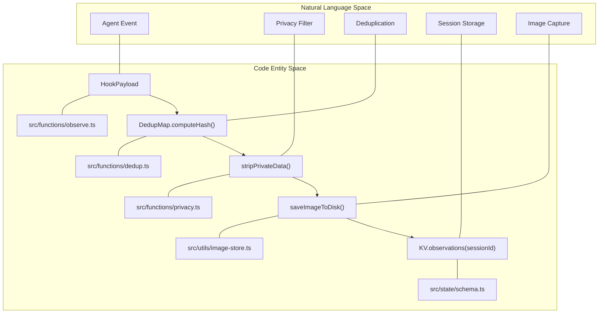
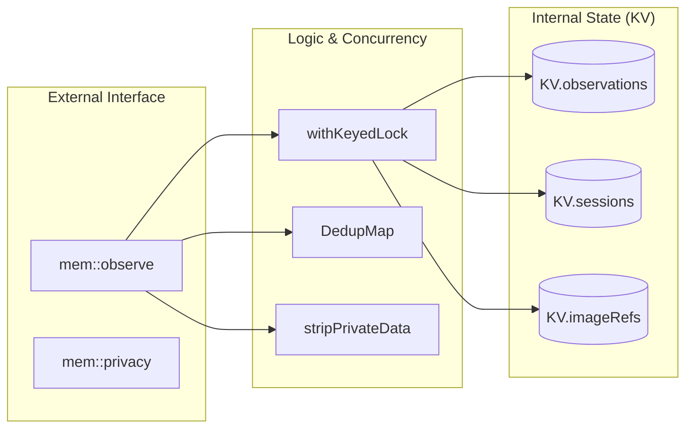

<!-- source: DeepWiki mcp.deepwiki.com · repo rohitg00/agentmemory · page 2.1 Observation & Capture · fetched 2026-10-30 -->

# Observation & Capture

Relevant source files

The following files were used as context for generating this wiki page:

- [src/functions/compress.ts](src/functions/compress.ts)
- [src/functions/consolidate.ts](src/functions/consolidate.ts)
- [src/functions/diagnostics.ts](src/functions/diagnostics.ts)
- [src/functions/disk-size-manager.ts](src/functions/disk-size-manager.ts)
- [src/functions/enrich.ts](src/functions/enrich.ts)
- [src/functions/image-quota-cleanup.ts](src/functions/image-quota-cleanup.ts)
- [src/functions/image-refs.ts](src/functions/image-refs.ts)
- [src/functions/migrate.ts](src/functions/migrate.ts)
- [src/functions/observe.ts](src/functions/observe.ts)
- [src/prompts/xml.ts](src/prompts/xml.ts)
- [src/triggers/events.ts](src/triggers/events.ts)
- [test/diagnostics.test.ts](test/diagnostics.test.ts)
- [test/multimodal.test.ts](test/multimodal.test.ts)
- [test/privacy.test.ts](test/privacy.test.ts)
- [test/session-end-triggers-graph.test.ts](test/session-end-triggers-graph.test.ts)
- [test/sliding-window.test.ts](test/sliding-window.test.ts)
- [test/xml.test.ts](test/xml.test.ts)

The **Observation & Capture** phase is the entry point of the `agentmemory` pipeline. It transforms raw events from agentic workflows—such as tool executions, user prompts, and session lifecycle changes—into structured `RawObservation` objects. This stage handles deduplication, privacy scrubbing, image persistence, and initial storage before triggering downstream compression.

## The Observation Pipeline

The primary entry point for capturing data is the `mem::observe` function [src/functions/observe.ts:40-46](). It processes a `HookPayload` and orchestrates the transition from a transient event to a stored observation.

### Data Flow: Hook to Store

1.  **Ingestion**: Hooks (e.g., from Claude Code or other integrations) send `HookPayload` objects containing a `sessionId`, `hookType`, `timestamp`, and `data` [src/functions/observe.ts:49-62]().
2.  **Deduplication**: The `DedupMap` computes a SHA-256 hash of the tool name and input. If a duplicate is detected within the TTL window, the process exits early to save resources [src/functions/observe.ts:67-90]().
3.  **Privacy Scrubbing**: The payload data is passed through `stripPrivateData` which redacts sensitive information based on defined patterns [src/functions/observe.ts:92-99]().
4.  **Normalization**: Data is mapped into a `RawObservation` object. If the `hookType` is `post_tool_use` or `post_tool_failure`, it extracts `toolName`, `toolInput`, and `toolOutput` [src/functions/observe.ts:104-128]().
5.  **Image Handling**: The pipeline uses `extractImage` to find base64 or path-based images in the payload [src/functions/observe.ts:17-38](). If found, it saves them to disk via `saveImageToDisk`, increments reference counts, and triggers `mem::vision-embed` if enabled [src/functions/observe.ts:173-193]().
6.  **Concurrency Control**: A `withKeyedLock` is acquired for the specific `sessionId` (`obs:${payload.sessionId}`) to prevent race conditions during state updates and enforcement of `maxObservationsPerSession` [src/functions/observe.ts:146-155]().
7.  **Persistence**: The observation is saved to the `StateKV` store under the `observations` scope for that session [src/functions/observe.ts:223-227]().
8.  **Streaming**: The raw observation is pushed to the `mem-live` WebSocket stream via `stream::set` for real-time dashboard updates [src/functions/observe.ts:241-249]().

### Natural Language to Code Entity Mapping: Observation Flow

This diagram illustrates how high-level "Observation" concepts map to specific code entities and files.

**Sources:** [src/functions/observe.ts:17-227](), [src/functions/privacy.ts:1-10](), [src/state/schema.ts:5-10]()

---

## Deduplication & Concurrency

To handle high-frequency tool calls and parallel agent execution, `agentmemory` employs two primary mechanisms:

### SHA-256 Deduplication (`DedupMap`)
The `DedupMap` prevents the storage of redundant observations (e.g., an agent repeatedly calling `ls` with the same arguments in a tight loop).
- **Hash Inputs**: `sessionId` + `toolName` (or `hookType`) + `toolInput` [src/functions/observe.ts:73-86]().
- **Behavior**: If `isDuplicate(hash)` is true, the function returns `{ deduplicated: true }` immediately without persisting data [src/functions/observe.ts:87-89]().

### Keyed Locking (`withKeyedLock`)
To maintain integrity within a session (e.g., checking `maxObservationsPerSession`), the system uses a `KeyedMutex` via `withKeyedLock` [src/functions/observe.ts:9]().
- **Scope**: Locks are per-session (`obs:${payload.sessionId}`) [src/functions/observe.ts:146]().
- **Guarantees**: Ensures that multiple simultaneous hooks for the same session do not corrupt the session's observation list or counter [src/functions/observe.ts:147-155]().

**Sources:** [src/functions/observe.ts:67-90](), [src/functions/observe.ts:146-155]()

---

## Privacy Scrubbing

The system provides automated redaction of sensitive information through `stripPrivateData` [src/functions/privacy.ts:5]().

### Redaction Rules
- **Explicit Redaction**: Any content wrapped in `<private>...</private>` tags is replaced with `[REDACTED]` [src/functions/privacy.ts:7-10]().
- **Pattern Matching**: The `SECRET_PATTERN_SOURCES` array contains regex for common credentials [src/functions/privacy.ts:12-30](), including:
    - Generic API keys/passwords (`api_key=...`, `secret: ...`).
    - Bearer tokens and JWTs.
    - Provider-specific keys: OpenAI (`sk-proj-...`), Anthropic (`sk-ant-...`), GitHub (`ghp_...`), AWS (`AKIA...`), and Google Cloud (`AIza...`).

**Sources:** [src/functions/privacy.ts:5-30]()

---

## Image Storage & Quota Management

When images are detected in a payload via `extractImage` [src/functions/observe.ts:17-38](), the system triggers a specialized management pipeline.

### Storage and Referencing
- **Disk Persistence**: Images are saved to a managed directory via `saveImageToDisk` [src/functions/observe.ts:174]().
- **Reference Counting**: The system tracks how many observations refer to a specific image file via `incrementImageRef` [src/functions/observe.ts:177]().
- **Disk Delta**: Any change in disk usage triggers `mem::disk-size-delta` to update global tracking [src/functions/observe.ts:178-182]().

### Quota Enforcement
The `mem::disk-size-delta` function monitors usage and triggers `mem::image-quota-cleanup` if `getMaxBytes()` is exceeded [src/functions/disk-size-manager.ts:13-44](). The cleanup process evicts unreferenced images (where `refCount === 0`) using an LRU strategy after a 30-second grace period [src/functions/image-quota-cleanup.ts:14-98]().

### Vision Integration
If `AGENTMEMORY_IMAGE_EMBEDDINGS` is enabled, the pipeline triggers `mem::vision-embed` [src/functions/observe.ts:183-193](). During compression, if a vision-capable provider is available, `provider.describeImage` is called to generate a text description [src/functions/compress.ts:84-101]().

**Sources:** [src/functions/observe.ts:173-193](), [src/functions/compress.ts:81-109](), [src/functions/disk-size-manager.ts:13-44](), [src/functions/image-quota-cleanup.ts:14-98]()

---

## Maintenance & Migration

The system includes utilities for maintaining state consistency and upgrading data structures.

### Diagnostics (`mem::diagnose`)
Performs consistency checks across 14+ categories, including orphaned leases, expired sentinels, and project scope coverage for memories [src/functions/diagnostics.ts:47-216]().

### Migration (`mem::migrate`)
Handles the transition of data between versions.
- **Project Inference**: The `inferMemoryProjects` step performs a majority-vote based on associated session projects to scope legacy unscoped memories [src/functions/migrate.ts:23-86]().
- **SQLite Import**: Supports migrating legacy `better-sqlite3` databases into the current KV-based architecture [src/functions/migrate.ts:115-215]().

**Sources:** [src/functions/diagnostics.ts:47-51](), [src/functions/migrate.ts:23-215]()

---

## Entity Relationship: Observation & State

This diagram shows how external hooks interact with the internal logic and KV state.

**Sources:** [src/functions/observe.ts:40-227](), [src/state/schema.ts:5-10](), [src/functions/image-refs.ts:12-18]()

---

