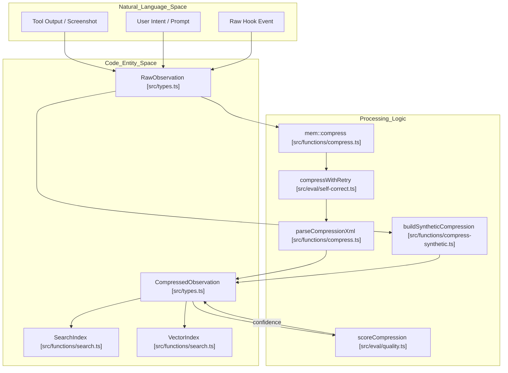
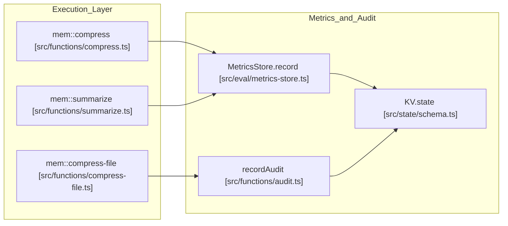

<!-- source: DeepWiki mcp.deepwiki.com · repo rohitg00/agentmemory · page 2.2 Compression & Summarization · fetched 2026-10-30 -->

# Compression & Summarization

Relevant source files

The following files were used as context for generating this wiki page:

- [src/functions/compress-file.ts](src/functions/compress-file.ts)
- [src/functions/compress-synthetic.ts](src/functions/compress-synthetic.ts)
- [src/functions/compress.ts](src/functions/compress.ts)
- [src/functions/disk-size-manager.ts](src/functions/disk-size-manager.ts)
- [src/functions/image-quota-cleanup.ts](src/functions/image-quota-cleanup.ts)
- [src/functions/image-refs.ts](src/functions/image-refs.ts)
- [src/functions/observe.ts](src/functions/observe.ts)
- [src/functions/replay.ts](src/functions/replay.ts)
- [src/functions/summarize.ts](src/functions/summarize.ts)
- [src/providers/index.ts](src/providers/index.ts)
- [src/replay/jsonl-parser.ts](src/replay/jsonl-parser.ts)
- [src/triggers/events.ts](src/triggers/events.ts)
- [test/agent-id-scope.test.ts](test/agent-id-scope.test.ts)
- [test/compress-file.test.ts](test/compress-file.test.ts)
- [test/fallback-model-resolution.test.ts](test/fallback-model-resolution.test.ts)
- [test/memories-pagination.test.ts](test/memories-pagination.test.ts)
- [test/multimodal.test.ts](test/multimodal.test.ts)
- [test/replay-import-key.test.ts](test/replay-import-key.test.ts)
- [test/replay-sensitive.test.ts](test/replay-sensitive.test.ts)
- [test/replay.test.ts](test/replay.test.ts)
- [test/session-end-triggers-graph.test.ts](test/session-end-triggers-graph.test.ts)
- [test/sliding-window.test.ts](test/sliding-window.test.ts)
- [test/summarize.test.ts](test/summarize.test.ts)

The **Compression & Summarization** stage is the second phase of the Core Memory Pipeline. It transforms volatile, high-volume `RawObservation` data into structured, semantically dense `CompressedObservation` objects. This process reduces token overhead for future retrieval while extracting key entities, facts, and importance scores.

## Observation Compression (`mem::compress`)

The `mem::compress` function [src/functions/compress.ts:73-78]() is the primary entry point for transforming raw hook data into a format suitable for long-term reasoning. It utilizes an LLM to perform structural extraction and qualitative assessment.

### Implementation Flow

The compression process follows a strict pipeline to ensure data integrity and quality:

1.  **Multimodal Processing**: If the observation contains image data (e.g., from a screenshot tool), `mem::compress` uses the provider's `describeImage` method [src/functions/compress.ts:84-101]() with the `VISION_DESCRIPTION_PROMPT` [src/functions/compress.ts:100]() to generate a text description.
2.  **Prompt Construction**: The system builds a prompt using `buildCompressionPrompt` [src/functions/compress.ts:111-120](), incorporating the tool name, input, output (including any image descriptions), and user prompt.
3.  **LLM Execution with Self-Correction**: The `compressWithRetry` utility [src/functions/compress.ts:136-142]() executes the LLM call. It uses a validator function that checks if the output is valid XML via `parseCompressionXml` [src/functions/compress.ts:44-49]() and conforms to the `CompressOutputSchema` [src/functions/compress.ts:123-134]().
4.  **XML Parsing**: The LLM response is parsed into fields like `type`, `title`, `facts`, `concepts`, and `importance` [src/functions/compress.ts:52-64]().
5.  **Quality Scoring**: The `scoreCompression` function [src/functions/compress.ts:157]() calculates a numeric quality score (0-100) used to set the `confidence` field [src/functions/compress.ts:164]().
6.  **Persistence & Indexing**: The resulting `CompressedObservation` is stored in `KV.observations(sessionId)` [src/functions/compress.ts:171-175](). It is added to the BM25 `SearchIndex` [src/functions/compress.ts:178-179]() and the `VectorIndex` via `vectorIndexAddGuarded` [src/functions/compress.ts:189-194]().
7.  **Real-time Streaming**: The compressed result is pushed to the `mem-live` WebSocket via `stream::set` [src/functions/compress.ts:197-204]().

### Zero-LLM Fallback: Synthetic Compression
If `isAutoCompressEnabled()` is false [src/functions/observe.ts:10]() or no LLM provider is configured, the system uses `buildSyntheticCompression` [src/functions/observe.ts:11](). This path bypasses LLM calls and uses heuristics to infer the `ObservationType` from tool names and truncate inputs/outputs into a narrative [src/functions/compress-synthetic.ts:76-105]().

### Data Transformation Diagram

The following diagram illustrates the transition from raw input to the structured code entities used within the system.

**Natural Language to Code Entity Space: Compression**

**Sources:** [src/functions/compress.ts:44-194](), [src/functions/compress-synthetic.ts:76-105](), [src/functions/observe.ts:9-11]()

---

## File-Specific Compression (`mem::compress-file`)

The `mem::compress-file` function [src/functions/compress-file.ts:101-187]() provides a specialized pipeline for shortening long Markdown files while preserving their structural integrity.

### Safeguards and Validation
*   **Path Protection**: Refuses to process files with sensitive names (e.g., `.env`, `token`, `secret`) [src/functions/compress-file.ts:9-16](), [src/functions/compress-file.ts:112-114]().
*   **Symlink Prevention**: Uses `lstat` [src/functions/compress-file.ts:117-120]() and `O_NOFOLLOW` [src/functions/compress-file.ts:157]() to prevent symlink attacks and TOCTOU swaps.
*   **Structural Validation**: The `validateCompression` helper [src/functions/compress-file.ts:47-85]() ensures that the compressed version has the exact same headings, URLs, and code blocks as the original. If validation fails, the file is not overwritten [src/functions/compress-file.ts:142-148]().
*   **Backups**: Automatically creates an `.original.md` (or `.backup.md`) backup before overwriting the file [src/functions/compress-file.ts:150-151]().

**Sources:** [src/functions/compress-file.ts:9-188](), [test/compress-file.test.ts:109-180]()

---

## Session Summarization (`mem::summarize`)

While compression operates on individual events, `mem::summarize` aggregates observations to generate a `SessionSummary`. This is triggered during the session stop lifecycle [src/triggers/events.ts:96-97]().

### Summarization Logic
1.  **Observation Retrieval**: Fetches observations for a session via `kv.list(KV.observations(sessionId))` [src/functions/summarize.ts:232-234]().
2.  **Chunking & Map-Reduce**: For large sessions (default > 400 observations), observations are split into chunks [src/functions/summarize.ts:119-121](). Chunks are summarized in parallel via `summarizeChunkWithRetry` [src/functions/summarize.ts:135-150]() and then merged via `REDUCE_SYSTEM` prompt [src/functions/summarize.ts:180-183]().
3.  **XML Extraction**: The LLM output is parsed into a `SessionSummary` which includes a `title`, `narrative`, `keyDecisions`, and `filesModified` [src/functions/summarize.ts:187-207]().
4.  **Quality Scoring**: `scoreSummary` [src/functions/summarize.ts:269]() evaluates the summary based on narrative length and content density.
5.  **Persistence**: The final summary is stored in `KV.summaries` keyed by the session ID [src/functions/summarize.ts:271-275]().

**Sources:** [src/functions/summarize.ts:27-185](), [src/triggers/events.ts:96-97]()

---

## Metrics & Quality Control

The system employs several layers of validation and metric tracking to ensure the memory pipeline remains reliable.

### Metrics Tracking
The `MetricsStore` records the performance of compression and summarization:
*   **Latency**: Time taken for LLM calls [src/functions/compress.ts:148]().
*   **Success/Failure Rate**: Tracked per function ID via `metricsStore.record` [src/functions/compress.ts:148]().
*   **Quality Scores**: Uses `scoreCompression` and `scoreSummary` to monitor the effectiveness of the LLM provider [src/functions/compress.ts:157](), [src/functions/summarize.ts:269]().

**Metrics Storage Logic**

**Sources:** [src/functions/compress.ts:146-157](), [src/functions/compress-file.ts:171-177](), [src/functions/summarize.ts:269]()

---

## Multi-Agent Scoping

Compression and summarization respect the `AGENT_ID` scope to maintain isolation in multi-agent environments.

*   **Agent Identification**: The `getAgentId()` helper retrieves the current agent's ID from environment variables or session metadata [src/functions/observe.ts:166-168]().
*   **Metadata Stamping**: `CompressedObservation` objects are stamped with the `agentId` if available [src/functions/compress.ts:168]().
*   **Isolation Enforcement**: `event::session::started` initializes the session with an `agentId` [src/triggers/events.ts:52-65](), ensuring all subsequent observations in that session inherit the correct scope.

**Sources:** [src/functions/observe.ts:166-171](), [src/functions/compress.ts:168](), [src/triggers/events.ts:52-65]()

---

