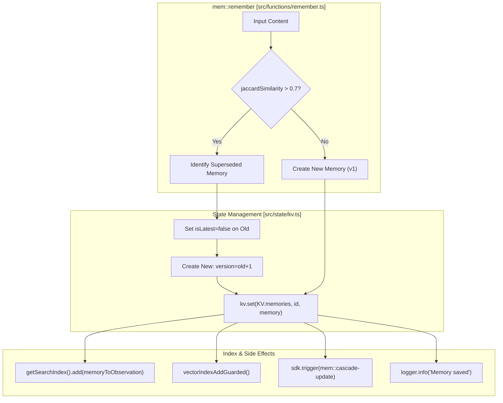
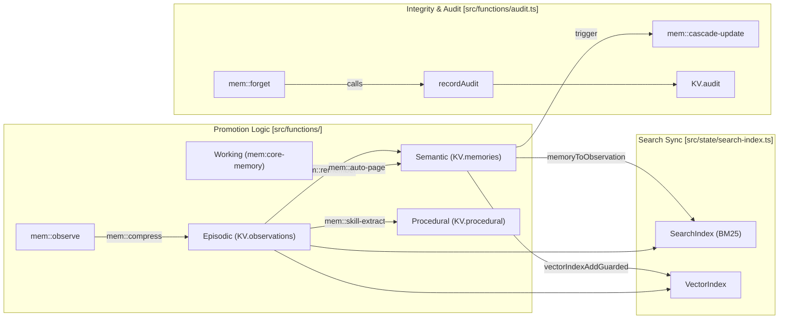

<!-- source: DeepWiki mcp.deepwiki.com · repo rohitg00/agentmemory · page 2.3 Memory Persistence & Lifecycle · fetched 2026-10-30 -->

# Memory Persistence & Lifecycle

Relevant source files

The following files were used as context for generating this wiki page:

- [src/functions/audit.ts](src/functions/audit.ts)
- [src/functions/auto-forget.ts](src/functions/auto-forget.ts)
- [src/functions/claude-bridge.ts](src/functions/claude-bridge.ts)
- [src/functions/evict.ts](src/functions/evict.ts)
- [src/functions/governance.ts](src/functions/governance.ts)
- [src/functions/remember.ts](src/functions/remember.ts)
- [src/functions/retention.ts](src/functions/retention.ts)
- [src/functions/search.ts](src/functions/search.ts)
- [src/functions/skill-extract.ts](src/functions/skill-extract.ts)
- [src/functions/working-memory.ts](src/functions/working-memory.ts)
- [src/state/hybrid-search.ts](src/state/hybrid-search.ts)
- [src/state/memory-utils.ts](src/state/memory-utils.ts)
- [src/state/search-index.ts](src/state/search-index.ts)
- [src/utils/image-store.ts](src/utils/image-store.ts)
- [test/audit.test.ts](test/audit.test.ts)
- [test/auto-forget.test.ts](test/auto-forget.test.ts)
- [test/claude-bridge.test.ts](test/claude-bridge.test.ts)
- [test/evict.test.ts](test/evict.test.ts)
- [test/governance.test.ts](test/governance.test.ts)
- [test/hybrid-search.test.ts](test/hybrid-search.test.ts)
- [test/remember-forget-audit.test.ts](test/remember-forget-audit.test.ts)
- [test/retention.test.ts](test/retention.test.ts)
- [test/search-index.test.ts](test/search-index.test.ts)
- [test/search.test.ts](test/search.test.ts)
- [test/skill-extract.test.ts](test/skill-extract.test.ts)
- [test/working-memory.test.ts](test/working-memory.test.ts)

This section covers the long-term storage and management of structured memories in `agentmemory`. It details the transition of information from transient observations into persistent knowledge, the deduplication logic, versioning strategies, and the tiered architecture that defines the lifecycle of a memory from creation to eventual decay or deletion.

## Memory Tiers

The system organizes information into four distinct tiers, representing different stages of the memory lifecycle and levels of abstraction.

| Tier | Type | Source | Description |
| :--- | :--- | :--- | :--- |
| **Working** | `CoreMemoryEntry` | `mem::core-add` | Highly relevant, pinned or frequently accessed snippets stored in `mem:core-memory` [src/functions/working-memory.ts:9-19](). |
| **Episodic** | `CompressedObservation` | `mem::compress` | Summarized events with importance scores and concept tags stored in session-scoped KV [src/types.ts:100-120](). |
| **Semantic** | `Memory` | `mem::remember` | De-duplicated facts, patterns, and preferences derived from episodes, stored in `KV.memories` [src/functions/remember.ts:98-118](). |
| **Procedural** | `ProceduralMemory` | `mem::skill-extract` | Extracted workflows (trigger + steps) for agent behavior, stored in `mem:procedural` [src/functions/skill-extract.ts:5-6](). |

**Sources:** [src/types.ts:1-300](), [src/functions/working-memory.ts:9-19](), [src/functions/remember.ts:98-118](), [src/functions/skill-extract.ts:5-6]()

---

## Long-term Storage: mem::remember

The `mem::remember` function is the primary entry point for promoting information to the **Semantic** tier. It handles content validation, automated versioning via Jaccard deduplication, and Time-To-Live (TTL) management.

### Implementation Details
When `mem::remember` is called, it performs the following steps:
1.  **Validation**: Ensures content is non-empty and maps the provided `type` to a valid `Memory["type"]` (e.g., `pattern`, `preference`, `architecture`, `bug`, `workflow`, `fact`) [src/functions/remember.ts:34-60]().
2.  **Deduplication & Superseding**: It generates candidates by querying the BM25 index for the top 50 hits starting with `mem_` [src/functions/remember.ts:79-90](). If a candidate's content has a `jaccardSimilarity` > 0.7 with the new content, and they share the same project scope, the existing memory is identified for superseding [src/functions/remember.ts:122-134]().
3.  **Persistence**: The new `Memory` object is saved with an incremented version number, `isLatest: true`, and optional `agentId` or `project` scoping [src/functions/remember.ts:152-175]().
4.  **Indexing**: To ensure immediate searchability, the memory is converted via `memoryToObservation` and added to the `SearchIndex` singleton [src/functions/remember.ts:192-195](). It also adds the memory to the `VectorIndex` via `vectorIndexAddGuarded` [src/functions/remember.ts:196-201]().
5.  **TTL Management**: If `data.ttlDays` is provided, a `forgetAfter` ISO timestamp is calculated [src/functions/remember.ts:177-179]().
6.  **Cascade Trigger**: If a memory was superseded, the system triggers `mem::cascade-update` to maintain referential integrity [src/functions/remember.ts:203-211]().

### Data Flow: Memory Promotion
The following diagram illustrates how a memory is saved and how the system handles versioning.

**Memory Versioning & Storage Flow**

**Sources:** [src/functions/remember.ts:22-220](), [src/state/schema.js:3-10](), [src/state/memory-utils.ts:11-24](), [src/functions/search.ts:47-50](), [src/functions/search.ts:124-156]()

---

## Targeted Deletion: mem::forget

The `mem::forget` function provides a mechanism for both surgical and bulk deletion of data across different lifecycle stages, while maintaining an audit trail and index consistency.

*   **Memory Deletion**: If a `memoryId` is provided, the specific long-term memory is removed from `KV.memories`, its `accessLog` is deleted, and it is removed from both `SearchIndex` and `VectorIndex` [src/functions/remember.ts:241-253]().
*   **Targeted Observation Deletion**: Deletes specific `observationIds` within a given `sessionId` and decrements associated image references [src/functions/remember.ts:255-276]().
*   **Session Purge**: If only a `sessionId` is provided, the system deletes all observations for that session, the session metadata, and the session summary [src/functions/remember.ts:278-295]().
*   **Audit Logging**: Every deletion path calls `recordAudit` to ensure structural removals are traceable [src/functions/audit.ts:6-33](). `mem::forget` specifically records "forget" operations with target IDs and counts [test/remember-forget-audit.test.ts:54-82]().
*   **Index Sync**: All deletion paths call `flushIndexSave()` to ensure that index removals are persisted to disk immediately [src/functions/remember.ts:311-313]().

**Sources:** [src/functions/remember.ts:222-321](), [src/functions/audit.ts:34-55](), [test/remember-forget-audit.test.ts:165-215]()

---

## Ebbinghaus Decay: mem::retention-score

Memory persistence is governed by an automated decay model that scores memories based on salience, recency, and reinforcement.

### Scoring Algorithm
The `mem::retention-score` function computes a score between 0 and 1 for every memory using the following components [src/functions/retention.ts:127-146]():
1.  **Salience**: Base importance derived from the memory `type` (e.g., `architecture` = 0.9, `fact` = 0.5) [src/functions/retention.ts:97-121]().
2.  **Temporal Decay**: Calculated as `exp(-lambda * deltaT)`, where `deltaT` is days since creation [src/functions/retention.ts:81-95]().
3.  **Reinforcement Boost**: A bonus applied for each time the memory was accessed (recalled), calculated as `sum(1 / daysSinceAccess) * sigma` [src/functions/retention.ts:65-79]().

### Automated Forgetting
The `mem::auto-forget` function runs periodically to perform cleanup:
*   **TTL Expiry**: Deletes memories where the current time exceeds `forgetAfter` [src/functions/auto-forget.ts:40-62]().
*   **Contradiction Pruning**: Uses Jaccard similarity (> 0.9) to identify redundant or contradictory memories within the same concept group, marking the older version as `isLatest: false` [src/functions/auto-forget.ts:97-145]().
*   **Low-Value Eviction**: Deletes observations older than 180 days that have an importance score <= 2 [src/functions/auto-forget.ts:160-191]().

**Sources:** [src/functions/retention.ts:20-121](), [src/functions/auto-forget.ts:25-198]()

---

## Procedural Evolution: Skill Extraction

Procedural memory represents the highest level of the lifecycle, where repeated patterns are distilled into executable skills.

### mem::skill-extract
This function analyzes a completed session to determine if a reusable "skill" was demonstrated:
1.  **Context Assembly**: It retrieves the `SessionSummary` and all `CompressedObservation` entries for the session [src/functions/skill-extract.ts:127-130]().
2.  **LLM Synthesis**: The provider analyzes the observations against the `SKILL_EXTRACT_SYSTEM` prompt to extract a `trigger`, `title`, `steps`, and `expected_outcome` [src/functions/skill-extract.ts:14-33]().
3.  **Procedural Storage**: If a skill is found, it is stored as a `ProceduralMemory`. If a similar skill already exists (verified via `fingerprintId`), the system reinforces the existing skill by increasing its `strength` and `frequency` [src/functions/skill-extract.ts:156-176]().

**Sources:** [src/functions/skill-extract.ts:14-220](), [src/state/schema.js:9-10]()

---

## Lifecycle Audit & Integrity

The following diagram bridges the high-level lifecycle stages to the specific code entities that manage state transitions and maintain the audit trail.

**Memory Lifecycle Architecture**

**Sources:** [src/functions/remember.ts:192-211](), [src/functions/working-memory.ts:194-221](), [src/functions/audit.ts:34-55](), [src/state/memory-utils.ts:11-24](), [src/functions/search.ts:124-156]()

---

