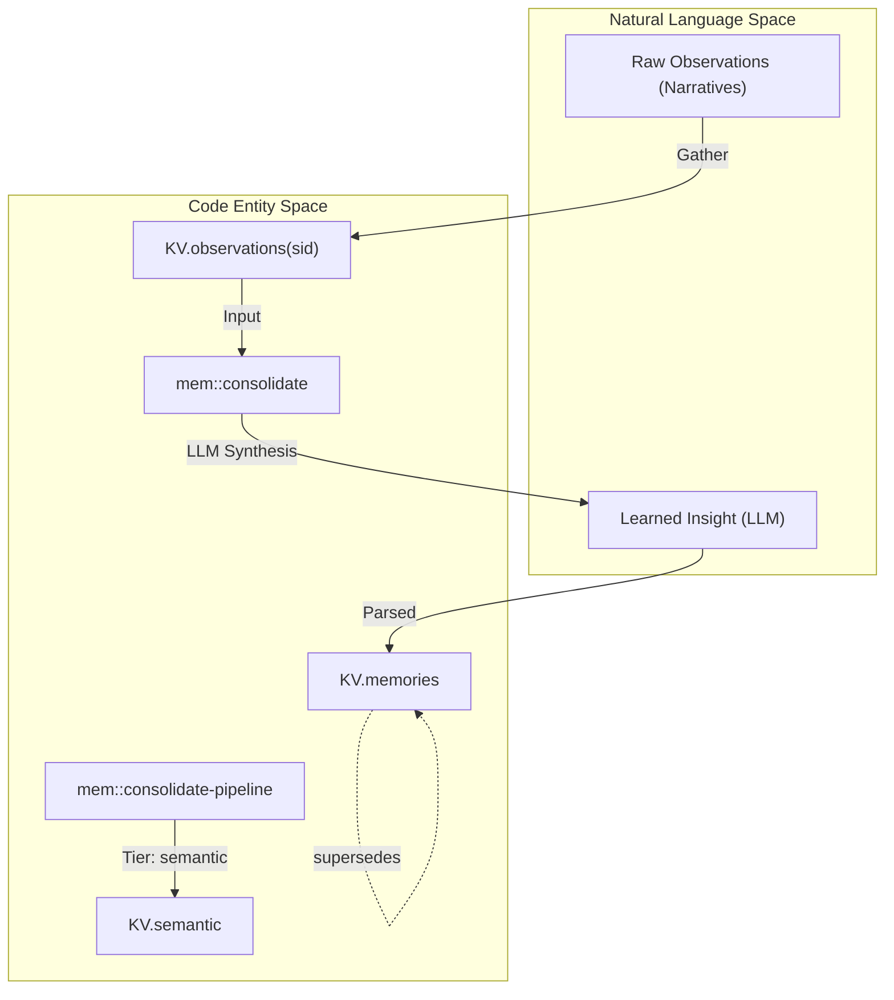
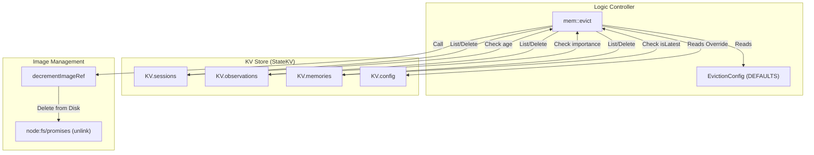

<!-- source: DeepWiki mcp.deepwiki.com · repo rohitg00/agentmemory · page 2.4 Consolidation & Forgetting · fetched 2026-10-30 -->

# Consolidation & Forgetting

Relevant source files

The following files were used as context for generating this wiki page:

- [src/functions/auto-forget.ts](src/functions/auto-forget.ts)
- [src/functions/consolidate.ts](src/functions/consolidate.ts)
- [src/functions/consolidation-pipeline.ts](src/functions/consolidation-pipeline.ts)
- [src/functions/crystallize.ts](src/functions/crystallize.ts)
- [src/functions/diagnostics.ts](src/functions/diagnostics.ts)
- [src/functions/enrich.ts](src/functions/enrich.ts)
- [src/functions/evict.ts](src/functions/evict.ts)
- [src/functions/mesh.ts](src/functions/mesh.ts)
- [src/functions/migrate.ts](src/functions/migrate.ts)
- [src/functions/obsidian-export.ts](src/functions/obsidian-export.ts)
- [src/functions/retention.ts](src/functions/retention.ts)
- [src/utils/image-store.ts](src/utils/image-store.ts)
- [test/consolidation-default.test.ts](test/consolidation-default.test.ts)
- [test/diagnostics.test.ts](test/diagnostics.test.ts)
- [test/evict.test.ts](test/evict.test.ts)
- [test/lessons.test.ts](test/lessons.test.ts)
- [test/mesh.test.ts](test/mesh.test.ts)
- [test/obsidian-export.test.ts](test/obsidian-export.test.ts)

The consolidation and forgetting subsystem is responsible for the long-term lifecycle of memories in `agentmemory`. It transitions short-term, session-specific observations into structured, high-level semantic knowledge while simultaneously pruning irrelevant or outdated data to prevent state bloat and "hallucination" from stale context.

## 4-Tier Consolidation Pipeline

Consolidation is the process of synthesizing multiple `CompressedObservation` objects into a single, durable `Memory` object. This is handled primarily by the `mem::consolidate` function [src/functions/consolidate.ts:70-71]() and the multi-tier `mem::consolidate-pipeline` [src/functions/consolidation-pipeline.ts:50-51]().

### 1. Grouping & Filtering
The pipeline gathers observations across sessions. It filters for high-value data, specifically targeting observations with a `title` and an `importance` score of 5 or higher [src/functions/consolidate.ts:94-98](). These are then grouped by `concepts` (tags) to identify clusters of related activity [src/functions/consolidate.ts:104-111]().

### 2. Concept-Based Selection
Groups are sorted by size, and clusters with at least 3 observations are processed [src/functions/consolidate.ts:122-124](). To maintain LLM efficiency, only the top 8 most important observations per concept are sent for synthesis [src/functions/consolidate.ts:129-131]().

### 3. LLM Synthesis & Tiering
The `MemoryProvider` uses a specific `CONSOLIDATION_SYSTEM` prompt [src/functions/consolidate.ts:12-26]() to transform raw narratives into structured XML. The pipeline also supports specialized tiers:
* **Semantic Tier**: Merges `SessionSummary` objects into `SemanticMemory` facts using `SEMANTIC_MERGE_SYSTEM` [src/functions/consolidation-pipeline.ts:59-134]().
* **Reflect Tier**: Uses `mem::reflect` to synthesize higher-order `Insight` objects from `GraphNode` clusters [src/functions/consolidation-pipeline.ts:136-148]().
* **Procedural Tier**: Extracts `ProceduralMemory` (step-by-step workflows) from repeated patterns via `PROCEDURAL_EXTRACTION_SYSTEM` [src/functions/consolidation-pipeline.ts:150-202]().

### 4. Versioning & Superseding
If a new memory shares a title with an existing one, the system marks the old memory as `isLatest: false` [src/functions/consolidate.ts:176-177](), creates a new `Memory` with an incremented `version` [src/functions/consolidate.ts:188](), and populates the `supersedes` array to maintain lineage [src/functions/consolidate.ts:190-193](). To prevent cross-project corruption, scoped consolidation runs only evolve memories belonging to the same project [src/functions/consolidate.ts:162-173]().

### Consolidation Data Flow
The following diagram illustrates how observations are transformed into versioned entities.

**Consolidation Entity Mapping**

**Sources:** [src/functions/consolidate.ts:70-212](), [src/functions/consolidation-pipeline.ts:50-202](), [src/state/schema.js:8-10]()

---

## Retention & Decay (Ebbinghaus Model)

`agentmemory` implements a proactive forgetting mechanism via `mem::auto-forget` [src/functions/auto-forget.ts:25-26]() and a retention scoring system based on the Ebbinghaus forgetting curve [src/functions/retention.ts:127-128]().

### Retention Scoring
The `mem::retention-score` function calculates a score between 0 and 1 for every memory based on:
* **Salience**: Base value determined by memory type (e.g., `architecture` = 0.9, `preference` = 0.85, `fact` = 0.5) [src/functions/retention.ts:103-112]().
* **Temporal Decay**: Calculated as $e^{-\lambda \Delta T}$ where $\lambda$ is the decay constant (default 0.01) [src/functions/retention.ts:20-21](), [src/functions/retention.ts:89]().
* **Reinforcement Boost**: Recent accesses recorded in `KV.accessLog` increase the score, simulating the "testing effect" [src/functions/retention.ts:65-79]().

### Auto-Forget Logic
The `auto-forget` worker performs three primary cleanup tasks:
1. **TTL Expiry**: Deletes memories where `now > forgetAfter` [src/functions/auto-forget.ts:40-50]().
2. **Contradiction Detection**: Calculates Jaccard similarity between memories. If similarity > 0.9, the older version is marked non-latest [src/functions/auto-forget.ts:118-134]().
3. **Low-Value Pruning**: Observations older than 180 days with `importance <= 2` are evicted [src/functions/auto-forget.ts:162-179]().

**Sources:** [src/functions/retention.ts:19-94](), [src/functions/auto-forget.ts:25-191]()

---

## Eviction System

While `auto-forget` handles content decay, `mem::evict` manages the hard capacity limits of the `StateKV` [src/functions/evict.ts:109-110]().

### Eviction Strategies
| Strategy | Trigger | Action |
| :--- | :--- | :--- |
| **Stale Sessions** | Session > 30 days old with no summary [src/functions/evict.ts:136-140]() | Recovery via `event::session::stopped` then delete [src/functions/evict.ts:161-173]() |
| **Low Importance** | Observation > 90 days old and importance < 3 [src/functions/evict.ts:207-212]() | Delete from `KV.observations` [src/functions/evict.ts:222-223]() |
| **Per-Project Cap** | Project exceeds `maxObservationsPerProject` (default 10k) [src/functions/evict.ts:29]() | Prune lowest importance first [src/functions/evict.ts:246-258]() |
| **Image Management** | Eviction of observation with `imageData` | Calls `decrementImageRef` to manage disk space [src/functions/evict.ts:233-234]() |

### Eviction Logic Flow
The eviction system operates as a cleanup worker, ensuring the storage layer remains performant and disk usage for images is tracked via `image-store.ts` utilities [src/utils/image-store.ts:63-77]().

**Eviction Logic and KV Interaction**

**Sources:** [src/functions/evict.ts:25-30](), [src/functions/evict.ts:109-234](), [src/utils/image-store.ts:63-77]()

---

## Reflection & Synthesis
Higher-order consolidation is achieved through `mem::reflect` (triggered within the pipeline [src/functions/consolidation-pipeline.ts:138-142]()), which groups concepts into clusters. It synthesizes actionable `Insight` objects. If an insight is rediscovered, the system reinforces it to increase its confidence score and update timestamps. The pipeline also applies periodic decay to `SemanticMemory` and `ProceduralMemory` strengths based on the time since last access [src/functions/consolidation-pipeline.ts:21-43]().

**Sources:** [src/functions/consolidation-pipeline.ts:21-148](), [src/functions/retention.ts:65-79]()

---

