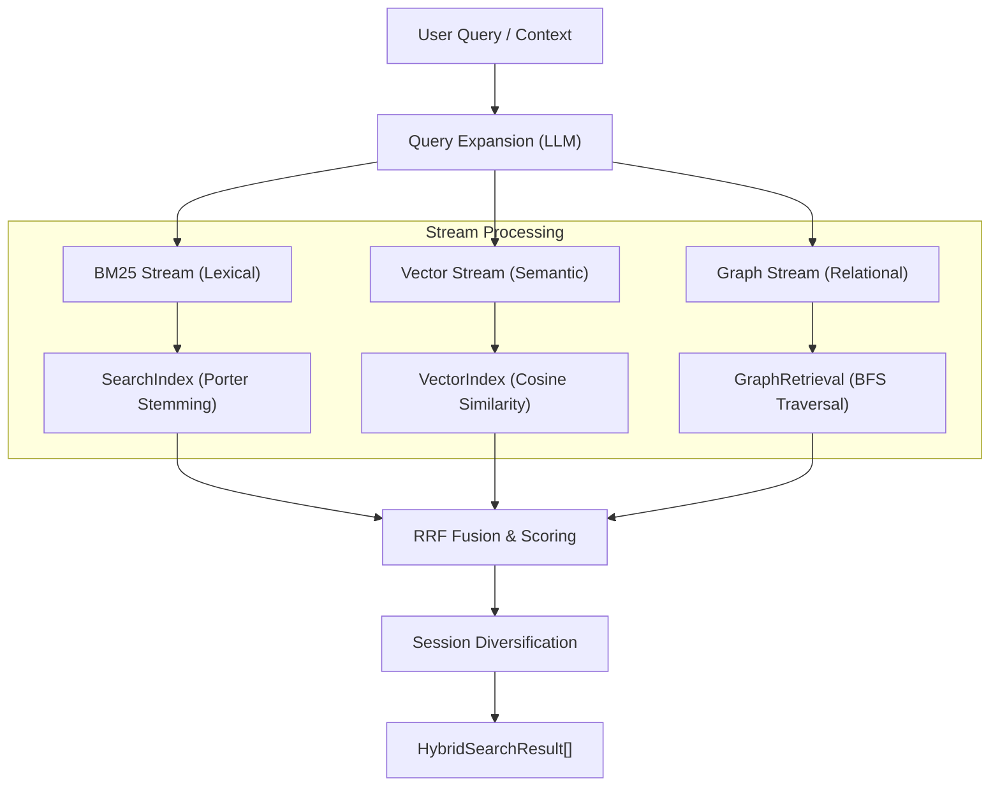
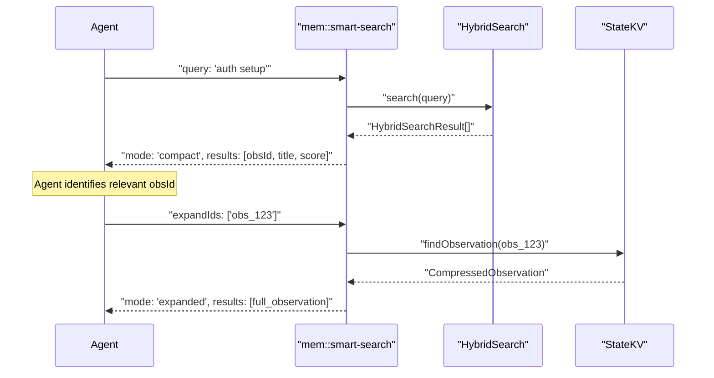

<!-- source: DeepWiki mcp.deepwiki.com · repo rohitg00/agentmemory · page 3 Search & Retrieval · fetched 2026-10-30 -->

# Search & Retrieval

Relevant source files

The following files were used as context for generating this wiki page:

- [src/config.ts](src/config.ts)
- [src/functions/remember.ts](src/functions/remember.ts)
- [src/functions/search.ts](src/functions/search.ts)
- [src/functions/smart-search.ts](src/functions/smart-search.ts)
- [src/state/hybrid-search.ts](src/state/hybrid-search.ts)
- [src/state/memory-utils.ts](src/state/memory-utils.ts)
- [src/state/search-index.ts](src/state/search-index.ts)
- [test/env-loader.test.ts](test/env-loader.test.ts)
- [test/hybrid-search.test.ts](test/hybrid-search.test.ts)
- [test/search-index.test.ts](test/search-index.test.ts)
- [test/search.test.ts](test/search.test.ts)

The search and retrieval system in `agentmemory` is built on a **triple-stream architecture** that combines lexical, semantic, and relational search methodologies. Unlike standard agent memory implementations that rely on simple keyword `grep` or loading entire files into the context window, `agentmemory` uses a hybrid approach to ensure high recall and precision even as the memory corpus grows to tens of thousands of observations.

### Retrieval Architecture

When a query is issued (via the API, MCP, or a lifecycle hook), it flows through the `HybridSearch` class, which orchestrates three parallel retrieval streams. The results from these streams are then fused using **Reciprocal Rank Fusion (RRF)** to produce a final ranked list of memories.

#### The Triple-Stream Flow

**Sources:**
- [src/state/hybrid-search.ts:22-36]()
- [src/state/hybrid-search.ts:81-120]()

---

### 1. BM25 Search Index (Lexical)
The lexical stream uses a custom implementation of the **BM25 (Best Matching 25)** algorithm. It excels at finding exact matches for technical terms, function names, and error codes. It utilizes Porter stemming and a domain-specific synonym map to handle variations in coding terminology (e.g., mapping "auth" to "authentication").

The `SearchIndex` handles both `CompressedObservation` objects and `Memory` objects (converted via `memoryToObservation` [src/state/memory-utils.ts:11-28]()). It supports prefix matching and stores an inverted index in memory, which is persisted to disk on shutdown.

For details on tokenization and scoring parameters, see [BM25 Search Index](#3.1).

**Sources:**
- [src/functions/search.ts:17-27]()
- [src/state/hybrid-search.ts:86-86]()
- [src/state/memory-utils.ts:11-28]()
- [src/state/search-index.ts:12-21]()

### 2. Vector & Embedding Search (Semantic)
The semantic stream handles "fuzzy" queries where the user's intent matches the meaning of a memory but not the specific words (e.g., "how do we handle database speed?" matching "N+1 query optimization"). It supports multiple embedding providers, including local execution via Xenova for privacy and zero-latency.

The `VectorIndex` uses cosine similarity to rank results. To prevent index corruption, the `vectorIndexAddGuarded` wrapper ensures all embeddings match the provider's expected dimensions before insertion and handles provider-specific failures gracefully [src/functions/search.ts:124-156]().

For details on supported providers and similarity scoring, see [Vector & Embedding Search](#3.2).

**Sources:**
- [src/functions/search.ts:130-156]()
- [src/state/hybrid-search.ts:95-102]()

### 3. Knowledge Graph (Relational)
The graph stream traverses relationships between entities (files, functions, PRs, developers) extracted from observations. If a search matches a specific file, the graph stream can "pull in" related observations about functions defined in that file or tasks that modified it, even if they don't match the query text. It also performs "expansion from chunks," taking top vector results and finding their neighbors in the graph [src/state/hybrid-search.ts:121-130]().

For details on entity extraction and BFS traversal, see [Knowledge Graph](#3.4).

**Sources:**
- [src/state/hybrid-search.ts:108-119]()
- [src/state/hybrid-search.ts:121-130]()

---

### Hybrid Fusion & Scoring

The `HybridSearch` class combines the streams using Reciprocal Rank Fusion (RRF) with a constant `RRF_K = 60` [src/state/hybrid-search.ts:20-20](). This ensures that a result appearing at the top of *any* stream is given high priority, while results appearing in multiple streams are boosted further.

| Feature | BM25 | Vector | Graph |
| :--- | :--- | :--- | :--- |
| **Primary Strength** | Exact terms, IDs, codes | Semantic intent, concepts | Relationships, context |
| **Default Weight** | 0.4 | 0.6 | 0.3 |
| **Ranking Logic** | BM25 (k1=1.2, b=0.75) | Cosine Similarity | BFS Distance + Node Weight |

**Sources:**
- [src/state/hybrid-search.ts:202-224]()
- [src/state/hybrid-search.ts:25-36]()

---

### Progressive Disclosure: `mem::smart-search`

To optimize the agent's context window, `agentmemory` implements a "Smart Search" pattern via `mem::smart-search`. Instead of returning full text for every match, it initially returns **Compact Results** (titles, IDs, and timestamps). The agent can then choose to **Expand** specific IDs to see the full narrative, facts, and metadata.

**Sources:**
- [src/functions/smart-search.ts:80-98]()
- [src/functions/smart-search.ts:132-177]()
- [src/functions/smart-search.ts:179-206]()

---

### Retrieval Utilities & Constraints

Beyond standard search, the system provides specialized retrieval logic and safety guards:
- **Search Fallback**: If an observation is not found in the per-session `KV.observations` scope, the search logic automatically falls back to checking `KV.memories` [test/hybrid-search.test.ts:146-182](). This is critical for `mem::remember` which writes to a synthetic "memory" session [src/state/memory-utils.ts:11-28]().
- **Agent Scoping**: Retrieval respects the `AGENT_ID` environment variable. If `AGENTMEMORY_AGENT_SCOPE=isolated` is enabled, search results are filtered to only include memories created by the current agent [src/functions/smart-search.ts:108-130]().
- **Session Diversification**: The `HybridSearch` automatically limits the number of results from a single session to prevent one long-winded session from dominating the results [src/state/hybrid-search.ts:226-231]().
- **Persistence**: The search index is not just in-memory; `IndexPersistence` handles periodic saves and startup loads to ensure search results are available immediately after a restart [src/functions/search.ts:78-91]().

**Sources:**
- [src/functions/smart-search.ts:108-130]()
- [src/state/hybrid-search.ts:226-231]()
- [src/state/memory-utils.ts:11-28]()
- [src/functions/search.ts:78-91]()
- [test/hybrid-search.test.ts:146-182]()

---

