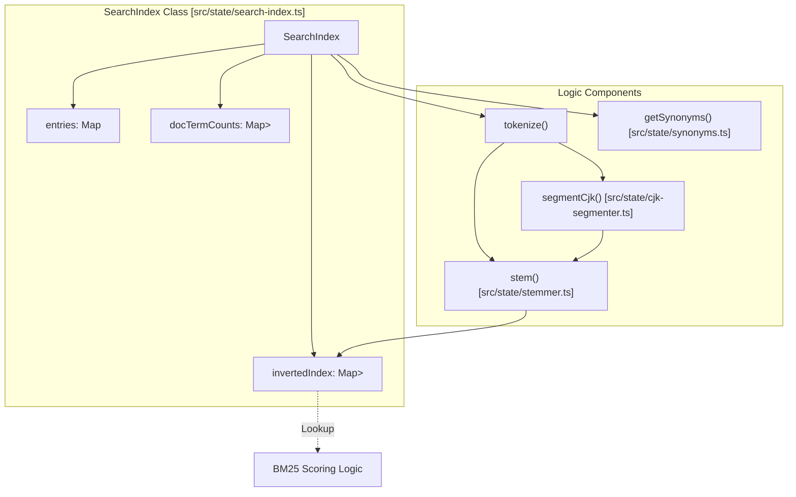
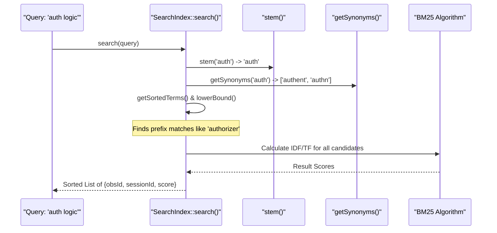
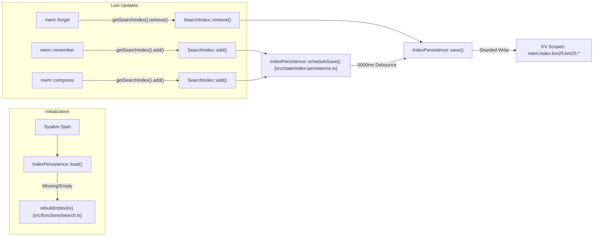

<!-- source: DeepWiki mcp.deepwiki.com · repo rohitg00/agentmemory · page 3.1 BM25 Search Index · fetched 2026-10-30 -->

# BM25 Search Index

Relevant source files

The following files were used as context for generating this wiki page:

- [src/functions/remember.ts](src/functions/remember.ts)
- [src/functions/search.ts](src/functions/search.ts)
- [src/state/hybrid-search.ts](src/state/hybrid-search.ts)
- [src/state/index-persistence.ts](src/state/index-persistence.ts)
- [src/state/memory-utils.ts](src/state/memory-utils.ts)
- [src/state/search-index.ts](src/state/search-index.ts)
- [test/hybrid-search.test.ts](test/hybrid-search.test.ts)
- [test/index-persistence.test.ts](test/index-persistence.test.ts)
- [test/search-index.test.ts](test/search-index.test.ts)
- [test/search.test.ts](test/search.test.ts)

The BM25 Search Index provides the keyword-based retrieval stream for `agentmemory`. It implements the Best Matching 25 (BM25) ranking function, a state-of-the-art probabilistic model for information retrieval. Unlike simple grep or substring matches, the BM25 index accounts for term frequency, document length normalization, and inverse document frequency to provide highly relevant results for natural language and code-specific queries.

### Implementation Overview

The core logic resides in the `SearchIndex` class [src/state/search-index.ts:12-12](). It maintains an in-memory inverted index that maps stemmed tokens to sets of observation identifiers. The index is specifically tuned for the "Coding-Agent" domain by incorporating Porter stemming, a custom synonym expansion layer, and specialized CJK (Chinese, Japanese, Korean) segmentation.

#### Key Scoring Parameters
The index uses standard BM25 constants to balance term saturation and length normalization:
*   **k1 = 1.2**: Controls non-linear term frequency saturation. A higher value increases the influence of repeated terms [src/state/search-index.ts:19-19]().
*   **b = 0.75**: Controls document length normalization. This penalizes long documents to prevent them from dominating results simply by containing more words [src/state/search-index.ts:20-20]().

### Data Flow: From Observation to Index

When a `CompressedObservation` or a `Memory` (converted via `memoryToObservation`) is added to the index, it undergoes a multi-stage pipeline to transform raw text into searchable features.

#### Indexing Pipeline
1.  **Memory Conversion**: If the input is a long-term `Memory` record, `memoryToObservation` wraps it in the observation shape, normalizing the type to `decision` so memories stay distinguishable in result metadata [src/state/memory-utils.ts:11-28]().
2.  **Field Extraction**: Concatenates `title`, `subtitle`, `narrative`, `facts`, `concepts`, `files`, and `type` [src/state/search-index.ts:223-233]().
3.  **Tokenization**: Normalizes text by removing special characters (except for path-related symbols like `/`, `.`, `-`, `_`), splitting on whitespace, and filtering out single-character tokens [src/state/search-index.ts:236-241]().
4.  **CJK Segmentation**: If CJK characters are detected via `hasCjk`, specialized segmenters are used to extract meaningful words rather than just character runs [src/state/cjk-segmenter.ts:128-161]().
5.  **Porter Stemming**: Reduces words to their root form (e.g., "implementing" -> "impl") using the `stem` function [src/state/search-index.ts:243-243]().
6.  **Frequency Tracking**: Calculates term frequency (TF) for the document and updates the global `totalDocLength` and `invertedIndex` [src/state/search-index.ts:24-45]().

**Search Index Data Structures**

Sources: [src/state/search-index.ts:12-17](), [src/state/search-index.ts:236-244](), [src/state/cjk-segmenter.ts:128-130]()

### Coding-Domain Synonyms

To bridge the gap between human queries and technical jargon, the index uses synonym expansion. During search, query terms are expanded with synonyms [src/state/search-index.ts:95-101](). Primary terms carry a weight of `1.0`, while synonym matches are weighted at `0.7` to prioritize exact matches [src/state/search-index.ts:93-98]().

Sources: [src/state/search-index.ts:88-101]()

### Retrieval and Prefix Matching

The `search` function performs a multi-pass retrieval to ensure high recall, especially for partial code identifiers.

1.  **Exact Term Match**: Calculates standard BM25 scores for terms present in the inverted index [src/state/search-index.ts:106-125]().
2.  **Prefix Match**: Uses a sorted term list and binary search (`lowerBound`) to find terms that start with the query term [src/state/search-index.ts:127-130](). 
3.  **Prefix Scoring**: Prefix matches are awarded a `0.5` multiplier on their IDF to ensure that full matches rank higher than partial matches [src/state/search-index.ts:135-136]().

**Retrieval Logic Flow**

Sources: [src/state/search-index.ts:77-160](), [src/state/search-index.ts:127-151]()

### Persistence and Sharding

The BM25 index is kept in memory for performance but is periodically serialized to the KV store via the `IndexPersistence` class [src/state/index-persistence.ts:68-68](). To handle large indexes that exceed KV size limits, `IndexPersistence` implements a sharding mechanism [src/state/index-persistence.ts:169-174]().

*   **Serialization**: The index is converted to a JSON string containing the versioned schema (`v: 2`), entries, inverted index, and term counts [src/state/search-index.ts:194-210]().
*   **Sharding Strategy**: Large serialized strings are split into chunks based on `shardChars` (default 2,000,000 characters) [src/state/index-persistence.ts:18-18](). Each shard is stored in a unique scope prefixed with `mem:index:bm25:bm25:[generation]:[shardIndex]` [src/state/index-persistence.ts:13-13]().
*   **Manifest**: A manifest file at `data:manifest` tracks the active generation and shard locations [src/state/index-persistence.ts:12-25]().
*   **Debounced Saving**: `IndexPersistence` uses a 5000ms debounce timer (`scheduleSave`) to prevent excessive I/O during high-frequency observation ingestion [src/state/index-persistence.ts:8-89]().
*   **Startup Recovery**: On system initialization, `IndexPersistence::load()` retrieves the manifest and reassembles the shards [src/state/index-persistence.ts:105-123](). It also supports loading legacy monolithic snapshots for backward compatibility [src/state/index-persistence.ts:139-155]().

**Index Lifecycle & Persistence**

Sources: [src/state/index-persistence.ts:90-103](), [src/state/search-index.ts:22-48](), [src/functions/remember.ts:79-89](), [src/functions/search.ts:102-104]()

### Implementation Details: CJK Support

To support multilingual coding environments, `agentmemory` includes specialized segmentation for Chinese, Japanese, and Korean scripts [src/state/cjk-segmenter.ts:5-10]().
*   **Chinese**: Uses `@node-rs/jieba` for dictionary-based segmentation [src/state/cjk-segmenter.ts:42-66]().
*   **Japanese**: Uses `tiny-segmenter` for morphological analysis [src/state/cjk-segmenter.ts:75-89]().
*   **Korean**: Uses regex-based syllable block extraction [src/state/cjk-segmenter.ts:120-126]().

Sources: [src/state/cjk-segmenter.ts:128-161](), [test/search-index.test.ts:205-218]()

---

