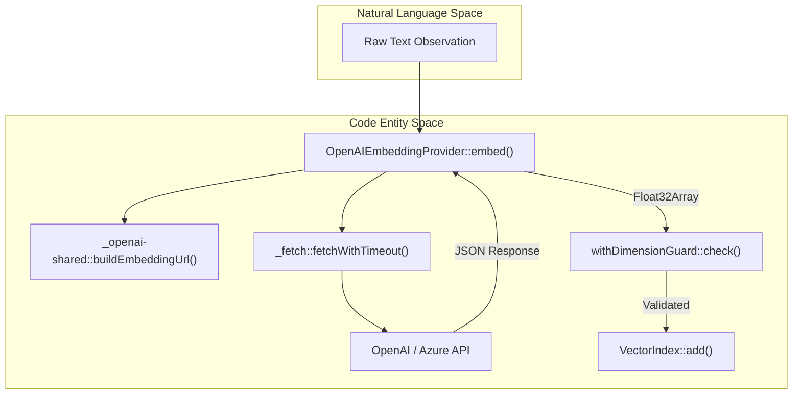
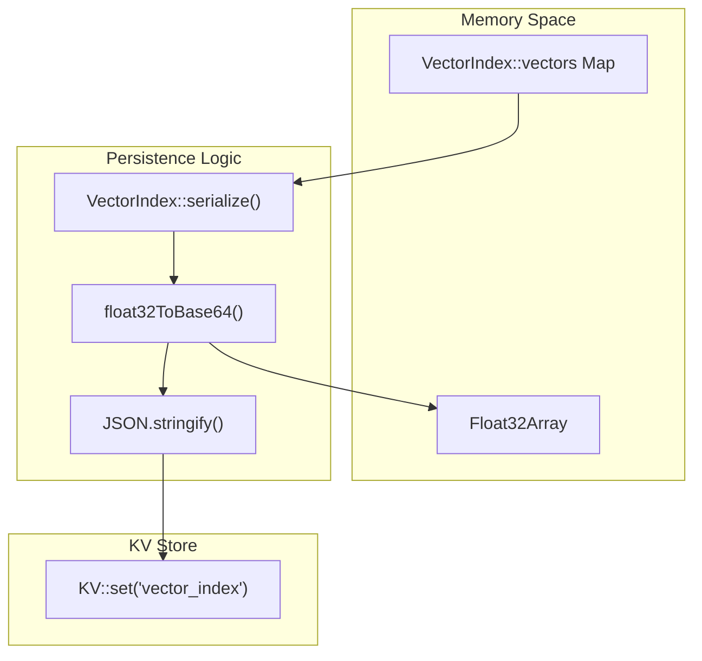

<!-- source: DeepWiki mcp.deepwiki.com · repo rohitg00/agentmemory · page 3.2 Vector & Embedding Search · fetched 2026-10-30 -->

# Vector & Embedding Search

Relevant source files

The following files were used as context for generating this wiki page:

- [src/functions/migrate-vector-index.ts](src/functions/migrate-vector-index.ts)
- [src/functions/vision-search.ts](src/functions/vision-search.ts)
- [src/providers/_fetch.ts](src/providers/_fetch.ts)
- [src/providers/embedding/clip.ts](src/providers/embedding/clip.ts)
- [src/providers/embedding/cohere.ts](src/providers/embedding/cohere.ts)
- [src/providers/embedding/gemini.ts](src/providers/embedding/gemini.ts)
- [src/providers/embedding/index.ts](src/providers/embedding/index.ts)
- [src/providers/embedding/openai.ts](src/providers/embedding/openai.ts)
- [src/providers/embedding/openrouter.ts](src/providers/embedding/openrouter.ts)
- [src/providers/embedding/voyage.ts](src/providers/embedding/voyage.ts)
- [src/providers/minimax.ts](src/providers/minimax.ts)
- [src/providers/openrouter.ts](src/providers/openrouter.ts)
- [src/state/vector-index.ts](src/state/vector-index.ts)
- [test/embedding-provider.test.ts](test/embedding-provider.test.ts)
- [test/fetch-timeout.test.ts](test/fetch-timeout.test.ts)
- [test/minimax-provider.test.ts](test/minimax-provider.test.ts)
- [test/vector-index-dimensions.test.ts](test/vector-index-dimensions.test.ts)
- [test/vector-index.test.ts](test/vector-index.test.ts)
- [test/vision-search.test.ts](test/vision-search.test.ts)

The Vector & Embedding Search subsystem provides semantic retrieval capabilities by mapping textual observations and images into a high-dimensional vector space. Unlike keyword-based search, this system identifies memories based on conceptual similarity, even when specific terminology differs.

## The VectorIndex Class

The `VectorIndex` class is the core in-memory data structure responsible for managing embeddings and performing similarity searches. It maintains a mapping of observation IDs to their corresponding `Float32Array` embeddings and associated session metadata [src/state/vector-index.ts:37-39]().

### Core Operations

| Method | Description |
| :--- | :--- |
| `add(obsId, sessionId, embedding)` | Inserts a new vector into the index [src/state/vector-index.ts:41-43](). |
| `remove(obsId)` | Deletes a specific vector from the index [src/state/vector-index.ts:45-47](). |
| `search(query, limit)` | Performs a brute-force scan to find the top-K most similar vectors using cosine similarity [src/state/vector-index.ts:49-77](). |
| `validateDimensions(expected)` | Validates that all stored vectors match the expected dimension size, identifying mismatches [src/state/vector-index.ts:91-104](). |
| `serialize()` | Converts the index into a JSON string with base64-encoded vectors for persistence [src/state/vector-index.ts:124-136](). |
| `deserialize(json)` | Reconstructs a `VectorIndex` from a serialized string [src/state/vector-index.ts:138-166](). |

### Similarity Scoring
The system uses **Cosine Similarity** to determine the distance between the query vector and stored observation vectors [src/state/vector-index.ts:61](). The calculation is implemented manually to handle `Float32Array` inputs, computing the dot product divided by the product of the magnitudes [src/state/vector-index.ts:23-35](). If the denominator is zero (e.g., a zero vector), it returns a score of 0 [src/state/vector-index.ts:34]().

Sources: [src/state/vector-index.ts:23-77](), [src/state/vector-index.ts:91-104]()

## Embedding Providers

`agentmemory` supports a variety of embedding backends through the `EmbeddingProvider` interface. The system supports local execution via Xenova or remote execution via major API providers.

### Supported Backends

| Provider | Model | Default Dimensions | Notes |
| :--- | :--- | :--- | :--- |
| `LocalEmbeddingProvider` | `Xenova/all-MiniLM-L6-v2` | 384 | Runs locally via `@xenova/transformers` [src/providers/embedding/index.ts:8](), [src/providers/embedding/index.ts:45-46](). |
| `OpenAIEmbeddingProvider` | `text-embedding-3-small` | 1536 | Supports Azure, custom base URLs, and dimension overrides [src/providers/embedding/openai.ts:13-50](). |
| `GeminiEmbeddingProvider` | `gemini-embedding-001` | 768 | Integrated via Google Generative Language API [src/providers/embedding/gemini.ts:6-11](). |
| `VoyageEmbeddingProvider` | Voyage AI | Varies | Specialized for retrieval [src/providers/embedding/voyage.ts:1-20](). |
| `CohereEmbeddingProvider` | Cohere | Varies | Multilingual support [src/providers/embedding/cohere.ts:1-15](). |
| `OpenRouterEmbeddingProvider`| OpenRouter | Varies | Unified API for multiple models [src/providers/embedding/openrouter.ts:8-24](). |

### OpenAI & Azure Integration
The `OpenAIEmbeddingProvider` shares transport logic with the LLM provider, including Azure auto-detection [src/providers/embedding/openai.ts:87](). It detects Azure endpoints by checking if the hostname ends in `.openai.azure.com` [src/providers/_openai-shared.ts:35-42](). 

The provider supports two Azure URL styles [src/providers/_openai-shared.ts:19-23]():
1. **Legacy**: Includes `/openai/deployments/` and requires an `api-version` query parameter [src/providers/_openai-shared.ts:63-74]().
2. **v1 (GA)**: Routes through `/openai/v1/` and mirrors standard OpenAI shape without `api-version` [src/providers/_openai-shared.ts:79-88]().

### Dimension Guarding
To prevent index corruption from mixed-dimension vectors, all providers are wrapped with `withDimensionGuard` [src/providers/embedding/index.ts:56](). This wrapper intercepts calls to `embed`, `embedBatch`, and `embedImage`, ensuring the returned vector length matches the provider's declared `dimensions` property [src/providers/embedding/index.ts:58-65](). It preserves the provider's prototype chain so `instanceof` checks still work [src/providers/embedding/index.ts:66-68]().

**Embedding Generation Flow**

Sources: [src/providers/embedding/openai.ts:92-122](), [src/providers/_openai-shared.ts:1-142](), [src/providers/embedding/index.ts:56-80](), [src/state/vector-index.ts:41-43]()

## Vision Search

The system provides specialized functions for embedding and searching images, primarily using CLIP-based models. This is enabled by setting `AGENTMEMORY_IMAGE_EMBEDDINGS=true` [src/functions/vision-search.ts:31-32]().

### Key Functions
- `mem::vision-embed`: Generates an embedding for a managed image file and stores it in `KV.imageEmbeddings` [src/functions/vision-search.ts:25-69](). It requires the `imageRef` to be registered in `KV.imageRefs` [src/functions/vision-search.ts:40-43]().
- `mem::vision-search`: Supports searching for images using text queries, other images (via `queryImageRef`), or base64 strings [src/functions/vision-search.ts:72-133](). It calculates cosine similarity between the query vector and all stored image embeddings [src/functions/vision-search.ts:122-124]().

### CLIP Implementation
The `ClipEmbeddingProvider` uses `@huggingface/transformers` to run `Xenova/clip-vit-base-patch32` locally [src/providers/embedding/clip.ts:11-15](). It provides separate extractors for text (`feature-extraction`) and images (`image-feature-extraction`) [src/providers/embedding/clip.ts:44-56]().

Sources: [src/functions/vision-search.ts:19-133](), [src/providers/embedding/clip.ts:1-57](), [test/vision-search.test.ts:41-182]()

## Storage & Retrieval Logic

Embeddings are stored in the Key-Value (KV) store in a serialized format. To optimize performance, the `VectorIndex` is kept in memory and synchronized with the KV store during the `IndexPersistence` lifecycle.

### Vector Search Algorithm
The `search` implementation uses a fixed-size results array to maintain the top-K matches efficiently [src/state/vector-index.ts:49-77]().

1. **Iteration**: The engine iterates through every vector in the `vectors` Map [src/state/vector-index.ts:60]().
2. **Scoring**: It calculates the `cosineSimilarity` between the query and the entry [src/state/vector-index.ts:61]().
3. **Selection**: 
    - If the results list is not full (less than `limit`), the result is added [src/state/vector-index.ts:62-63]().
    - Once full, it sorts the initial batch to establish a `minScore` [src/state/vector-index.ts:64-67]().
    - Subsequent vectors are only added if their score exceeds `minScore`, replacing the lowest-scoring element and re-sorting [src/state/vector-index.ts:68-72]().
4. **Final Sort**: The final list is sorted in descending order (highest score first) [src/state/vector-index.ts:75]().

### Serialization & Base64 Encoding
To store `Float32Array` data in JSON-based KV stores, the system converts the underlying `ArrayBuffer` to a Base64 string using `float32ToBase64` [src/state/vector-index.ts:8-12](). Crucially, it uses `byteOffset` and `byteLength` to avoid issues with Node's Buffer pool, where `Buffer.from` might otherwise return a slice of a shared pool [src/state/vector-index.ts:1-7]().

**Vector Persistence Flow**

Sources: [src/state/vector-index.ts:1-21](), [src/state/vector-index.ts:124-136]()

## Error Handling & Fallbacks
- **Batching**: Providers like `GeminiEmbeddingProvider` implement batching (e.g., 100 texts per request) to handle large numbers of observations efficiently [src/providers/embedding/gemini.ts:5-7](), [src/providers/embedding/gemini.ts:27-29]().
- **Normalization**: Gemini performs L2 normalization on returned vectors to ensure consistent cosine similarity scoring [src/providers/embedding/gemini.ts:51-52](), [src/providers/embedding/gemini.ts:61-78]().
- **Validation**: During restoration, `validateDimensions` is used to ensure that a legacy on-disk index doesn't contain vectors that mismatch the current provider's requirements [src/state/vector-index.ts:91-104]().
- **Timeouts**: All remote provider calls use `fetchWithTimeout` to prevent hanging requests from blocking the memory pipeline [src/providers/_fetch.ts:44-55]().

Sources: [src/providers/embedding/gemini.ts:24-56](), [src/state/vector-index.ts:91-104](), [src/providers/embedding/index.ts:30-50](), [src/providers/_fetch.ts:1-75]()

---

