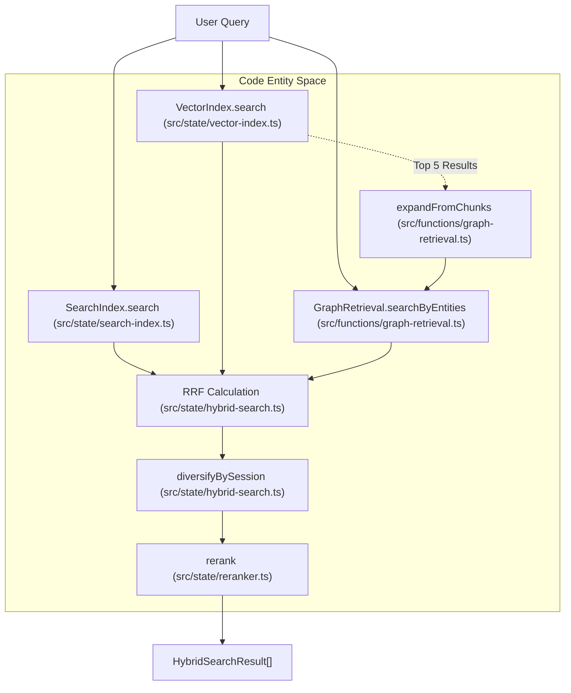
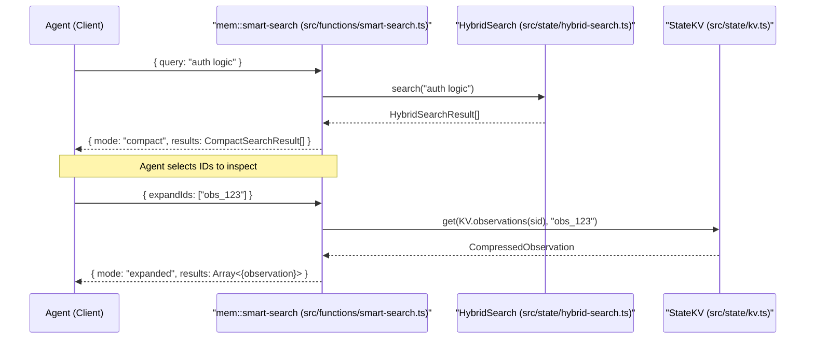

<!-- source: DeepWiki mcp.deepwiki.com · repo rohitg00/agentmemory · page 3.3 Hybrid Search & RRF Fusion · fetched 2026-10-30 -->

# Hybrid Search & RRF Fusion

Relevant source files

The following files were used as context for generating this wiki page:

- [src/config.ts](src/config.ts)
- [src/functions/context.ts](src/functions/context.ts)
- [src/functions/remember.ts](src/functions/remember.ts)
- [src/functions/search.ts](src/functions/search.ts)
- [src/functions/smart-search.ts](src/functions/smart-search.ts)
- [src/state/hybrid-search.ts](src/state/hybrid-search.ts)
- [src/state/memory-utils.ts](src/state/memory-utils.ts)
- [src/state/reranker.ts](src/state/reranker.ts)
- [src/state/search-index.ts](src/state/search-index.ts)
- [test/context-lessons.test.ts](test/context-lessons.test.ts)
- [test/env-loader.test.ts](test/env-loader.test.ts)
- [test/hybrid-search.test.ts](test/hybrid-search.test.ts)
- [test/reranker.test.ts](test/reranker.test.ts)
- [test/search-index.test.ts](test/search-index.test.ts)
- [test/search.test.ts](test/search.test.ts)

The `HybridSearch` class is the central engine for memory retrieval in `agentmemory`. It implements a triple-stream search architecture that combines lexical (BM25), semantic (Vector), and relational (Knowledge Graph) retrieval. These disparate result sets are unified using Reciprocal Rank Fusion (RRF) to provide a single, ranked list of memories.

### Triple Stream Search Execution

The core retrieval logic is encapsulated in the `tripleStreamSearch` method [src/state/hybrid-search.ts:81](). It executes three parallel retrieval paths to capture different facets of the user's query intent.

| Stream | Component | Mechanism | Strength |
| :--- | :--- | :--- | :--- |
| **Lexical** | `SearchIndex` | BM25 scoring on tokens and stems | Exact matches, file paths, and unique identifiers. |
| **Semantic** | `VectorIndex` | Cosine similarity on embeddings | Conceptual matches and paraphrases. |
| **Relational** | `GraphRetrieval` | Entity-based traversal and chunk expansion | Contextual relationships and multi-hop discovery. |

#### Data Flow: Triple Stream Retrieval
The following diagram illustrates how a single query is dispatched across the three search streams and then fused within the `HybridSearch` class.

Title: Triple Stream Search Architecture

Sources: [src/state/hybrid-search.ts:81-120](), [src/state/hybrid-search.ts:121-130](), [src/state/reranker.ts:34-70]()

### Reciprocal Rank Fusion (RRF)

To combine scores from different algorithms (which use different scales), `HybridSearch` employs Reciprocal Rank Fusion with a constant `RRF_K = 60` [src/state/hybrid-search.ts:20]().

The combined score for an observation $d$ is calculated as:
$$Score(d) = \sum_{s \in Streams} w_s \cdot \frac{1}{k + rank_s(d)}$$

Where:
*   $w_s$ is the weight assigned to the stream (BM25, Vector, or Graph) [src/state/hybrid-search.ts:30-32]().
*   $rank_s(d)$ is the 1-based rank of the document in that stream (or $\infty$ if not found) [src/state/hybrid-search.ts:146-196]().
*   $k$ is the smoothing constant `RRF_K` (60) [src/state/hybrid-search.ts:20]().

#### Weight Configuration
Weights are passed to the `HybridSearch` constructor and normalized during execution to ensure the total weight equals 1.0 [src/state/hybrid-search.ts:201-206](). The system also applies an `AGREEMENT_BONUS` of 0.05 for each additional stream that returns the same document [src/state/hybrid-search.ts:201](), [src/state/hybrid-search.ts:221]().

*   `bm25Weight`: Default 0.4 [src/state/hybrid-search.ts:30]().
*   `vectorWeight`: Default 0.6 [src/state/hybrid-search.ts:31]().
*   `graphWeight`: Default 0.3 [src/state/hybrid-search.ts:32]().

Sources: [src/state/hybrid-search.ts:201-224]()

### Query Expansion & Reranking

To improve recall and precision, the system supports LLM-driven query expansion and local cross-encoder reranking.

*   **Query Expansion**: The `searchWithExpansion` method handles multi-query execution by merging results from reformulations and temporal concretizations [src/state/hybrid-search.ts:42-60]().
*   **Temporal Concretization**: Resolves relative time expressions (e.g., "last week") into absolute ISO timestamps during expansion [src/state/hybrid-search.ts:50]().
*   **Entity Extraction**: Entities identified via `extractEntitiesFromQuery` (using regex for quotes and capitalized words) seed the `GraphRetrieval` stream [src/state/hybrid-search.ts:104-107]().
*   **Reranker**: If enabled via `RERANK_ENABLED` [src/state/hybrid-search.ts:33](), the system uses `Xenova/ms-marco-MiniLM-L-6-v2` to rerank the top candidates [src/state/reranker.ts:46-57](). It constructs query-document pairs and scores them using a local `text-classification` pipeline [src/state/reranker.ts:60-70]().
*   **Session Diversification**: The `diversifyBySession` method prevents a single high-activity session from dominating search results by capping results per session [src/state/hybrid-search.ts:225]().

Sources: [src/state/hybrid-search.ts:42-79](), [src/state/hybrid-search.ts:104-107](), [src/state/reranker.ts:34-70]()

### Progressive Disclosure Pattern

The `mem::smart-search` function implements a "Progressive Disclosure" pattern to manage the token budget of the calling agent [src/functions/smart-search.ts:75]().

1.  **Compact Mode**: Returns a list of results containing metadata: `obsId`, `title`, `type`, `score`, and `timestamp` [src/functions/smart-search.ts:179-240](). This allows the agent to see a broad overview without consuming large amounts of context.
2.  **Expanded Mode**: When the agent provides specific `expandIds`, the function retrieves the full `CompressedObservation` for those specific memories [src/functions/smart-search.ts:132-177](). It uses `findObservation` to fetch the detailed content from the KV store [src/functions/smart-search.ts:150-154]().

#### Smart Search Logic
The following diagram maps the `mem::smart-search` flow to the underlying `HybridSearch` and `StateKV` entities.

Title: Progressive Disclosure Search Flow

Sources: [src/functions/smart-search.ts:80-240](), [src/state/hybrid-search.ts:38-40]()

### Hybrid Ranking in Standard Search
While `mem::smart-search` is the primary interface for hybrid retrieval, the standard `mem::search` function can also use the hybrid ranker if one is registered via `setHybridRanker` [src/functions/search.ts:29-31](). This ensures that even legacy recall surfaces benefit from vector and graph streams [src/functions/search.ts:17-22]().

### Key Functions and Classes

| Entity | Role |
| :--- | :--- |
| `HybridSearch` | Orchestrates the three search streams and applies RRF [src/state/hybrid-search.ts:22](). |
| `tripleStreamSearch` | Private method executing BM25, Vector, and Graph retrieval [src/state/hybrid-search.ts:81](). |
| `rerank` | Uses a local transformer model to re-score retrieval candidates [src/state/reranker.ts:34](). |
| `mem::smart-search` | Registered SDK function for progressive disclosure [src/functions/smart-search.ts:80](). |
| `GraphRetrieval` | Entity-based retrieval and neighborhood expansion [src/functions/graph-retrieval.ts:14](). |
| `extractEntitiesFromQuery` | Regex-based utility for pulling entities from raw strings [src/functions/query-expansion.ts:132](). |
| `memoryToObservation` | Utility to transform long-term memories into the searchable observation shape [src/state/memory-utils.ts:11](). |

Sources: [src/state/hybrid-search.ts:22-36](), [src/functions/smart-search.ts:80-98](), [src/state/reranker.ts:34-42](), [src/state/memory-utils.ts:11-24]()

---

