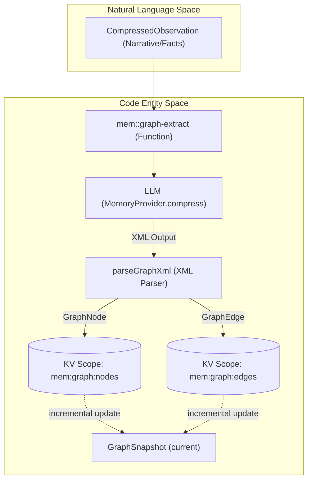
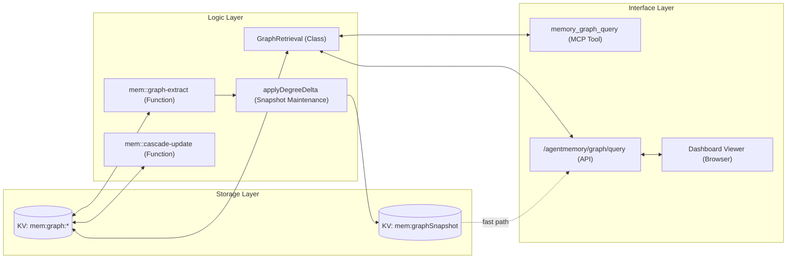

<!-- source: DeepWiki mcp.deepwiki.com · repo rohitg00/agentmemory · page 3.4 Knowledge Graph · fetched 2026-10-30 -->

# Knowledge Graph

Relevant source files

The following files were used as context for generating this wiki page:

- [src/functions/cascade.ts](src/functions/cascade.ts)
- [src/functions/graph-retrieval.ts](src/functions/graph-retrieval.ts)
- [src/functions/graph.ts](src/functions/graph.ts)
- [src/functions/relations.ts](src/functions/relations.ts)
- [src/functions/verify.ts](src/functions/verify.ts)
- [src/mcp/server.ts](src/mcp/server.ts)
- [src/mcp/tools-registry.ts](src/mcp/tools-registry.ts)
- [src/state/schema.ts](src/state/schema.ts)
- [test/graph-retrieval.test.ts](test/graph-retrieval.test.ts)
- [test/graph.test.ts](test/graph.test.ts)

The Knowledge Graph subsystem provides a structured, relational representation of information extracted from agent observations. Unlike flat vector embeddings or keyword indices, the graph captures explicit entities (files, functions, decisions) and the semantic or temporal relationships between them. This allows the system to perform multi-hop reasoning and context expansion during retrieval.

## Data Model: Nodes and Edges

The graph is composed of two primary primitives defined in the core type system: `GraphNode` and `GraphEdge`.

### GraphNode
Nodes represent discrete entities identified within the codebase or session narrative.
*   **Types**: `file`, `function`, `concept`, `error`, `decision`, `pattern`, `library`, `person`, `project`, `preference`, `location`, `organization`, `event` [src/functions/graph.ts:66]().
*   **Properties**: Arbitrary key-value pairs (e.g., `path`, `lang`) extracted from XML attributes [src/functions/graph.ts:58-63]().
*   **Metadata**: Tracks `sourceObservationIds` to link graph entities back to the raw evidence [src/functions/graph.ts:69]().
*   **Stale Flag**: Nodes can be marked as `stale: true`, which excludes them from active retrieval [src/functions/graph-retrieval.ts:49]().

### GraphEdge
Edges represent directed, weighted relationships between nodes.
*   **Relationship Types**: Includes `uses`, `imports`, `modifies`, `causes`, `fixes`, `depends_on`, `related_to`, `works_at`, `prefers`, `blocked_by`, `caused_by`, `optimizes_for`, `rejected`, `avoids`, `located_in`, `succeeded_by` [src/functions/graph.ts:85]().
*   **Weight**: A float from `0.1` to `1.0` representing relationship strength or directness [src/functions/graph.ts:90]().
*   **Temporal Fields**: Supports bi-temporal modeling via `tcommit` (system time), `tvalid` (when the fact became true), and `tvalidEnd` (when the fact ceased being true) [src/functions/graph-retrieval.ts:188-197]().

**Sources**: [src/functions/graph.ts:54-107](), [src/functions/graph-retrieval.ts:1-14](), [src/functions/graph-retrieval.ts:49-50](), [src/state/schema.ts:17-18]().

---

## Entity Extraction via mem::graph

The system populates the graph using LLM-based extraction triggered via the `mem::graph-extract` function.

### Extraction Flow
1.  **Input**: A collection of `CompressedObservation` objects [src/functions/graph.ts:340]().
2.  **Prompting**: The system uses `GRAPH_EXTRACTION_SYSTEM` and `buildGraphExtractionPrompt` to guide the LLM in producing XML-formatted entities and relationships [src/functions/graph.ts:345-359]().
3.  **LLM Processing**: The provider's `compress` method processes the narrative and facts into a graph structure [src/functions/graph.ts:356-359]().
4.  **Parsing**: `parseGraphXml` extracts XML tags like `<entity>` and `<relationship>`. The parser uses a robust regex-based approach to handle self-closing tags and reordered attributes (e.g., `name` before `type`) [src/functions/graph.ts:249-332]().
5.  **Deduplication & Merging**: When saving, the system checks for existing nodes by name and type using `nameIndexKey`. If found, it merges properties and appends new `sourceObservationIds` [src/functions/graph.ts:367-386]().

### Extraction Architecture
The following diagram illustrates the flow from natural language observations to the structured KV state.

**Graph Extraction Data Flow**

**Sources**: [src/functions/graph.ts:334-424](), [src/functions/graph.ts:249-332](), [test/graph.test.ts:135-163](), [src/state/schema.ts:17-25]().

---

## Retrieval and Dijkstra Traversal

The `GraphRetrieval` class handles searching the graph to find relevant context for queries.

### Dijkstra Traversal
The system implements a weighted shortest-path traversal in `dijkstraTraversal` to explore the neighborhood of matching nodes [src/functions/graph-retrieval.ts:230-235](). This replaced a simpler BFS to ensure that high-weight chains are prioritized over weak direct edges.
*   **Cost Function**: The cost of an edge is calculated as `1 / weight`. Dijkstra selects the path with the minimum total cost [src/functions/graph-retrieval.ts:247-248]().
*   **Max Depth**: Typically defaults to 2, allowing for discovery of indirect relationships [src/functions/graph-retrieval.ts:46]().
*   **Path Scoring**: The score is calculated as `avgWeight * (1 / pathLength)`. Shorter paths and stronger edge weights result in higher relevance scores [src/functions/graph-retrieval.ts:88]().

### Retrieval Methods
| Method | Purpose | Implementation |
| :--- | :--- | :--- |
| `searchByEntities` | Finds nodes matching keywords and traverses their neighbors using Dijkstra. | [src/functions/graph-retrieval.ts:44-115]() |
| `expandFromChunks` | Takes existing observation IDs and finds related entities to pull in more context. | [src/functions/graph-retrieval.ts:117-156]() |
| `temporalQuery` | Filters the graph state based on a specific `asOf` timestamp. | [src/functions/graph-retrieval.ts:158-206]() |

**Sources**: [src/functions/graph-retrieval.ts:41-115](), [src/functions/graph-retrieval.ts:230-235](), [test/graph-retrieval.test.ts:192-204]().

---

## Temporal Modeling

The knowledge graph supports bi-temporal modeling, allowing the agent to understand how relationships have changed over time.

1.  **System Time (`tcommit`)**: The timestamp when the fact was recorded in the database [src/functions/graph-retrieval.ts:188]().
2.  **Valid Time (`tvalid` / `tvalidEnd`)**: The period during which the fact was true in the real world [src/functions/graph-retrieval.ts:190-197]().
3.  **Version Tracking**: The system uses an `isLatest` flag for edges. When a relationship is updated, the newest edge is prioritized in `getLatestEdges` [src/functions/graph-retrieval.ts:208-228]().
4.  **Point-in-Time Recovery**: The `temporalQuery` method can reconstruct the graph state as it existed at any `asOf` date by filtering against `tcommit`, `tvalid`, and `tvalidEnd` [src/functions/graph-retrieval.ts:186-205]().

**Sources**: [src/functions/graph-retrieval.ts:158-228](), [test/graph-retrieval.test.ts:142-159](), [src/state/schema.ts:62]().

---

## Integration and Snapshot System

### Graph Snapshot & Viewer
To support high-performance visualization in the dashboard without timing out the engine, the system maintains a `GraphSnapshot` [src/functions/graph.ts:62-77]().
*   **Snapshotting**: `buildSnapshotFromArrays` ranks nodes by degree and stores the top `SNAPSHOT_TOP_NODES` (default 500) [src/functions/graph.ts:94-141]().
*   **Incremental Updates**: `applyDegreeDelta` mutates the snapshot in real-time as new edges are extracted, maintaining the top-N ranking without a full re-scan [src/functions/graph.ts:204-247]().
*   **Live Budget**: `mem::graph-query` races live enumeration against a 6000ms budget, falling back to the snapshot if the corpus is too large [src/functions/graph.ts:41-59](), [src/functions/graph.ts:456-464]().

### Maintenance and Cascade
When a memory is superseded, the `mem::cascade-update` function identifies graph components derived from the old memory's observations and marks them as `stale` to prevent them from appearing in future search results [src/functions/cascade.ts:27-59]().

**Graph Integration Architecture**

**Sources**: [src/functions/graph.ts:24-41](), [src/functions/graph.ts:94-141](), [src/functions/graph.ts:204-247](), [src/functions/cascade.ts:8-59](), [src/state/schema.ts:25-40]().

---

