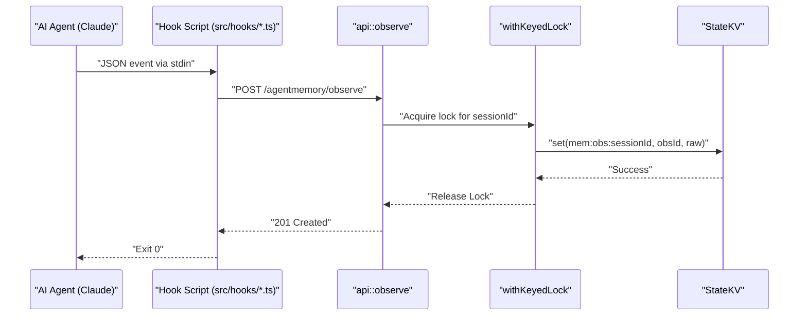

<!-- source: DeepWiki mcp.deepwiki.com · repo rohitg00/agentmemory · page 4 API & Integration Interfaces · fetched 2026-10-30 -->

# API & Integration Interfaces

<details>
<summary>Relevant source files</summary>

The following files were used as context for generating this wiki page:

- [AGENTS.md](AGENTS.md)
- [README.md](README.md)
- [src/cli.ts](src/cli.ts)
- [src/functions/graph.ts](src/functions/graph.ts)
- [src/index.ts](src/index.ts)
- [src/mcp/server.ts](src/mcp/server.ts)
- [src/mcp/tools-registry.ts](src/mcp/tools-registry.ts)
- [src/state/schema.ts](src/state/schema.ts)
- [src/triggers/api.ts](src/triggers/api.ts)
- [src/viewer/index.html](src/viewer/index.html)
- [test/graph.test.ts](test/graph.test.ts)

</details>


The `agentmemory` system provides three distinct layers for external interaction, ranging from standard web protocols to deep lifecycle integration with AI agents. These interfaces allow developers to query memories, agents to manage their own state, and platforms to automate context injection.

### Interface Overview

1.  **REST API**: A standard HTTP interface for programmatic access to the memory engine, session management, and system health. It exposes over 130 endpoints [AGENTS.md:120-120]().
2.  **MCP Server**: An implementation of the Model Context Protocol, exposing 54+ memory tools, 6 resources, and 3 prompts directly to LLMs [AGENTS.md:119-121]().
3.  **Claude Plugin & Hooks**: A set of 12 native lifecycle hooks that intercept agent events to automate the memory pipeline [AGENTS.md:122-122]().

### Integration Architecture

The following diagram illustrates how external entities interact with the core `iii-engine` through these three interfaces.

**Interface Mapping to Code Entities**
```mermaid
graph TD
    subgraph "External_Entities"
        [Web_Dashboard]
        [Claude_Code]
        [Custom_App]
        [MCP_Client]
    end

    subgraph "Interface_Layer"
        ["registerApiTriggers"]
        ["registerMcpEndpoints"]
        ["mcp::tools::call"]
        ["hooks.json"]
    end

    subgraph "Core_Engine"
        ["mem::observe"]
        ["mem::search"]
        ["StateKV"]
    end

    [Web_Dashboard] -- "HTTP/JSON" --> ["registerApiTriggers"]
    [Custom_App] -- "Bearer Token" --> ["registerApiTriggers"]
    [Claude_Code] -- "JSON-RPC" --> ["registerMcpEndpoints"]
    [Claude_Code] -- "Lifecycle Events" --> ["hooks.json"]
    [MCP_Client] -- "Stdio/JSON-RPC" --> ["mcp::tools::call"]

    ["registerApiTriggers"] -- "sdk.trigger" --> ["mem::observe"]
    ["registerMcpEndpoints"] -- "sdk.trigger" --> ["mem::search"]
    ["mcp::tools::call"] -- "sdk.trigger" --> ["mem::search"]
    ["hooks.json"] -- "Spawn Node Process" --> [scripts]
    [scripts] -- "HTTP POST" --> ["registerApiTriggers"]
```
Sources: [src/triggers/api.ts:140-146](), [src/mcp/server.ts:43-47](), [src/mcp/server.ts:74-88](), [src/index.ts:94-96]()

---

### REST API Reference
The REST API is the primary gateway for administrative tasks and custom application integrations. It is hosted by the `iii-engine` and provides 130 endpoints [AGENTS.md:120-120]().

*   **Authentication**: Secured via `middleware::api-auth` using `timingSafeCompare` against a `Bearer` token [src/triggers/api.ts:147-166]().
*   **Core Endpoints**:
    *   `GET /agentmemory/livez`: Liveness probe for health monitoring [src/triggers/api.ts:181-191]().
    *   `POST /agentmemory/remember`: Explicitly saves an insight or fact [src/mcp/server.ts:168-201]().
    *   `POST /agentmemory/smart-search`: Performs hybrid semantic+keyword search with progressive disclosure [src/mcp/server.ts:128-142]().
    *   `GET /agentmemory/config-flags`: Returns current runtime configuration status (e.g., `GRAPH_EXTRACTION_ENABLED`) [src/triggers/api.ts:193-207]().

For details, see [REST API Reference](#4.1).

---

### MCP Server
The Model Context Protocol (MCP) server allows AI agents to "see" `agentmemory` as native capabilities. 

*   **Standalone Mode**: The CLI provides an `mcp` command to start the server [src/cli.ts:187-188]().
*   **Tool Registry**: 54 tools are available, including 8 visible by default [AGENTS.md:119-119]().
*   **Key Tools**: Includes `memory_recall` for search [src/mcp/tools-registry.ts:13-38](), `memory_save` for manual persistence [src/mcp/tools-registry.ts:55-95](), and `memory_vision_search` for CLIP-based image retrieval [src/mcp/tools-registry.ts:144-157]().

For details, see [MCP Server](#4.2).

---

### Claude Plugin & Lifecycle Hooks
The plugin architecture enables passive memory management by intercepting agent lifecycle events.

*   **Event Interception**: 12 lifecycle hooks (e.g., `SessionStart`, `PreToolUse`, `TaskCompleted`) automate observation capture [AGENTS.md:122-122]().
*   **Hook Execution**: Hooks are standalone scripts that read JSON from `stdin` and POST to the REST API [AGENTS.md:93-94]().
*   **Resilience**: Context-injecting hooks use `AbortSignal.timeout()` to prevent agent hangs [AGENTS.md:96-97]().

**Hook Observation Flow**

Sources: [src/triggers/api.ts:3-5](), [src/state/keyed-mutex.ts:3-10](), [AGENTS.md:93-97]()

For details, see [Claude Plugin & Lifecycle Hooks](#4.3).

---

### Third-Party Agent Integrations
`agentmemory` supports a wide range of agent frameworks beyond Claude Code:

*   **Supported Adapters**: GitHub Copilot CLI, Cursor, Gemini CLI, Codex CLI, Hermes, OpenClaw, pi, and OpenCode [README.md:10-10]().
*   **CLI Connectivity**: The `agentmemory connect [agent]` command automates the wiring of MCP and hooks [src/cli.ts:173-176]().
*   **Shared Context**: All integrations share the same underlying memory server via shared `AGENTMEMORY_URL` and `AGENTMEMORY_SECRET` configuration [src/cli.ts:87-91]().

For details, see [Third-Party Agent Integrations](#4.4).

---

