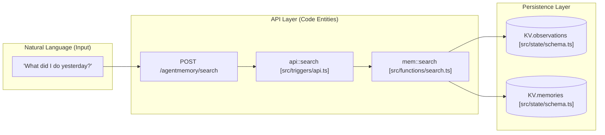
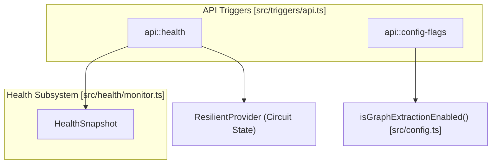

<!-- source: DeepWiki mcp.deepwiki.com · repo rohitg00/agentmemory · page 4.1 REST API Reference · fetched 2026-10-30 -->

# REST API Reference

<details>
<summary>Relevant source files</summary>

The following files were used as context for generating this wiki page:

- [AGENTS.md](AGENTS.md)
- [README.md](README.md)
- [src/cli.ts](src/cli.ts)
- [src/functions/audit.ts](src/functions/audit.ts)
- [src/functions/claude-bridge.ts](src/functions/claude-bridge.ts)
- [src/functions/context.ts](src/functions/context.ts)
- [src/functions/governance.ts](src/functions/governance.ts)
- [src/index.ts](src/index.ts)
- [src/triggers/api.ts](src/triggers/api.ts)
- [src/viewer/index.html](src/viewer/index.html)
- [test/audit.test.ts](test/audit.test.ts)
- [test/auto-forget.test.ts](test/auto-forget.test.ts)
- [test/claude-bridge.test.ts](test/claude-bridge.test.ts)
- [test/context-lessons.test.ts](test/context-lessons.test.ts)
- [test/governance.test.ts](test/governance.test.ts)
- [test/remember-forget-audit.test.ts](test/remember-forget-audit.test.ts)
- [test/retention.test.ts](test/retention.test.ts)

</details>


The `agentmemory` REST API provides a comprehensive interface for managing agent sessions, capturing observations, retrieving context, and performing complex memory operations. All endpoints are prefixed with `/agentmemory/` and are registered as HTTP triggers within the `iii-sdk` framework [src/triggers/api.ts:187-191](). As of version 0.9.29, the system exposes 130 REST endpoints [AGENTS.md:120]().

## Authentication & Middleware

Access to the REST API is secured via a `Bearer` token mechanism. The system uses a middleware-based approach to ensure consistency across all endpoints.

### Implementation Details
- **CheckAuth Function**: An internal utility `checkAuth` validates incoming requests by comparing the `Authorization` header against the configured `AGENTMEMORY_SECRET` using `timingSafeCompare` [src/triggers/api.ts:41-54]().
- **Middleware Trigger**: The `middleware::api-auth` function is registered to handle authentication logic for the engine's request pipeline, returning a `401 Unauthorized` response on failure [src/triggers/api.ts:148-166]().
- **Timing Safe Comparison**: To prevent timing attacks, the system uses `timingSafeCompare` which ensures comparison time is independent of the input values by comparing HMAC digests [src/auth.ts:6-10]().
- **Header Format**: `Authorization: Bearer <secret>`.
- **Enforcement**: If `AGENTMEMORY_SECRET` is not set, authentication is bypassed for local development, but specific features like `mesh::sync` or `config-flags` require a secret to be configured [src/triggers/api.ts:56-65]().

**Auth Flow Diagram**
```mermaid
graph TD
    subgraph "Request_Pipeline [src/triggers/api.ts]"
    A["Incoming HTTP Request"] --> B["middleware::api-auth"]
    B --> C{ "secret defined?" }
    C -- "No" --> D["Return action: continue"]
    C -- "Yes" --> E["Extract 'authorization' Header"]
    E --> F["timingSafeCompare(auth, 'Bearer secret')"]
    F -- "Match" --> D
    F -- "Mismatch" --> G["Return 401 Unauthorized"]
    end
```
Sources: [src/triggers/api.ts:41-54](), [src/triggers/api.ts:148-166](), [src/auth.ts:1-10]()

---

## Session Management

Sessions represent a continuous period of agent activity within a specific project directory.

| Endpoint | Method | Underlying Function | Description |
| :--- | :--- | :--- | :--- |
| `/agentmemory/session/start` | `POST` | `event::session::started` | Initializes a new session and returns initial project context [src/triggers/events.ts:11-46](). |
| `/agentmemory/session/end` | `POST` | `event::session::ended` | Marks a session as `completed` and sets `endedAt` [src/triggers/events.ts:107-120](). |
| `/agentmemory/sessions` | `GET` | `api::sessions` | Lists all known sessions stored in `KV.sessions` [src/triggers/api.ts:625](). |

### Start Session Logic
When a session starts, the system:
1. Generates a new `Session` object with `status: "active"` and optional `agentId` [src/triggers/events.ts:23-31]().
2. Persists it to the `KV.sessions` namespace [src/triggers/events.ts:32]().
3. Triggers `mem::context` to provide the agent with relevant historical data immediately [src/triggers/events.ts:33-43]().

Sources: [src/triggers/events.ts:11-51](), [src/state/schema.ts:4](), [src/triggers/api.ts:620-630]()

---

## Observation & Context

These endpoints facilitate the "Capture" and "Retrieve" stages of the memory pipeline.

### Capture Observation
- **Endpoint**: `POST /agentmemory/observe`
- **Function**: `api::observe` invokes `mem::observe` [src/triggers/api.ts:356-359]().
- **Payload**: Accepts a `HookPayload` containing `hookType`, `sessionId`, and `data`.
- **Deduplication**: Uses `DedupMap` to prevent redundant storage of identical tool calls [src/index.ts:100]().

### Retrieve Context
- **Endpoint**: `POST /agentmemory/context`
- **Function**: `api::context` invokes `mem::context` [src/triggers/api.ts:378-381]().
- **Usage**: Used by `pre-compact` lifecycle hooks to inject relevant memories, lessons, and profiles into the agent's context window [src/functions/context.ts:39-45]().

**Data Flow: Natural Language Space to Code Entity Space**

Sources: [src/triggers/api.ts:346-387](), [src/functions/context.ts:11-45](), [src/state/schema.ts:3-7]()

---

## Search & Discovery

The API provides two primary ways to search through stored memories.

### Standard Search
- **Endpoint**: `POST /agentmemory/search`
- **Body**: `{ "query": string, "limit"?: number, "format"?: "full" | "compact" | "narrative" }`
- **Behavior**: Executes `mem::search` which performs keyword (BM25) and vector matching [src/triggers/api.ts:404-408]().

### Smart Search
- **Endpoint**: `POST /agentmemory/smart-search`
- **Behavior**: Executes `mem::smart-search`, which performs query expansion and multi-stream fusion [src/triggers/api.ts:429-433]().

Sources: [src/triggers/api.ts:392-439](), [src/index.ts:35-52]()

---

## Health & Monitoring

The API exposes endpoints for monitoring system stability and configuration.

### Health Check
- **Endpoint**: `GET /agentmemory/health`
- **Response**: Returns a `HealthSnapshot` including CPU usage, memory usage, and the current state of the LLM `CircuitBreaker` [src/triggers/api.ts:304-326]().
- **Status Codes**: Returns `503` if the health status is `critical`, otherwise `200` [src/triggers/api.ts:300]().

### Liveness & Config
- **`/agentmemory/livez`**: Simple ping to verify the HTTP server is up and report the viewer port [src/triggers/api.ts:181-186]().
- **`/agentmemory/config-flags`**: Returns the status of feature flags like `GRAPH_EXTRACTION_ENABLED`, `CONSOLIDATION_ENABLED`, and `AGENTMEMORY_SLOTS` [src/triggers/api.ts:193-204]().

**Health Monitoring Architecture**

Sources: [src/triggers/api.ts:178-339](), [src/health/monitor.ts:98](), [src/config.ts:10-25]()

---

## Governance & Audit

The system tracks all deletions and structural changes via an audit log stored in `KV.audit` [src/functions/audit.ts:53]().

| Endpoint | Method | Underlying Function | Description |
| :--- | :--- | :--- | :--- |
| `/agentmemory/governance/delete` | `POST` | `mem::governance-delete` | Manual deletion of specific memories with reason [src/functions/governance.ts:11-52](). |
| `/agentmemory/governance/bulk` | `POST` | `mem::governance-bulk` | Filtered bulk deletion (by type, date, quality) [src/functions/governance.ts:54-165](). |
| `/agentmemory/audit/query` | `POST` | `mem::audit-query` | Query the audit log for specific operations [src/functions/governance.ts:167-176](). |

Sources: [src/functions/audit.ts:34-55](), [src/functions/governance.ts:10-177](), [src/types.ts:1-50]()

---

## Memory Lifecycle & Graph Operations

| Endpoint | Method | Underlying Function | Description |
| :--- | :--- | :--- | :--- |
| `/agentmemory/remember` | `POST` | `mem::remember` | Promotes data to long-term memory [src/triggers/api.ts:444](). |
| `/agentmemory/forget` | `POST` | `mem::forget` | Delete memories or purge session data [src/triggers/api.ts:465](). |
| `/agentmemory/evolve` | `POST` | `mem::evolve` | Update memories with cascading changes [src/triggers/api.ts:486](). |
| `/agentmemory/graph/query` | `POST` | `mem::graph` | Query the knowledge graph (Nodes/Edges) [src/triggers/api.ts:743](). |
| `/agentmemory/consolidate` | `POST` | `mem::consolidate` | Manually trigger memory consolidation [src/triggers/api.ts:721](). |

Sources: [src/triggers/api.ts:440-496](), [src/triggers/api.ts:710-755]()

---

## Slots & Persistence

Memory slots provide pinned context for specific roles or projects [src/functions/slots.ts:32]().

| Endpoint | Method | Underlying Function | Description |
| :--- | :--- | :--- | :--- |
| `/agentmemory/slots` | `GET` | `mem::slot-list` | Lists all memory slots [src/triggers/api.ts:1003](). |
| `/agentmemory/slot/get` | `POST` | `mem::slot-get` | Retrieves a specific slot by label [src/triggers/api.ts:1019](). |
| `/agentmemory/slot/update` | `POST` | `mem::slot-update` | Updates content of a memory slot [src/triggers/api.ts:1051](). |

Sources: [src/triggers/api.ts:990-1070](), [src/functions/slots.ts:32]()

---

## Mesh & Synchronization

These endpoints support P2P mesh networking and external bridge synchronization.

- **`/agentmemory/mesh/sync`**: Triggers a synchronization event with configured peers using `mem::mesh` [src/triggers/api.ts:969]().
- **`/agentmemory/mesh/peers`**: Returns the list of registered mesh peers from `KV.mesh` [src/triggers/api.ts:992]().
- **`/agentmemory/claude-bridge/sync`**: Synchronizes memory state with the local `MEMORY.md` file [src/triggers/api.ts:696]().

Sources: [src/triggers/api.ts:685-706](), [src/triggers/api.ts:958-998]()

---

## Web Viewer & Dashboard

The API serves the administrative dashboard and provides a real-time data stream.

- **Endpoint**: `GET /agentmemory/viewer`
- **Function**: `api::viewer` serves the dashboard via `renderViewerDocument` [src/triggers/api.ts:1099]().
- **Security**: The viewer includes a strict Content Security Policy (CSP) to mitigate script execution risks [src/viewer/index.html:8-15]().
- **Real-time Stream**: The viewer connects to the `mem-live` stream to receive real-time updates of observations [src/index.ts:98]().

Sources: [src/triggers/api.ts:1086-1108](), [src/viewer/server.ts:14](), [src/viewer/index.html:1-51]()

---

