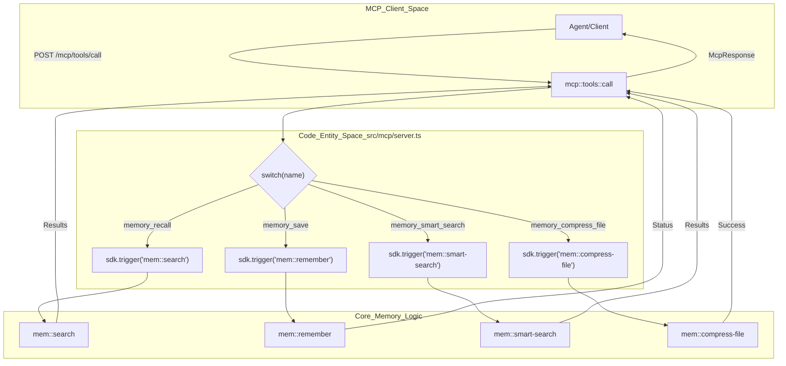
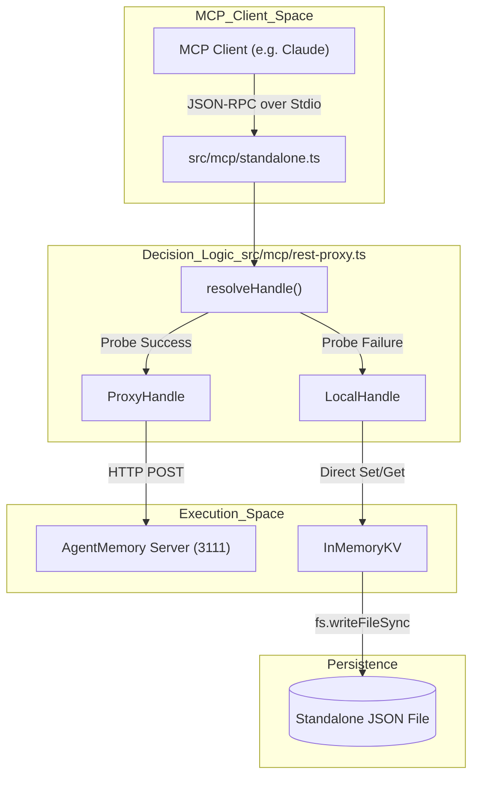

<!-- source: DeepWiki mcp.deepwiki.com · repo rohitg00/agentmemory · page 4.2 MCP Server · fetched 2026-10-30 -->

# MCP Server

Relevant source files

The following files were used as context for generating this wiki page:

- [src/functions/graph.ts](src/functions/graph.ts)
- [src/mcp/rest-proxy.ts](src/mcp/rest-proxy.ts)
- [src/mcp/server.ts](src/mcp/server.ts)
- [src/mcp/standalone.ts](src/mcp/standalone.ts)
- [src/mcp/tools-registry.ts](src/mcp/tools-registry.ts)
- [src/mcp/transport.ts](src/mcp/transport.ts)
- [src/state/schema.ts](src/state/schema.ts)
- [test/confidence.test.ts](test/confidence.test.ts)
- [test/enrich.test.ts](test/enrich.test.ts)
- [test/graph.test.ts](test/graph.test.ts)
- [test/mcp-env-placeholder.test.ts](test/mcp-env-placeholder.test.ts)
- [test/mcp-prompts.test.ts](test/mcp-prompts.test.ts)
- [test/mcp-resources.test.ts](test/mcp-resources.test.ts)
- [test/mcp-standalone-proxy.test.ts](test/mcp-standalone-proxy.test.ts)
- [test/mcp-standalone.test.ts](test/mcp-standalone.test.ts)
- [test/mcp-surface-default.test.ts](test/mcp-surface-default.test.ts)
- [test/mcp-transport.test.ts](test/mcp-transport.test.ts)

The Model Context Protocol (MCP) server implementation in `agentmemory` provides a standardized interface for AI models (like Claude) to interact with the memory system. It exposes the core memory capabilities through a rich set of 53+ tools, 6 resources, and 3 prompts, allowing agents to perform semantic searches, save insights, manage long-term persistence, and query the knowledge graph.

## Architecture & Implementation

The MCP server is implemented as a set of functions registered with the `iii-sdk` and exposed via HTTP triggers [src/mcp/server.ts:61-72](). It follows a command-pattern where tool calls, resource requests, and prompt lookups are routed through centralized handlers.

The system supports two primary modes:
1.  **Standard Mode**: Integrated into the main `agentmemory` worker, utilizing the full `StateKV` layer and `ResilientProvider` [src/mcp/server.ts:43-47]().
2.  **Standalone Mode**: A lightweight binary (`src/mcp/standalone.ts`) that can run independently, proxying calls to a remote server or falling back to a local `InMemoryKV` store [src/mcp/standalone.ts:1-38]().

### Data Flow: Tool Execution
When an agent calls a tool (e.g., `memory_recall`), the request flows from the MCP client to the `mcp::tools::call` function. The server then dispatches this to the internal `mem::*` functions via the `sdk.trigger()` system [src/mcp/server.ts:124-130]().

Title: MCP Tool Call Flow

Sources: [src/mcp/server.ts:74-85](), [src/mcp/server.ts:124-130](), [src/mcp/server.ts:149-165](), [src/mcp/server.ts:190-202](), [src/mcp/server.ts:223-228]()

## Tools Registry

The system provides 53+ tools categorized into Core, v0.4.0 (Advanced), and Specialized sets. By default, the full surface is visible unless restricted via the `AGENTMEMORY_TOOLS` environment variable [src/mcp/tools-registry.ts:11-26](), [test/mcp-surface-default.test.ts:23-28]().

### Core Tools
These provide the fundamental interaction layer for memory management.

| Tool Name | Description | Key Parameters |
| :--- | :--- | :--- |
| `memory_recall` | Search past session observations for relevant context. | `query`, `limit`, `format`, `token_budget` |
| `memory_save` | Save an explicit insight or pattern to long-term memory. | `content`, `type`, `concepts`, `files`, `project` |
| `memory_smart_search` | Hybrid semantic+keyword search with progressive disclosure. | `query`, `expandIds`, `limit` |
| `memory_file_history` | Retrieve observations filtered by file paths. | `files`, `sessionId` |
| `memory_patterns` | Detect recurring patterns across sessions. | `project` |
| `memory_vision_search` | Cross-modal image search via CLIP embeddings. | `queryText`, `queryImageRef`, `queryImageBase64` |
| `memory_compress_file` | Compress a markdown file to reduce token usage. | `filePath` |

Sources: [src/mcp/tools-registry.ts:11-157](), [src/mcp/server.ts:89-203]()

### Advanced & Integration Tools
Tools introduced in later versions focus on knowledge graphs, team collaboration, and task orchestration.

| Tool Name | Description | Key Parameters |
| :--- | :--- | :--- |
| `memory_graph_query` | Query entities and relations via BFS traversal. | `startNodeId`, `maxDepth` |
| `memory_consolidate` | Manually trigger the 4-tier consolidation pipeline. | `tier` |
| `memory_mesh_sync` | Synchronize data with P2P mesh peers. | `peerId`, `direction` |
| `memory_verify` | Verify the integrity of the memory indices. | - |
| `memory_governance_delete` | Targeted deletion of memories for governance/privacy. | `memoryIds`, `reason` |
| `memory_action_create` | Create a new orchestrated action/task. | `title`, `description` |

Sources: [src/mcp/tools-registry.ts:196-222](), [src/mcp/server.ts:316-330](), [src/mcp/standalone.ts:169-175]()

## Resources

Resources allow agents to "read" state as if it were a file system. The server exposes primary resource URIs for introspection.

| URI Pattern | Description | Implementation |
| :--- | :--- | :--- |
| `agentmemory://status` | System health and session counts. | Lists `KV.sessions` [src/state/schema.ts:5]() |
| `agentmemory://project/{name}/profile` | Top concepts and file patterns for a project. | Triggers `mem::profile` [src/state/schema.ts:15]() |
| `agentmemory://graph/stats` | Node/Edge counts and density metrics. | Lists `KV.graphNodes/Edges` [src/state/schema.ts:17-18]() |
| `agentmemory://graph/snapshot` | Top-degree subgraph for visualization. | Reads `KV.graphSnapshot` [src/state/schema.ts:25]() |

Sources: [src/mcp/server.ts:488-600](), [src/state/schema.ts:5-25](), [src/functions/graph.ts:28-35]()

## Prompts

Prompts provide pre-configured templates for complex memory operations.

1.  **`recall_context`**: Used at the start of a task to pull relevant past memories and observations.
2.  **`session_handoff`**: Generates a summary of a specific session to pass context between different agent instances.
3.  **`detect_patterns`**: Guides the agent in analyzing file co-occurrence and recurring architectural decisions.

Sources: [src/mcp/server.ts:643-745]()

## Standalone Server & Proxying

The standalone MCP binary (`src/mcp/standalone.ts`) allows MCP clients to connect via `stdio` using JSON-RPC 2.0 [src/mcp/transport.ts:1-6](). It uses a `resolveHandle` mechanism to determine its operation mode [src/mcp/rest-proxy.ts:115-125]().

*   **Proxy Mode**: If `AGENTMEMORY_URL` (default `http://localhost:3111`) is reachable via a `livez` probe, it proxies tool calls to the REST API [src/mcp/rest-proxy.ts:136-161]().
*   **Local Mode**: If the server is unreachable, it falls back to a local `InMemoryKV` store persisted to a JSON file [src/mcp/standalone.ts:59-64](), [src/mcp/in-memory-kv.ts:1-20]().

Title: MCP Standalone Operation

Sources: [src/mcp/standalone.ts:38](), [src/mcp/rest-proxy.ts:92-108](), [src/mcp/rest-proxy.ts:136-166](), [test/mcp-standalone-proxy.test.ts:170-181]()

## Security & Authentication

The MCP server implements authentication to protect sensitive memory data.

1.  **checkAuth**: Validates the `Authorization` header using `timingSafeCompare` against the configured secret [src/mcp/server.ts:48-59]().
2.  **Bearer Token**: The standalone server forwards the `AGENTMEMORY_SECRET` as a Bearer token when proxying requests [src/mcp/rest-proxy.ts:52-55]().
3.  **Environment Guards**: `resolveEnvOrEmpty` prevents literal `${VAR}` placeholders from being used as valid URLs if the environment variable was not expanded by the host [src/mcp/rest-proxy.ts:41-46]().

Sources: [src/mcp/server.ts:48-59](), [src/mcp/rest-proxy.ts:52-55](), [src/mcp/rest-proxy.ts:41-46]()

---

