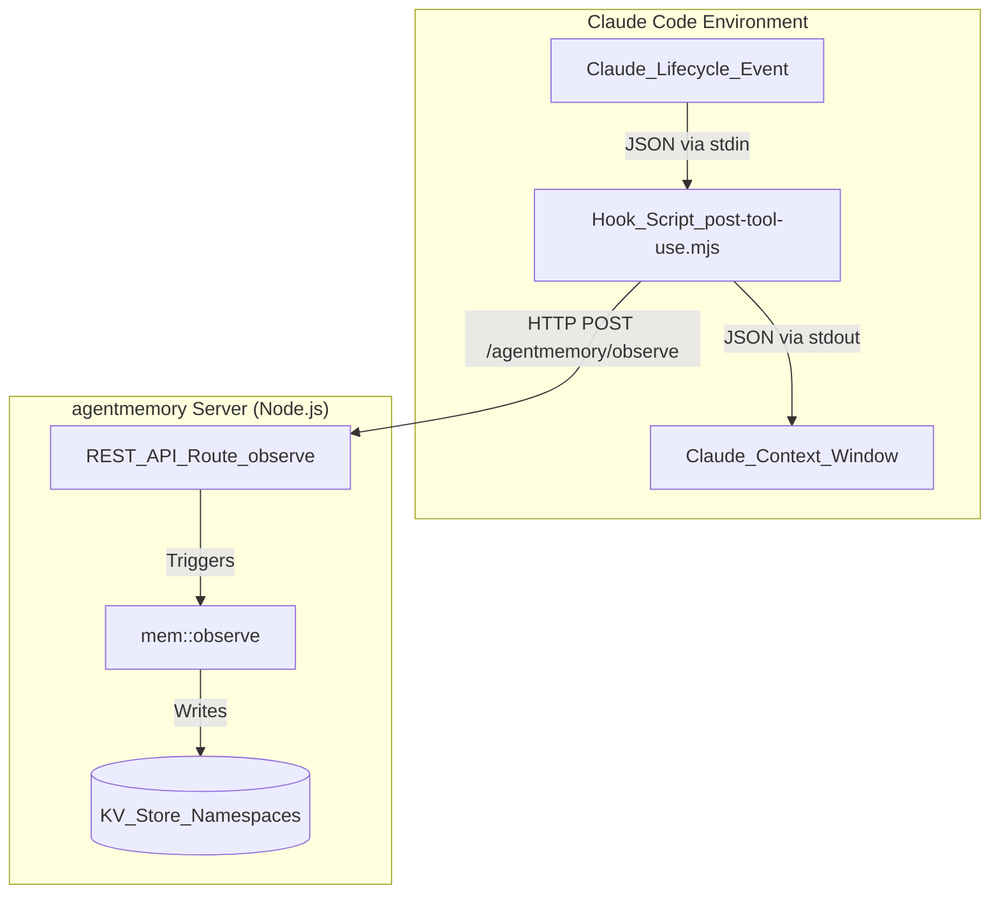
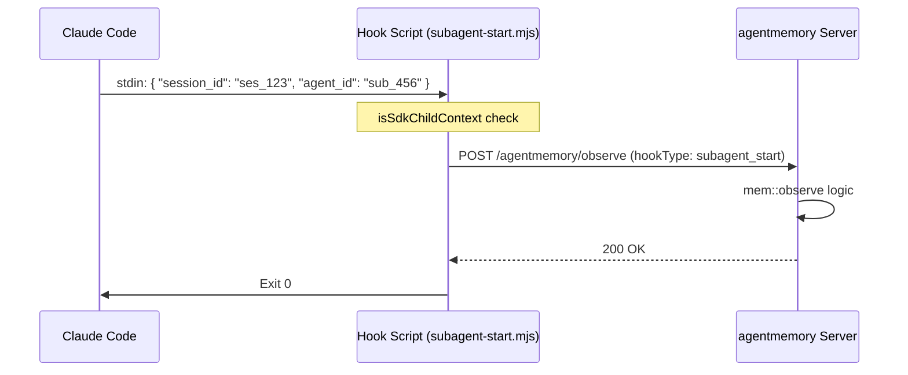

<!-- source: DeepWiki mcp.deepwiki.com · repo rohitg00/agentmemory · page 4.3 Claude Plugin & Lifecycle Hooks · fetched 2026-10-30 -->

# Claude Plugin & Lifecycle Hooks

Relevant source files

The following files were used as context for generating this wiki page:

- [.claude-plugin/marketplace.json](.claude-plugin/marketplace.json)
- [.codex-plugin/marketplace.json](.codex-plugin/marketplace.json)
- [plugin/.mcp.json](plugin/.mcp.json)
- [plugin/hooks/hooks.codex.json](plugin/hooks/hooks.codex.json)
- [plugin/hooks/hooks.json](plugin/hooks/hooks.json)
- [plugin/scripts/notification.mjs](plugin/scripts/notification.mjs)
- [plugin/scripts/post-tool-failure.mjs](plugin/scripts/post-tool-failure.mjs)
- [plugin/scripts/post-tool-use.mjs](plugin/scripts/post-tool-use.mjs)
- [plugin/scripts/pre-compact.mjs](plugin/scripts/pre-compact.mjs)
- [plugin/scripts/pre-tool-use.mjs](plugin/scripts/pre-tool-use.mjs)
- [plugin/scripts/prompt-submit.mjs](plugin/scripts/prompt-submit.mjs)
- [plugin/scripts/session-end.mjs](plugin/scripts/session-end.mjs)
- [plugin/scripts/session-start.mjs](plugin/scripts/session-start.mjs)
- [plugin/scripts/stop.mjs](plugin/scripts/stop.mjs)
- [plugin/scripts/subagent-start.mjs](plugin/scripts/subagent-start.mjs)
- [plugin/scripts/subagent-stop.mjs](plugin/scripts/subagent-stop.mjs)
- [plugin/scripts/task-completed.mjs](plugin/scripts/task-completed.mjs)
- [src/cli/connect/util.ts](src/cli/connect/util.ts)
- [src/hooks/post-tool-use.ts](src/hooks/post-tool-use.ts)
- [src/hooks/pre-compact.ts](src/hooks/pre-compact.ts)
- [src/hooks/pre-tool-use.ts](src/hooks/pre-tool-use.ts)
- [src/hooks/prompt-submit.ts](src/hooks/prompt-submit.ts)
- [src/hooks/session-end.ts](src/hooks/session-end.ts)
- [src/hooks/session-start.ts](src/hooks/session-start.ts)
- [src/hooks/stop.ts](src/hooks/stop.ts)
- [src/hooks/subagent-start.ts](src/hooks/subagent-start.ts)
- [src/hooks/task-completed.ts](src/hooks/task-completed.ts)
- [test/codex-plugin.test.ts](test/codex-plugin.test.ts)

This page describes the Claude plugin architecture for `agentmemory`. It details how the system integrates with the Claude Code lifecycle via 12 specific hooks, the metadata configuration that enables this integration, the communication pattern used to inject memory-derived context, and the post-session consolidation workflows.

## Plugin Architecture

The `agentmemory` plugin is a set of executable scripts that the Claude environment invokes at specific lifecycle stages. This integration is governed by manifest files that map agent events to Node.js scripts.

### Plugin Metadata (`plugin.json`)
The manifest at `plugin/.codex-plugin/plugin.json` defines the plugin's identity and references its capabilities.
*   **Identity**: Name is set to `agentmemory` with a version matching the main `package.json` [test/codex-plugin.test.ts:39-60]().
*   **References**: Points to the skills directory, MCP server configuration, and the hooks mapping file [test/codex-plugin.test.ts:63-70]().

### Hooks Mapping (`hooks.json`)
The system maps Claude's internal lifecycle events to specific scripts. These scripts are compiled from TypeScript source files in `src/hooks/` to ESM modules in `plugin/scripts/` using `tsdown` [test/codex-plugin.test.ts:28-31]().

| Hook Name | Script Path | Purpose |
| :--- | :--- | :--- |
| `SessionStart` | `session-start.mjs` | Registers the session and retrieves initial project context if `AGENTMEMORY_INJECT_CONTEXT` is enabled [plugin/scripts/session-start.mjs:51-79](). |
| `PromptSubmit` | `prompt-submit.mjs` | Captures user intent as an observation before processing [plugin/hooks/hooks.codex.json:14-23](). |
| `PreToolUse` | `pre-tool-use.mjs` | Performs "Enrichment" by searching for context related to tool arguments (Default: Off) [src/hooks/pre-tool-use.ts:9-23](). |
| `PostToolUse` | `post-tool-use.mjs` | Captures tool output, extracting image data and truncating large results (8KB limit) [plugin/scripts/post-tool-use.mjs:53-68](). |
| `PostToolUseFailure` | `post-tool-failure.mjs` | Records tool errors, ignoring manual interrupts, and truncating error messages to 4KB [plugin/scripts/post-tool-failure.mjs:58-76](). |
| `PreCompact` | `pre-compact.mjs` | Injected during context window management to provide fresh project context [plugin/hooks/hooks.codex.json:46-55](). |
| `SubagentStart` | `subagent-start.mjs` | Tracks spawning of child agents with `agent_id` and `agent_type` [plugin/scripts/subagent-start.mjs:59-76](). |
| `SubagentStop` | `subagent-stop.mjs` | Records the termination of subagent tasks. |
| `TaskCompleted` | `task-completed.mjs` | Marks the primary objective as finished. |
| `SessionEnd` | `session-end.mjs` | Finalizes session, extracts prompts from `.jsonl` transcripts, and triggers bridge sync [plugin/scripts/session-end.mjs:48-118](). |
| `Stop` | `stop.mjs` | Final safety hook to ensure `session/end` is called if `SessionEnd` was missed [plugin/scripts/stop.mjs:26-32](). |

**Sources:** [plugin/hooks/hooks.codex.json:2-66](), [plugin/scripts/post-tool-use.mjs:53-68](), [plugin/scripts/stop.mjs:26-32](), [plugin/scripts/subagent-start.mjs:59-76](), [plugin/scripts/session-start.mjs:51-79]().

## Communication Pattern: Stdin/Stdout

The hooks follow a strict UNIX-style communication pattern. This allows `agentmemory` to be non-blocking; if the memory server is unreachable, the hook fails silently via `.catch(() => {})` or times out without crashing the agent [plugin/scripts/post-tool-use.mjs:80]().

1.  **Input (stdin)**: Claude pipes a JSON object containing the current session state (e.g., `session_id`, `cwd`, `tool_name`, `tool_input`) into the hook script [plugin/scripts/post-tool-use.mjs:48-55]().
2.  **Processing**: The script parses the JSON, resolves the project name via `git rev-parse --show-toplevel` [plugin/scripts/post-tool-use.mjs:5-22](), and makes an asynchronous HTTP request to the `agentmemory` REST API [plugin/scripts/post-tool-use.mjs:63-80]().
3.  **Output (stdout)**: For "enrichment" hooks (like `SessionStart`), if `AGENTMEMORY_INJECT_CONTEXT` is enabled and the REST API returns a `context` string, the hook writes it to `stdout` formatted for the specific agent (e.g., Cursor, Devin, or Claude Code) [plugin/scripts/session-start.mjs:37-57](), [plugin/scripts/session-start.mjs:94-98]().

### Hook Data Flow Diagram

**Sources:** [plugin/scripts/post-tool-use.mjs:4-82](), [plugin/scripts/session-start.mjs:37-98](), [src/hooks/pre-tool-use.ts:117-120]().

## Context Injection Mechanisms

### 1. Session Initialization (`SessionStart`)
When a new session begins, `session-start.mjs` registers the `sessionId` and `project` path [plugin/scripts/session-start.mjs:69-81](). If `AGENTMEMORY_INJECT_CONTEXT=true`, it performs a blocking fetch (up to 1500ms) to retrieve historical context and writes it to `stdout` using the `contextPayload` formatter [plugin/scripts/session-start.mjs:89-98]().

### 2. Tool-Aware Enrichment (`PreToolUse`)
Targets file-system tools to provide relevant history before a tool executes [src/hooks/pre-tool-use.ts:63-64]().
*   **Extraction**: Parses file paths and search patterns from `tool_input` [src/hooks/pre-tool-use.ts:73-81]().
*   **Enrichment**: Calls `/agentmemory/enrich` to find historical memories related to the specific files [src/hooks/pre-tool-use.ts:103-114]().

### 3. Pre-Compact Context Injection
The `PreCompact` hook allows `agentmemory` to inject a fresh context block just before Claude "compacts" its history, ensuring critical project knowledge persists across context window shifts [plugin/hooks/hooks.codex.json:46-55]().

### SDK Guard and Recursion Prevention
To prevent infinite loops where a memory-triggered agent action creates more memory events, hooks implement an `isSdkChildContext` check [src/hooks/stop.ts:6-10]().
*   If `AGENTMEMORY_SDK_CHILD === "1"` or the payload `entrypoint` is `sdk-ts`, the hook exits immediately [plugin/scripts/stop.mjs:25]().
*   This prevents subagents using the Claude Agent SDK from triggering recursive memory cycles.

### Lifecycle Sequence Diagram

**Sources:** [plugin/scripts/subagent-start.mjs:35-80](), [plugin/scripts/post-tool-use.mjs:35-82](), [plugin/scripts/stop.mjs:3-35](), [src/hooks/pre-tool-use.ts:63-114]().

## Post-Session Lifecycle

When a session ends, `agentmemory` performs background maintenance.

*   **Transcript Extraction**: `session-end.mjs` reads the Claude transcript `.jsonl` file, extracts up to 50 user queries wrapped in `<user_query>` tags, and sends them as `prompt_submit` observations [plugin/scripts/session-end.mjs:48-107]().
*   **Session Finalization**: `session-end.mjs` and `stop.mjs` call `/agentmemory/session/end` to mark the session as inactive [plugin/scripts/session-end.mjs:108-113](), [plugin/scripts/stop.mjs:27-32]().
*   **Claude Bridge**: If `CLAUDE_MEMORY_BRIDGE="true"`, the hook triggers `/agentmemory/claude-bridge/sync` to update local `CLAUDE.md` files with new memories [plugin/scripts/session-end.mjs:114-118]().

**Sources:** [plugin/scripts/session-end.mjs:48-118](), [plugin/scripts/stop.mjs:26-32](), [src/hooks/session-end.ts:33-66]().

---

