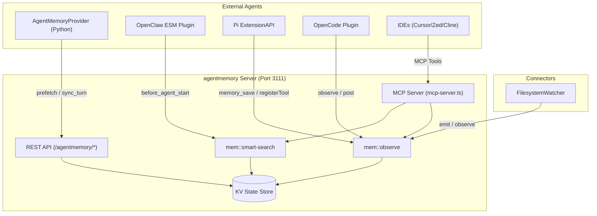
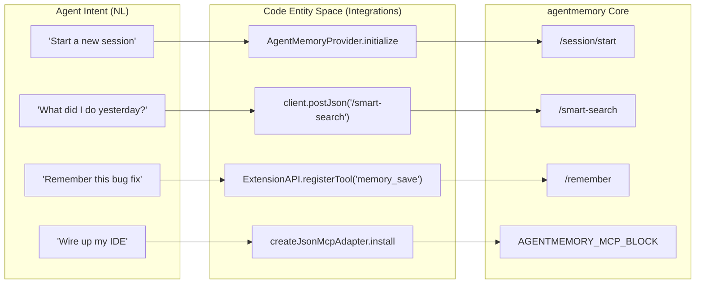

<!-- source: DeepWiki mcp.deepwiki.com · repo rohitg00/agentmemory · page 4.4 Third-Party Agent Integrations · fetched 2026-10-30 -->

# Third-Party Agent Integrations

Relevant source files

The following files were used as context for generating this wiki page:

- [integrations/filesystem-watcher/README.md](integrations/filesystem-watcher/README.md)
- [integrations/filesystem-watcher/bin.mjs](integrations/filesystem-watcher/bin.mjs)
- [integrations/filesystem-watcher/package.json](integrations/filesystem-watcher/package.json)
- [integrations/filesystem-watcher/watcher.mjs](integrations/filesystem-watcher/watcher.mjs)
- [integrations/hermes/README.md](integrations/hermes/README.md)
- [integrations/hermes/__init__.py](integrations/hermes/__init__.py)
- [integrations/hermes/plugin.yaml](integrations/hermes/plugin.yaml)
- [integrations/openclaw/README.md](integrations/openclaw/README.md)
- [integrations/openclaw/openclaw.plugin.json](integrations/openclaw/openclaw.plugin.json)
- [integrations/openclaw/package.json](integrations/openclaw/package.json)
- [integrations/openclaw/plugin.mjs](integrations/openclaw/plugin.mjs)
- [integrations/pi/README.md](integrations/pi/README.md)
- [integrations/pi/index.ts](integrations/pi/index.ts)
- [integrations/pi/security.ts](integrations/pi/security.ts)
- [plugin/hooks/hooks.droid.json](plugin/hooks/hooks.droid.json)
- [plugin/opencode/agentmemory-capture.ts](plugin/opencode/agentmemory-capture.ts)
- [plugin/opencode/plugin.json](plugin/opencode/plugin.json)
- [src/cli/connect/antigravity.ts](src/cli/connect/antigravity.ts)
- [src/cli/connect/claude-code.ts](src/cli/connect/claude-code.ts)
- [src/cli/connect/cline.ts](src/cli/connect/cline.ts)
- [src/cli/connect/codex-hooks.ts](src/cli/connect/codex-hooks.ts)
- [src/cli/connect/codex.ts](src/cli/connect/codex.ts)
- [src/cli/connect/cursor.ts](src/cli/connect/cursor.ts)
- [src/cli/connect/droid.ts](src/cli/connect/droid.ts)
- [src/cli/connect/gemini-cli.ts](src/cli/connect/gemini-cli.ts)
- [src/cli/connect/hermes.ts](src/cli/connect/hermes.ts)
- [src/cli/connect/json-mcp-adapter.ts](src/cli/connect/json-mcp-adapter.ts)
- [src/cli/connect/kiro.ts](src/cli/connect/kiro.ts)
- [src/cli/connect/openclaw.ts](src/cli/connect/openclaw.ts)
- [src/cli/connect/openhuman.ts](src/cli/connect/openhuman.ts)
- [src/cli/connect/pi.ts](src/cli/connect/pi.ts)
- [src/cli/connect/qwen.ts](src/cli/connect/qwen.ts)
- [src/cli/connect/types.ts](src/cli/connect/types.ts)
- [src/cli/connect/warp.ts](src/cli/connect/warp.ts)
- [src/cli/connect/zed.ts](src/cli/connect/zed.ts)
- [test/connect-new-agents.test.ts](test/connect-new-agents.test.ts)
- [test/droid-connect-hooks.test.ts](test/droid-connect-hooks.test.ts)
- [test/fs-watcher.test.ts](test/fs-watcher.test.ts)
- [test/hermes-plugin.test.ts](test/hermes-plugin.test.ts)
- [test/integration-plaintext-http.test.ts](test/integration-plaintext-http.test.ts)
- [test/openclaw-plugin.test.ts](test/openclaw-plugin.test.ts)
- [test/opencode-auto-context.test.ts](test/opencode-auto-context.test.ts)

This page documents the integration of `agentmemory` with non-Claude agents, including Hermes, OpenClaw, Pi, OpenCode, and various IDE-based adapters like Cursor, Zed, and Copilot CLI. These integrations allow multiple agents to share a unified memory backend, ensuring that facts learned in one tool (e.g., Claude Code) are available in another (e.g., Hermes or Warp).

All integrations rely on the central `agentmemory` server and share a common configuration pattern for connectivity and authentication.

### Shared Configuration

Every integration supports two primary environment variables for connecting to the memory server:

| Variable | Default | Description |
|---|---|---|
| `AGENTMEMORY_URL` | `http://localhost:3111` | The base URL of the running `agentmemory` server. [integrations/hermes/__init__.py:76](), [integrations/openclaw/plugin.mjs:13](), [integrations/pi/index.ts:31](), [src/cli/connect/codex.ts:29](), [plugin/opencode/agentmemory-capture.ts:5]() |
| `AGENTMEMORY_SECRET` | (None) | Bearer token used for timing-safe authentication if the server is protected. [integrations/hermes/__init__.py:182](), [integrations/openclaw/plugin.mjs:112](), [integrations/pi/index.ts:96](), [test/fs-watcher.test.ts:148](), [plugin/opencode/agentmemory-capture.ts:14]() |

The Hermes integration specifically includes a `_preload_agentmemory_dotenv` function that attempts to read these values from `~/.agentmemory/.env` or `$XDG_CONFIG_HOME/agentmemory/.env` at import time to ensure consistency across process managers. [integrations/hermes/__init__.py:94-121]()

**Sources:** [integrations/hermes/__init__.py:76-182](), [integrations/openclaw/plugin.mjs:13-112](), [integrations/pi/index.ts:31-96](), [src/cli/connect/codex.ts:24-30](), [test/fs-watcher.test.ts:144-161](), [plugin/opencode/agentmemory-capture.ts:5-14]()

---

### 1. Hermes Python Plugin

The Hermes integration is implemented as an `AgentMemoryProvider` class that hooks into the Hermes agent lifecycle. It provides both background turn-level capture and proactive context injection.

#### Lifecycle Hooks
- `initialize`: Starts a new session and sets up the base URL and session ID. [integrations/hermes/__init__.py:59]()
- `system_prompt_block`: Injects project profiles and conventions at session start. [integrations/hermes/README.md:100](), [integrations/hermes/__init__.py:66]()
- `prefetch`: Executes a `smart-search` based on the current query to find relevant historical observations before an LLM call. [integrations/hermes/README.md:95](), [integrations/hermes/__init__.py:67]()
- `sync_turn`: Captures conversation turns in the background after every exchange. [integrations/hermes/README.md:96](), [integrations/hermes/__init__.py:69]()
- `on_memory_write`: Mirrors manual writes to `MEMORY.md` into the structured `agentmemory` store. [integrations/hermes/README.md:99](), [integrations/hermes/__init__.py:72]()

**Sources:** [integrations/hermes/__init__.py:52-73](), [integrations/hermes/README.md:93-110](), [test/hermes-plugin.test.ts:4-11]()

---

### 2. OpenClaw ESM Plugin

The OpenClaw integration is a JavaScript ESM plugin that utilizes the `before_agent_start` and `agent_end` events to manage memory flow.

#### Implementation Details
- **Context Injection**: On `before_agent_start`, the plugin performs a `smart-search` using the user's prompt and prepends results to the agent's context. [integrations/openclaw/README.md:129]()
- **Observation Capture**: On `agent_end`, the plugin extracts the conversation turns and submits them as an observation to the `/agentmemory/observe` endpoint. [integrations/openclaw/README.md:130]()
- **Capability Registration**: Claims the `plugins.slots.memory` slot via `api.registerMemoryCapability` to ensure it is recognized as the active memory provider. [integrations/openclaw/README.md:128](), [integrations/openclaw/README.md:139-142]()

**Sources:** [integrations/openclaw/README.md:126-142](), [test/openclaw-plugin.test.ts:1-20]()

---

### 3. Pi TypeScript Extension

The Pi integration uses a native TypeScript extension API to provide deep lifecycle integration.

#### Key Features
- **Tools**: Registers `memory_recall` (via `smart-search`) and `memory_save` (via `remember`) as agent-accessible tools. [integrations/pi/README.md:41-49](), [integrations/pi/index.ts:167-200]()
- **Commands**: Adds `/agentmemory-status` to check server health from the Pi CLI. [integrations/pi/index.ts:127-140]()
- **UI Integration**: Displays a status indicator in the Pi interface. [integrations/pi/index.ts:121-125]()

**Sources:** [integrations/pi/index.ts:121-200](), [integrations/pi/README.md:41-49]()

---

### 4. OpenCode Plugin

The OpenCode integration provides coverage for the OpenCode environment, wiring into tool lifecycle events and chat commands.

#### Capabilities
- **Rich Capture**: The `observe` function captures `hookType`, `sessionId`, and `project` metadata along with the event data. [plugin/opencode/agentmemory-capture.ts:50-64]()
- **Project Resolution**: Uses `resolveProjectName` to attribute memories to the correct repository based on git top-level or directory name. [plugin/opencode/agentmemory-capture.ts:85-107]()
- **Context Enrichment**: Injects `AGENTMEMORY_INSTRUCTIONS` and recalled context into the agent's system prompt dynamically. [plugin/opencode/agentmemory-capture.ts:150-184]()
- **Tool Mapping**: Specifically tracks file-related tools like `read`, `write`, `edit`, `glob`, and `grep` to enrich observations with file paths. [plugin/opencode/agentmemory-capture.ts:9-10]()

**Sources:** [plugin/opencode/agentmemory-capture.ts:1-184](), [test/opencode-auto-context.test.ts:1-20]()

---

### 5. Filesystem Watcher Connector

The `@agentmemory/fs-watcher` is a standalone utility that monitors directories and emits observations whenever files are created, modified, or deleted.

#### Data Flow
1. **Detection**: Monitors file events using `node:fs` `watch`. [integrations/filesystem-watcher/watcher.mjs:1]()
2. **Debouncing**: Changes are debounced by 500ms (`DEBOUNCE_MS`) per path to prevent redundant observations during rapid saves. [integrations/filesystem-watcher/watcher.mjs:48](), [integrations/filesystem-watcher/watcher.mjs:206-217]()
3. **Privacy Scrubbing**: Automatically redacts sensitive keys (API keys, passwords, tokens) and JWT/PEM blocks from file previews before sending. [integrations/filesystem-watcher/watcher.mjs:60-135](), [test/fs-watcher.test.ts:163-201]()
4. **Ingestion**: Emits a `post_tool_use` payload to `/agentmemory/observe` with `changeKind: "file_change"` or `"file_delete"`. [test/fs-watcher.test.ts:43-78](), [test/fs-watcher.test.ts:80-98]()

**Sources:** [integrations/filesystem-watcher/watcher.mjs:1-217](), [test/fs-watcher.test.ts:43-201]()

---

### 6. Automated Connect Adapters

The `agentmemory connect` CLI command provides automated wiring for a wide range of agents and IDEs by mutating local configuration files.

#### Supported Adapters
- **Native Hook Support**: Claude Code [src/cli/connect/claude-code.ts:39](), Codex CLI [src/cli/connect/codex.ts:63](), Hermes [src/cli/connect/hermes.ts:11](), OpenClaw [src/cli/connect/openclaw.ts:5](), Droid [src/cli/connect/droid.ts:5]().
- **MCP-Only Adapters**: Cursor [src/cli/connect/cursor.ts:5](), Zed [src/cli/connect/zed.ts:5](), Cline [src/cli/connect/cline.ts:5](), Warp [src/cli/connect/warp.ts:5](), Copilot CLI, Gemini CLI [src/cli/connect/gemini-cli.ts:5](), Qwen [src/cli/connect/qwen.ts:5](), Kiro [src/cli/connect/kiro.ts:5](), Antigravity [src/cli/connect/antigravity.ts:5]().

#### Wiring Logic
The adapters typically use `createJsonMcpAdapter` to inject the `AGENTMEMORY_MCP_BLOCK` into JSON-based configs (e.g., `mcpServers` or `context_servers`). [src/cli/connect/json-mcp-adapter.ts:51-148](). For TOML-based agents like Codex CLI, the adapter performs manual string manipulation to append the `[mcp_servers.agentmemory]` block. [src/cli/connect/codex.ts:75-133]()

**Sources:** [src/cli/connect/claude-code.ts:39-118](), [src/cli/connect/codex.ts:24-133](), [src/cli/connect/json-mcp-adapter.ts:51-148](), [src/cli/connect/zed.ts:5-14](), [src/cli/connect/types.ts:23-43]()

---

### Integration Architecture Diagram

The following diagram illustrates how different agent types interact with the central `agentmemory` server.

**Agent Memory Integration Map**

**Sources:** [integrations/hermes/__init__.py:67-69](), [integrations/openclaw/README.md:129-130](), [integrations/pi/index.ts:167-200](), [integrations/filesystem-watcher/watcher.mjs:186-204](), [plugin/opencode/agentmemory-capture.ts:50-64]()

### Data Transformation Flow

This diagram bridges the natural language intent of the agent to the specific code entities used during the integration lifecycle.

**Natural Language to Code Entity Space**

**Sources:** [integrations/hermes/__init__.py:59](), [integrations/openclaw/README.md:129-130](), [integrations/pi/index.ts:188-200](), [src/cli/connect/json-mcp-adapter.ts:68-146](), [src/cli/connect/util.ts:25-33]()

---

