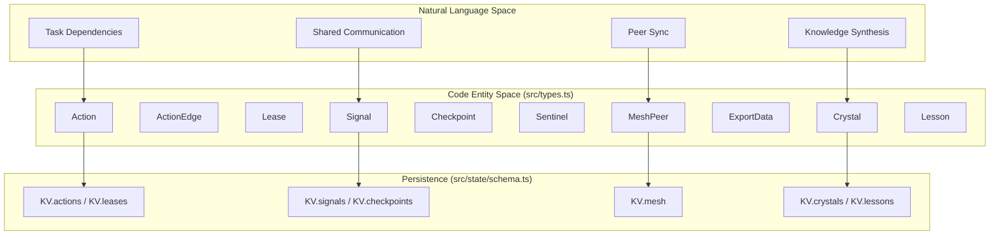
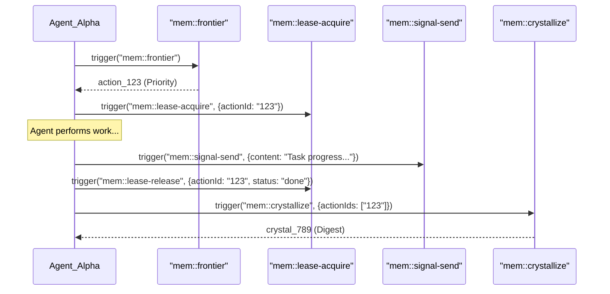

<!-- source: DeepWiki mcp.deepwiki.com · repo rohitg00/agentmemory · page 5 Multi-Agent Coordination · fetched 2026-10-30 -->

# Multi-Agent Coordination

Relevant source files

The following files were used as context for generating this wiki page:

- [src/functions/crystallize.ts](src/functions/crystallize.ts)
- [src/functions/graph.ts](src/functions/graph.ts)
- [src/functions/mesh.ts](src/functions/mesh.ts)
- [src/functions/obsidian-export.ts](src/functions/obsidian-export.ts)
- [src/mcp/server.ts](src/mcp/server.ts)
- [src/mcp/tools-registry.ts](src/mcp/tools-registry.ts)
- [src/state/schema.ts](src/state/schema.ts)
- [test/graph.test.ts](test/graph.test.ts)
- [test/lessons.test.ts](test/lessons.test.ts)
- [test/mesh.test.ts](test/mesh.test.ts)
- [test/obsidian-export.test.ts](test/obsidian-export.test.ts)

Multi-agent coordination in `agentmemory` provides the orchestration primitives necessary for multiple autonomous agents to collaborate on complex tasks without resource conflicts or redundant work. This system transitions agents from isolated entities into a cohesive team by managing shared state, task dependencies, and inter-agent communication.

### Coordination Framework Overview

The coordination layer is built upon three pillars that ensure consistency and progress across distributed agent instances:

1.  **Task Orchestration**: Managing the `Action` lifecycle and dependency graph via `ActionEdge` to prevent race conditions [src/state/schema.ts:48-49]().
2.  **Synchronous Messaging**: Using `Signals` for threaded communication [src/state/schema.ts:53]() and `Checkpoints` to create shared decision gates [src/state/schema.ts:54]().
3.  **Data Synchronization**: Leveraging P2P `Mesh Networking` to propagate state across physically or logically separated agents [src/state/schema.ts:55]().

### Core Entities and Code Mapping

The following diagram bridges high-level coordination concepts to the specific TypeScript namespaces and storage keys used in the codebase.

**Diagram: Coordination Entity Mapping**

**Sources:** [src/state/schema.ts:48-60](), [src/types.ts:4-12]()

---

### Orchestration Primitives

#### [Actions, Leases & Frontier](#5.1)
The orchestration system manages work via a directed acyclic graph (DAG) of `Action` and `ActionEdge` entities. To prevent multiple agents from executing the same task, the system uses a TTL-based `Lease` mechanism. Agents compete for leases on the `Frontier`—a priority queue of available tasks whose dependencies have been satisfied.

*   **Action Lifecycle**: Transitions through states such as `pending`, `active`, and `done` [src/functions/crystallize.ts:39-42]().
*   **Crystallization**: Completed action chains are synthesized into `Crystal` digests via `mem::crystallize`, capturing narratives, outcomes, and affected files [src/functions/crystallize.ts:23-28]().
*   **Automated Cleanup**: The `mem::auto-crystallize` function periodically groups and summarizes stale completed actions to keep the active task space clean [src/functions/crystallize.ts:148-157]().

For details, see [Actions, Leases & Frontier](#5.1).

#### [Signals, Checkpoints & Team Collaboration](#5.2)
Inter-agent communication is handled through `Signals`, which support threading and read receipts. `Checkpoints` act as synchronization barriers, requiring explicit resolution before dependent actions can be unblocked.

*   **Lessons**: High-confidence patterns or best practices can be explicitly saved via `mem::lesson-save` [src/functions/lessons.ts:59-66]() and recalled during task execution to improve performance [src/functions/lessons.ts:134-141]().
*   **Confidence Scoring**: Lessons track `reinforcements` and `confidence` levels, allowing agents to weight shared knowledge based on its historical reliability [src/functions/lessons.ts:94-110]().
*   **Sentinels**: Event watchers that trigger specific logic when coordination conditions are met (e.g., a specific signal received or action completed) [src/state/schema.ts:58]().

For details, see [Signals, Checkpoints & Team Collaboration](#5.2).

#### [Mesh Networking & Data Portability](#5.3)
When agents operate in different environments, the Mesh Networking layer synchronizes their KV stores. It uses a P2P model with configurable sync modes and protects against SSRF via IP/URL validation.

*   **Conflict Resolution**: Uses Last-Write-Wins (LWW) based on `updatedAt` or `createdAt` timestamps to merge disparate state [src/functions/mesh.ts:77-83]().
*   **SSRF Protection**: Peer registration is guarded by `isAllowedUrl` and `isPrivateIP` checks to prevent internal network probing [src/functions/mesh.ts:19-55]().
*   **Scoped Sync**: Peers can define `sharedScopes` (e.g., only syncing `memories` and `actions`) and `syncFilter` to limit data propagation to specific projects [src/functions/mesh.ts:144-150]().
*   **Obsidian Integration**: Coordination data (memories, lessons, crystals) can be exported to Markdown for human review in Obsidian vaults [src/functions/obsidian-export.ts:248-255]().

For details, see [Mesh Networking & Data Portability](#5.3).

---

### System Interaction Flow

The following diagram illustrates how an agent interacts with the coordination API to claim a task and notify the team.

**Diagram: Multi-Agent Interaction Sequence**

**Sources:** [src/functions/crystallize.ts:23-28](), [src/state/schema.ts:48-59]()

### Summary of Coordination Functions
Coordination logic is exposed through a suite of `mem::` functions registered in the SDK.

| Function | Purpose | Registration |
| :--- | :--- | :--- |
| `mem::crystallize` | Summarizes completed actions into a `Crystal`. | [src/functions/crystallize.ts:23]() |
| `mem::lesson-save` | Persists a reusable best practice or pattern. | [src/functions/lessons.ts:59]() |
| `mem::mesh-register` | Adds a new P2P sync peer with security validation. | [src/functions/mesh.ts:144]() |
| `mem::mesh-sync` | Triggers LWW synchronization with registered peers. | [src/functions/mesh.ts:196]() |
| `mem::obsidian-export` | Generates Markdown vault for coordination data. | [src/functions/obsidian-export.ts:248]() |
| `mcp::tools::call` | Proxies coordination tools to MCP-capable agents. | [src/mcp/server.ts:74]() |

**Sources:** [src/functions/crystallize.ts:1-229](), [src/functions/mesh.ts:1-230](), [src/functions/lessons.ts:1-205](), [src/mcp/server.ts:74-147]()

---

