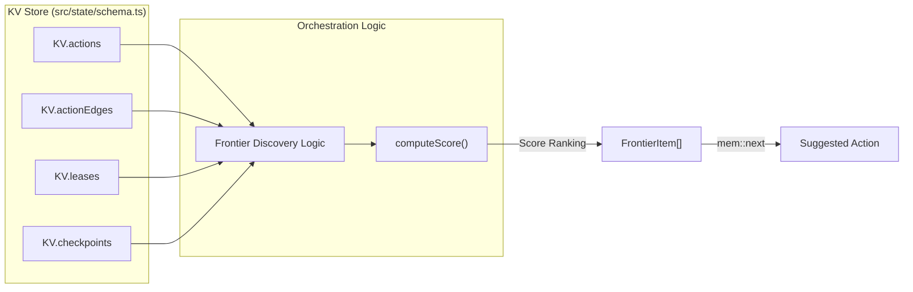
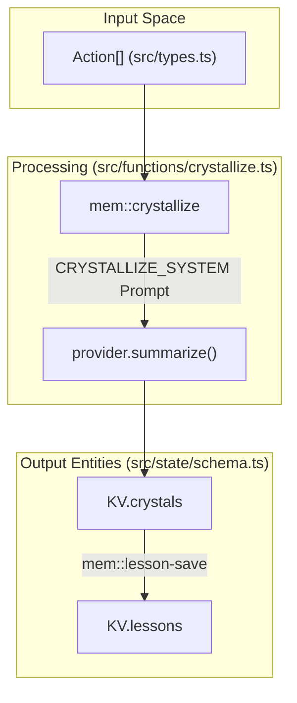

<!-- source: DeepWiki mcp.deepwiki.com · repo rohitg00/agentmemory · page 5.1 Actions, Leases & Frontier · fetched 2026-10-30 -->

# Actions, Leases & Frontier

<details>
<summary>Relevant source files</summary>

The following files were used as context for generating this wiki page:

- [src/functions/crystallize.ts](src/functions/crystallize.ts)
- [src/functions/graph.ts](src/functions/graph.ts)
- [src/functions/mesh.ts](src/functions/mesh.ts)
- [src/functions/obsidian-export.ts](src/functions/obsidian-export.ts)
- [src/functions/patterns.ts](src/functions/patterns.ts)
- [src/functions/snapshot.ts](src/functions/snapshot.ts)
- [src/mcp/server.ts](src/mcp/server.ts)
- [src/mcp/tools-registry.ts](src/mcp/tools-registry.ts)
- [src/state/schema.ts](src/state/schema.ts)
- [test/graph.test.ts](test/graph.test.ts)
- [test/lessons.test.ts](test/lessons.test.ts)
- [test/mesh.test.ts](test/mesh.test.ts)
- [test/obsidian-export.test.ts](test/obsidian-export.test.ts)
- [test/snapshot.test.ts](test/snapshot.test.ts)

</details>


The task orchestration system in `agentmemory` provides a robust framework for multi-agent collaboration, ensuring that tasks are discovered, prioritized, and executed without race conditions or redundant work. It relies on a dependency-aware directed graph of **Actions**, a TTL-based **Lease** mechanism for concurrency control, and a **Frontier** priority queue for task discovery.

## Action Lifecycle & Dependency Graph

An `Action` represents a discrete unit of work. Actions are stored in the `KV.actions` namespace [src/state/schema.ts:48]() and progress through a state machine managed by orchestration functions.

### Action States
| State | Description |
| :--- | :--- |
| `pending` | The action is ready to be worked on. |
| `blocked` | The action has unmet dependencies (`requires` or `gated_by`). |
| `active` | The action is currently held by an agent via a `Lease`. |
| `done` | The action is successfully completed. |
| `cancelled` | The action is no longer relevant. |

### The ActionEdge Graph
Dependencies between actions are defined using `ActionEdge` objects in the `KV.actionEdges` namespace [src/state/schema.ts:49](). Valid edge types include:
*   **requires**: The source action cannot start until the target action is `done`.
*   **unlocks**: A semantic hint that completing the source enables the target.
*   **gated_by**: The action is blocked until a `Checkpoint` or `Sentinel` is triggered.
*   **conflicts_with**: Prevents two actions from being `active` simultaneously.

When an action is updated to `done`, the system triggers propagation logic to re-evaluate and unblock dependent actions by scanning `KV.actionEdges`.

**Sources:** [src/state/schema.ts:48-49](), [src/types.ts:13-14](), [src/functions/crystallize.ts:39-44]().

## Frontier Priority Queue

The **Frontier** is the discovery engine for agents. It filters the global action list to find "runnable" tasks—those that are not completed, not blocked by dependencies, and not currently leased by others.

### Scoring Algorithm
The system computes a score for each actionable item to determine its priority in the queue:
1.  **Base Priority**: Derived from the action's priority field (typically 1-10).
2.  **Age Bonus**: Incremental bonuses based on how long an action has been `pending`.
3.  **Unlock Bonus**: Points added for every action this task `unlocks` in the graph.
4.  **Active Status**: A weight adjustment if the action is already `active` (encouraging the current lease holder to finish).

The `mem::next` function provides a simplified interface that returns the single highest-scoring suggestion for an agent.

**Sources:** [src/state/schema.ts:48-49](), [src/types.ts:13-14]().

## Lease Management

Leases prevent multiple agents from working on the same `Action` simultaneously. The system uses a TTL-based mechanism with mandatory renewal for long-running tasks.

### Acquisition & Renewal
*   **Acquire**: Agents call `mem::lease-acquire`. If successful, the action status changes to `active` and a `Lease` object is created in the `KV.leases` [src/state/schema.ts:50]() namespace with a specific expiration.
*   **Renew**: If a task takes longer than expected, agents must renew the lease before the expiration timestamp.
*   **Release**: Upon completion or stoppage, the lease is released and the action is marked as `done` or returned to `pending`.

### Cleanup & Expiry
A background process monitors for expired leases. If an agent crashes or fails to renew, the lease is automatically cleared and the associated action is reverted to `pending`, allowing other agents to pick it up from the Frontier.

**Sources:** [src/state/schema.ts:50](), [src/types.ts:201-217]().

## Event Watchers: Sentinels & Checkpoints

External events and manual approvals integrate into the action graph via `Sentinels` and `Checkpoints`.

*   **Checkpoints**: Manual or external gates (e.g., `approval`, `ci`, `deploy`) stored in `KV.checkpoints` [src/state/schema.ts:54](). Actions linked to a pending checkpoint are marked `blocked`.
*   **Sentinels**: Automated watchers in `KV.sentinels` [src/state/schema.ts:58]() that trigger based on specific conditions like timers or pattern detection in observations.

**Sources:** [src/state/schema.ts:54-58](), [src/types.ts:17-18]().

## Summarization: Sketches, Crystals & Lessons

As action chains complete, the system provides multiple layers of "distillation" to turn raw execution logs into long-term memory.

| Entity | Function | Purpose |
| :--- | :--- | :--- |
| **Crystal** | `mem::crystallize` | Summarizes a chain of `done` actions into a narrative with key outcomes and lessons [src/functions/crystallize.ts:23-28](). |
| **Lesson** | `mem::lesson-save` | Discrete insights derived from Crystals or manual input, stored with confidence scores [src/functions/crystallize.ts:75-78](). |
| **Sketch** | `mem::sketch-create` | Drafts a plan or sequence of actions before they are formally committed to the graph [src/state/schema.ts:56](). |
| **Routine** | `mem::routine-create` | Reusable templates for recurring multi-step tasks [src/state/schema.ts:51](). |

### Crystallization Process
The `mem::crystallize` function uses the `summarize` method of the `MemoryProvider` [src/functions/crystallize.ts:57]() to extract narratives, outcomes, and lessons from completed actions. It ensures that the "why" and "how" of a task are preserved. The resulting `Crystal` is stored in `KV.crystals` [src/state/schema.ts:59]().

**Sources:** [src/functions/crystallize.ts:13-22](), [src/functions/crystallize.ts:57-72](), [test/obsidian-export.test.ts:95-107]().

## Implementation Diagrams

### Action State Transitions
This diagram maps the internal status transitions for Actions and their relationship with Leases.

```mermaid
graph TD
    "START" --> P["[status: 'pending']"]
    P -- "Dependency Created (ActionEdge)" --> B["[status: 'blocked']"]
    P -- "mem::lease-acquire" --> A["[status: 'active']"]
    B -- "Dependency Resolved" --> P
    A -- "mem::lease-release (no result)" --> P
    A -- "mem::lease-release (with result)" --> D["[status: 'done']"]
    A -- "Lease Expiry (TTL Cleanup)" --> P
    D -- "mem::crystallize" --> C["Crystal Entity Created"]
```
**Sources:** [src/types.ts:13-14](), [src/functions/crystallize.ts:39-44](), [src/functions/crystallize.ts:60-72]().

### Frontier Data Flow
How the system identifies the next task for an agent by querying the state layer.


**Sources:** [src/state/schema.ts:48-54](), [src/types.ts:13-14]().

### Crystallization & Lesson Flow
The process of transforming completed `Action` entities into `Crystal` digests and `Lesson` objects.


**Sources:** [src/functions/crystallize.ts:13-16](), [src/functions/crystallize.ts:57-72](), [src/functions/crystallize.ts:75-88]().

---

