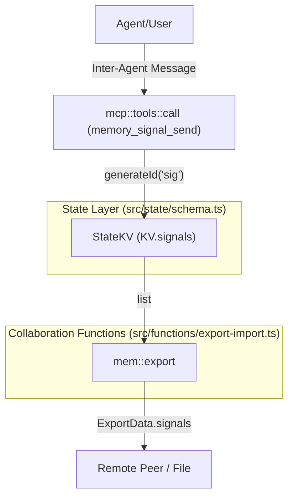
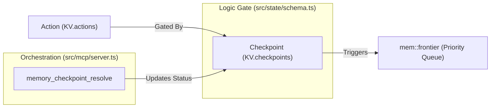
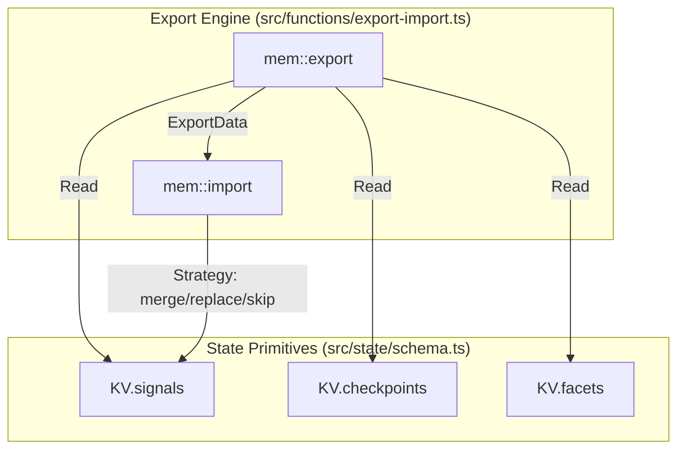

<!-- source: DeepWiki mcp.deepwiki.com · repo rohitg00/agentmemory · page 5.2 Signals, Checkpoints & Team Collaboration · fetched 2026-10-30 -->

# Signals, Checkpoints & Team Collaboration

Relevant source files

The following files were used as context for generating this wiki page:

- [src/functions/graph.ts](src/functions/graph.ts)
- [src/functions/relations.ts](src/functions/relations.ts)
- [src/mcp/server.ts](src/mcp/server.ts)
- [src/mcp/tools-registry.ts](src/mcp/tools-registry.ts)
- [src/state/schema.ts](src/state/schema.ts)
- [test/graph.test.ts](test/graph.test.ts)

This section details the coordination and sharing mechanisms within `agentmemory` that enable multiple agents and human teams to synchronize state, communicate asynchronously, and manage complex workflows. These features build upon the core memory pipeline to provide structured inter-agent messaging, synchronization gates, and project-wide visibility.

## Signals: Inter-Agent Messaging

Signals are the primary mechanism for asynchronous communication between agents. Unlike observations, which record what an agent *did*, Signals are used to express intent, request help, or provide status updates to other agents.

### Implementation & Data Flow

Signals are stored in the `KV.signals` namespace [src/state/schema.ts:53](). They are defined by the `Signal` interface in the core type system [src/types.ts:971]().

1.  **Sending**: Signals are generated with unique identifiers using `generateId("sig")` [src/state/schema.ts:84-88]().
2.  **Storage**: The `mem::export` and `mem::import` functions handle `Signal` objects as first-class collaborative entities, serializing them into the `ExportData` structure [src/functions/export-import.ts:106-134]().
3.  **MCP Access**: Agents can interact with the signaling system via the `memory_signal_send` and `memory_signal_list` tools registered in the MCP server [src/mcp/server.ts:430-460]().

### Signal Lifecycle Diagram

The following diagram illustrates how a signal moves from a sender to the state layer and is eventually processed by the system's collaborative functions.

**Signal Data Flow (Natural Language to Code Entities)**

Sources: [src/state/schema.ts:53-88](), [src/types.ts:971](), [src/mcp/server.ts:430-460](), [src/functions/export-import.ts:106-134]()

---

## Checkpoints: Synchronization Gates

Checkpoints serve as blocking gates for `Actions`. They allow the system to pause execution until a specific condition—such as manual approval, a CI pass, or a timer—is met.

### Checkpoint Resolution Logic

Checkpoints are managed via the `KV.checkpoints` scope [src/state/schema.ts:54]().

*   **Blocking**: When a checkpoint is created, it is stored in the KV store and linked to related workflows. The `Checkpoint` type tracks `status` (pending/resolved) and `resolution` details [src/types.ts:971]().
*   **State Tracking**: Checkpoints are tracked within the `ExportData` schema, ensuring that synchronization states are preserved during system migrations or mesh syncs [src/functions/export-import.ts:107]().
*   **Resolution**: The `memory_checkpoint_resolve` MCP tool allows agents or humans to satisfy the gate condition, updating the checkpoint in the `KV.checkpoints` namespace [src/mcp/server.ts:470-500]().

**Checkpoint Synchronization Diagram**

Sources: [src/state/schema.ts:54](), [src/types.ts:971](), [src/mcp/server.ts:470-500](), [src/functions/export-import.ts:107]()

---

## Team Collaboration & Sharing

The team subsystem allows agents to promote local memories or observations to a shared team feed, enabling project-wide knowledge sharing via `mem::team-share`.

### Key Components
| Entity | Role | Data Target |
| :--- | :--- | :--- |
| `Memory` | Long-term shared insights across sessions. | `KV.memories` [src/state/schema.ts:7]() |
| `SessionSummary` | High-level narrative of session progress for the team. | `KV.summaries` [src/state/schema.ts:8]() |
| `TeamProfile` | Aggregated team activity and project metadata. | `KV.teamProfile` [src/state/schema.ts:46]() |
| `TeamShared` | Explicitly shared objects within a team scope. | `KV.teamShared` [src/state/schema.ts:43]() |

### Team Sharing Flow
1.  **Ingestion**: An agent identifies a high-value memory during a session [src/types.ts:83-105]().
2.  **Promotion**: The memory is associated with a specific `project` and marked as `isLatest: true` [src/functions/relations.ts:152]().
3.  **Consolidation**: The `mem::consolidate` function synthesizes observations into team-wide memories using a `MemoryProvider` [src/functions/consolidate.ts:65-71]().
4.  **Mesh Sync**: Shared team data is synchronized across peers using the `mem::mesh-sync` function [src/functions/mesh.ts:250-300]().

Sources: [src/state/schema.ts:7-46](), [src/functions/relations.ts:129-153](), [src/functions/consolidate.ts:65-71](), [src/functions/mesh.ts:250-300]()

---

## Facets: Multi-Dimensional Tagging

Facets provide a flexible, multi-dimensional tagging system that allows agents to categorize memories, actions, and observations across custom dimensions [src/types.ts:971]().

### Facet Structure
A `Facet` is stored in the `KV.facets` scope [src/state/schema.ts:57](). It allows for filtering collaborative entities without modifying their core schemas. A facet consists of a `name`, `value`, and a reference to the `targetId` it describes [src/types.ts:971]().

### Filtering and Querying
Agents can perform complex intersections using facet queries during `mem::export` or via the `memory_facet_search` MCP tool to isolate specific project domains [src/functions/export-import.ts:102]().

Sources: [src/state/schema.ts:57](), [src/types.ts:971](), [src/functions/export-import.ts:102]()

---

## Data Portability & Snapshots

To ensure collaboration integrity and data portability across different environments, `agentmemory` includes comprehensive export/import tools.

### Export/Import Pipeline
The `mem::export` function serializes the entire state including sessions, observations, memories, graph nodes, actions, signals, and facets [src/functions/export-import.ts:35-111]().

*   **Pagination**: Supports `maxSessions` and `offset` for large datasets to prevent payload overflows [src/functions/export-import.ts:37-45]().
*   **Versioning**: Exports include a version marker to ensure compatibility during import [src/functions/export-import.ts:112]().
*   **Strategies**: `mem::import` supports `merge`, `replace`, and `skip` strategies to handle conflicts when syncing team data [src/functions/export-import.ts:164-176]().

### Collaborative Integrity Diagram
This diagram shows how collaborative entities are bundled for sharing or diagnostic review.

**System Integrity Flow (Code Entities to Persistence)**

Sources: [src/functions/export-import.ts:35-176](), [src/state/schema.ts:53-57](), [test/export-import.test.ts:119-129]()

---

