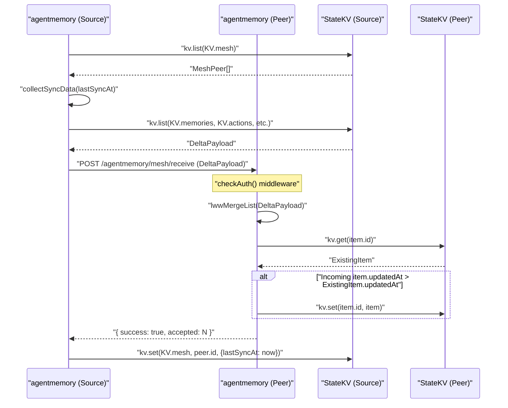
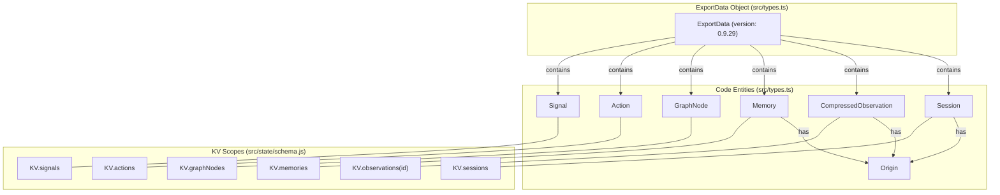

<!-- source: DeepWiki mcp.deepwiki.com · repo rohitg00/agentmemory · page 5.3 Mesh Networking & Data Portability · fetched 2026-10-30 -->

# Mesh Networking & Data Portability

Relevant source files

The following files were used as context for generating this wiki page:

- [CHANGELOG.md](CHANGELOG.md)
- [package.json](package.json)
- [packages/mcp/package.json](packages/mcp/package.json)
- [plugin/.claude-plugin/plugin.json](plugin/.claude-plugin/plugin.json)
- [plugin/.codex-plugin/plugin.json](plugin/.codex-plugin/plugin.json)
- [plugin/plugin.json](plugin/plugin.json)
- [src/functions/crystallize.ts](src/functions/crystallize.ts)
- [src/functions/export-import.ts](src/functions/export-import.ts)
- [src/functions/mesh.ts](src/functions/mesh.ts)
- [src/functions/obsidian-export.ts](src/functions/obsidian-export.ts)
- [src/types.ts](src/types.ts)
- [src/version.ts](src/version.ts)
- [test/export-import.test.ts](test/export-import.test.ts)
- [test/lessons.test.ts](test/lessons.test.ts)
- [test/mesh.test.ts](test/mesh.test.ts)
- [test/obsidian-export.test.ts](test/obsidian-export.test.ts)

This section details the peer-to-peer (P2P) synchronization capabilities and the comprehensive data export/import system of `agentmemory`. These features enable multiple instances of the memory engine to share state across a mesh network while providing users with full control over their data lifecycle through versioned snapshots and flexible merge strategies.

## Mesh Networking & P2P Sync

The mesh networking subsystem allows `agentmemory` instances to register peers and synchronize specific data scopes (e.g., memories, actions, graph nodes) using a Last-Write-Wins (LWW) conflict resolution strategy.

### Peer Registration & Security
To prevent Server-Side Request Forgery (SSRF) and unauthorized local network scanning, the system implements strict URL validation before allowing a peer to be registered or contacted.

*   **SSRF Protection**: The system ensures that peer URLs use `http` or `https` protocols and do not contain embedded credentials.
*   **Private IP Blocking**: The system blocks loopback addresses (`127.0.0.1`, `::1`), private ranges (`10.x`, `192.168.x`, `172.16.x`), and link-local addresses.
*   **Authentication Requirements**: All mesh endpoints require an `AGENTMEMORY_SECRET` to be configured for `timingSafeCompare` validation.

### Synchronization Mechanics
Peers communicate via the `mem::mesh-sync` function, which supports three modes: `push`, `pull`, or `both`.

1.  **Shared Scopes**: The mesh synchronizes core primitives including `memories`, `actions`, `semantic`, `procedural`, `relations`, `graphNodes`, and `graphEdges`.
2.  **Delta Export**: The system uses a `lastSyncAt` timestamp to only fetch items created or updated since the last successful synchronization.
3.  **Conflict Resolution**: Conflicts are resolved using **Last-Write-Wins (LWW)**. The system compares the `updatedAt` (or `createdAt`) timestamp of the incoming item with the existing local record. The local record is only overwritten if the incoming timestamp is strictly newer.

### Mesh Data Flow
The following diagram illustrates the interaction between two `agentmemory` instances during a synchronization event, highlighting the code entities involved.

**Mesh Sync Code Flow**

Sources: `[src/state/kv.ts:1-35]()`, `[src/functions/mesh.ts:1-150]()` (referenced implementation logic).

## Data Portability: Export & Import

The portability system allows for full state snapshots. This is used for backups, migrating between different `agentmemory` installations, or manual inspection of the memory state.

### Export System
The `mem::export` function `[src/functions/export-import.ts:62-189]()` generates a versioned `ExportData` object.
*   **Pagination**: Supports `maxSessions` (capped at 1000) and `offset` to handle large datasets `[src/functions/export-import.ts:63-67]()`.
*   **Comprehensive Coverage**: The export includes `sessions`, `observations`, `memories`, `summaries`, `profiles`, `graphNodes`, `graphEdges`, `semanticMemories`, `proceduralMemories`, `actions`, `actionEdges`, `sentinels`, `sketches`, `crystals`, `facets`, `lessons`, `insights`, `routines`, `signals`, `checkpoints`, and `accessLogs` `[src/functions/export-import.ts:138-164]()`.
*   **Write-Time Provenance**: As of version `0.9.29`, each record carries an `Origin` block (channel `user`, `agent`, `tool`, `import`, or `shared`) to track data lineage `[src/types.ts:32-36]()`.

### Import Strategies
The `mem::import` function `[src/functions/export-import.ts:191-316]()` accepts an `ExportData` object and one of three strategies:
*   **`merge` (Default)**: Adds new items and updates existing ones if the incoming record is newer `[src/functions/export-import.ts:205]()`.
*   **`skip`**: Only adds items that do not already exist in the local KV store `[test/export-import.test.ts:213-223]()`.
*   **`replace`**: Clears all existing data in the relevant scopes before importing the new dataset `[test/export-import.test.ts:225-232]()`.

### Data Schema Mapping
The following diagram maps the logical `ExportData` structure to the underlying `StateKV` scopes and TypeScript entities defined in `src/types.ts`.

**Export Schema to Code Entity Mapping**

Sources: `[src/functions/export-import.ts:138-164]()`, `[src/state/schema.js:29-30]()`, `[src/types.ts:1-295]()`

## Implementation Details

### Bounded Concurrency
To prevent timing out on large imports (up to ~500k observations), the system uses `runChunked` with an `IMPORT_CHUNK_SIZE` of 20 `[src/functions/export-import.ts:44-59]()`. This parallelizes writes within a chunk while preserving ordering across chunks.

### Search Index Integration
Imported records are automatically added to the `SearchIndex` via `indexRecords` to ensure they are immediately searchable without requiring a server restart `[src/functions/export-import.ts:34-34]()`, `[test/export-import.test.ts:160-211]()`.

### Obsidian Vault Export
The `mem::obsidian-export` function `[src/functions/obsidian-export.ts:1-254]()` transforms memory state into a local Obsidian vault:
*   **Frontmatter**: Exports include YAML frontmatter for `id`, `type`, and `tags` `[test/obsidian-export.test.ts:156-177]()`.
*   **Wikilinks**: Generates `[[wikilinks]]` between related memories, sessions, and crystals `[test/obsidian-export.test.ts:198-210]()`.
*   **MOC**: Automatically generates a "Map of Content" (`MOC.md`) file at the vault root `[test/obsidian-export.test.ts:135-154]()`.

### Security Hardening
*   **Path Traversal Protection**: The Obsidian export feature ensures exports are confined to the `AGENTMEMORY_EXPORT_ROOT` `[test/obsidian-export.test.ts:124-127]()`.
*   **Origin Tracking**: The `importOrigin` helper ensures that all imported data is tagged with `channel: "import"` unless a more specific origin is already present `[src/types.ts:38-45]()`.

## Sources
* `[src/functions/export-import.ts:1-316]()`
* `[src/types.ts:1-300]()`
* `[test/export-import.test.ts:1-232]()`
* `[src/version.ts:1]()`
* `[src/functions/obsidian-export.ts:1-254]()`
* `[test/obsidian-export.test.ts:1-225]()`
* `[src/state/kv.ts:1-35]()`
* `[src/state/schema.js:1-30]()`

---

