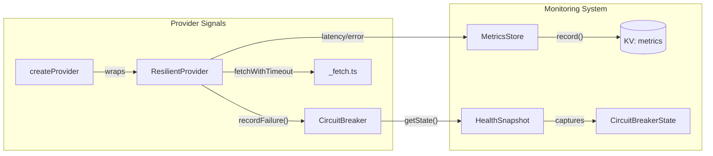

<!-- source: DeepWiki mcp.deepwiki.com · repo rohitg00/agentmemory · page 6 Providers & Resilience · fetched 2026-10-30 -->

# Providers & Resilience

<details>
<summary>Relevant source files</summary>

The following files were used as context for generating this wiki page:

- [src/functions/replay.ts](src/functions/replay.ts)
- [src/functions/summarize.ts](src/functions/summarize.ts)
- [src/providers/_fetch.ts](src/providers/_fetch.ts)
- [src/providers/embedding/index.ts](src/providers/embedding/index.ts)
- [src/providers/embedding/openai.ts](src/providers/embedding/openai.ts)
- [src/providers/embedding/openrouter.ts](src/providers/embedding/openrouter.ts)
- [src/providers/index.ts](src/providers/index.ts)
- [src/replay/jsonl-parser.ts](src/replay/jsonl-parser.ts)
- [src/state/vector-index.ts](src/state/vector-index.ts)
- [test/embedding-provider.test.ts](test/embedding-provider.test.ts)
- [test/fallback-model-resolution.test.ts](test/fallback-model-resolution.test.ts)
- [test/fetch-timeout.test.ts](test/fetch-timeout.test.ts)
- [test/replay-import-key.test.ts](test/replay-import-key.test.ts)
- [test/replay-sensitive.test.ts](test/replay-sensitive.test.ts)
- [test/replay.test.ts](test/replay.test.ts)
- [test/summarize.test.ts](test/summarize.test.ts)
- [test/vector-index.test.ts](test/vector-index.test.ts)

</details>


The `agentmemory` system relies on external Large Language Models (LLMs) and embedding models to process, compress, and search through agent observations. To ensure high availability and consistent performance, the system employs a provider-agnostic architecture centered around a **Circuit Breaker** pattern and a **Fallback Chain** mechanism.

## Provider Architecture Overview

The system abstracts LLM interactions through the `MemoryProvider` interface and embedding interactions through the `EmbeddingProvider` interface [src/providers/index.ts:1-13](). This abstraction allows core logic—such as memory compression in `mem::compress` or summarization in `mem::summarize` [src/functions/summarize.ts:60-75]()—to remain decoupled from specific API implementations.

### Code Entity Relationship

The following diagram illustrates how high-level memory functions interact with the provider resilience layer to reach concrete API implementations.

**Provider & Resilience Flow**
```mermaid
graph TD
    subgraph "Natural Language Space"
        [A] -- "Agent Observation" --> B["mem::compress"]
        [C] -- "Session End" --> D["mem::summarize"]
    end

    subgraph "Code Entity Space (Resilience Layer)"
        B --> E["ResilientProvider"]
        D --> E
        E -- "wraps" --> G["FallbackChainProvider"]
        E -- "updates" --> F["CircuitBreaker"]
    end

    subgraph "Concrete Providers"
        G --> H["AnthropicProvider"]
        G --> I["OpenRouterProvider"]
        G --> J["MinimaxProvider"]
        G --> K["AgentSDKProvider"]
        G --> L["NoopProvider"]
        G --> M["OpenAIProvider"]
    end

    F -- "isAllowed()" --> E
    E -- "recordSuccess/Failure" --> F
```
**Sources:** [src/providers/index.ts:55-57](), [src/providers/index.ts:87-90](), [src/providers/index.ts:93-149](), [src/functions/summarize.ts:98-116]()

## LLM Providers & Circuit Breaker

The `ResilientProvider` acts as a decorator for any `MemoryProvider`, wrapping every call in a `CircuitBreaker` state machine to manage transient failures [src/providers/index.ts:55-56]().

- **Circuit Breaker:** Monitors failure rates. If a provider fails repeatedly (threshold of 3), the breaker transitions to an `open` state, immediately rejecting further requests for a 60-second window to prevent cascading failures and wasted tokens.
- **Fallback Chain:** When multiple providers are configured via `FALLBACK_PROVIDERS`, the `FallbackChainProvider` attempts to route requests to the primary provider. If it fails or its circuit is open, the chain automatically tries the next available provider in the sequence [src/providers/index.ts:59-91]().
- **Default Model Resolution:** To prevent 404 errors during fallback, each provider in the chain resolves its own default model (e.g., `gpt-5.6-luna` for OpenAI, `claude-sonnet-5` for Anthropic) rather than inheriting the primary provider's model name [src/providers/index.ts:35-53]().
- **Timeouts:** Outbound requests are protected by `fetchWithTimeout`, defaulting to 60,000ms but configurable via `AGENTMEMORY_LLM_TIMEOUT_MS`. It also implements a hard budget cap of 170s to stay within execution limits [src/providers/_fetch.ts:2-26](), [test/fetch-timeout.test.ts:57-63](), [test/fetch-timeout.test.ts:114-141]().

For detailed documentation on the state machine and specific LLM implementations, see **[LLM Providers & Circuit Breaker](#6.1)**.

## Embedding Providers

Embeddings are critical for the vector search stream in the `VectorIndex` and `HybridSearch` pipeline [src/state/vector-index.ts:49-77](). The system supports a variety of backends which are resolved during initialization via `createEmbeddingProvider` [src/providers/index.ts:16]().

- **Local (Xenova):** Provides offline, zero-cost embeddings when no cloud keys are present [test/embedding-provider.test.ts:27-30]().
- **Cloud:** Supports OpenAI, Gemini, Voyage, Cohere, and OpenRouter [src/providers/embedding/openai.ts:51-123](), [test/embedding-provider.test.ts:32-44]().
- **Dimension Guard:** To prevent index corruption, the `withDimensionGuard` wrapper ensures that all embeddings generated match the expected dimensions of the existing index [test/embedding-provider.test.ts:160-192]().
- **Serialization Resilience:** The `VectorIndex` uses explicit `byteOffset` and `byteLength` during Base64 conversion to survive Node.js Buffer pool slicing, preventing "phantom dimension" crashes [src/state/vector-index.ts:8-21](), [test/vector-index.test.ts:80-103]().

For details on configuring embedding backends and tuning search weights, see **[Embedding Providers](#6.2)**.

## Observability & Health Integration

The resilience of providers is monitored in real-time. The `CircuitBreaker` exposes its internal state which is collected into health snapshots to provide visibility into the system's operational status.

| Component | Responsibility | Source |
| :--- | :--- | :--- |
| `CircuitBreaker` | Tracks failure counts and window-based state transitions. | [src/providers/index.ts:30-34]() |
| `ResilientProvider` | Intercepts provider calls to update the breaker state. | [src/providers/index.ts:55-57]() |
| `createFallbackProvider` | Builds the provider hierarchy from configuration. | [src/providers/index.ts:59-91]() |
| `fetchWithTimeout` | Enforces outbound request duration limits and bounded retries. | [src/providers/_fetch.ts:2-26](), [test/fetch-timeout.test.ts:144-156]() |

**Provider Health Mapping**

**Sources:** [src/providers/index.ts:55-57](), [src/providers/_fetch.ts:2-26](), [test/fetch-timeout.test.ts:57-63]()

For information on how these metrics are visualized in the dashboard, see **[Observability & Health](#7)**.

---

