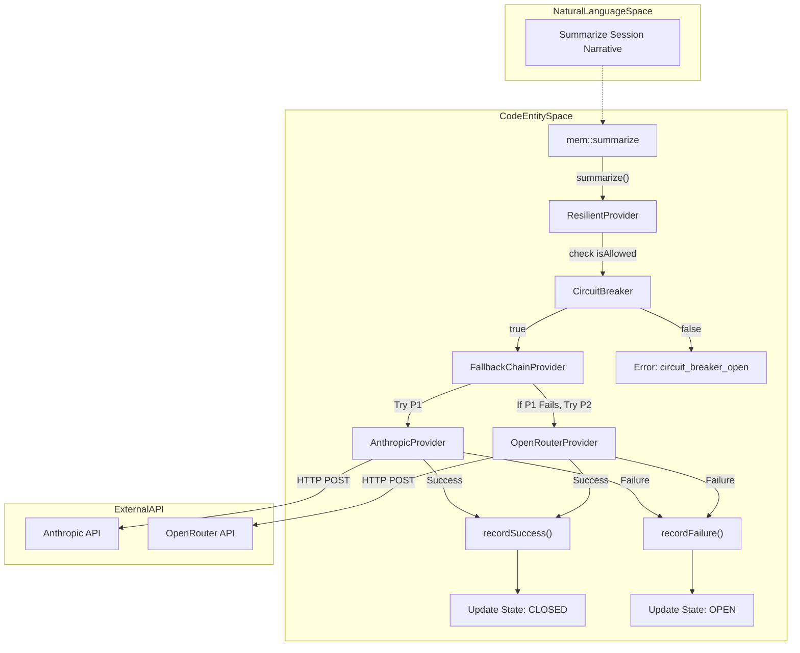
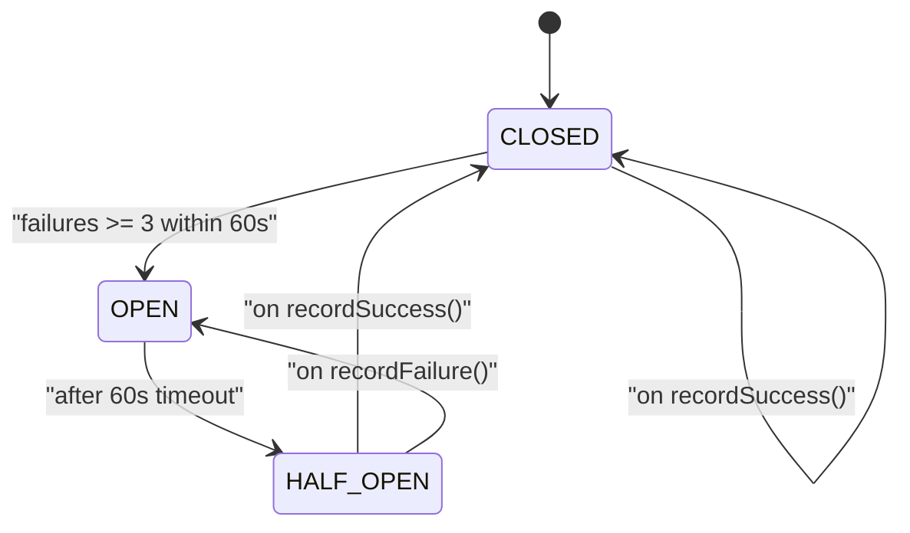
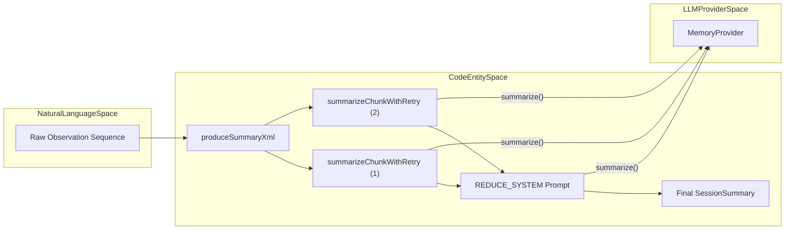

<!-- source: DeepWiki mcp.deepwiki.com · repo rohitg00/agentmemory · page 6.1 LLM Providers & Circuit Breaker · fetched 2026-10-30 -->

# LLM Providers & Circuit Breaker

Relevant source files

The following files were used as context for generating this wiki page:

- [src/functions/replay.ts](src/functions/replay.ts)
- [src/functions/summarize.ts](src/functions/summarize.ts)
- [src/providers/_openai-shared.ts](src/providers/_openai-shared.ts)
- [src/providers/agent-sdk.ts](src/providers/agent-sdk.ts)
- [src/providers/embedding/cohere.ts](src/providers/embedding/cohere.ts)
- [src/providers/embedding/gemini.ts](src/providers/embedding/gemini.ts)
- [src/providers/embedding/voyage.ts](src/providers/embedding/voyage.ts)
- [src/providers/index.ts](src/providers/index.ts)
- [src/providers/minimax.ts](src/providers/minimax.ts)
- [src/providers/openai.ts](src/providers/openai.ts)
- [src/providers/openrouter.ts](src/providers/openrouter.ts)
- [src/replay/jsonl-parser.ts](src/replay/jsonl-parser.ts)
- [test/agent-sdk-provider.test.ts](test/agent-sdk-provider.test.ts)
- [test/claude-bridge-path.test.ts](test/claude-bridge-path.test.ts)
- [test/fallback-model-resolution.test.ts](test/fallback-model-resolution.test.ts)
- [test/minimax-provider.test.ts](test/minimax-provider.test.ts)
- [test/openai-shared.test.ts](test/openai-shared.test.ts)
- [test/replay-import-key.test.ts](test/replay-import-key.test.ts)
- [test/replay-sensitive.test.ts](test/replay-sensitive.test.ts)
- [test/replay.test.ts](test/replay.test.ts)
- [test/summarize.test.ts](test/summarize.test.ts)

The `agentmemory` system relies on Large Language Models (LLMs) for critical background tasks such as observation compression and session summarization. To ensure high availability and prevent cascading failures when upstream LLM APIs are unstable, the system implements a provider abstraction layer coupled with a robust Circuit Breaker pattern and fallback mechanisms.

## MemoryProvider Interface

All LLM interactions are abstracted through the `MemoryProvider` interface [src/providers/index.ts:1-5](). This allows the core memory logic to remain agnostic of the specific model or API being used.

### Core Interface
The interface defines two primary asynchronous methods used for processing text:
- `compress(systemPrompt: string, userPrompt: string)`: Used by the `mem::compress` pipeline to transform raw logs into structured observations [src/providers/openai.ts:70-72]().
- `summarize(systemPrompt: string, userPrompt: string)`: Used by `mem::summarize` to generate end-of-session narratives [src/providers/openai.ts:74-76]().

### Concrete Implementations
| Provider Class | Description | Implementation Detail |
| :--- | :--- | :--- |
| `AnthropicProvider` | Native Anthropic API integration. | [src/providers/index.ts:103-109]() |
| `MinimaxProvider` | Direct fetch implementation for MiniMax's Anthropic-compatible API to avoid SDK header rejection. | [src/providers/minimax.ts:19-40]() |
| `OpenRouterProvider` | Integration via OpenRouter or Gemini OpenAI-compatible endpoints. | [src/providers/index.ts:125-131]() |
| `OpenAIProvider` | Native OpenAI API integration, also used for DeepSeek, SiliconFlow, and Azure. | [src/providers/openai.ts:47-152]() |
| `AgentSDKProvider` | Spawns `@anthropic-ai/claude-agent-sdk` child sessions; includes recursion guards. | [src/providers/agent-sdk.ts:37-59]() |
| `NoopProvider` | A safe default that performs no LLM operations. | [src/providers/index.ts:146-147]() |
| `ResilientProvider` | A wrapper that adds circuit breaking logic to any provider. | [src/providers/index.ts:57-59]() |
| `FallbackChainProvider` | A wrapper that tries a list of providers in sequence until one succeeds. | [src/providers/index.ts:61-93]() |

**Sources:** [src/providers/index.ts:57-150](), [src/providers/minimax.ts:19-70](), [src/providers/agent-sdk.ts:37-120](), [src/providers/openai.ts:47-152]()

## Resilience Architecture

The provider system is designed to be "resilient by default." When a provider is created via `createProvider` or `createFallbackProvider`, it is automatically wrapped in a `ResilientProvider` which manages a `CircuitBreaker` instance [src/providers/index.ts:57-59]().

### Provider Data Flow
The following diagram illustrates how a request from a memory function (like `mem::summarize`) flows through the resilience layers to the actual LLM API.

**Provider Execution Flow**

**Sources:** [src/providers/index.ts:57-93](), [src/providers/openai.ts:78-151](), [src/providers/resilient.ts:1-37]()

## Circuit Breaker State Machine

The `CircuitBreaker` manages the health state of LLM providers. It prevents the system from hanging on timed-out requests by using a 60-second window and a 3-failure threshold.

### State Definitions
- **CLOSED**: The default state. Requests are allowed to pass through to the provider.
- **OPEN**: The provider has failed repeatedly. Requests are immediately rejected without attempting a network call.
- **HALF-OPEN**: After a recovery timeout (default 60 seconds), the breaker allows a probe request to test if the service has recovered.

### Timeouts and Introspection
Outbound requests are governed by `fetchWithTimeout` [src/providers/openai.ts:107-115](). The timeout is resolved with the following precedence:
1. `OPENAI_TIMEOUT_MS` (for OpenAI-compatible providers) [src/providers/openai.ts:160-162]().
2. `AGENTMEMORY_LLM_TIMEOUT_MS` (global default) [src/providers/openai.ts:164-166]().
3. 60,000 ms (fallback) [src/providers/openai.ts:168]().

### State Transitions

**Sources:** [src/providers/openai.ts:154-169](), [src/providers/openai.ts:116-124]()

## Recursion Guard: Agent SDK Provider

A specific challenge arises when using `AgentSDKProvider` from within agents like Claude Code. Because the SDK spawns child sessions that inherit the same plugin hooks, a call to `mem::summarize` (triggered by the `Stop` hook) could spawn a child agent that triggers its own `Stop` hook, leading to infinite recursion.

The system implements a dual-layer recursion guard in `AgentSDKProvider` [src/providers/agent-sdk.ts:23-33]():

1.  **In-process Guard**: Uses `AsyncLocalStorage` (`sdkChildContext`) to track recursion within the same async call tree. This ensures that concurrent siblings (e.g., chunks in a chunked summarize) do not block each other while genuine re-entry is caught [src/providers/agent-sdk.ts:64-74]().
2.  **Cross-process Guard**: Sets `process.env.AGENTMEMORY_SDK_CHILD = '1'` before the SDK call. Since subprocesses inherit environment variables, hook scripts spawned by the SDK see this marker and short-circuit their REST callbacks [src/providers/agent-sdk.ts:82-85]().

**Sources:** [src/providers/agent-sdk.ts:23-118](), [test/agent-sdk-provider.test.ts:40-160]()

## Fallback Chains

When `FALLBACK_PROVIDERS` is configured, the system constructs a `FallbackChainProvider` [src/providers/index.ts:61-67]().

- **Model Resolution**: Fallback providers resolve their own default models via `defaultModelFor` (e.g., a Gemini fallback uses its flash model even if the primary was OpenAI) to prevent 404 errors from model mismatches [src/providers/index.ts:35-53]().
- **Execution**: The chain iterates through the list of `MemoryProvider` instances. If the primary fails, it attempts the next in line [src/providers/index.ts:69-87]().
- **Resilience**: The entire chain is wrapped in a `ResilientProvider` to provide circuit breaking at the entry point [src/providers/index.ts:90-92]().

**Sources:** [src/providers/index.ts:35-93]()

## Summarization Strategy: Map-Reduce

For large sessions that exceed the LLM's context window, `produceSummaryXml` implements a map-reduce pattern [src/functions/summarize.ts:98-108]().

1.  **Chunking**: Observations are split into chunks based on `SUMMARIZE_CHUNK_SIZE` (default 400) [src/functions/summarize.ts:109-121]().
2.  **Parallel Map**: Chunks are processed concurrently (controlled by `SUMMARIZE_CHUNK_CONCURRENCY`) using `summarizeChunkWithRetry` [src/functions/summarize.ts:135-150]().
3.  **Bailout**: If more than 50% (`MAX_SKIP_RATIO`) of chunks fail to parse, the operation throws `too_many_chunks_skipped` to avoid generating a misleading summary [src/functions/summarize.ts:155-159]().
4.  **Reduce**: Successful partial summaries are merged into a final narrative via a "reduce" LLM call using `REDUCE_SYSTEM` prompt [src/functions/summarize.ts:168-183]().

**Summarization Data Flow**

**Sources:** [src/functions/summarize.ts:24-185](), [src/functions/summarize.ts:37-51]()

---

