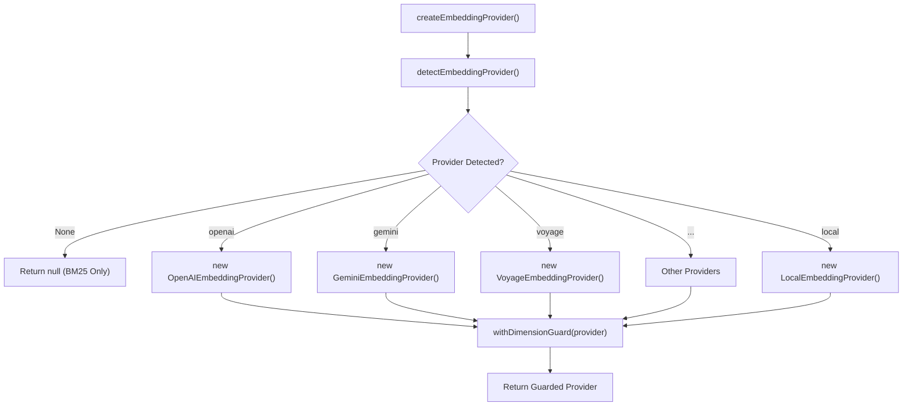
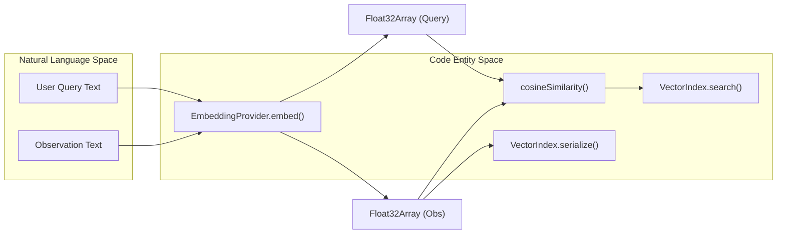

<!-- source: DeepWiki mcp.deepwiki.com · repo rohitg00/agentmemory · page 6.2 Embedding Providers · fetched 2026-10-30 -->

# Embedding Providers

Relevant source files

The following files were used as context for generating this wiki page:

- [src/functions/vision-search.ts](src/functions/vision-search.ts)
- [src/providers/_fetch.ts](src/providers/_fetch.ts)
- [src/providers/embedding/clip.ts](src/providers/embedding/clip.ts)
- [src/providers/embedding/cohere.ts](src/providers/embedding/cohere.ts)
- [src/providers/embedding/gemini.ts](src/providers/embedding/gemini.ts)
- [src/providers/embedding/index.ts](src/providers/embedding/index.ts)
- [src/providers/embedding/openai.ts](src/providers/embedding/openai.ts)
- [src/providers/embedding/openrouter.ts](src/providers/embedding/openrouter.ts)
- [src/providers/embedding/voyage.ts](src/providers/embedding/voyage.ts)
- [src/providers/minimax.ts](src/providers/minimax.ts)
- [src/providers/openrouter.ts](src/providers/openrouter.ts)
- [src/state/vector-index.ts](src/state/vector-index.ts)
- [test/embedding-provider.test.ts](test/embedding-provider.test.ts)
- [test/fetch-timeout.test.ts](test/fetch-timeout.test.ts)
- [test/minimax-provider.test.ts](test/minimax-provider.test.ts)
- [test/vector-index.test.ts](test/vector-index.test.ts)
- [test/vision-search.test.ts](test/vision-search.test.ts)

The `agentmemory` system utilizes a pluggable architecture for generating vector representations of text and images. These embeddings are critical for the **Vector Search** stream of the hybrid retrieval pipeline and the **Vision Search** subsystem. The system supports multiple cloud-based providers and local offline modes.

## The EmbeddingProvider Interface

All embedding backends must implement the `EmbeddingProvider` interface. This ensures consistent behavior across different models and APIs.

### Interface Definition
The interface requires several main components:
1.  **`name`**: A unique string identifier for the provider (e.g., "openai", "gemini", "clip"). [src/providers/embedding/openai.ts:52-52](), [src/providers/embedding/gemini.ts:10-10](), [src/providers/embedding/clip.ts:14-14]()
2.  **`dimensions`**: The fixed size of the vector produced by the model. [src/providers/embedding/openai.ts:53-53](), [src/providers/embedding/gemini.ts:11-11](), [src/providers/embedding/clip.ts:15-15]()
3.  **`embed(text: string)`**: A method to generate a vector for a single string. [src/providers/embedding/openai.ts:92-95](), [src/providers/embedding/gemini.ts:19-22]()
4.  **`embedBatch(texts: string[])`**: A method to generate vectors for multiple strings in a single request. [src/providers/embedding/openai.ts:97-122](), [src/providers/embedding/gemini.ts:24-56]()
5.  **`embedImage?(imageRef: string)`**: An optional method for multimodal providers to embed images. [src/providers/embedding/clip.ts:35-42](), [src/providers/embedding/index.ts:75-78]()

### Provider Initialization Flow
The system uses `createEmbeddingProvider` to instantiate the appropriate backend based on environment variables. It prioritizes explicit overrides via `EMBEDDING_PROVIDER` before falling back to detecting keys for Gemini, OpenAI, Voyage, Cohere, or OpenRouter. [src/providers/embedding/index.ts:30-50]()

#### Embedding Provider Factory Flow

Sources: [src/providers/embedding/index.ts:30-50](), [test/embedding-provider.test.ts:10-53]()

---

## Dimension Safety and Validation

Wrong-dimension vectors can corrupt the index silently because similarity calculations require matching lengths. If a vector of length 1536 is compared against a vector of length 768, the search may fail or return invalid results.

### The Dimension Guard
The `withDimensionGuard` wrapper intercepts all calls to `embed`, `embedBatch`, and `embedImage`. It verifies that the returned `Float32Array` length matches the provider's declared `dimensions` property before the vector reaches the persistence layer. [src/providers/embedding/index.ts:56-80]()

### Persistence Validation
The `VectorIndex` class includes a `validateDimensions(expected)` method. This is used during startup to refuse loading any index containing wrong-dimension vectors, preventing issues caused by mid-session provider swaps or legacy on-disk corruption. [src/state/vector-index.ts:91-104]()

Sources: [src/providers/embedding/index.ts:56-80](), [src/state/vector-index.ts:91-104](), [test/embedding-provider.test.ts:160-192]()

---

## Supported Backends

### 1. OpenAI (and Azure)
The `OpenAIEmbeddingProvider` supports standard models and Azure OpenAI. It shares transport logic with the OpenAI LLM provider via `_openai-shared`. [src/providers/embedding/openai.ts:15-23]()

*   **Default Model**: `text-embedding-3-small` (1536 dims). [src/providers/embedding/openai.ts:13-13](), [src/providers/embedding/openai.ts:81-81]()
*   **Dimensions**: Resolved via `resolveDimensions` using a model-to-dimension map or `OPENAI_EMBEDDING_DIMENSIONS` override. [src/providers/embedding/openai.ts:82-86]()
*   **Azure Support**: Automatically detected if `OPENAI_BASE_URL` contains `.openai.azure.com`. It uses the `api-key` header and `api-version` query parameters. [src/providers/embedding/openai.ts:18-23](), [src/providers/embedding/openai.ts:87-90]()

### 2. Google Gemini
The `GeminiEmbeddingProvider` uses Google's generative language API.

*   **Model**: `models/gemini-embedding-001`. [src/providers/embedding/gemini.ts:6-6]()
*   **Dimensions**: 768. [src/providers/embedding/gemini.ts:11-11]()
*   **Normalization**: Performs L2 normalization on returned vectors. [src/providers/embedding/gemini.ts:61-78]()
*   **Batching**: Internal chunking with a `BATCH_LIMIT` of 100. [src/providers/embedding/gemini.ts:5-5](), [src/providers/embedding/gemini.ts:27-29]()

### 3. CLIP & Vision Search
Multimodal search is handled by the `ClipEmbeddingProvider`, typically using `Xenova/clip-vit-base-patch32`. [src/providers/embedding/clip.ts:11-15]()

*   **Image Ingestion**: Supports local file paths and `data:` URIs. [src/providers/embedding/clip.ts:72-84]()
*   **Vision Functions**: `mem::vision-embed` and `mem::vision-search` use the `imageProvider` to store and query image vectors in the `KV.imageEmbeddings` scope. [src/functions/vision-search.ts:24-133]()
*   **Local Processing**: Uses `@huggingface/transformers` for local feature extraction. [src/providers/embedding/clip.ts:59-70]()

### 4. Voyage, Cohere, and OpenRouter
*   **Voyage**: Optimized for retrieval via the `VoyageEmbeddingProvider`.
*   **Cohere**: Implemented in `CohereEmbeddingProvider` for enterprise-grade embeddings.
*   **OpenRouter**: Provides a unified interface to multiple embedding models (defaulting to OpenAI's small model) via the `OpenRouterEmbeddingProvider`. [src/providers/embedding/openrouter.ts:8-25]()

Sources: [src/providers/embedding/openai.ts:51-123](), [src/providers/embedding/gemini.ts:9-57](), [src/providers/embedding/clip.ts:13-57](), [src/functions/vision-search.ts:19-133]()

---

## Vector Storage and Search

The `VectorIndex` class manages the in-memory storage and cosine similarity calculations for embeddings.

### Implementation Details
*   **Storage**: Uses a `Map<string, { embedding: Float32Array; sessionId: string }>` to store vectors keyed by observation ID. [src/state/vector-index.ts:38-39]()
*   **Cosine Similarity**: Calculated manually to avoid external dependencies. [src/state/vector-index.ts:23-35]()
*   **Serialization**: Vectors are converted to Base64 for storage. To prevent issues with Node's `Buffer` pool, the system explicitly uses `byteOffset` and `byteLength` during conversion. [src/state/vector-index.ts:1-21](), [src/state/vector-index.ts:124-136]()

#### Code Entity to Vector Space Mapping

Sources: [src/state/vector-index.ts:23-77](), [src/providers/embedding/index.ts:56-80]()

---

## BM25-Only Fallback Mode

If no embedding provider is configured (i.e., `createEmbeddingProvider` returns `null`), the system enters **BM25-only mode**. [test/embedding-provider.test.ts:27-30]()

### Behavioral Changes
1.  **Search Streams**: Retrieval logic skips the `vectorStream` and relies entirely on the BM25 inverted index.
2.  **Vision Search**: Multimodal features are disabled. `mem::vision-search` returns an error stating "image embeddings disabled". [src/functions/vision-search.ts:80-82]()
3.  **Weight Tuning**: The hybrid search fusion respects `bm25Weight` and `vectorWeight` configuration. In fallback mode, `vectorWeight` is effectively zeroed as no vector results are generated.

Sources: [src/providers/embedding/index.ts:30-50](), [src/functions/vision-search.ts:147]()

---

## Technical Comparison

| Provider | Default Dimensions | Transport | Auth Pattern |
| :--- | :--- | :--- | :--- |
| **OpenAI** | 1536 | REST (`/v1/embeddings`) | `Authorization: Bearer` |
| **Azure OpenAI** | 1536 | REST (`/embeddings`) | `api-key` header |
| **Gemini** | 768 | REST (`batchEmbedContents`) | Query param `key` |
| **OpenRouter** | 1536 | REST (`/v1/embeddings`) | `Authorization: Bearer` |
| **CLIP** | 512 | Local (Transformers.js) | N/A (Offline) |

Sources: [src/providers/embedding/openai.ts:12-25](), [src/providers/embedding/gemini.ts:6-11](), [src/providers/embedding/openrouter.ts:6-12](), [src/providers/embedding/clip.ts:11-15]()

---

