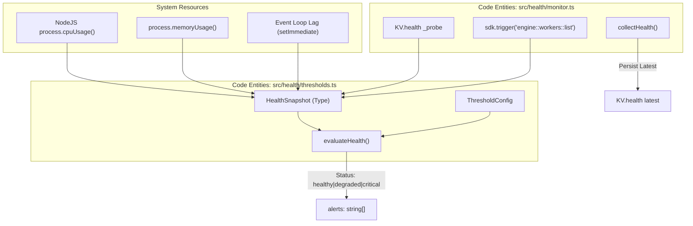
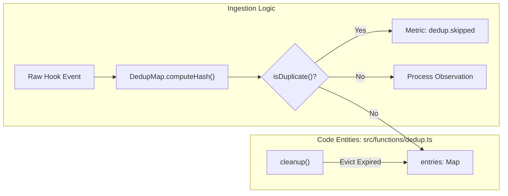

<!-- source: DeepWiki mcp.deepwiki.com · repo rohitg00/agentmemory · page 7.1 Telemetry, Metrics & Health Monitoring · fetched 2026-10-30 -->

# Telemetry, Metrics & Health Monitoring

Relevant source files

The following files were used as context for generating this wiki page:

- [src/eval/metrics-store.ts](src/eval/metrics-store.ts)
- [src/functions/dedup.ts](src/functions/dedup.ts)
- [src/functions/recent-searches-sweep.ts](src/functions/recent-searches-sweep.ts)
- [src/health/monitor.ts](src/health/monitor.ts)
- [src/health/thresholds.ts](src/health/thresholds.ts)
- [src/telemetry/setup.ts](src/telemetry/setup.ts)
- [test/diagnostic-followup-rate.test.ts](test/diagnostic-followup-rate.test.ts)
- [test/health-thresholds.test.ts](test/health-thresholds.test.ts)

The **agentmemory** system implements a comprehensive observability stack designed to provide real-time insights into memory operations, provider performance, and system resource health. This infrastructure enables self-healing through circuit breakers and automated recovery, while providing developers with a high-fidelity audit trail via the OpenTelemetry standard and a dedicated health monitoring sub-system.

## OpenTelemetry & Metrics Collection

The system utilizes a structured metrics collection pattern centered around `initMetrics` in `src/telemetry/setup.ts`. This setup initializes both counters (for discrete events) and histograms (for latency and distribution data) using an OpenTelemetry-compatible `Meter` interface.

### Metric Definitions
The system tracks two primary types of data:
1.  **Counters**: Monotonic values that only increase (e.g., total observations, cache misses).
2.  **Histograms**: Distribution of values used primarily for timing and scoring (e.g., LLM latency, quality scores).

| Metric Name | Type | Code Identifier | Purpose |
| :--- | :--- | :--- | :--- |
| `observations.total` | Counter | `observationsTotal` | Tracks raw event ingestion volume [src/telemetry/setup.ts:78](). |
| `compression.success` | Counter | `compressionSuccess` | Count of successful LLM summarizations [src/telemetry/setup.ts:79](). |
| `compression.latency_ms` | Histogram | `compressionLatency` | Measures time taken for LLM compression [src/telemetry/setup.ts:102](). |
| `search.latency_ms` | Histogram | `searchLatency` | Measures hybrid search execution time [src/telemetry/setup.ts:103](). |
| `quality.score` | Histogram | `qualityScore` | Tracks the 1-100 quality score of LLM outputs [src/telemetry/setup.ts:105](). |
| `circuit_breaker.open` | Counter | `circuitBreakerOpen` | Counts how many times a provider was tripped [src/telemetry/setup.ts:84](). |
| `vector_search.total` | Counter | `vectorSearchTotal` | Tracks vector-specific retrieval attempts [src/telemetry/setup.ts:87](). |
| `snapshot.create` | Counter | `snapshotCreate` | Tracks health snapshot generation frequency [src/telemetry/setup.ts:95](). |
| `smart_search.followup_within_window_total` | Counter | `smartSearchFollowupWithinWindow` | Tracks directional signals for search failure [src/telemetry/setup.ts:97](). |

### Implementation Flow
The `initMetrics` function [src/telemetry/setup.ts:128-149]() maps internal `COUNTER_NAMES` [src/telemetry/setup.ts:77-99]() and `HISTOGRAM_NAMES` [src/telemetry/setup.ts:101-108]() to the provided OpenTelemetry meter. If no meter is provided (e.g., during local CLI usage), it defaults to `NOOP` implementations [src/telemetry/setup.ts:74-75]() to prevent runtime overhead.

**Sources:** [src/telemetry/setup.ts:1-149]()

---

## MetricsStore & Moving Averages

While OpenTelemetry handles external export, the internal `MetricsStore` class [src/eval/metrics-store.ts:5-65]() provides the system with "self-awareness." It persists function-level performance data into the KV store, allowing the system to track its own health over time.

### Key Capabilities
-   **Moving Averages**: Calculates `avgLatencyMs` and `avgQualityScore` using an incremental mean formula to avoid storing every individual data point [src/eval/metrics-store.ts:31-43]().
-   **Persistence**: Synchronizes in-memory `cache` with the `KV.metrics` namespace [src/eval/metrics-store.ts:45-47]().
-   **Success/Failure Tracking**: Maintains `successCount` and `failureCount` per function ID [src/eval/metrics-store.ts:32-36]().

**Sources:** [src/eval/metrics-store.ts:1-65]()

---

## Health Monitoring & Tri-State Model

The health system evaluates the physical state of the host and the connectivity of the data layer. It uses a `HealthSnapshot` [src/health/monitor.ts:21-94]() to capture point-in-time metrics which are then processed by a tri-state evaluator.

### Health Evaluation Logic
The `evaluateHealth` function [src/health/thresholds.ts:23-81]() applies a `ThresholdConfig` [src/health/thresholds.ts:3-11]() to determine if the system is `healthy`, `degraded`, or `critical`.

| State | Condition | Impact |
| :--- | :--- | :--- |
| **Healthy** | All metrics below `Warn` thresholds. | Normal operation. |
| **Degraded** | Metrics exceed `Warn` (e.g., CPU > 80% [src/health/thresholds.ts:16]() or Event Loop Lag > 100ms [src/health/thresholds.ts:14]()). | System may throttle non-essential background tasks. |
| **Critical** | Metrics exceed `Critical` (e.g., Memory > 95% [src/health/thresholds.ts:19]()) or KV disconnected [src/health/thresholds.ts:34-38](). | System may reject new observations to prevent data loss. |

### Memory RSS Floor
To prevent false positives in small processes, the system uses a `memoryRssFloorBytes` (default 512MB) [src/health/thresholds.ts:20](). If the process Resident Set Size (RSS) is below this floor, high heap usage percentages only trigger a `note` rather than a `warn` or `critical` alert [src/health/thresholds.ts:67-77](). This behavior is verified by tests ensuring steady-state processes remain "healthy" even with tight heaps [test/health-thresholds.test.ts:21-36]().

### Resource Probing
The `registerHealthMonitor` [src/health/monitor.ts:7-105]() function runs a collection loop every 30 seconds [src/health/monitor.ts:97-99](). It gathers:
- **CPU/Memory**: Via `process.cpuUsage()` and `process.memoryUsage()` [src/health/monitor.ts:22-33]().
- **Event Loop Lag**: Measured by timing a `setImmediate` callback [src/health/monitor.ts:35-37]().
- **KV Probe**: A "ping" to the KV store (writing and reading a `_probe` key in the `KV.health` namespace) with a 5-second timeout [src/health/monitor.ts:48-64]().
- **Worker List**: Queries the engine for active worker status via `engine::workers::list` [src/health/monitor.ts:41-46]().

**Entity Mapping: Health Monitoring Flow**

**Sources:** [src/health/thresholds.ts:1-81](), [src/health/monitor.ts:1-111](), [test/health-thresholds.test.ts:1-97]()

---

## Search Effectiveness Diagnostics (#771)

To monitor retrieval quality in live environments, the system tracks "follow-up" searches that occur within a configured time window (default 60s).

### Follow-up Detection Logic
A search is flagged as a potential failure if:
1. A second search is issued within the `AGENTMEMORY_FOLLOWUP_WINDOW_SECONDS` [src/functions/recent-searches-sweep.ts:6]().
2. The second search returns a result set with **zero overlap** with the previous one [test/diagnostic-followup-rate.test.ts:124-141]().
3. The query string has changed (identical re-queries are treated as retries, not follow-ups) [test/diagnostic-followup-rate.test.ts:160-176]().

### Sweep & Stats
- **`mem::diagnostic::recent-searches-sweep`**: An hourly cleanup function that prunes the `KV.recentSearches` namespace to prevent storage bloat [src/functions/recent-searches-sweep.ts:14-49]().
- **`mem::diagnostic::followup-stats`**: Provides a read-back surface for external dashboards to calculate the follow-up rate [src/functions/recent-searches-sweep.ts:53-71]().

**Sources:** [src/functions/recent-searches-sweep.ts:1-72](), [test/diagnostic-followup-rate.test.ts:1-213]()

---

## Deduplication (DedupMap)

To prevent "telemetry storms" from redundant tool calls, the `DedupMap` [src/functions/dedup.ts:11-57]() uses SHA-256 hashing of `sessionId`, `toolName`, and `toolInput` [src/functions/dedup.ts:20-27]().

### Deduplication Logic
1. **Hash Generation**: The system hashes the first 500 characters of the tool input to create a unique fingerprint [src/functions/dedup.ts:23-26]().
2. **TTL Enforcement**: Entries are stored with a 5-minute TTL (`TTL_MS = 300,000`) [src/functions/dedup.ts:3, 40]().
3. **Background Cleanup**: A timer runs every 60 seconds [src/functions/dedup.ts:4, 16]() to prune expired hashes [src/functions/dedup.ts:43-48]().

**Entity Mapping: Telemetry Ingestion & Dedup**

**Sources:** [src/functions/dedup.ts:1-57](), [src/telemetry/setup.ts:82]()

---

