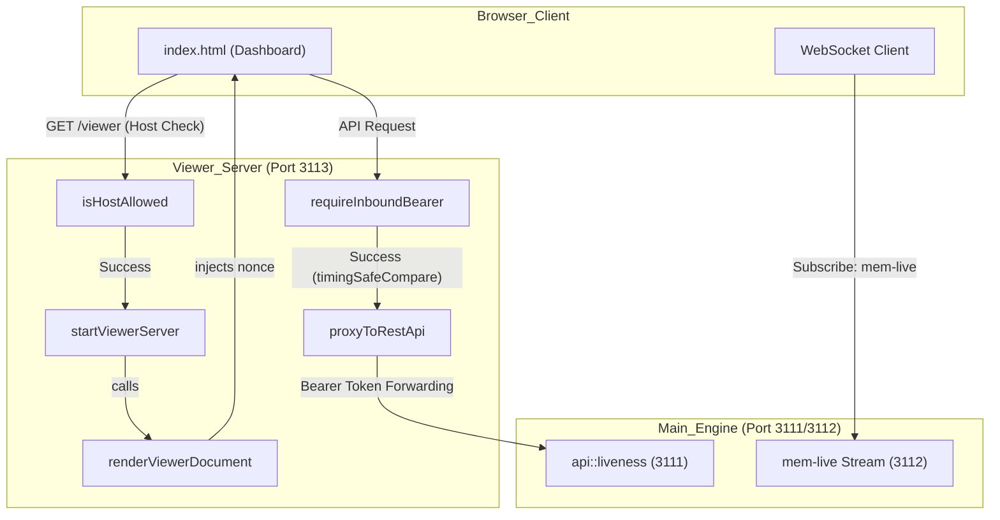
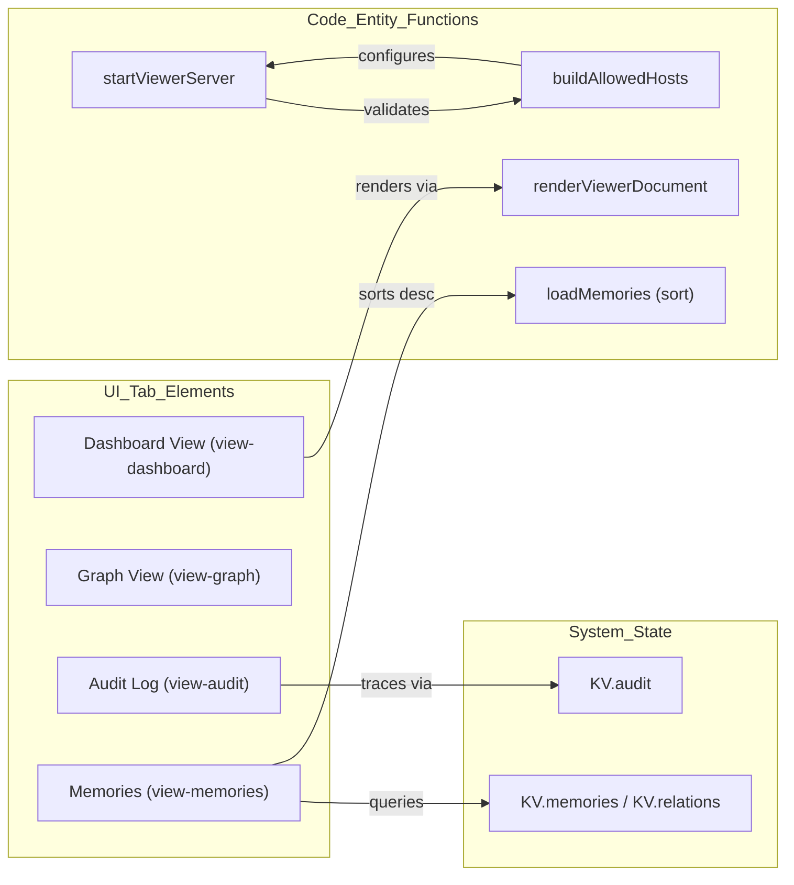

<!-- source: DeepWiki mcp.deepwiki.com · repo rohitg00/agentmemory · page 7.2 Web Viewer & Dashboard · fetched 2026-10-30 -->

# Web Viewer & Dashboard

Relevant source files

The following files were used as context for generating this wiki page:

- [deploy/README.md](deploy/README.md)
- [deploy/coolify/README.md](deploy/coolify/README.md)
- [deploy/coolify/entrypoint.sh](deploy/coolify/entrypoint.sh)
- [deploy/fly/README.md](deploy/fly/README.md)
- [deploy/fly/entrypoint.sh](deploy/fly/entrypoint.sh)
- [deploy/fly/fly.toml](deploy/fly/fly.toml)
- [src/auth.ts](src/auth.ts)
- [src/viewer/favicon.svg](src/viewer/favicon.svg)
- [src/viewer/server.ts](src/viewer/server.ts)
- [test/viewer-host.test.ts](test/viewer-host.test.ts)
- [test/viewer-memories-sort.test.ts](test/viewer-memories-sort.test.ts)
- [test/viewer-security.test.ts](test/viewer-security.test.ts)
- [test/viewer-session-id.test.ts](test/viewer-session-id.test.ts)

The `agentmemory` Web Viewer is a high-fidelity, thick-client dashboard designed for real-time observability of an agent's internal state. It provides a visual interface for exploring the knowledge graph, auditing the memory pipeline, monitoring system health, and tracking real-time observation streams via WebSockets.

## Viewer Server & Proxy Architecture

The viewer is served by a dedicated Node.js HTTP server, typically running on port `3113` [src/viewer/server.ts:196-202](). This server acts as both a static file host for the dashboard and a secure proxy to the main REST API (port `3111`).

### Port Layout
| Port | Role | Code Entity |
| :--- | :--- | :--- |
| **3111** | Core REST API | `restPort` [src/viewer/server.ts:201]() |
| **3112** | WebSocket Stream | `iii-stream` (configured via env) [deploy/fly/entrypoint.sh:61-67]() |
| **3113** | Web Viewer | `startViewerServer` [src/viewer/server.ts:196]() |

### Proxy and Security Policy
The `startViewerServer` implements several critical security and routing features:
*   **Path Rewriting**: Requests to `/`, `/viewer`, or `/agentmemory/viewer` serve the `index.html` dashboard via `renderViewerDocument` [src/viewer/server.ts:248-255]().
*   **DNS Rebinding Defense**: The server maintains an `allowedHosts` Set, validated via `isHostAllowed` [src/viewer/server.ts:107-115](). It rejects any request where the `Host` header does not match the listening port or an allowed origin [src/viewer/server.ts:219-223]().
*   **CORS Policy**: The server enforces an `ALLOWED_ORIGINS` list, defaulting to localhost and 127.0.0.1 on ports 3111 and 3113 [src/viewer/server.ts:36-41]().
*   **Token Forwarding**: If an `AGENTMEMORY_SECRET` is configured, the `proxyToRestApi` logic injects it into the `Authorization` header as a Bearer token when communicating with the upstream REST API [src/viewer/server.ts:285-288]().
*   **Content Security Policy (CSP)**: The viewer is served with a strict CSP header generated by `renderViewerDocument`, utilizing a unique nonce for script execution and restricting images to `'self'` [src/auth.ts:16-30](), [test/viewer-security.test.ts:12-23]().
*   **Inbound Bearer Guard**: When bound to a non-loopback host (e.g., in a Fly.io deployment), the viewer requires its own inbound Bearer token for all proxied API calls, verified via `requireInboundBearer` [src/viewer/server.ts:122-130]().

### Data Flow: Viewer Proxy
The following diagram illustrates how the viewer interacts with the core system components.

"Viewer Proxy and Security Flow"

Sources: [src/viewer/server.ts:196-300](), [src/viewer/server.ts:107-115](), [src/viewer/server.ts:122-130](), [src/auth.ts:6-10](), [deploy/fly/entrypoint.sh:98-110]()

## Real-time Stream (`mem-live`)

The dashboard maintains a live connection to the `mem-live` stream. This stream broadcasts updates whenever an observation is processed.

*   **Trigger Mechanism**: The viewer UI initiates a connection to the WebSocket stream to receive real-time updates [test/viewer-session-id.test.ts:169-171]().
*   **Status Monitoring**: The UI displays connection state via `.ws-status` elements, switching between `connected` and `disconnected` classes based on the socket state [src/viewer/index.html:142-163]().

Sources: [test/viewer-session-id.test.ts:169-171](), [src/viewer/index.html:142-163]()

## Dashboard Components

The viewer is a "thick client" application using a high-density aesthetic with a multi-tab interface [test/viewer-session-id.test.ts:70-83]().

### 1. Knowledge Graph Canvas
A force-directed graph visualization rendered using a canvas element. It visualizes entities (`GraphNode`) and their relationships (`GraphEdge`).
*   **Node Types**: Color-coded by category: `file`, `function`, `concept`, `error`, `decision`, `pattern`, `library`, and `person` [src/viewer/favicon.svg:12-15]().
*   **Interactivity**: Supports zooming, dragging, and node selection to view metadata via tooltips.

### 2. Timeline & Audit Log
*   **Timeline**: Displays a chronological sequence of agent interactions and memories [test/viewer-session-id.test.ts:74]().
*   **Audit Log**: Displays the system's internal `AuditEntry` stream, allowing developers to trace how specific memories were formed or modified [test/viewer-session-id.test.ts:79]().
*   **Sorting**: The Memories tab sorts items by `createdAt` (falling back to `updatedAt`) in descending order to ensure new entries appear at the top [test/viewer-memories-sort.test.ts:9-25]().

### 3. Circuit Breaker & Health Status
The dashboard visualizes the system's `HealthSnapshot`.
*   **Metrics**: Displays a grid of statistics including memory count, session count, and system health status (Healthy/Degraded/Critical).
*   **Circuit Breakers**: Shows the real-time status of LLM provider connections, indicating if any providers are currently in an `open` or `half-open` state.

### 4. Search & Filter Interface
The viewer provides a centralized search interface that interacts with the `smart-search` endpoint, allowing for filtering by session, project, or memory type.

"Dashboard Code-to-UI Mapping"

Sources: [src/viewer/server.ts:76-105](), [test/viewer-session-id.test.ts:70-83](), [test/viewer-memories-sort.test.ts:4-16]()

## Implementation Details

### Document Rendering
The `renderViewerDocument` function prepares the dashboard by loading the `index.html` template and injecting a security `nonce` for the CSP [test/viewer-security.test.ts:12-23](). It checks multiple candidate paths to ensure the template is found in both development and production environments [src/viewer/server.ts:17-29]().

### Proxy Logic
The `startViewerServer` manages the upstream communication.
*   **Favicon**: The server self-hosts the `favicon.svg` at `/favicon.svg` to maintain a tight `img-src 'self'` CSP policy [src/viewer/server.ts:17-34]().
*   **Host Validation**: The `buildAllowedHosts` function ensures the server only responds to legitimate loopback addresses or configured `VIEWER_ALLOWED_HOSTS` [src/viewer/server.ts:76-105]().
*   **Auth Defense**: It utilizes `timingSafeCompare` for secret verification to prevent timing attacks when validating the inbound Bearer token [src/auth.ts:6-10]().
*   **Deployment Configuration**: In platforms like Fly.io, the entrypoint script detects the environment and sets `AGENTMEMORY_VIEWER_HOST=::` to allow reachability via WireGuard proxy while maintaining security [deploy/fly/entrypoint.sh:106-110]().

Sources: [src/viewer/server.ts:17-130](), [src/auth.ts:6-10](), [test/viewer-security.test.ts:11-55](), [deploy/fly/entrypoint.sh:98-110]()

---

