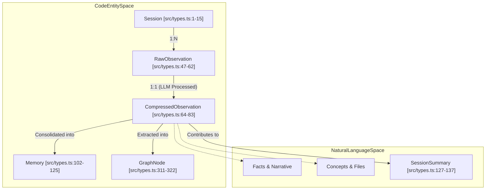
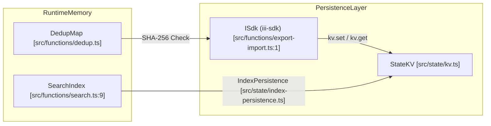

<!-- source: DeepWiki mcp.deepwiki.com · repo rohitg00/agentmemory · page 8 State Layer & Data Model · fetched 2026-10-30 -->

# State Layer & Data Model

Relevant source files

The following files were used as context for generating this wiki page:

- [CHANGELOG.md](CHANGELOG.md)
- [package.json](package.json)
- [packages/mcp/package.json](packages/mcp/package.json)
- [plugin/.claude-plugin/plugin.json](plugin/.claude-plugin/plugin.json)
- [plugin/.codex-plugin/plugin.json](plugin/.codex-plugin/plugin.json)
- [plugin/plugin.json](plugin/plugin.json)
- [src/functions/export-import.ts](src/functions/export-import.ts)
- [src/functions/graph.ts](src/functions/graph.ts)
- [src/mcp/server.ts](src/mcp/server.ts)
- [src/mcp/tools-registry.ts](src/mcp/tools-registry.ts)
- [src/state/schema.ts](src/state/schema.ts)
- [src/types.ts](src/types.ts)
- [src/version.ts](src/version.ts)
- [test/export-import.test.ts](test/export-import.test.ts)
- [test/graph.test.ts](test/graph.test.ts)

The State Layer provides the persistence backbone for `agentmemory`, managing everything from raw hook events to long-term architectural memories. It utilizes a structured Key-Value (KV) schema divided into functional namespaces, a comprehensive TypeScript type system for data integrity, and specialized concurrency primitives to ensure consistency across asynchronous pipelines.

### Data Model Architecture
The system bridges "Natural Language Space" (summaries, facts, narratives) with "Code Entity Space" (sessions, observations, nodes) by mapping LLM-generated insights into structured objects defined in `src/types.ts` [src/types.ts:1-322]().

**Entity Relationship Overview**

Sources: [src/types.ts:1-137](), [src/types.ts:311-322]()

---

### KV Schema & Namespaces
The system organizes data into distinct KV scopes defined in `src/state/schema.ts` [src/state/schema.ts:4-76](). This namespacing allows for efficient prefix-based lookups and logical separation of concerns. The `StateKV` wrapper provides a type-safe interface for these operations, which are heavily utilized in core functions like `mem::export` [src/functions/export-import.ts:62-186]() and `mem::import` [src/functions/export-import.ts:188-300]().

| Namespace Group | KV Scopes (Examples) | Purpose |
| :--- | :--- | :--- |
| **Core Storage** | `KV.sessions`, `KV.observations(id)`, `KV.memories` | Primary storage for sessions, observations, and long-term memories. |
| **Search Indices** | `KV.embeddings`, `KV.bm25Index` | Vector embeddings and the BM25 inverted index persistence. |
| **Graph** | `KV.graphNodes`, `KV.graphSnapshot`, `KV.graphNameIndex` | Entity-relationship data and optimized lookup indexes for the knowledge graph. |
| **Coordination** | `KV.actions`, `KV.leases`, `KV.signals` | Primitives for multi-agent task management, messaging, and resource locking. |
| **Governance** | `KV.audit`, `KV.metrics`, `KV.health` | Telemetry, audit logs, and system health snapshots. |

For a complete list of all 33+ scopes and ID generation logic (e.g., `generateId`, `fingerprintId`), see **[Type System & KV Schema](#8.1)**.

Sources: [src/state/schema.ts:4-76](), [src/functions/export-import.ts:62-164](), [src/state/schema.ts:84-93]()

---

### Persistence & Concurrency
Data persistence is handled via the `iii-engine` state module. Because many operations (like compression and consolidation) are asynchronous and involve multiple KV writes, the system employs a `withKeyedLock` primitive (using `KeyedMutex`) to prevent race conditions on specific resources.

**State Persistence Flow**

Sources: [src/functions/export-import.ts:1-36](), [src/functions/search.ts:9-10](), [src/state/schema.ts:90-93]()

#### Concurrency Controls
To maintain data integrity during complex updates, such as graph extraction or memory consolidation, the system uses targeted locking. For example, `mem::graph-extract` uses a keyed mutex to manage the `graphSnapshot` [src/state/schema.ts:19-25](), ensuring that concurrent extractions do not corrupt the top-degree ranking or aggregate statistics.

For details on index lifecycle and deduplication, see **[Concurrency & Index Persistence](#8.2)**.

Sources: [src/state/schema.ts:19-40](), [src/functions/graph.ts:28-35]()

---

### Real-time State Streaming
Beyond static persistence, `agentmemory` maintains a live state stream via the `STREAM` definitions in `src/state/schema.ts` [src/state/schema.ts:78-82](). This broadcasts observations and system events to the Web Viewer, enabling real-time monitoring of the agent's internal state.

*   **Group Scoping:** Streams are partitioned by `sessionId` for agent-specific context and a global `viewer` group for the dashboard [src/state/schema.ts:79-82]().
*   **Payloads:** Includes `RawObservation` and `CompressedObservation` objects, along with health status updates and circuit breaker state [src/types.ts:47-83](), [src/types.ts:221-244]().

Sources: [src/state/schema.ts:78-82](), [src/types.ts:47-83](), [src/types.ts:221-244]()

---

### Child Pages
*   **[Type System & KV Schema](#8.1)**: Deep dive into `src/types.ts` and the `KV` constant. Covers all core types, the 33+ KV scopes, ID generation, and `jaccardSimilarity` [src/state/schema.ts:132-154]().
*   **[Concurrency & Index Persistence](#8.2)**: Details on the `withKeyedLock` primitive, the `IndexPersistence` manager, and how the `SearchIndex` and `DedupMap` maintain state across reboots.

---

