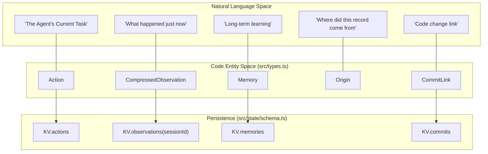
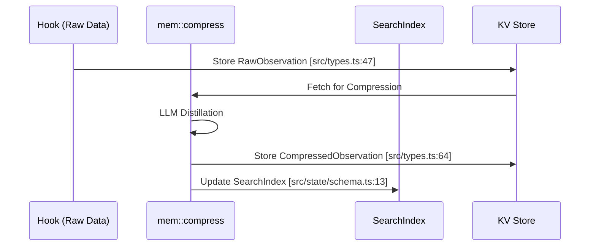

<!-- source: DeepWiki mcp.deepwiki.com · repo rohitg00/agentmemory · page 8.1 Type System & KV Schema · fetched 2026-10-30 -->

# Type System & KV Schema

Relevant source files

The following files were used as context for generating this wiki page:

- [CHANGELOG.md](CHANGELOG.md)
- [package.json](package.json)
- [packages/mcp/package.json](packages/mcp/package.json)
- [plugin/.claude-plugin/plugin.json](plugin/.claude-plugin/plugin.json)
- [plugin/.codex-plugin/plugin.json](plugin/.codex-plugin/plugin.json)
- [plugin/plugin.json](plugin/plugin.json)
- [src/functions/export-import.ts](src/functions/export-import.ts)
- [src/functions/graph.ts](src/functions/graph.ts)
- [src/mcp/server.ts](src/mcp/server.ts)
- [src/mcp/tools-registry.ts](src/mcp/tools-registry.ts)
- [src/state/schema.ts](src/state/schema.ts)
- [src/types.ts](src/types.ts)
- [src/version.ts](src/version.ts)
- [test/export-import.test.ts](test/export-import.test.ts)
- [test/graph.test.ts](test/graph.test.ts)

This section documents the foundational data structures and the persistent Key-Value (KV) schema that underpin the `agentmemory` system. The type system is designed to facilitate the transition from raw agent events to structured, searchable memories, while the KV schema provides a multi-tenant, namespaced storage layer.

## Core Type System

The core types are defined in `src/types.ts` and represent the lifecycle of data from initial capture to long-term consolidation.

### Data Flow Entities
The system processes data through several stages, each represented by a specific interface:

| Entity | Role | File Reference |
| :--- | :--- | :--- |
| `Session` | Tracks the lifecycle of an agent's work session (project, status, duration). | [src/types.ts:1-15]() |
| `Origin` | Immutable write-time provenance (channel, detail, timestamp) for every record. | [src/types.ts:32-36]() |
| `RawObservation` | The immutable record of a specific hook event (tool call, response, etc.). | [src/types.ts:47-62]() |
| `CompressedObservation` | An LLM-distilled version of a raw observation, containing facts and importance. | [src/types.ts:64-83]() |
| `Memory` | Long-term knowledge (patterns, preferences) derived from multiple observations. | [src/types.ts:102-125]() |
| `SessionSummary` | A high-level narrative and decision log for an entire session. | [src/types.ts:127-137]() |
| `CommitLink` | Connects specific git commits to the sessions that authored them. | [src/types.ts:17-28]() |

### Orchestration & Graph Entities
For multi-agent coordination and structural knowledge, the following types are used:

*   **Graph Entities**: `GraphNode` and `GraphEdge` represent entities (files, concepts, decisions) and their relationships. [src/types.ts:311-331]()
*   **Coordination**: `Action` defines tasks, while `Lease` manages temporary ownership of resources. [src/types.ts:333-358]()
*   **Communication**: `Signal` facilitates inter-agent messaging, and `Checkpoint` acts as a synchronization gate. [src/types.ts:360-384]()
*   **Emergent Structures**: `Sketch` (draft concepts), `Crystal` (stable digests), and `Facet` (multi-dimensional tags) support complex knowledge synthesis. [src/types.ts:386-420]()

### Natural Language to Code Entity Mapping

The following diagram bridges the gap between conceptual system names and their implementation in the codebase.

**System Concept Mapping**

Sources: [src/types.ts:1-125](), [src/state/schema.ts:5-72]()

## KV Namespace Schema

The system uses a flat KV store organized by string namespaces. This allows for efficient prefix-based lookups and logical separation of data tiers.

### Scope Definitions
There are 33+ distinct scopes defined in the `KV` object, enabling multi-tenant isolation and efficient indexing.

| Namespace | Key Format | Description | File Reference |
| :--- | :--- | :--- | :--- |
| `mem:sessions` | `sessions` | Global list of all agent sessions. | [src/state/schema.ts:5]() |
| `mem:obs:${sessionId}` | `observations(sessionId)` | Session-scoped compressed observations. | [src/state/schema.ts:6]() |
| `mem:memories` | `memories` | Global long-term memory store. | [src/state/schema.ts:7]() |
| `mem:emb:${obsId}` | `embeddings(obsId)` | Vector embeddings for search. | [src/state/schema.ts:12]() |
| `mem:graph:nodes` | `graphNodes` | Knowledge graph entities. | [src/state/schema.ts:17]() |
| `mem:graph:snapshot` | `graphSnapshot` | Precomputed top-degree subgraph snapshot. | [src/state/schema.ts:25]() |
| `mem:actions` | `actions` | Multi-agent task queue. | [src/state/schema.ts:48]() |
| `mem:audit` | `audit` | Governance and change logs. | [src/state/schema.ts:47]() |
| `mem:signals` | `signals` | Inter-agent messaging bus. | [src/state/schema.ts:53]() |
| `mem:commits` | `commits` | Git commit-to-session mappings. | [src/state/schema.ts:72]() |

### ID Generation & Similarity
The system provides utilities for generating identifiers and measuring data overlap:

*   **`generateId(prefix)`**: Creates a unique ID using a base36 timestamp and a random segment. [src/state/schema.ts:84-88]()
*   **`fingerprintId(prefix, content)`**: Generates a deterministic ID based on the SHA-256 hash of the content, used for deduplication. [src/state/schema.ts:90-93]()
*   **`jaccardSimilarity(a, b)`**: Calculates the similarity between two strings based on token overlap, using CJK-aware segmentation and bigram shingles for non-whitespace languages. [src/state/schema.ts:132-154]()

Sources: [src/state/schema.ts:4-154]()

## Data Transformation Flow

The transformation from raw input to persistent state involves several modules and types.

**Memory Pipeline Data Flow**

### Key Functions
*   **Export/Import**: `mem::export` aggregates data from across KV scopes into a versioned `ExportData` object. It handles pagination and includes metadata like `exportedAt` and `version`. [src/functions/export-import.ts:62-174]()
*   **Chunked Import**: `runChunked` parallelizes import writes (20 at a time) to prevent timeouts during large state restoration. [src/functions/export-import.ts:51-59]()
*   **Provenance Handling**: `importOrigin` ensures that imported records retain their original metadata or are correctly tagged as "import". [src/types.ts:38-45]()
*   **Graph Snapshotting**: `buildSnapshotFromArrays` ranks nodes by degree to create a performance-optimized view of the knowledge graph. [src/functions/graph.ts:95-142]()

Sources: [src/functions/export-import.ts:1-174](), [src/types.ts:38-45](), [src/functions/graph.ts:95-142]()

## Operational Types

Beyond core data, the system defines types for health monitoring, configuration, and resilience.

*   **`HealthSnapshot`**: Captures system-level metrics including CPU usage, heap memory, event loop lag, and KV connectivity status. [src/types.ts:221-237]()
*   **`CircuitBreakerState`**: Tracks the state of LLM providers (closed, open, half-open) to ensure system resilience. [src/types.ts:239-244]()
*   **`ExportData`**: The schema for full system backups, supporting sessions, observations, memories, and graph data. [src/types.ts:425-450](), [src/functions/export-import.ts:138-164]()
*   **`AuditEntry`**: Tracks access and modifications for governance and security auditing. [src/types.ts:460-470]()

Sources: [src/types.ts:221-470](), [src/functions/export-import.ts:138-164](), [src/version.ts:1]()

---

