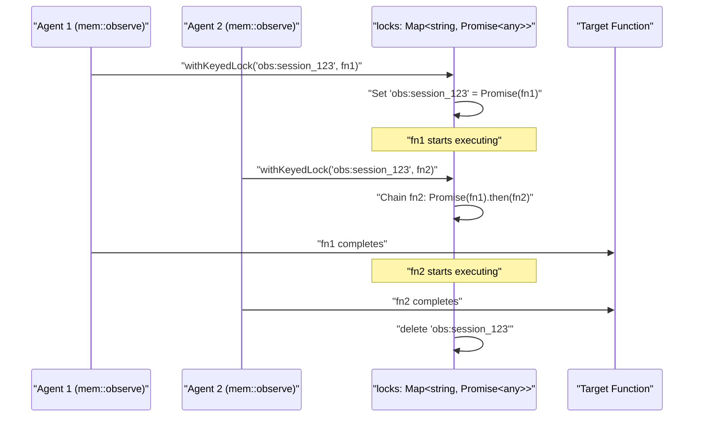
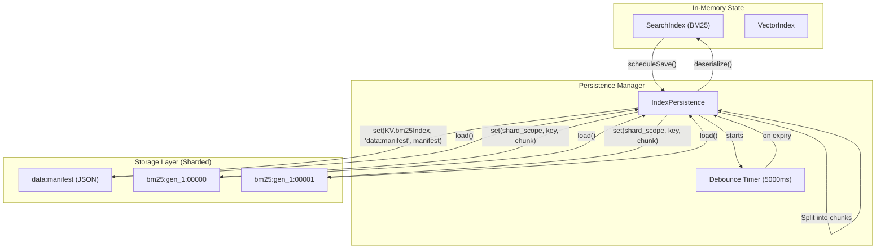
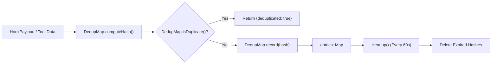
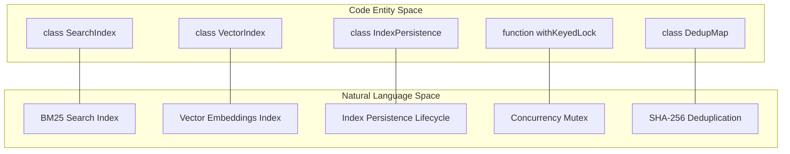

<!-- source: DeepWiki mcp.deepwiki.com · repo rohitg00/agentmemory · page 8.2 Concurrency & Index Persistence · fetched 2026-10-30 -->

# Concurrency & Index Persistence

Relevant source files

The following files were used as context for generating this wiki page:

- [src/functions/compress.ts](src/functions/compress.ts)
- [src/functions/disk-size-manager.ts](src/functions/disk-size-manager.ts)
- [src/functions/image-quota-cleanup.ts](src/functions/image-quota-cleanup.ts)
- [src/functions/image-refs.ts](src/functions/image-refs.ts)
- [src/functions/observe.ts](src/functions/observe.ts)
- [src/state/index-persistence.ts](src/state/index-persistence.ts)
- [src/triggers/events.ts](src/triggers/events.ts)
- [test/index-persistence.test.ts](test/index-persistence.test.ts)
- [test/multimodal.test.ts](test/multimodal.test.ts)
- [test/session-end-triggers-graph.test.ts](test/session-end-triggers-graph.test.ts)
- [test/sliding-window.test.ts](test/sliding-window.test.ts)

This section details the mechanisms used by `agentmemory` to ensure data integrity during concurrent operations, manage the lifecycle of search indices through sharded persistence, and prevent duplicate data ingestion via SHA-256 deduplication.

## Keyed Mutex Concurrency

To prevent race conditions when multiple agents or processes attempt to modify the same resource (such as a specific session or memory entry), the system employs a keyed locking mechanism. This ensures that operations on a specific "key" are serialized while allowing operations on different keys to proceed in parallel.

### `withKeyedLock` Implementation
The `withKeyedLock` function manages a global map of promises, where each key represents a unique resource identifier [src/state/keyed-mutex.ts:1-18](). This is used extensively in high-stakes operations like `mem::observe` to serialize writes to a session's observation stream [src/functions/observe.ts:146-213]() and in `mem::remember` to prevent concurrent writes from creating duplicate or inconsistent memory versions [src/functions/remember.ts:62-166]().

1.  **Queueing**: When a function is wrapped in `withKeyedLock`, it looks up the existing promise chain for that specific key [src/state/keyed-mutex.ts:7]().
2.  **Execution**: The new function is appended to the chain using `.then()`, ensuring it only starts after the previous operation completes (or fails) [src/state/keyed-mutex.ts:8]().
3.  **Cleanup**: Once the chain for a key is exhausted, the entry is removed from the `locks` map to free memory [src/state/keyed-mutex.ts:14-16]().

The system also applies this pattern to specialized resource management, such as `mem::image-quota-cleanup`, which uses a `system:cleanupLock` to prevent concurrent eviction processes [src/functions/image-quota-cleanup.ts:18-96](), and `incrementImageRef`, which locks per-file paths (`imgRef:${filePath}`) to maintain accurate reference counts [src/functions/image-refs.ts:12-18]().

**Resource Locking Flow**

Sources: [src/state/keyed-mutex.ts:1-18](), [src/functions/observe.ts:146-146](), [src/functions/image-quota-cleanup.ts:18-18](), [src/functions/image-refs.ts:13-13]()

## Index Persistence Lifecycle

The `IndexPersistence` class manages the serialization and restoration of the `SearchIndex` (BM25) and `VectorIndex`. Indices are maintained in-memory for performance but must be persisted to survive system restarts.

### Sharded Storage Architecture
To handle large indices that exceed the single-value size limits of some KV backends, `IndexPersistence` implements a sharding strategy [src/state/index-persistence.ts:169-232]().
*   **Sharding**: Indices are serialized to JSON and split into chunks (default 2,000,000 characters) [src/state/index-persistence.ts:18-18](), [src/state/index-persistence.ts:180-193]().
*   **Generations**: Each save creates a new unique generation ID (prefixed with `idx_`) to avoid partial overwrite corruption [src/state/index-persistence.ts:41-43](), [src/state/index-persistence.ts:178-179]().
*   **Manifests**: A manifest file (e.g., `data:manifest` for BM25) tracks the shards, their scopes, and keys for the current generation [src/state/index-persistence.ts:20-25](), [src/state/index-persistence.ts:218-223]().

### Startup, Load, and Debouncing
*   **Startup Load**: On initialization, `load()` reads the manifest and reconstructs the index by concatenating all referenced shards [src/state/index-persistence.ts:105-123](). It also supports loading legacy monolithic snapshots for backward compatibility [src/state/index-persistence.ts:245-257]().
*   **Scheduled Saves**: `scheduleSave()` uses a 5-second debounce (`DEBOUNCE_MS`) to batch multiple updates into a single I/O operation [src/state/index-persistence.ts:8-8](), [src/state/index-persistence.ts:79-88]().
*   **Resilience**: Error throttling prevents log spam during I/O pressure (60-second window) [src/state/index-persistence.ts:9-9](), [src/state/index-persistence.ts:132-149](). If shard writes fail, the system rolls back by deleting the partial generation [src/state/index-persistence.ts:213-216]().

**Index Synchronization & Sharding**

Sources: [src/state/index-persistence.ts:1-240](), [src/state/schema.js:1-5](), [test/index-persistence.test.ts:109-137]()

## DedupMap & SHA-256 Deduplication

The `DedupMap` prevents the system from processing redundant tool outputs or observations, which is common in agentic loops where retries or identical tool calls occur.

### Deduplication Logic
1.  **Fingerprinting**: The `computeHash` function generates a SHA-256 hash using the `sessionId`, `toolName` (or `hookType`), and the `toolInput` (or raw data) [src/functions/observe.ts:73-86]().
2.  **TTL Enforcement**: Every recorded hash is assigned an expiration time (TTL) of 5 minutes (300,000ms) [src/functions/dedup.ts:3-3]().
3.  **Automatic Cleanup**: A background interval runs every 60 seconds to purge expired hashes from the internal `Map`, preventing memory leaks [src/functions/dedup.ts:4-18]().

### Deduplication Process
| Feature | Implementation Detail |
| :--- | :--- |
| **Hash Algorithm** | SHA-256 via `node:crypto` [src/functions/dedup.ts:1]() |
| **Input Data** | `sessionId` + `toolName` + `toolInput` [src/functions/observe.ts:82-86]() |
| **TTL** | 300,000ms (5 minutes) [src/functions/dedup.ts:3]() |
| **Cleanup Interval** | 60,000ms (1 minute) [src/functions/dedup.ts:4]() |

**Deduplication Data Flow**

Sources: [src/functions/dedup.ts:1-57](), [src/functions/observe.ts:66-90]()

## Multi-Stage Persistence Integration

Persistence is integrated into the core observation and compression pipelines to ensure search indices stay current with ingested data.

*   **`mem::observe`**: Captures raw data, performs deduplication via `DedupMap`, and saves multimodal data (images) to disk before triggering downstream compression [src/functions/observe.ts:46-213]().
*   **`mem::compress`**: After LLM summarization, the resulting `CompressedObservation` is immediately added to the in-memory `SearchIndex` and `VectorIndex` [src/functions/compress.ts:178-194]().
*   **`mem::index-persistence`**: The background worker that periodically flushes these in-memory index updates to the KV store [src/state/index-persistence.ts:10-10]().

### Code Entity Mapping

Sources: [src/state/search-index.ts:12-12](), [src/state/vector-index.ts:1-10](), [src/state/index-persistence.ts:68-68](), [src/state/keyed-mutex.ts:1-1](), [src/functions/dedup.ts:20-20]()

---

