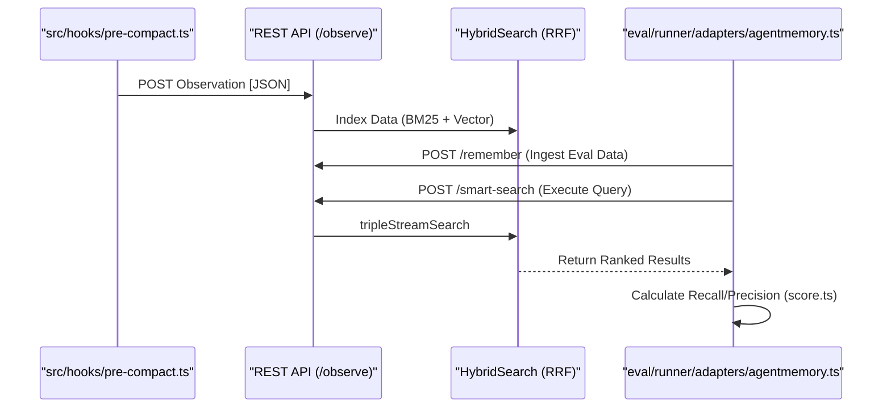

<!-- source: DeepWiki mcp.deepwiki.com · repo rohitg00/agentmemory · page 9 Testing & Benchmarks · fetched 2026-10-30 -->

# Testing & Benchmarks

<details>
<summary>Relevant source files</summary>

The following files were used as context for generating this wiki page:

- [benchmark/COMPARISON.md](benchmark/COMPARISON.md)
- [integrations/openclaw/plugin.yaml](integrations/openclaw/plugin.yaml)
- [test/integration.test.ts](test/integration.test.ts)

</details>


The `agentmemory` project employs a rigorous dual-track verification strategy consisting of a comprehensive Vitest-based test suite and a specialized benchmark suite for quality and scale evaluation. These systems ensure the reliability of memory capture, the accuracy of hybrid retrieval, and the performance of the system under high-volume data loads.

### System Verification Overview

The verification architecture bridges the gap between individual code entities and the high-level memory lifecycle. It ensures that functions like `mem::observe` and `mem::search` maintain integrity across various deployment environments. Consistency checks also ensure that documentation, versioning, and Docker configurations remain synchronized with the core engine [test/consistency.test.ts:23-110]().

**Testing & Benchmark Mapping**

```mermaid
graph TD
    subgraph "Natural Language Space"
        ["User Queries"]
        ["Agent Observations"]
        ["System Quality"]
    end

    subgraph "Code Entity Space"
        D["test/integration.test.ts"]
        E["eval/runner/coding-life.ts"]
        F["benchmark/scale-eval.ts"]
        G["src/state/hybrid-search.ts"]
        H["src/hooks/pre-compact.ts"]
        I["test/consistency.test.ts"]
    end

    ["User Queries"] --> G
    ["Agent Observations"] --> H
    D -- "Validates API" --> G
    E -- "Measures Accuracy" --> G
    F -- "Measures Latency" --> G
    H -- "Triggers Context" --> D
    I -- "Checks version/MCP" --> ["System Quality"]
```
**Sources:** [test/integration.test.ts:1-50](), [eval/runner/coding-life.ts:10-14](), [src/hooks/pre-compact.ts:41-57](), [test/consistency.test.ts:23-60]()

---

## Test Suite

The test suite consists of 51 unit and integration tests powered by **Vitest**. It validates the entire memory pipeline, from raw hook ingestion to complex graph-based retrieval.

### Infrastructure & Patterns
The testing infrastructure utilizes a live server pattern for integration tests, typically targeting `http://localhost:3111` [test/integration.test.ts:3-11](). It uses a `withKeyedLock` concurrency model to ensure data integrity during parallel test execution and provides extensive mocks for external LLM and embedding providers.

*   **Integration Testing**: Validates the REST API endpoints, including session lifecycle (`/session/start`, `/session/end`) and observation capture (`/observe`) [test/integration.test.ts:52-148]().
*   **Subsystem Coverage**: Specific tests cover the `SearchIndex` (BM25), `VectorIndex`, `HybridSearch`, and privacy scrubbing logic.
*   **Consistency Checks**: Specialized tests in `test/consistency.test.ts` verify that the `VERSION` in `src/version.ts` matches `package.json` [test/consistency.test.ts:27-30](), all MCP tools have valid schemas [test/consistency.test.ts:68-75](), and Docker bind mounts are correctly published [test/consistency.test.ts:77-109]().
*   **MCP Validation**: Tests ensure that the 38+ MCP tools and resources respond correctly to protocol requests.

For details, see [Test Suite](#9.1).

**Sources:** [test/integration.test.ts:52-148](), [test/consistency.test.ts:9-109]()

---

## Benchmarks & Quality Evaluation

The benchmark suite is designed to quantify the "intelligence" of the retrieval system and its operational efficiency compared to standard agent memory patterns and academic baselines.

### Evaluation Metrics & Academic Results
The system uses standard Information Retrieval (IR) metrics to evaluate the retrieval stack:
*   **Recall@K & Precision@K**: Measures the percentage of relevant memories found in the top results.
*   **Academic Accuracy**: On the **LongMemEval-S** benchmark (500 questions, ~115K tokens each), `agentmemory` achieves **95.2% R@5** using local `all-MiniLM-L6-v2` embeddings [benchmark/COMPARISON.md:9-15]().
*   **BM25 Fallback**: Even without an embedding provider, the BM25-only fallback achieves **86.2% R@5** [benchmark/COMPARISON.md:16]().

### Scale & Efficiency
The suite tests the system with up to **50,000 observations**, measuring:
*   **Performance**: Measures index build time and search latency at scale.
*   **Token Efficiency**: `agentmemory` maintains a highly efficient context injection strategy. While pasting full history exceeds context windows after ~200 observations, `agentmemory` (using local embeddings) reduces annual token usage from ~19.5M+ to **~170K tokens** [benchmark/COMPARISON.md:57-62]().
*   **Token Savings Calculator**: Users can verify these savings locally by running `npx @agentmemory/agentmemory status` [benchmark/COMPARISON.md:66]().

For details, see [Benchmarks & Quality Evaluation](#9.2).

**Sources:** [benchmark/COMPARISON.md:9-66](), [benchmark/SCALE.md:1-110](), [integrations/openclaw/plugin.yaml:3]()

---

## Data Flow: Observation to Evaluation

The following diagram illustrates how data flows from a hook event through the system to be eventually validated by the benchmark suite, specifically utilizing the `agentmemoryAdapter` for evaluation.


**Sources:** [src/hooks/pre-compact.ts:42-54](), [eval/runner/adapters/agentmemory.ts:43-93](), [eval/runner/score.ts:1-20]()

### Summary Table: Verification Components

| Component | File Path | Purpose |
| :--- | :--- | :--- |
| **Integration Tests** | `test/integration.test.ts` | Validates API endpoints and session state [test/integration.test.ts:1-100]() |
| **Consistency Tests** | `test/consistency.test.ts` | Guards against regression in versions, tools, and Docker mounts [test/consistency.test.ts:23-110]() |
| **Comparison Matrix** | `benchmark/COMPARISON.md` | Feature and accuracy comparison vs Mem0, Letta, and others [benchmark/COMPARISON.md:28-50]() |
| **LongMemEval Bench** | `eval/runner/longmemeval.ts` | Public 500-question academic benchmark [benchmark/COMPARISON.md:9-20]() |
| **Scale Eval** | `benchmark/SCALE.md` | Benchmarks performance up to 50k docs [benchmark/SCALE.md:10-34]() |

**Sources:** [test/integration.test.ts:1-100](), [test/consistency.test.ts:23-110](), [benchmark/COMPARISON.md:9-50](), [benchmark/SCALE.md:10-34]()

---

