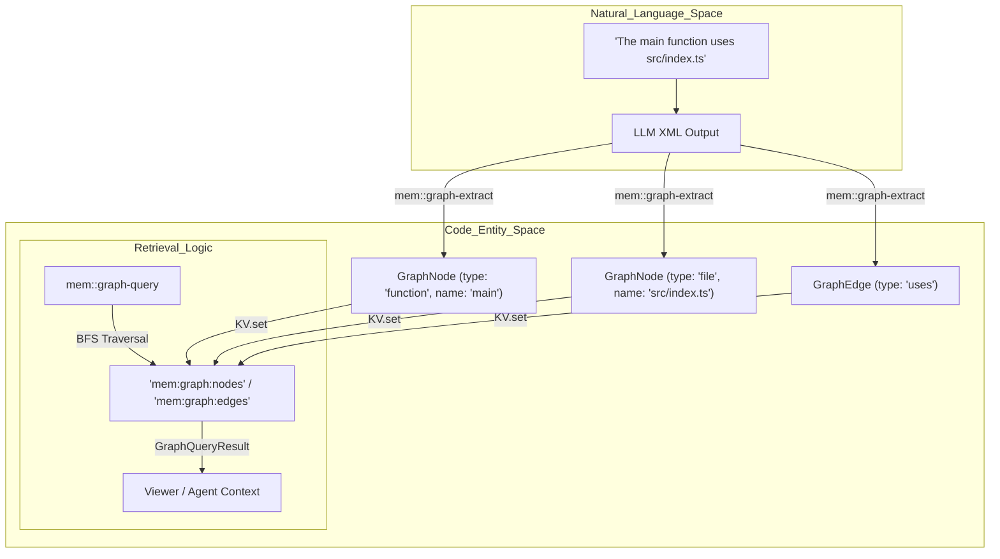
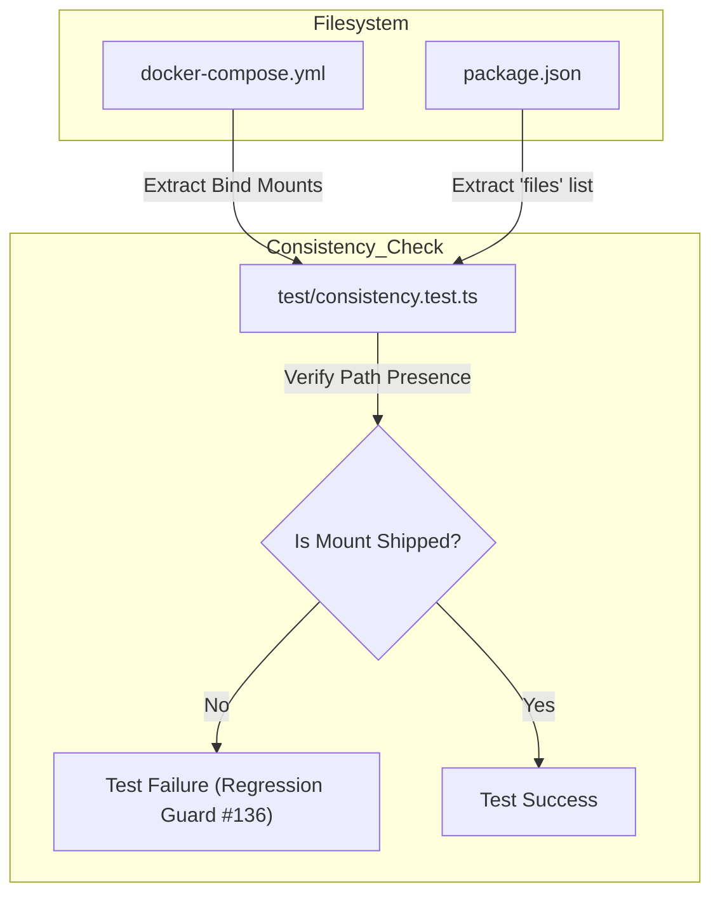

<!-- source: DeepWiki mcp.deepwiki.com · repo rohitg00/agentmemory · page 9.1 Test Suite · fetched 2026-10-30 -->

# Test Suite

Relevant source files

The following files were used as context for generating this wiki page:

- [src/functions/audit.ts](src/functions/audit.ts)
- [src/functions/claude-bridge.ts](src/functions/claude-bridge.ts)
- [src/functions/governance.ts](src/functions/governance.ts)
- [src/functions/graph.ts](src/functions/graph.ts)
- [src/mcp/server.ts](src/mcp/server.ts)
- [src/mcp/tools-registry.ts](src/mcp/tools-registry.ts)
- [src/state/schema.ts](src/state/schema.ts)
- [test/audit.test.ts](test/audit.test.ts)
- [test/auto-forget.test.ts](test/auto-forget.test.ts)
- [test/claude-bridge.test.ts](test/claude-bridge.test.ts)
- [test/consistency.test.ts](test/consistency.test.ts)
- [test/governance.test.ts](test/governance.test.ts)
- [test/graph.test.ts](test/graph.test.ts)
- [test/integration.test.ts](test/integration.test.ts)
- [test/remember-forget-audit.test.ts](test/remember-forget-audit.test.ts)
- [test/retention.test.ts](test/retention.test.ts)

The `agentmemory` test suite provides a robust validation layer for the entire memory pipeline, from raw data ingestion to complex graph-based retrieval and multi-agent orchestration. It utilizes **Vitest** for unit and integration testing, ensuring that both individual logic components (like BM25 scoring or XML parsing) and full system flows (like session lifecycles over REST) function correctly.

## Test Infrastructure & Setup

The infrastructure is built around a dual-mode testing strategy: unit tests for isolated logic and integration tests for end-to-end API validation.

### Vitest Configuration
The system uses Vitest as the primary test runner. Unit tests typically reside alongside the source code or in the `test/` directory, targeting `.ts` files directly. Integration tests expect a live server instance to be reachable, typically via the `AGENTMEMORY_URL` environment variable [test/integration.test.ts:3-4]().

### Test Helpers and Mocks
To facilitate testing of complex functions that depend on the `iii-sdk` and KV storage without requiring a full runtime, test files implement standardized mock factories.

*   **`mockKV()`**: Implements an in-memory `Map`-based store that replicates the `get`, `set`, `delete`, and `list` interface of the production `StateKV` layer [test/graph.test.ts:15-34]().
*   **`mockSdk()`**: Mocks the `iii-sdk` function registration and trigger system, allowing tests to manually trigger functions like `mem::observe` or `mem::graph-extract` and inspect the results [test/graph.test.ts:36-52]().
*   **`mockProvider`**: A stubbed `MemoryProvider` used to simulate LLM responses, such as XML-formatted entity extractions for graph building [test/graph.test.ts:54-64]().

### Integration Test Pattern
Integration tests in `test/integration.test.ts` perform real HTTP calls against the `agentmemory` REST API. They verify:
1.  **Health Checks**: Ensuring the service is reachable at `/agentmemory/health` and returns a `healthy` status [test/integration.test.ts:42-50]().
2.  **Session Lifecycle**: Starting sessions via `/agentmemory/session/start` with `SESSION_ID` and `PROJECT`, listing them, and ending them while verifying status transitions (e.g., `active` to `completed`) [test/integration.test.ts:52-105]().
3.  **Observation Capture**: Posting `hookType` payloads to `/agentmemory/observe` and verifying they are stored and searchable [test/integration.test.ts:130-187]().
4.  **Search & Context**: Validating that the search engine returns results for ingested data and that the `/agentmemory/context` endpoint produces valid strings [test/integration.test.ts:189-224]().

**Sources:** [test/graph.test.ts:15-64](), [test/integration.test.ts:1-224]()

---

## Subsystem Coverage

The test suite is partitioned into specialized files covering the key functional areas of the codebase.

### Search & Retrieval
*   **Hybrid Search**: `test/search.test.ts` validates the `mem::search` function, ensuring it supports `full`, `compact`, and `narrative` formats.
*   **Index Cleanup**: `test/remember-forget-audit.test.ts` ensures that `mem::forget` synchronously removes entries from the BM25 index and flushes persistence to prevent stale data from appearing in search results after a restart [test/remember-forget-audit.test.ts:192-208]().
*   **Governance Deletion**: `test/governance.test.ts` validates that `mem::governance-delete` and `mem::governance-bulk` correctly remove memories from both KV and the search index, immediately calling `persistence.save()` [test/governance.test.ts:183-207]().

### Knowledge Graph
*   **Graph Extraction**: `test/graph.test.ts` verifies that `mem::graph-extract` correctly parses LLM-generated XML to create `GraphNode` and `GraphEdge` entities [test/graph.test.ts:90-107]().
*   **BFS Traversal**: Tests the `mem::graph-query` function's ability to perform Breadth-First Search (BFS) starting from a specific `nodeId` [test/graph.test.ts:176-190]().
*   **Parser Resilience**: Ensures the graph parser tolerates reordered XML attributes (e.g., `name` before `type`) frequently emitted by different LLM models [test/graph.test.ts:135-163]().

### Retention & Privacy
*   **Retention Scoring**: `test/retention.test.ts` validates `mem::retention-score`, ensuring recent and high-salience (e.g., "architecture") memories receive higher scores than old facts [test/retention.test.ts:120-185]().
*   **Tier Classification**: Verifies memories are correctly classified into `hot`, `warm`, `cold`, and `evictable` tiers based on age and access patterns [test/retention.test.ts:187-208]().
*   **Audit Logging**: `test/remember-forget-audit.test.ts` and `test/audit.test.ts` verify that every structural deletion (scoped or bulk) emits a corresponding `AuditEntry` in the `mem:audit` keyspace [test/remember-forget-audit.test.ts:54-110]().

### MCP (Model Context Protocol)
*   **Tools**: `test/mcp-server.test.ts` (referenced via `src/mcp/server.ts`) validates the 38+ tools like `memory_recall` and `memory_save`, ensuring they enforce auth and correctly map arguments to internal functions [src/mcp/server.ts:88-201]().
*   **Resources**: Verifies registered MCP resources return correctly formatted JSON contents.

### Consistency & Integrity
*   **Version Sync**: `test/consistency.test.ts` ensures `VERSION` matches `package.json`, `plugin.json`, and the `@agentmemory/mcp` package [test/consistency.test.ts:27-45]().
*   **Documentation Integrity**: Validates that `README.md` and `AGENTS.md` accurately reflect the number of registered MCP tools and REST endpoints [test/consistency.test.ts:52-68]().
*   **Docker Safety**: Regression guard for #136 ensures every bind mount in `docker-compose.yml` is included in the npm package's `files` list to prevent runtime crashes [test/consistency.test.ts:86-118]().

**Sources:** [test/graph.test.ts:90-190](), [test/remember-forget-audit.test.ts:54-208](), [test/retention.test.ts:120-208](), [test/consistency.test.ts:27-118](), [src/functions/audit.ts:34-55](), [src/functions/governance.ts:10-51]()

---

## Data Flow: Extraction to Graph

The following diagram illustrates how the test suite validates the transition of raw observations into a structured knowledge graph, mapping "Natural Language Space" to "Code Entity Space".

### Graph Entity Extraction and Persistence
Title: Graph Entity Extraction and Persistence

**Sources:** [test/graph.test.ts:90-190](), [src/functions/graph.ts:94-141]()

---

## Infrastructure Verification

Title: Docker and Package Integrity

**Sources:** [test/consistency.test.ts:86-118]()

---

## Summary of Test Coverage

| Subsystem | File(s) | Implementation Detail |
| :--- | :--- | :--- |
| **Knowledge Graph** | `graph.test.ts` | Validates XML parsing, BFS traversal, and attribute reordering. |
| **Retention & Tiers** | `retention.test.ts` | Tests Ebbinghaus decay, salience weighting, and tiering. |
| **Audit & Governance** | `remember-forget-audit.test.ts`, `governance.test.ts` | Ensures structural deletions are audited and index-purged. |
| **MCP Integration** | `src/mcp/server.ts` | Maps MCP tool calls to internal triggers with auth checks. |
| **API Integration** | `integration.test.ts` | End-to-end REST validation for sessions and observations. |
| **Consistency** | `consistency.test.ts` | Cross-references versions, MCP counts, and Docker bind mounts. |

**Sources:** [test/graph.test.ts:1-200](), [test/integration.test.ts:1-224](), [test/consistency.test.ts:1-119](), [test/retention.test.ts:1-250](), [test/remember-forget-audit.test.ts:1-210](), [src/functions/audit.ts:1-55]()

---

