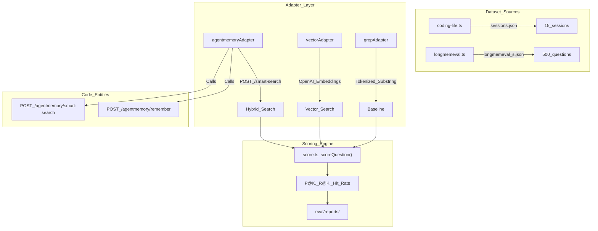
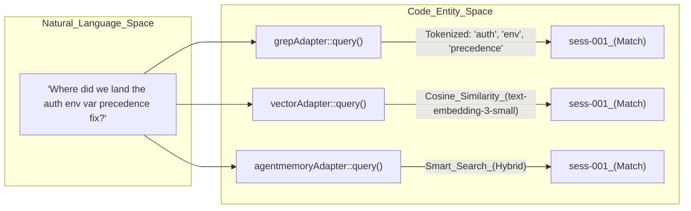

<!-- source: DeepWiki mcp.deepwiki.com · repo rohitg00/agentmemory · page 9.2 Benchmarks & Quality Evaluation · fetched 2026-10-30 -->

# Benchmarks & Quality Evaluation

<details>
<summary>Relevant source files</summary>

The following files were used as context for generating this wiki page:

- [benchmark/COMPARISON.md](benchmark/COMPARISON.md)
- [benchmark/QUALITY.md](benchmark/QUALITY.md)
- [benchmark/README.md](benchmark/README.md)
- [benchmark/SCALE.md](benchmark/SCALE.md)
- [benchmark/data/.gitignore](benchmark/data/.gitignore)
- [benchmark/data/longmemeval_results_bm25.json](benchmark/data/longmemeval_results_bm25.json)
- [benchmark/data/longmemeval_results_hybrid.json](benchmark/data/longmemeval_results_hybrid.json)
- [benchmark/dataset.ts](benchmark/dataset.ts)
- [benchmark/lib/percentiles.ts](benchmark/lib/percentiles.ts)
- [benchmark/load-100k.ts](benchmark/load-100k.ts)
- [benchmark/longmemeval-bench.ts](benchmark/longmemeval-bench.ts)
- [benchmark/quality-eval.ts](benchmark/quality-eval.ts)
- [benchmark/results/load-100k-96c0ed0.json](benchmark/results/load-100k-96c0ed0.json)
- [benchmark/scale-eval.ts](benchmark/scale-eval.ts)
- [docs/benchmarks/2026-05-20-coding-agent-life-v1.md](docs/benchmarks/2026-05-20-coding-agent-life-v1.md)
- [docs/benchmarks/TEMPLATE.md](docs/benchmarks/TEMPLATE.md)
- [eval/README.md](eval/README.md)
- [eval/data/coding-agent-life-v1/queries.json](eval/data/coding-agent-life-v1/queries.json)
- [eval/data/coding-agent-life-v1/sessions.json](eval/data/coding-agent-life-v1/sessions.json)
- [eval/runner/adapters/agentmemory.ts](eval/runner/adapters/agentmemory.ts)
- [eval/runner/adapters/grep.ts](eval/runner/adapters/grep.ts)
- [eval/runner/adapters/vector.ts](eval/runner/adapters/vector.ts)
- [eval/runner/coding-life.ts](eval/runner/coding-life.ts)
- [integrations/openclaw/plugin.yaml](integrations/openclaw/plugin.yaml)

</details>


The `agentmemory` benchmark suite provides a rigorous framework for evaluating retrieval quality, system scalability, and token efficiency. It compares `agentmemory` against built-in agent memory solutions like `CLAUDE.md`, `MEMORY.md`, and simple keyword `grep`.

## Overview of Evaluation Framework

The evaluation suite consists of five primary assessment vectors:
1.  **Quality Evaluation**: Measures retrieval accuracy using standard Information Retrieval (IR) metrics (Recall@K, Precision@K, NDCG@10, MRR) against a labeled dataset of 240 observations across 30 sessions [benchmark/QUALITY.md:1-8]().
2.  **Coding-Agent-Life-v1**: An in-house corpus of 15 fictional Claude Code sessions for a Rust CLI project (`shipctl`), with 15 hand-graded queries covering bug fixes, refactors, and temporal reasoning [eval/README.md:8-9]().
3.  **Academic Benchmarking**: Validates performance on the **LongMemEval-S** (ICLR 2025) dataset, testing 500 questions across ~115K tokens [benchmark/COMPARISON.md:9-11]().
4.  **Scale Evaluation**: Measures performance and "reachability" as the corpus grows from 1,000 to 50,000 observations [benchmark/QUALITY.md:60-71]().
5.  **Real-Embeddings Evaluation**: Specifically isolates the impact of local vector embeddings (e.g., `Xenova/all-MiniLM-L6-v2`) on semantic search quality [benchmark/COMPARISON.md:15-16]().

### Data Flow: Evaluation Pipeline

The benchmark runner transforms raw dataset generation into comparative metrics by exercising various adapters.

**Benchmark Execution Flow**

Sources: [eval/runner/coding-life.ts:10-14](), [eval/runner/score.ts:7-7](), [eval/runner/adapters/agentmemory.ts:41-42](), [eval/runner/adapters/grep.ts:15-16](), [eval/runner/adapters/vector.ts:77-78]()

## Quality Evaluation Metrics

The system evaluates search quality using industry-standard metrics to ensure retrieved memories are relevant and well-ranked:

| Metric | Definition | Implementation |
| :--- | :--- | :--- |
| **Recall@K** | Fraction of all relevant documents found in the top K results. | `scoreQuestion` [eval/runner/score.ts:7-7]() |
| **Precision@K** | Fraction of the top K results that are actually relevant. | `scoreQuestion` [eval/runner/score.ts:7-7]() |
| **NDCG@10** | Normalized Discounted Cumulative Gain; measures ranking quality. | `aggregate` [eval/runner/score.ts:7-7]() |
| **MRR** | Mean Reciprocal Rank; position of the first relevant result. | `aggregate` [eval/runner/score.ts:7-7]() |

## Head-to-Head Comparison

### Coding-Agent-Life-v1 (In-House)
This benchmark simulates a real-world coding environment for a Rust project called `shipctl` [eval/data/coding-agent-life-v1/sessions.json:2-77]().

| Adapter | P@5 | R@5 | Hit rate | p50 latency |
| :--- | :--- | :--- | :--- | :--- |
| `grep` (tokenized substring) | 0.227 | 0.967 | 15 / 15 | 0 ms |
| `agentmemory-hybrid` | **0.240** | **1.000** | **15 / 15** | 14 ms |

**Key Finding**: `agentmemory-hybrid` hits the math ceiling for this dataset (1.000 Recall@5). The differentiator is **temporal queries** (e.g., "What was shipped on April 8th 2026?"), where hybrid search finds both gold sessions while grep misses one [docs/benchmarks/2026-05-20-coding-agent-life-v1.md:32-45](), [docs/benchmarks/2026-05-20-coding-agent-life-v1.md:71-73]().

### Academic Benchmark: LongMemEval-S
On the academic LongMemEval-S benchmark, `agentmemory` achieves high retrieval accuracy compared to other solutions [benchmark/COMPARISON.md:13-20]().

| System | Benchmark | R@5 | Notes |
| :--- | :--- | :--- | :--- |
| **agentmemory (Hybrid)** | LongMemEval-S | **95.2%** | Local embeddings, no API key |
| agentmemory (BM25) | LongMemEval-S | 86.2% | Fallback mode |
| MemGPT / Letta | LoCoMo | 83.2% | Vendor claim |
| Mem0 | LoCoMo | 68.5% | Vendor claim |

Sources: [benchmark/COMPARISON.md:13-20]()

## Scale & Token Efficiency

As a project grows, built-in memory systems (typically capped at 200 lines) become "blind" to older history.

### The "Unreachable" Memory Problem
At 1,000 observations, **80% of project history is invisible** to built-in systems because they exceed the 200-line `MEMORY.md` cap [benchmark/QUALITY.md:71](). `agentmemory` maintains 100% reachability by searching the full corpus stored in the KV layer.

| Observations | MEMORY.md Tokens | agentmemory (Top 10) | Savings | MEMORY.md Reachable |
| :--- | :--- | :--- | :--- | :--- |
| 240 | 12,000 | 3,142 | 74% | 83% |
| 1,000 | 50,000 | 3,142 | 94% | 20% |
| 5,000 | 250,000 | 3,142 | 99% | 4% |

Sources: [benchmark/QUALITY.md:64-71]()

### Token Savings Analysis
The primary driver for persistent memory is cost reduction. `agentmemory` significantly reduces token consumption by injecting only relevant context.

| Approach | Tokens / year | Cost / year |
| :--- | :--- | :--- |
| Paste full history | 19.5M+ | Impossible (Context limit) |
| LLM-summarized | ~650K | ~$500 |
| **agentmemory (API)** | **~170K** | **~$10** |
| **agentmemory (Local)** | **~170K** | **$0** |

Sources: [benchmark/COMPARISON.md:57-62]()

## Search Strategy Performance

The system utilizes a triple-stream search architecture. Benchmarks show that hybrid search provides the best balance of recall and precision.

**Natural Language Space to Code Entity Space**

Sources: [eval/runner/adapters/grep.ts:20-36](), [eval/runner/adapters/vector.ts:97-107](), [eval/runner/adapters/agentmemory.ts:67-92]()

### Quality by Category (Triple-Stream)
| Category | Avg Recall@10 | Avg NDCG@10 | Avg MRR |
| :--- | :--- | :--- | :--- |
| **Entity** | 78.5% | 98.1% | 100.0% |
| **Cross-session** | 77.8% | 84.7% | 72.2% |
| **Exact** | 60.0% | 71.8% | 86.7% |
| **Semantic** | 33.3% | 75.7% | 86.7% |

Sources: [benchmark/QUALITY.md:53-58]()

## Reproducibility

Benchmarks are reproducible using the provided sandbox script, which prevents contamination of local memory stores.

```sh
source eval/scripts/sandbox.sh
npm run eval:coding-life -- --adapters grep,agentmemory
```
Sources: [eval/README.md:25-27](), [docs/benchmarks/2026-05-20-coding-agent-life-v1.md:91-93]()

The sandbox environment isolates the data directory to `/tmp/agentmemory-eval-sandbox/` and runs the `iii-engine` on ports 3411/3412 [docs/benchmarks/2026-05-20-coding-agent-life-v1.md:10-11]().

Sources: [eval/runner/coding-life.ts:1-101](), [eval/runner/adapters/agentmemory.ts:1-93](), [benchmark/QUALITY.md:1-75](), [benchmark/COMPARISON.md:1-114]()

---

