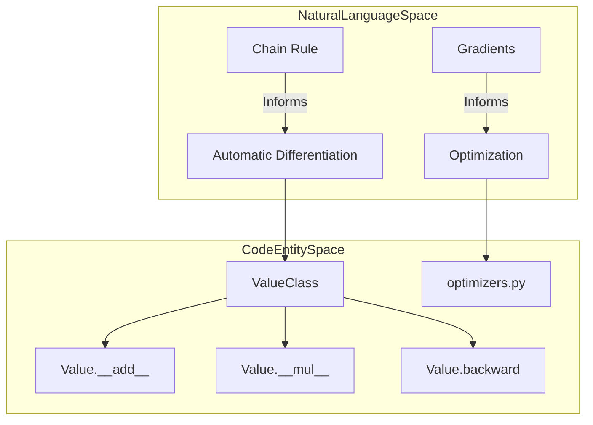
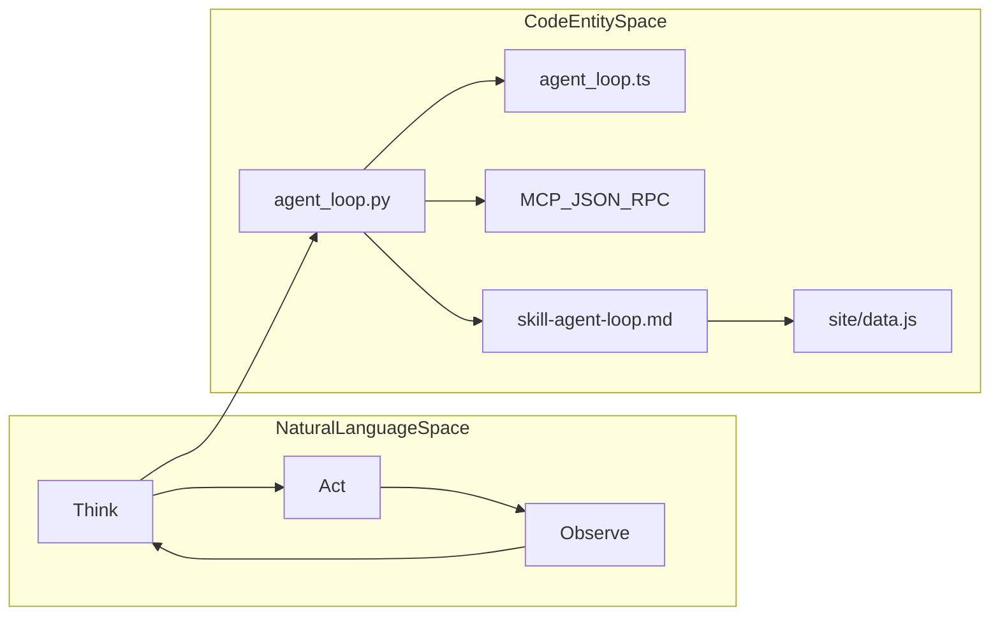

<!-- source: DeepWiki mcp.deepwiki.com · repo rohitg00/ai-engineering-from-scratch · page 1 Overview: AI Engineering from Scratch · fetched 2026-10-30 -->

# Overview: AI Engineering from Scratch

<details>
<summary>Relevant source files</summary>

The following files were used as context for generating this wiki page:

- [.github/workflows/curriculum.yml](.github/workflows/curriculum.yml)
- [.gitignore](.gitignore)
- [AGENTS.md](AGENTS.md)
- [README.md](README.md)
- [phases/14-agent-engineering/15-crewai-role-based-crews/code/main.py](phases/14-agent-engineering/15-crewai-role-based-crews/code/main.py)
- [phases/14-agent-engineering/15-crewai-role-based-crews/docs/en.md](phases/14-agent-engineering/15-crewai-role-based-crews/docs/en.md)
- [scripts/_lib.py](scripts/_lib.py)
- [scripts/build_catalog.py](scripts/build_catalog.py)
- [scripts/check_readme_counts.py](scripts/check_readme_counts.py)
- [scripts/install_skills.py](scripts/install_skills.py)
- [site/app.js](site/app.js)
- [site/build.js](site/build.js)
- [site/catalog.html](site/catalog.html)
- [site/cmdpalette.js](site/cmdpalette.js)
- [site/data.js](site/data.js)
- [site/glossary.html](site/glossary.html)
- [site/header.js](site/header.js)
- [site/index.html](site/index.html)
- [site/lesson.html](site/lesson.html)
- [site/prereqs.html](site/prereqs.html)
- [site/progress.js](site/progress.js)
- [site/robots.txt](site/robots.txt)
- [site/stats.json](site/stats.json)
- [site/style.css](site/style.css)
- [vercel.json](vercel.json)

</details>


The **AI Engineering from Scratch** repository is a comprehensive, code-first curriculum designed to take engineers from mathematical foundations to building autonomous multi-agent swarms. Unlike traditional courses that rely heavily on high-level frameworks, this program mandates building every core component from first principles before transitioning to industry-standard libraries.

The mission is to transform "AI users" into "AI engineers" who understand the underlying mechanics of tensors, gradients, transformers, and agentic loops [README.md:19-26](). Every lesson in the 20-phase roadmap results in a functional, reusable artifact—a **Toolkit** of prompts, skills, and agents that form a professional portfolio [README.md:38-41]().

### Core Philosophy: The 6-Step Lesson Lifecycle
Each of the 503 lessons follows a strict pedagogical structure:
1.  **MOTTO**: A one-line core intuition [README.md:106]().
2.  **PROBLEM**: Concrete pain or bottleneck if the concept is ignored [README.md:106]().
3.  **CONCEPT**: Mental models, diagrams, and intuition [README.md:107]().
4.  **BUILD IT**: Step-by-step implementation from raw math, no frameworks [README.md:108]().
5.  **USE IT**: Mapping the "from-scratch" version to production libraries like PyTorch or Scikit-Learn [README.md:109]().
6.  **SHIP IT**: Exporting a reusable artifact (prompt, skill, agent, or MCP server) [README.md:110]().

---

## Curriculum Roadmap & Progress Tracking
The curriculum is organized into 20 logical phases, spanning the entire stack of modern AI. Progress is tracked in the codebase through a central registry and visualized on the web platform.

*   **Phases 0-2 (Foundations)**: Environment setup, Linear Algebra, Calculus, and Classical Machine Learning (Linear/Logistic Regression, SVMs, Trees) [README.md:60-62]().
*   **Phases 3-9 (Deep Learning & Modalities)**: Neural network internals, Computer Vision, NLP, Speech, and Reinforcement Learning [README.md:63-66]().
*   **Phases 10-20 (The Frontier)**: LLM Pre-training, Vector DBs, RAG, Agent Engineering, and Multi-Agent Swarms [README.md:69-78]().

For a detailed breakdown of all 503 lessons and current completion status (✅/🚧/⬚), see **[Curriculum Roadmap & Progress Tracking](#1.1)**.

---

## Lesson Structure & Toolkit Output System
The repository serves as a factory for AI utilities. Every lesson directory follows a standardized layout to ensure portability and clarity [README.md:91-97]().

### Lesson Directory Layout
```text
phases/<NN>-<phase-name>/<NN>-<lesson-name>/
├── code/      # Runnable implementations (Python, TypeScript, Rust, Julia)
├── docs/      # Lesson narrative (en.md)
└── outputs/   # Prompts, skills, agents, or MCP servers this lesson produces
```
Sources: [README.md:92-97]()

### The Toolkit
The ultimate goal of the curriculum is the root `outputs/` directory. This is a centralized collection of:
*   **Prompts**: System instructions and templates (e.g., `prompt-attention-explainer.md`).
*   **Skills**: Executable logic or reasoning patterns (e.g., `skill-tokenizer.md`).
*   **Agents & MCP Servers**: Autonomous entities and Model Context Protocol servers [README.md:22-23]().

The site infrastructure uses `site/build.js` to automatically discover these artifacts and index them in `site/data.js` for the web catalog [site/build.js:231-245]().

For details on the directory standards and how to use the generated artifacts, see **[Lesson Structure & Toolkit Output System](#1.2)**.

---

## Bridging Natural Language to Code
The following diagrams illustrate how the conceptual "Natural Language Space" of the curriculum maps directly to "Code Entity Space" through specific implementations.

### Diagram 1: From Math Intuition to Autodiff Engine
This diagram shows how Phase 1 mathematical concepts manifest as the foundational `Value` class used for backpropagation.


Sources: [README.md:38-41](), [site/data.js:111-117]()

### Diagram 2: The Agentic Loop System
This diagram maps the high-level "Agent" concept to the specific multi-language implementations and artifacts produced in Phase 14.


Sources: [README.md:105-111](), [site/data.js:2-4]()

---

## Contributing & Community Guidelines
This is an open-source project designed for extensibility. The repository includes CI/CD automation via GitHub Actions to ensure lesson consistency and metadata synchronization [curriculum.yml:1-32]().

*   **Automation**: The `readme-counts-sync` job ensures that the lesson counts in the main `README.md` match the actual file structure [curriculum.yml:46-63]().
*   **Site Generation**: The `site-rebuild` job triggers `node site/build.js` to refresh the interactive catalog whenever the curriculum changes [curriculum.yml:100-113]().
*   **Standards**: Contributors must follow the directory structure and "Ship It" artifact requirements to pass the `audit_lessons.py` invariant checks [curriculum.yml:33-44]().

For instructions on how to submit a PR or set up your fork, see **[Contributing & Community Guidelines](#1.3)**.

---

## Navigation Links
*   **[Curriculum Roadmap & Progress Tracking](#1.1)**: The full 20-phase schedule.
*   **[Lesson Structure & Toolkit Output System](#1.2)**: How we build and ship artifacts.
*   **[Contributing & Community Guidelines](#1.3)**: How to join the mission.

Sources: [README.md:1-40](), [site/data.js:1-10](), [.github/workflows/curriculum.yml:1-45]()

---

