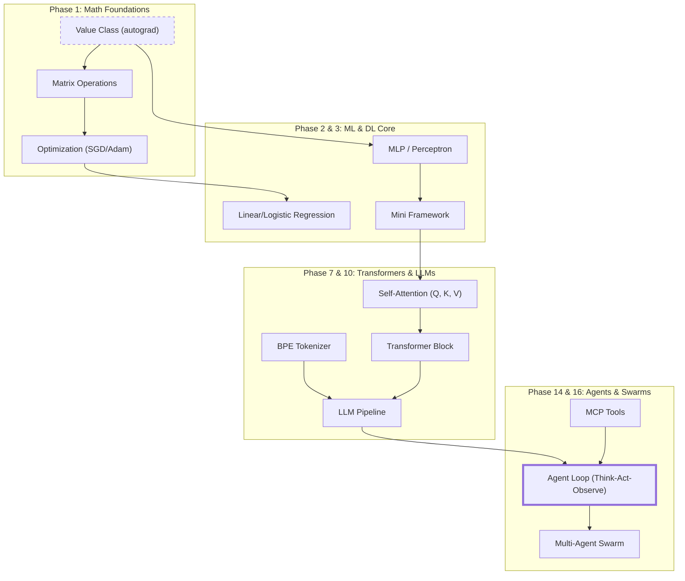
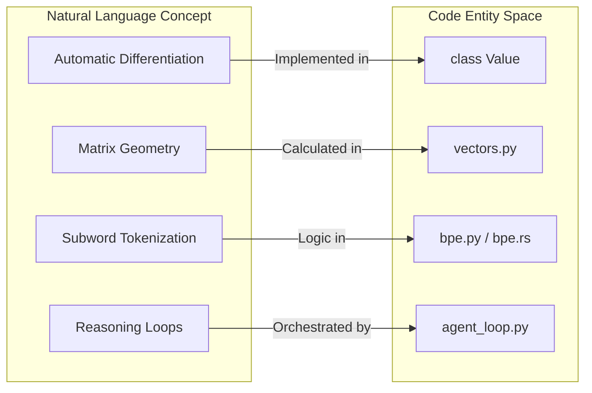

<!-- source: DeepWiki mcp.deepwiki.com · repo rohitg00/ai-engineering-from-scratch · page 1.1 Curriculum Roadmap & Progress Tracking · fetched 2026-10-30 -->

# Curriculum Roadmap & Progress Tracking

Relevant source files

The following files were used as context for generating this wiki page:

- [.gitignore](.gitignore)
- [README.md](README.md)
- [ROADMAP.md](ROADMAP.md)
- [phases/13-tools-and-protocols/18-mcp-auth-production/assets/auth-flow.svg](phases/13-tools-and-protocols/18-mcp-auth-production/assets/auth-flow.svg)
- [phases/13-tools-and-protocols/18-mcp-auth-production/code/main.py](phases/13-tools-and-protocols/18-mcp-auth-production/code/main.py)
- [phases/13-tools-and-protocols/18-mcp-auth-production/docs/en.md](phases/13-tools-and-protocols/18-mcp-auth-production/docs/en.md)
- [phases/13-tools-and-protocols/18-mcp-auth-production/notebook/.gitkeep](phases/13-tools-and-protocols/18-mcp-auth-production/notebook/.gitkeep)
- [phases/13-tools-and-protocols/18-mcp-auth-production/outputs/skill-mcp-auth.md](phases/13-tools-and-protocols/18-mcp-auth-production/outputs/skill-mcp-auth.md)
- [phases/16-multi-agent-and-swarms/03-communication-protocols/code/main.ts](phases/16-multi-agent-and-swarms/03-communication-protocols/code/main.ts)
- [phases/16-multi-agent-and-swarms/03-communication-protocols/docs/en.md](phases/16-multi-agent-and-swarms/03-communication-protocols/docs/en.md)
- [phases/16-multi-agent-and-swarms/03-communication-protocols/outputs/prompt-protocol-selector.md](phases/16-multi-agent-and-swarms/03-communication-protocols/outputs/prompt-protocol-selector.md)
- [site/app.js](site/app.js)
- [site/build.js](site/build.js)
- [site/catalog.html](site/catalog.html)
- [site/cmdpalette.js](site/cmdpalette.js)
- [site/data.js](site/data.js)
- [site/glossary.html](site/glossary.html)
- [site/header.js](site/header.js)
- [site/index.html](site/index.html)
- [site/lesson.html](site/lesson.html)
- [site/prereqs.html](site/prereqs.html)
- [site/progress.js](site/progress.js)
- [site/robots.txt](site/robots.txt)
- [site/stats.json](site/stats.json)
- [site/style.css](site/style.css)
- [vercel.json](vercel.json)

This page provides a comprehensive technical breakdown of the 20-phase curriculum within the `ai-engineering-from-scratch` repository. It tracks the evolution from fundamental mathematical operations to the deployment of autonomous multi-agent systems. Each phase is designed to produce reusable artifacts—collectively known as the **Toolkit**—ensuring that theoretical knowledge is immediately converted into engineering utility.

## The Learning Arc

The curriculum follows a "Bottom-Up" engineering philosophy. It starts by implementing the basic primitives of intelligence (Linear Algebra, Calculus) before moving into classical Machine Learning, Deep Learning, and eventually Large Language Models (LLMs) and Agents [README.md:31-46](). The total curriculum encompasses 503 lessons across 20 phases [ROADMAP.md:7-9]().

### System Evolution Diagram
The following diagram illustrates how low-level code entities from early phases compose into the complex systems found in later phases.

**Data Flow: From Math Primitives to Autonomous Agents**

Sources: [README.md:57-81](), [ROADMAP.md:28-95](), [site/data.js:4-133]()

---

## Phase Breakdown & Status

The repository uses a standardized status legend in `ROADMAP.md`:
*   ✅ **Complete**: Implementation, documentation, and toolkit outputs are finished.
*   🚧 **In Progress**: Core logic exists, but documentation or auxiliary languages may be missing.
*   ⬚ **Planned**: Curriculum defined but implementation has not yet begun.

### Phase 0: Setup & Tooling (✅ Complete)
**Lessons: 12**
Focuses on the infrastructure required for high-performance AI development [ROADMAP.md:11-26]().
*   **Key Entities**: `uv` for Python environments [site/data.js:61-63](), `Docker` for AI containers [site/data.js:70-72](), and `datasets` library for data management [site/data.js:88-90]().
*   **Output**: A verified developer environment capable of running Python, Rust, and Julia.

### Phase 1: Math Foundations (✅ Complete)
**Lessons: 22**
The bedrock of the curriculum. Every algorithm is implemented from scratch to remove "black box" abstractions [ROADMAP.md:28-53]().
*   **Key Entities**: 
    *   `Value` class: A scalar-valued autograd engine for chain rule and automatic differentiation [ROADMAP.md:36]().
    *   `Gradient Descent Family`: Implementation of core optimization algorithms [ROADMAP.md:39]().
*   **Toolkit Outputs**: `PCA`, `SVD`, and `Information Theory` utilities [ROADMAP.md:40-42]().

### Phase 2: ML Fundamentals (✅ Complete)
**Lessons: 18**
Classical machine learning algorithms that remain the workhorses of production AI [ROADMAP.md:55-76]().
*   **Key Entities**: `LinearRegression`, `DecisionTree`, `SVM`, and `NaiveBayes` classes [ROADMAP.md:60-72]().
*   **Focus**: Bias-variance tradeoff, feature engineering, and cross-validation pipelines [ROADMAP.md:66-68]().

### Phase 3: Deep Learning Core (✅ Complete)
**Lessons: 13**
Transitioning from classical ML to neural networks [ROADMAP.md:78-95]().
*   **Key Entities**: `The Perceptron`, `Multi-Layer Networks`, and `Backpropagation from Scratch` [ROADMAP.md:82-84]().
*   **Logic**: Building a mini framework to understand `PyTorch` and `JAX` internals [ROADMAP.md:91-93]().

### Phase 4-6: Modality Foundations (✅ Complete)
**Lessons: 28 (Vision), 29 (NLP), 17 (Audio)**
*   **Vision**: `CNNs`, `YOLO`, `U-Net`, and `Diffusion Models` [ROADMAP.md:96-127]().
*   **NLP**: `Word2Vec`, `Seq2Seq`, and the `Attention Mechanism` [ROADMAP.md:129-165]().
*   **Audio**: `Spectrograms`, `Whisper`, and `TTS` [ROADMAP.md:167-185]().

### Phase 14-16: Agent Engineering & Swarms (🚧 In Progress)
**Lessons: 42 (Agent Workbench), 10 (Swarms)**
Moving from static inference to dynamic reasoning loops and multi-agent coordination [ROADMAP.md:328-390]().
*   **Key Entities**: `Agent Loop` (Think-Act-Observe) [README.md:103-111]().
*   **Logic**: Integration with `MCP` (Model Context Protocol) for tool usage [ROADMAP.md:315-326]().

Sources: [ROADMAP.md:7-450](), [site/data.js:4-133](), [README.md:31-81]()

---

## Curriculum Logic: From Math to Code
This diagram bridges the "Natural Language" conceptual space to the "Code Entity" space by showing how mathematical concepts map to specific files and classes in the repository.

**Mapping Concepts to Code Entities**

Sources: [README.md:126](), [ROADMAP.md:36](), [ROADMAP.md:133](), [ROADMAP.md:213](), [ROADMAP.md:330]()

---

## Roadmap Summary Table

| Phase | Title | Lessons | Status | Key Artifacts |
| :--- | :--- | :---: | :---: | :--- |
| 0 | Setup & Tooling | 12 | ✅ | `uv`, `Docker`, `verify.py` |
| 1 | Math Foundations | 22 | ✅ | `Value` (Autograd), `SVD`, `PCA` |
| 2 | ML Fundamentals | 18 | ✅ | `RandomForest`, `SVM`, `K-Means` |
| 3 | Deep Learning Core | 13 | ✅ | `Backprop`, `Mini-Framework` |
| 4 | Computer Vision | 28 | ✅ | `YOLO`, `Diffusion`, `SAM 3` |
| 5 | NLP Foundations | 29 | ✅ | `Word2Vec`, `Attention`, `RAG` |
| 7 | Transformers | 14 | ✅ | `Self-Attention`, `FlashAttention` |
| 10 | LLMs from Scratch | 15 | ✅ | `BPE Tokenizer`, `SFT`, `DPO` |
| 11 | LLM Engineering | 17 | ✅ | `LoRA`, `Function Calling` |
| 14 | Agent Engineering | 42 | 🚧 | `AgentLoop`, `Workbench` |
| 16 | Multi-Agent Swarms | 10 | 🚧 | `Communication Protocols` |
| 19 | Capstone Projects | 87 | 🚧 | `SWE-bench Agent`, `GPT-from-scratch` |

Sources: [ROADMAP.md:7-450](), [site/data.js:4-133]()

---

