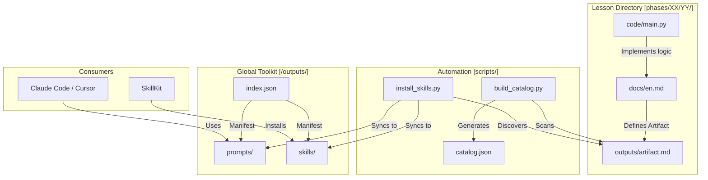
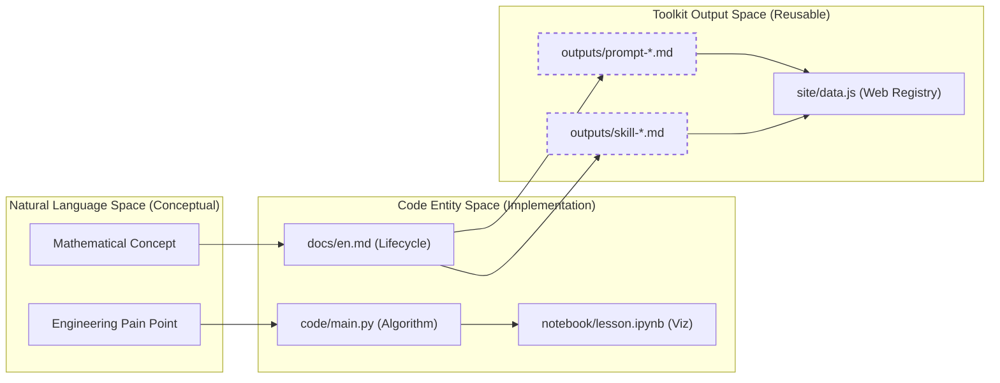

<!-- source: DeepWiki mcp.deepwiki.com · repo rohitg00/ai-engineering-from-scratch · page 1.2 Lesson Structure & Toolkit Output System · fetched 2026-10-30 -->

# 1.2 Lesson Structure & Toolkit Output System

<details>
<summary>Relevant source files</summary>

The following files were used as context for generating this wiki page:

- [.github/workflows/curriculum.yml](.github/workflows/curriculum.yml)
- [.gitignore](.gitignore)
- [AGENTS.md](AGENTS.md)
- [README.md](README.md)
- [phases/14-agent-engineering/15-crewai-role-based-crews/code/main.py](phases/14-agent-engineering/15-crewai-role-based-crews/code/main.py)
- [phases/14-agent-engineering/15-crewai-role-based-crews/docs/en.md](phases/14-agent-engineering/15-crewai-role-based-crews/docs/en.md)
- [scripts/_lib.py](scripts/_lib.py)
- [scripts/build_catalog.py](scripts/build_catalog.py)
- [scripts/check_readme_counts.py](scripts/check_readme_counts.py)
- [scripts/install_skills.py](scripts/install_skills.py)
- [site/app.js](site/app.js)
- [site/build.js](site/build.js)
- [site/catalog.html](site/catalog.html)
- [site/cmdpalette.js](site/cmdpalette.js)
- [site/data.js](site/data.js)
- [site/glossary.html](site/glossary.html)
- [site/header.js](site/header.js)
- [site/index.html](site/index.html)
- [site/lesson.html](site/lesson.html)
- [site/prereqs.html](site/prereqs.html)
- [site/progress.js](site/progress.js)
- [site/robots.txt](site/robots.txt)
- [site/stats.json](site/stats.json)
- [site/style.css](site/style.css)
- [vercel.json](vercel.json)

</details>


This page defines the architectural standards for lessons within the `ai-engineering-from-scratch` repository. It covers the standardized directory layout, the pedagogical "6-step lifecycle" used to transition from theory to production-ready code, and the **Toolkit** system—a mechanism that ensures every lesson contributes a reusable artifact (Prompts, Skills, Agents, or MCP Servers) to a centralized library.

## Lesson Directory Layout

Every lesson follows a strict structural contract to ensure consistency across the 503 planned modules [README.md:22-23](). This structure separates implementation code from human-readable documentation and the resulting toolkit outputs.

```text
phases/XX-phase-name/YY-lesson-name/
├── code/                # Primary implementation (Python, TS, Rust, or Julia)
│   ├── main.py          # Entry point for the from-scratch build
│   └── requirements.txt # Dependencies specific to this lesson
├── notebook/            # Interactive experimentation (Optional)
│   └── lesson.ipynb     # Jupyter notebook for visualization/exploration
├── docs/                # Human-readable documentation
│   └── en.md            # The "Source of Truth" for the lesson content
└── outputs/             # Toolkit artifacts generated by this lesson
    ├── prompt-*.md      # Reusable LLM system prompts
    └── skill-*.md       # Executable or reference "skills"
```

The `site/build.js` script specifically looks for these patterns to generate the curriculum website, extracting metadata from the `docs/en.md` and `code/` directories [site/build.js:233-255]().

**Sources:** [README.md:87-97](), [site/build.js:23-28](), [site/build.js:233-255]()

---

## The 6-Step Lesson Lifecycle

The curriculum rejects passive learning. Every lesson is structured around a "Build-First" philosophy, moving through six distinct stages defined in the narrative documentation [README.md:99-111]().

| Step | Name | Purpose |
| :--- | :--- | :--- |
| **1** | **MOTTO** | A one-line core idea that serves as a mental anchor. |
| **2** | **PROBLEM** | Defines a concrete pain point. What is difficult without this concept? |
| **3** | **CONCEPT** | Intuition-building using diagrams and mental models. |
| **4** | **BUILD IT** | Step-by-step, from-scratch implementation using raw math/logic. |
| **5** | **USE IT** | Running the same task using production libraries (e.g., PyTorch, vLLM). |
| **6** | **SHIP IT** | Producing a reusable artifact (Prompt, Skill, Agent, or MCP). |

This lifecycle ensures that by the time a student uses a framework like PyTorch, they already understand the underlying mechanics because they implemented them in the "Build It" phase [README.md:38-41]().

**Sources:** [README.md:99-111](), [README.md:31-41]()

---

## The Toolkit Output System

The primary goal of the repository is to build a **Toolkit**—a collection of production-ready assets that can be used in external projects or AI-enhanced development environments like Claude Code or Cursor [README.md:129-134]().

### Artifact Types

Lessons produce four primary types of artifacts indexed by the system:

1.  **Prompts (`prompt-*.md`)**: System instructions with YAML frontmatter.
2.  **Skills (`skill-*.md`)**: Structured knowledge or executable patterns.
3.  **Agents**: Autonomous loops, such as the `agent_loop.py` found in Phase 14 [README.md:150-155]().
4.  **MCP Servers**: Implementations of the **Model Context Protocol** (Phase 13) to provide LLMs with tool access [README.md:72-73]().

### Data Flow: From Lesson to Toolkit

The following diagram illustrates how a lesson's internal implementation flows into the global Toolkit ecosystem via automation scripts.

**Lesson-to-Toolkit Data Flow**

**Sources:** [site/build.js:1-9](), [scripts/build_catalog.py:1-10](), [scripts/install_skills.py:1-15]()

---

## Technical Implementation of Artifacts

Artifacts must follow a specific schema to be compatible with the repository's indexing tools, such as `scripts/build_catalog.py`.

### Metadata Schema
Both Prompts and Skills use Markdown files with a YAML header. This header is parsed by `scripts/_lib.py` to categorize the artifact within the curriculum roadmap.

```markdown
---
name: prompt-attention-explainer
description: Visualizes self-attention matrices
phase: 7
lesson: 2
tags: [transformers, visualization]
---
# [Content follows...]
```

### Automation & Invariants
The repository uses GitHub Actions (`.github/workflows/curriculum.yml`) to ensure the integrity of the Toolkit:
*   **Audit Job**: Runs `scripts/audit_lessons.py` to check for "Lesson Contract" invariants [curriculum.yml:33-44]().
*   **Sync Job**: Runs `scripts/check_readme_counts.py` to ensure the `README.md` lesson counts match the physical files [curriculum.yml:46-63]().
*   **Site Rebuild**: Automatically updates `site/data.js` so the web interface reflects new artifacts [curriculum.yml:100-113]().

**Sources:** [.github/workflows/curriculum.yml:33-113](), [site/build.js:134-169](), [scripts/_lib.py:1-10]()

---

## Artifact Relationship Map

This diagram bridges the conceptual "Lesson Space" with the physical "Code Entity Space," showing how specific files in the repository represent different stages of the Toolkit output.

**Entity Mapping: Theory to Artifact**


**Sources:** [README.md:87-111](), [site/data.js:4-10](), [site/build.js:18-21]()

---

