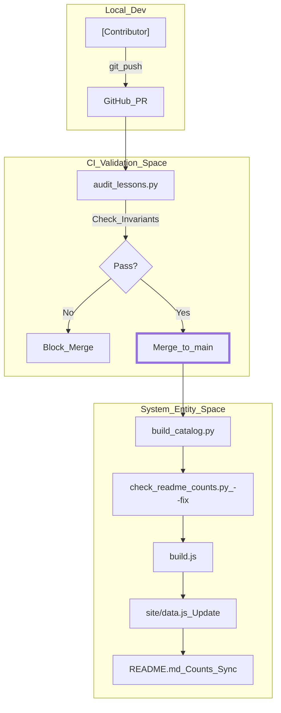
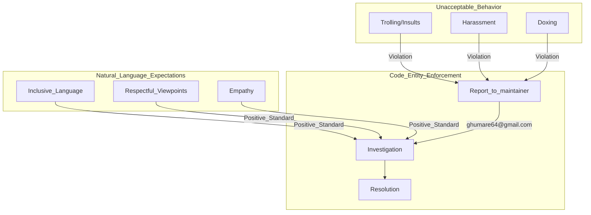

<!-- source: DeepWiki mcp.deepwiki.com · repo rohitg00/ai-engineering-from-scratch · page 1.3 Contributing & Community Guidelines · fetched 2026-10-30 -->

# Contributing & Community Guidelines

Relevant source files

The following files were used as context for generating this wiki page:

- [.github/workflows/curriculum.yml](.github/workflows/curriculum.yml)
- [AGENTS.md](AGENTS.md)
- [CODE_OF_CONDUCT.md](CODE_OF_CONDUCT.md)
- [CONTRIBUTING.md](CONTRIBUTING.md)
- [FORKING.md](FORKING.md)
- [assets/banner.svg](assets/banner.svg)
- [phases/14-agent-engineering/15-crewai-role-based-crews/code/main.py](phases/14-agent-engineering/15-crewai-role-based-crews/code/main.py)
- [phases/14-agent-engineering/15-crewai-role-based-crews/docs/en.md](phases/14-agent-engineering/15-crewai-role-based-crews/docs/en.md)
- [scripts/_lib.py](scripts/_lib.py)
- [scripts/build_catalog.py](scripts/build_catalog.py)
- [scripts/check_readme_counts.py](scripts/check_readme_counts.py)
- [scripts/install_skills.py](scripts/install_skills.py)

This page outlines the technical and social frameworks for participating in the `ai-engineering-from-scratch` project. It covers the standardized lesson architecture, the automated CI/CD validation gates, forking strategies, and the community standards that govern all interactions.

## Contribution Architecture

Contributing to the repository involves adhering to a strict directory structure and the "Lesson Contract" to ensure the automated build systems can parse and verify content.

### 1. Lesson Directory Structure
Every new lesson must be contained within a specific phase directory following the naming convention `phases/NN-phase-slug/MM-lesson-slug/` [AGENTS.md:18-20]().

| Directory | Requirement | Description |
| :--- | :--- | :--- |
| `code/` | **Required** | Implementation + tests. Must run end-to-end and exit 0 [AGENTS.md:22, 102-106](). |
| `docs/en.md` | **Required** | The lesson explainer with mandatory YAML frontmatter [AGENTS.md:21, 65-79](). |
| `quiz.json` | **Required** | Exactly 6 questions (1 pre, 3 check, 2 post) following a specific schema [AGENTS.md:23, 83-98](). |
| `outputs/` | Optional | Reusable artifacts like `skill-*.md`, `prompt-*.md`, or `agent-*.md` [AGENTS.md:24](). |

### 2. The Lesson Contract
The project enforces a standardized documentation lifecycle and metadata format to maintain curriculum coherence [AGENTS.md:5-6, 63]().

*   **Frontmatter**: Must include `Type` (Learn/Build/Reference), `Languages` (matching `main.*` files in `code/`), `Prerequisites`, and `Time` [AGENTS.md:65-81]().
*   **Structure**: Documentation follows the Motto → Problem → Concept → Build It → Use It → Ship It flow [CONTRIBUTING.md:42-65]().
*   **Testing**: `code/tests/` must contain a minimum of 5 unit tests using the language's standard runner [AGENTS.md:108-111]().

### 3. Hard Rules for Contributors
*   **One commit per lesson**: Never batch multiple lessons. A 10-lesson PR must have 10 commits [AGENTS.md:40]().
*   **Conventional Commits**: Use `feat(phase-NN/MM): <slug>` [AGENTS.md:41]().
*   **Dependency Allowlist**: Stick to the approved list (e.g., `numpy`, `torch` for Python; `hono`, `zod` for TS). Use stdlib-first whenever possible [AGENTS.md:50-59]().
*   **No AI Slop**: Write direct, human prose. Cut filler [CONTRIBUTING.md:143]().

**Sources:** [AGENTS.md:18-111](), [CONTRIBUTING.md:42-143]()

---

## Technical Workflow & Automation

The repository uses an automated lifecycle to sync lesson counts and rebuild the site manifest.

### Curriculum Data Flow
This diagram illustrates how a local contribution moves through the automated `curriculum.yml` workflow to update the system state.

**Sources:** [.github/workflows/curriculum.yml:32-148](), [scripts/build_catalog.py:6-43](), [scripts/check_readme_counts.py:7-15]()

### Automated Maintenance
The following files are managed by CI and should **not** be edited manually in PRs [AGENTS.md:141-148]():
*   `catalog.json`: The machine-readable truth of the repo [scripts/build_catalog.py:2-8]().
*   `README.md` counts: Auto-synced by `check_readme_counts.py` [scripts/check_readme_counts.py:9-10]().
*   `site/data.js`: Rebuilt by `site/build.js` on every push to main [AGENTS.md:147]().

---

## Forking & Adaptation Strategies

The repository is MIT licensed, enabling various adaptation paths for different audiences [FORKING.md:3]().

| Audience | Strategy | Key Action |
| :--- | :--- | :--- |
| **Teams** | Internal Training | Add company-specific examples and internal tool integrations [FORKING.md:5-13](). |
| **Schools** | Academic Course | Map phases to semesters and add grading rubrics [FORKING.md:15-23](). |
| **Bootcamps** | Professional Training | Add video content and live sessions; structure for cohort timelines [FORKING.md:25-32](). |
| **Translators** | Localization | Create `docs/XX.md` in lesson folders while keeping code intact [CONTRIBUTING.md:74-89](). |

**Sources:** [FORKING.md:1-60](), [CONTRIBUTING.md:74-89]()

---

## Community Standards & Enforcement

The project follows the **Contributor Covenant 2.1** to ensure a harassment-free experience [CODE_OF_CONDUCT.md:30]().

### Behavioral Mapping
This diagram maps behavioral expectations to the project's enforcement mechanisms.

### Implementation Principles
*   **Build from Scratch First**: Always implement the math/logic manually before using a framework (the `Build It` vs `Use It` split) [AGENTS.md:11, CONTRIBUTING.md:141]().
*   **No Comments in Code**: Code should be self-explanatory; documentation belongs in `docs/en.md` [CONTRIBUTING.md:139]().
*   **Best Tool for the Job**: Use the language (Python, TS, Rust, Julia) that best fits the engineering task [CONTRIBUTING.md:140]().

**Sources:** [CODE_OF_CONDUCT.md:1-31](), [CONTRIBUTING.md:136-164](), [AGENTS.md:9-12]()

---

