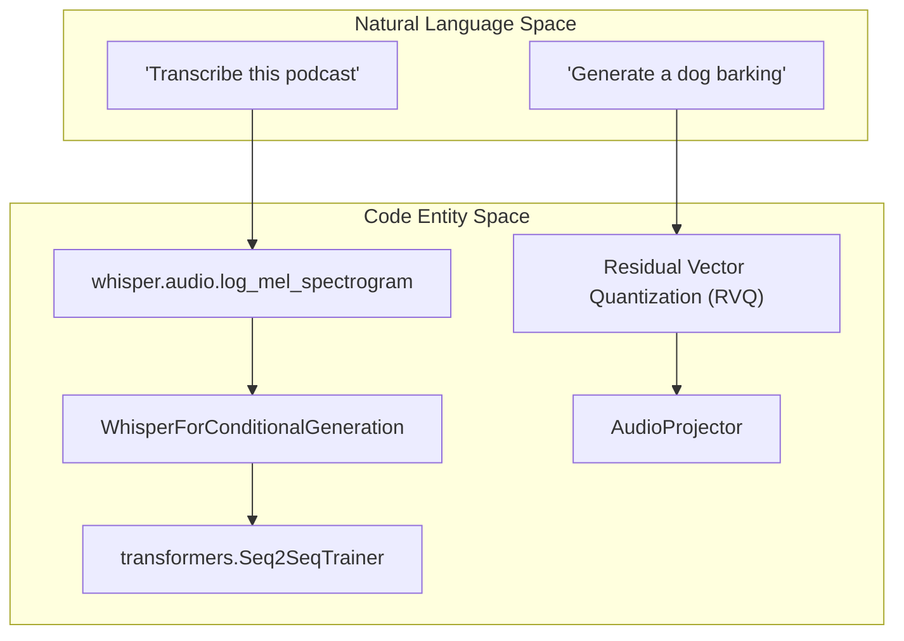
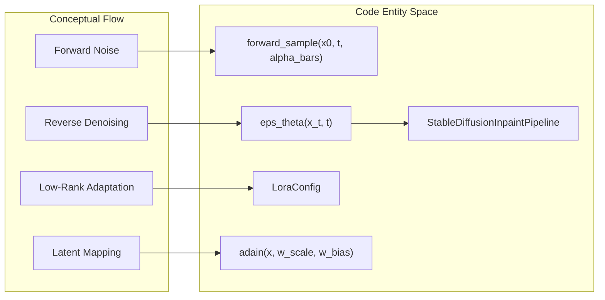

<!-- source: DeepWiki mcp.deepwiki.com · repo rohitg00/ai-engineering-from-scratch · page 10 Phase 6 & 8: Speech/Audio & Generative AI · fetched 2026-10-30 -->

# Phase 6 & 8: Speech/Audio & Generative AI

Relevant source files

The following files were used as context for generating this wiki page:

- [phases/06-speech-and-audio/03-audio-classification/docs/en.md](phases/06-speech-and-audio/03-audio-classification/docs/en.md)
- [phases/06-speech-and-audio/04-speech-recognition-asr/docs/en.md](phases/06-speech-and-audio/04-speech-recognition-asr/docs/en.md)
- [phases/06-speech-and-audio/05-whisper-architecture-finetuning/docs/en.md](phases/06-speech-and-audio/05-whisper-architecture-finetuning/docs/en.md)
- [phases/06-speech-and-audio/10-audio-language-models/docs/en.md](phases/06-speech-and-audio/10-audio-language-models/docs/en.md)
- [phases/08-generative-ai/01-generative-models-taxonomy-history/docs/en.md](phases/08-generative-ai/01-generative-models-taxonomy-history/docs/en.md)
- [phases/08-generative-ai/03-gans-generator-discriminator/docs/en.md](phases/08-generative-ai/03-gans-generator-discriminator/docs/en.md)
- [phases/08-generative-ai/05-stylegan/docs/en.md](phases/08-generative-ai/05-stylegan/docs/en.md)
- [phases/08-generative-ai/06-diffusion-ddpm-from-scratch/docs/en.md](phases/08-generative-ai/06-diffusion-ddpm-from-scratch/docs/en.md)
- [phases/08-generative-ai/07-latent-diffusion-stable-diffusion/docs/en.md](phases/08-generative-ai/07-latent-diffusion-stable-diffusion/docs/en.md)
- [phases/08-generative-ai/08-controlnet-lora-conditioning/docs/en.md](phases/08-generative-ai/08-controlnet-lora-conditioning/docs/en.md)
- [phases/08-generative-ai/09-inpainting-outpainting-editing/docs/en.md](phases/08-generative-ai/09-inpainting-outpainting-editing/docs/en.md)
- [phases/08-generative-ai/10-video-generation/docs/en.md](phases/08-generative-ai/10-video-generation/docs/en.md)
- [phases/08-generative-ai/11-audio-generation/docs/en.md](phases/08-generative-ai/11-audio-generation/docs/en.md)
- [phases/08-generative-ai/14-evaluation-fid-clip-score/docs/en.md](phases/08-generative-ai/14-evaluation-fid-clip-score/docs/en.md)

This phase covers the transition from processing one-dimensional wave signals to synthesizing high-dimensional content across multiple modalities. Phase 6 focuses on the extraction of meaning from audio and the generation of speech, while Phase 8 explores the taxonomy and implementation of generative models, with a heavy emphasis on Diffusion and GAN architectures.

## Phase 6: Speech & Audio Processing

The Speech and Audio phase moves from digital signal processing fundamentals to modern Transformer-based architectures like Whisper. It addresses the unique challenges of audio, such as high sample rates (16-48 kHz) and the temporal nature of sound.

### Core Components
*   **Fundamentals & Features:** Understanding spectrograms and Mel features as the primary input for neural networks [phases/06-speech-and-audio/10-audio-language-models/docs/en.md:7-7]().
*   **ASR (Automatic Speech Recognition):** Leveraging models like Whisper for robust, multilingual transcription [phases/06-speech-and-audio/05-whisper-architecture-finetuning/docs/en.md:3-3]().
*   **Audio-Language Models (ALMs):** Systems like Qwen2.5-Omni and Audio Flamingo that reason over speech, environmental sounds, and music [phases/06-speech-and-audio/10-audio-language-models/docs/en.md:3-3]().
*   **Neural Codecs:** Using RVQ (Residual Vector Quantization) to compress audio into discrete tokens (50-75 Hz) for generative tasks [phases/08-generative-ai/11-audio-generation/docs/en.md:3-3]().

### Audio Architecture Bridge
The following diagram illustrates how raw audio is transformed into entities used by LLMs and generative pipelines.

**Audio Processing to Code Entities**

Sources: [phases/06-speech-and-audio/05-whisper-architecture-finetuning/docs/en.md:47-47](), [phases/06-speech-and-audio/05-whisper-architecture-finetuning/docs/en.md:108-108](), [phases/06-speech-and-audio/10-audio-language-models/docs/en.md:111-111](), [phases/08-generative-ai/11-audio-generation/docs/en.md:26-26]()

For details on ASR, TTS, and real-time voice pipelines, see [Speech & Audio Processing](#10.1).

---

## Phase 8: Generative AI

Phase 8 covers the taxonomy of generative modeling, moving from Variational Autoencoders (VAEs) and Generative Adversarial Networks (GANs) to the modern state-of-the-art: Diffusion and Flow Matching.

### Generative Paradigms
*   **GANs:** A minimax game between a Generator and Discriminator [phases/08-generative-ai/03-gans-generator-discriminator/docs/en.md:19-19](). While superseded in some areas, StyleGAN remains the standard for narrow-domain photorealism [phases/08-generative-ai/05-stylegan:3-3]().
*   **Diffusion (DDPM):** Learning to reverse a Markov chain of Gaussian noise [phases/08-generative-ai/06-diffusion-ddpm-from-scratch/docs/en.md:14-14]().
*   **Latent Diffusion:** Running the diffusion process inside a VAE's latent space to save compute (e.g., Stable Diffusion) [phases/08-generative-ai/07-latent-diffusion-stable-diffusion/docs/en.md:3-3]().
*   **Conditioning & Editing:** Using ControlNet for spatial control and LoRA for concept fine-tuning [phases/08-generative-ai/08-controlnet-lora-conditioning/docs/en.md:3-3](). Inpainting techniques allow for localized regeneration within masks [phases/08-generative-ai/09-inpainting-outpainting-editing/docs/en.md:16-16]().

### Generative System Bridge
This diagram maps generative concepts to the specific implementation classes and functions used in the codebase.

**Generative Logic to Code Entities**

Sources: [phases/08-generative-ai/06-diffusion-ddpm-from-scratch/docs/en.md:75-75](), [phases/08-generative-ai/06-diffusion-ddpm-from-scratch/docs/en.md:28-28](), [phases/08-generative-ai/08-controlnet-lora-conditioning/docs/en.md:112-112](), [phases/08-generative-ai/09-inpainting-outpainting-editing/docs/en.md:40-40](), [phases/08-generative-ai/05-stylegan/docs/en.md:67-67]()

### Comparison of Generative Families (2026)

| Family | Sampling | Training | Best Use Case |
| :--- | :--- | :--- | :--- |
| **GAN** | One-shot | Unstable (Minimax) | Faces, Narrow domains |
| **Diffusion** | Iterative | Stable (MSE) | General Text-to-Image |
| **Flow Matching** | Fast Iterative | Stable (ODE) | Video, High-speed Image |
| **Autoregressive** | Sequential | Stable (CE) | Text, Audio, Codecs |

Sources: [phases/08-generative-ai/01-generative-models-taxonomy-history/docs/en.md:22-31](), [phases/08-generative-ai/03-gans-generator-discriminator/docs/en.md:22-22]()

For details on diffusion architectures, video generation, and evaluation metrics like FID and CLIP score, see [Generative AI: Diffusion, GANs & Multimodal Generation](#10.2).

---

