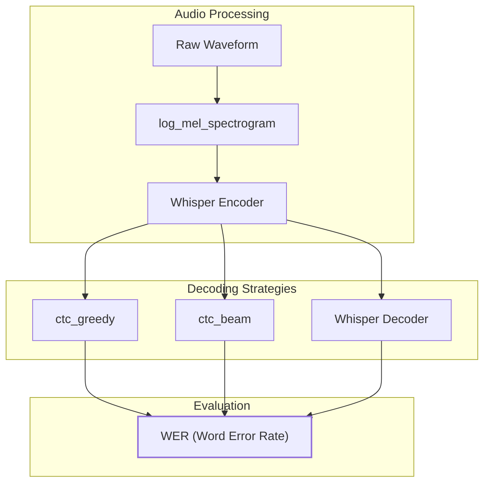
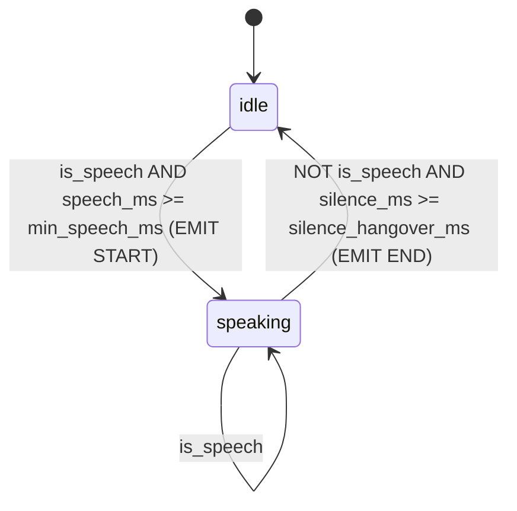

<!-- source: DeepWiki mcp.deepwiki.com · repo rohitg00/ai-engineering-from-scratch · page 10.1 Speech & Audio Processing · fetched 2026-10-30 -->

# Speech & Audio Processing

Relevant source files

The following files were used as context for generating this wiki page:

- [phases/06-speech-and-audio/03-audio-classification/docs/en.md](phases/06-speech-and-audio/03-audio-classification/docs/en.md)
- [phases/06-speech-and-audio/04-speech-recognition-asr/docs/en.md](phases/06-speech-and-audio/04-speech-recognition-asr/docs/en.md)
- [phases/06-speech-and-audio/05-whisper-architecture-finetuning/docs/en.md](phases/06-speech-and-audio/05-whisper-architecture-finetuning/docs/en.md)
- [phases/06-speech-and-audio/10-audio-language-models/docs/en.md](phases/06-speech-and-audio/10-audio-language-models/docs/en.md)
- [phases/06-speech-and-audio/13-neural-audio-codecs/assets/codec-comparison.svg](phases/06-speech-and-audio/13-neural-audio-codecs/assets/codec-comparison.svg)
- [phases/06-speech-and-audio/13-neural-audio-codecs/code/main.py](phases/06-speech-and-audio/13-neural-audio-codecs/code/main.py)
- [phases/06-speech-and-audio/13-neural-audio-codecs/docs/en.md](phases/06-speech-and-audio/13-neural-audio-codecs/docs/en.md)
- [phases/06-speech-and-audio/13-neural-audio-codecs/outputs/skill-codec-picker.md](phases/06-speech-and-audio/13-neural-audio-codecs/outputs/skill-codec-picker.md)
- [phases/06-speech-and-audio/14-voice-activity-detection-turn-taking/assets/vad-turn-taking.svg](phases/06-speech-and-audio/14-voice-activity-detection-turn-taking/assets/vad-turn-taking.svg)
- [phases/06-speech-and-audio/14-voice-activity-detection-turn-taking/code/main.py](phases/06-speech-and-audio/14-voice-activity-detection-turn-taking/code/main.py)
- [phases/06-speech-and-audio/14-voice-activity-detection-turn-taking/docs/en.md](phases/06-speech-and-audio/14-voice-activity-detection-turn-taking/docs/en.md)
- [phases/06-speech-and-audio/14-voice-activity-detection-turn-taking/outputs/skill-vad-tuner.md](phases/06-speech-and-audio/14-voice-activity-detection-turn-taking/outputs/skill-vad-tuner.md)

The Speech & Audio Processing phase (Phase 6) covers the end-to-end lifecycle of audio data in AI systems. This includes the transition from continuous waveforms to discrete digital representations (Spectrograms, Mel features), the classification of audio events, Automatic Speech Recognition (ASR), and the emerging field of Audio Language Models (ALMs). The curriculum culminates in real-time voice assistant pipelines and the use of neural audio codecs for generative speech tasks.

## Audio Fundamentals & Representations

Audio is processed by transforming raw waveforms into the frequency domain. The industry standard is the **Log-Mel Spectrogram**, which maps frequencies to the nonlinear Mel scale to approximate human hearing.

### Feature Extraction Pipeline
The transition from "Natural Language Space" (audio content) to "Code Entity Space" involves specific mathematical transforms:
1.  **STFT**: Short-Time Fourier Transform converts time-domain signals to frequency-domain magnitudes.
2.  **Mel Filterbank**: Applies a bank of triangular filters to the power spectrum.
3.  **Log-scaling**: Converts linear energy to decibels (dB), matching the logarithmic nature of human perception.

**Code Reference:** The `featurize_mfcc` function demonstrates the construction of these features from scratch [phases/06-speech-and-audio/03-audio-classification/docs/en.md:56-63]().

## Speech Recognition (ASR) & Whisper

Automatic Speech Recognition is formulated through three primary architectures: **CTC** (Connectionist Temporal Classification), **RNN-T** (Transducers), and **Attention-based Encoder-Decoders** [phases/06-speech-and-audio/04-speech-recognition-asr/docs/en.md:14-18]().

### Whisper Architecture
Whisper is a transformer encoder-decoder model pinned to a 30-second window [phases/06-speech-and-audio/05-whisper-architecture-finetuning/docs/en.md:3-3]().
*   **Encoder**: 1D Convolutional downsampling followed by Transformer blocks.
*   **Decoder**: Cross-attends to encoder features to generate BPE tokens.
*   **Multitask Prompting**: Uses special tokens like `<|startoftranscript|>`, `<|en|>`, and `<|transcribe|>` to steer model behavior [phases/06-speech-and-audio/05-whisper-architecture-finetuning/docs/en.md:33-44]().

### ASR System Flow
The following diagram maps the ASR concepts to specific code implementations and metrics.

Sources: [phases/06-speech-and-audio/04-speech-recognition-asr/docs/en.md:53-109](), [phases/06-speech-and-audio/05-whisper-architecture-finetuning/docs/en.md:24-31]()

## Voice Activity Detection (VAD) & Turn-Taking

Voice assistants require low-latency detection of when a user starts and stops speaking. A production-grade system uses a three-tier cascade:
1.  **Energy Gate**: Simple RMS thresholding to filter absolute silence [phases/06-speech-and-audio/14-voice-activity-detection-turn-taking/docs/en.md:26-26]().
2.  **Silero VAD**: A deep-learning model that distinguishes speech from noise [phases/06-speech-and-audio/14-voice-activity-detection-turn-taking/docs/en.md:28-28]().
3.  **Semantic Turn Detector**: Uses linguistic context to determine if a pause is mid-sentence or an endpoint [phases/06-speech-and-audio/14-voice-activity-detection-turn-taking/docs/en.md:30-30]().

### The TurnDetector State Machine
The `TurnDetector` class manages transitions between `idle` and `speaking` states using `silence_hangover_ms` and `min_speech_ms` parameters [phases/06-speech-and-audio/14-voice-activity-detection-turn-taking/code/main.py:39-63]().

Sources: [phases/06-speech-and-audio/14-voice-activity-detection-turn-taking/code/main.py:39-63](), [phases/06-speech-and-audio/14-voice-activity-detection-turn-taking/docs/en.md:88-110]()

## Neural Audio Codecs (RVQ)

Neural codecs like **EnCodec**, **DAC**, **SNAC**, and **Mimi** discretize audio into tokens for Language Models. They utilize **Residual Vector Quantization (RVQ)**, where a signal is quantized by a cascade of codebooks, each modeling the residual of the previous [phases/06-speech-and-audio/13-neural-audio-codecs/docs/en.md:25-30]().

### Semantic-Acoustic Split
Modern codecs like **Mimi** (used in Moshi) separate tokens into:
*   **Semantic Tokens (Codebook 0)**: Content and phonemes, often distilled from WavLM [phases/06-speech-and-audio/13-neural-audio-codecs/docs/en.md:39-39]().
*   **Acoustic Tokens (Codebooks 1-N)**: Timbre, speaker identity, and environmental noise [phases/06-speech-and-audio/13-neural-audio-codecs/docs/en.md:60-63]().

**Code Reference:** The `rvq_encode` and `rvq_decode` functions illustrate the mathematical process of cascading codebooks [phases/06-speech-and-audio/13-neural-audio-codecs/code/main.py:46-63]().

## Audio Language Models (ALM)

Audio Language Models (e.g., Qwen2.5-Omni, Audio Flamingo) reason over audio by projecting audio encoder features into an LLM's embedding space [phases/06-speech-and-audio/10-audio-language-models/docs/en.md:25-31]().

### Architecture Components
*   **Audio Encoder**: Usually Whisper or CLAP [phases/06-speech-and-audio/10-audio-language-models/docs/en.md:29-29]().
*   **Projector**: A linear or MLP layer mapping `audio_dim` to `llm_dim` [phases/06-speech-and-audio/10-audio-language-models/docs/en.md:111-120]().
*   **LLM Backbone**: A decoder model (Llama, Qwen) that processes interleaved tokens [phases/06-speech-and-audio/10-audio-language-models/docs/en.md:31-31]().

### Comparison of Neural Audio Codecs
| Codec | Frame Rate | Bitrate | Primary Use Case |
| :--- | :--- | :--- | :--- |
| **EnCodec** | 75 Hz | 6 kbps | General audio / MusicGen |
| **DAC** | 86 Hz | 6 kbps | High-fidelity reconstruction |
| **SNAC** | ~12 Hz | 3 kbps | Multi-scale AR-LM generation |
| **Mimi** | 12.5 Hz | 4.4 kbps | Streaming speech / Moshi |

Sources: [phases/06-speech-and-audio/13-neural-audio-codecs/docs/en.md:45-50](), [phases/06-speech-and-audio/13-neural-audio-codecs/code/main.py:90-98]()

## Toolkit Artifacts

The Speech & Audio phase produces specific Toolkit outputs for configuring production pipelines:

*   **skill-vad-tuner**: A guide for selecting VAD models (Silero vs. Cobra) and tuning silence hangovers (typically 500-800 ms) [phases/06-speech-and-audio/14-voice-activity-detection-turn-taking/outputs/skill-vad-tuner.md:1-28]().
*   **skill-codec-picker**: A decision matrix for choosing between EnCodec, DAC, SNAC, and Mimi based on latency and fidelity requirements [phases/06-speech-and-audio/13-neural-audio-codecs/outputs/skill-codec-picker.md:1-28]().

### The Flush Trick
To achieve sub-200ms latency in voice assistants, the **Flush Trick** is used. When the VAD fires an "END" event, a flush signal is sent to the STT server to force immediate processing of the look-ahead buffer [phases/06-speech-and-audio/14-voice-activity-detection-turn-taking/docs/en.md:39-43]().

Sources: [phases/06-speech-and-audio/14-voice-activity-detection-turn-taking/docs/en.md:112-119](), [phases/06-speech-and-audio/14-voice-activity-detection-turn-taking/outputs/skill-vad-tuner.md:15-15]()

---

