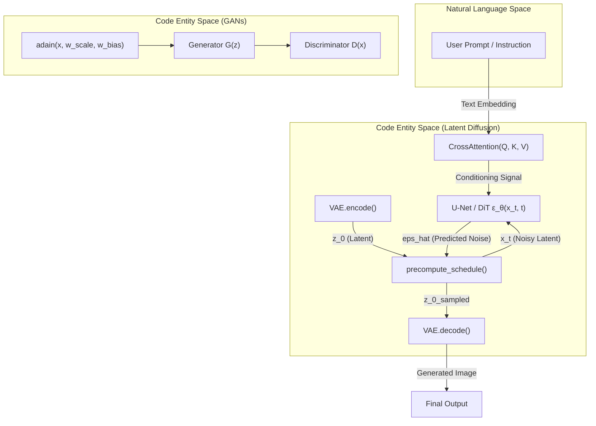
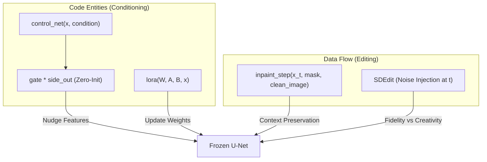

<!-- source: DeepWiki mcp.deepwiki.com · repo rohitg00/ai-engineering-from-scratch · page 10.2 Generative AI: Diffusion, GANs & Multimodal Generation · fetched 2026-10-30 -->

# Generative AI: Diffusion, GANs & Multimodal Generation

Relevant source files

The following files were used as context for generating this wiki page:

- [phases/04-computer-vision/10-image-generation-diffusion/code/main.py](phases/04-computer-vision/10-image-generation-diffusion/code/main.py)
- [phases/04-computer-vision/10-image-generation-diffusion/docs/en.md](phases/04-computer-vision/10-image-generation-diffusion/docs/en.md)
- [phases/04-computer-vision/10-image-generation-diffusion/outputs/prompt-diffusion-sampler-picker.md](phases/04-computer-vision/10-image-generation-diffusion/outputs/prompt-diffusion-sampler-picker.md)
- [phases/04-computer-vision/10-image-generation-diffusion/outputs/skill-noise-schedule-designer.md](phases/04-computer-vision/10-image-generation-diffusion/outputs/skill-noise-schedule-designer.md)
- [phases/04-computer-vision/10-image-generation-diffusion/quiz.json](phases/04-computer-vision/10-image-generation-diffusion/quiz.json)
- [phases/08-generative-ai/01-generative-models-taxonomy-history/docs/en.md](phases/08-generative-ai/01-generative-models-taxonomy-history/docs/en.md)
- [phases/08-generative-ai/03-gans-generator-discriminator/docs/en.md](phases/08-generative-ai/03-gans-generator-discriminator/docs/en.md)
- [phases/08-generative-ai/05-stylegan/docs/en.md](phases/08-generative-ai/05-stylegan/docs/en.md)
- [phases/08-generative-ai/06-diffusion-ddpm-from-scratch/docs/en.md](phases/08-generative-ai/06-diffusion-ddpm-from-scratch/docs/en.md)
- [phases/08-generative-ai/07-latent-diffusion-stable-diffusion/docs/en.md](phases/08-generative-ai/07-latent-diffusion-stable-diffusion/docs/en.md)
- [phases/08-generative-ai/08-controlnet-lora-conditioning/docs/en.md](phases/08-generative-ai/08-controlnet-lora-conditioning/docs/en.md)
- [phases/08-generative-ai/09-inpainting-outpainting-editing/docs/en.md](phases/08-generative-ai/09-inpainting-outpainting-editing/docs/en.md)
- [phases/08-generative-ai/10-video-generation/docs/en.md](phases/08-generative-ai/10-video-generation/docs/en.md)
- [phases/08-generative-ai/11-audio-generation/docs/en.md](phases/08-generative-ai/11-audio-generation/docs/en.md)
- [phases/08-generative-ai/14-evaluation-fid-clip-score/docs/en.md](phases/08-generative-ai/14-evaluation-fid-clip-score/docs/en.md)

This page covers the architectural evolution and implementation details of generative models, focusing on the transition from adversarial frameworks (GANs) to the dominant diffusion and flow-matching paradigms. It details the mechanics of Denoising Diffusion Probabilistic Models (DDPM), Latent Diffusion (Stable Diffusion), and the various conditioning and editing techniques (ControlNet, LoRA, Inpainting) that enable production-grade image, video, and audio generation.

## Generative Model Taxonomy

Generative AI is categorized into five primary families based on how they model the data distribution $p_{data}(x)$.

| Family | Modeling Approach | Key Models | Pros/Cons |
| :--- | :--- | :--- | :--- |
| **Explicit (Tractable)** | Direct $log p(x)$ calculation | GPT, PixelCNN | Exact likelihood; sequential (slow) inference |
| **Explicit (Approximate)** | Optimize ELBO | VAE, DDPM | Stable training; iterative sampling |
| **Implicit** | Adversarial game (no density) | GAN, StyleGAN | Sharpest samples; unstable training |
| **Score-Based** | Model $\nabla_x log p(x)$ | SDE, Flow Matching | Straight paths; fast sampling |
| **Discrete Token** | AR over VQ-tokens | Sora, MusicGen | Scales well; requires learned tokenizer |

**Sources:** [phases/08-generative-ai/01-generative-models-taxonomy-history/docs/en.md:1-31]()

## Generative Architecture & Data Flow

The following diagram bridges the conceptual "Natural Language Space" (prompts/intent) to the "Code Entity Space" by showing how various components like the `model_forward` function in a DDPM or the `adain` function in StyleGAN interact with noise and latents.

### Generative Pipeline Logic

**Sources:** [phases/08-generative-ai/07-latent-diffusion-stable-diffusion/docs/en.md:20-81](), [phases/08-generative-ai/05-stylegan/docs/en.md:1-30](), [phases/04-computer-vision/10-image-generation-diffusion/docs/en.md:59-75]()

## Diffusion Models from Scratch (DDPM)

Denoising Diffusion Probabilistic Models (DDPM) operate by destroying data with Gaussian noise over $T$ steps and training a network to reverse the process.

### The Forward Process
The forward process $q(x_t | x_0)$ has a closed-form jump, allowing any $t$ to be sampled in one step:
`x_t = sqrt(alpha_bar_t) * x_0 + sqrt(1 - alpha_bar_t) * epsilon` [phases/04-computer-vision/10-image-generation-diffusion/docs/en.md:41-51]().

### The Training Objective
The model $\epsilon_\theta$ is trained using a simple Mean Squared Error (MSE) loss between the added noise and the predicted noise:
`loss = (eps - eps_hat) ** 2` [phases/08-generative-ai/06-diffusion-ddpm-from-scratch/docs/en.md:84-91]().

### Key Implementation Entities
- `linear_beta_schedule`: Defines the variance schedule from $\beta_1$ to $\beta_T$ [phases/04-computer-vision/10-image-generation-diffusion/docs/en.md:130-132]().
- `q_sample`: Implements the closed-form forward noising [phases/04-computer-vision/10-image-generation-diffusion/docs/en.md:154-158]().
- `sample`: The reverse loop that reconstructs $x_0$ from $x_T \sim \mathcal{N}(0, I)$ [phases/08-generative-ai/06-diffusion-ddpm-from-scratch/docs/en.md:96-105]().

**Sources:** [phases/08-generative-ai/06-diffusion-ddpm-from-scratch/docs/en.md:20-105](), [phases/04-computer-vision/10-image-generation-diffusion/docs/en.md:27-100]()

## Latent Diffusion & Stable Diffusion

Stable Diffusion improves efficiency by running the diffusion process in a compressed latent space rather than pixel space.

1.  **Stage 1 (VAE):** A Variational Autoencoder compresses an image $x$ into a latent $z$ (e.g., $512^2 \rightarrow 64^2 \times 4$) [phases/08-generative-ai/07-latent-diffusion-stable-diffusion/docs/en.md:10-16]().
2.  **Stage 2 (Latent Diffusion):** The U-Net or Diffusion Transformer (DiT) predicts noise within this $z$-space [phases/08-generative-ai/07-latent-diffusion-stable-diffusion/docs/en.md:22-26]().
3.  **Conditioning:** Text features are injected via `CrossAttention` layers where $Q$ is the image feature and $K, V$ are text tokens [phases/08-generative-ai/07-latent-diffusion-stable-diffusion/docs/en.md:73-81]().

**Sources:** [phases/08-generative-ai/07-latent-diffusion-stable-diffusion/docs/en.md:1-81]()

## GANs & StyleGAN

Generative Adversarial Networks (GANs) use a minimax game between a Generator ($G$) and a Discriminator ($D$).

### StyleGAN Architecture
StyleGAN introduced the mapping network $f: Z \rightarrow W$, which decouples the latent space.
- **Mapping Network:** An 8-layer MLP that transforms noise $z$ into a style vector $w$ [phases/08-generative-ai/05-stylegan/docs/en.md:54-62]().
- **AdaIN (Adaptive Instance Normalization):** Injects $w$ into the synthesis network by scaling and shifting normalized feature maps [phases/08-generative-ai/05-stylegan/docs/en.md:64-74]().
- **Per-layer noise:** Adds stochastic detail (hair, skin texture) without altering global structure [phases/08-generative-ai/05-stylegan/docs/en.md:76-81]().

**Sources:** [phases/08-generative-ai/03-gans-generator-discriminator/docs/en.md:1-41](), [phases/08-generative-ai/05-stylegan/docs/en.md:1-36]()

## Image Editing: Inpainting & Conditioning

Production workflows rely on precise control beyond text prompts.

### Inpainting & Outpainting
Inpainting models typically use a 9-channel input: `concat([noisy_latent (4ch), encoded_image (4ch), mask (1ch)])` [phases/08-generative-ai/09-inpainting-outpainting-editing/docs/en.md:30-38](). This allows the model to "see" the surrounding context of the masked region.

### ControlNet & LoRA
- **ControlNet:** Clones the U-Net encoder to accept spatial conditioning (depth, edges, pose) while keeping the base model frozen [phases/08-generative-ai/08-controlnet-lora-conditioning/docs/en.md:24-32]().
- **LoRA (Low-Rank Adaptation):** Adds trainable rank-decomposition matrices to linear layers: $W' = W + B \times A$ [phases/08-generative-ai/08-controlnet-lora-conditioning/docs/en.md:40-48]().

### Image Editing Relationship

**Sources:** [phases/08-generative-ai/08-controlnet-lora-conditioning/docs/en.md:77-93](), [phases/08-generative-ai/09-inpainting-outpainting-editing/docs/en.md:42-85]()

## Multimodal Generation: Video, Audio, & 3D

### Video Generation (DiT)
Video models like Sora or WAN 2.2 use Spatiotemporal Diffusion Transformers. They "patchify" video into 3D cubes (time, height, width) and apply attention across both spatial and temporal dimensions [phases/08-generative-ai/10-video-generation/docs/en.md:21-36]().

### Audio Generation
Audio models use neural codecs (e.g., Encodec, DAC) to compress waveforms into discrete tokens at ~50-75 Hz. Generation is then performed using Token-Autoregressive (TTS) or Latent Diffusion (Music/SFX) [phases/08-generative-ai/11-audio-generation/docs/en.md:24-43]().

**Sources:** [phases/08-generative-ai/10-video-generation/docs/en.md:1-44](), [phases/08-generative-ai/11-audio-generation/docs/en.md:1-43]()

## Evaluation Metrics

Evaluating generative models requires triangulating between quality and adherence.

- **FID (Fréchet Inception Distance):** Measures the distance between real and generated distributions in feature space. Lower is better [phases/08-generative-ai/14-evaluation-fid-clip-score/docs/en.md:24-32]().
- **CLIP Score:** Measures cosine similarity between image and text embeddings to assess prompt adherence [phases/08-generative-ai/14-evaluation-fid-clip-score/docs/en.md:39-47]().
- **Elo Rating:** Aggregates human (or LLM-judge) preferences in head-to-head comparisons [phases/08-generative-ai/14-evaluation-fid-clip-score/docs/en.md:56-64]().

**Sources:** [phases/08-generative-ai/14-evaluation-fid-clip-score/docs/en.md:1-64]()

## Toolkit Artifacts

- **skill-noise-schedule-designer:** Configures linear, cosine, or sigmoid schedules for DDPM training.
- **prompt-diffusion-sampler-picker:** A decision logic for selecting samplers (DDIM, DPM-Solver++, Euler Ancestral) based on latency and quality targets [phases/04-computer-vision/10-image-generation-diffusion/outputs/prompt-diffusion-sampler-picker.md:1-28]().

**Sources:** [phases/04-computer-vision/10-image-generation-diffusion/outputs/prompt-diffusion-sampler-picker.md:1-60]()

---

