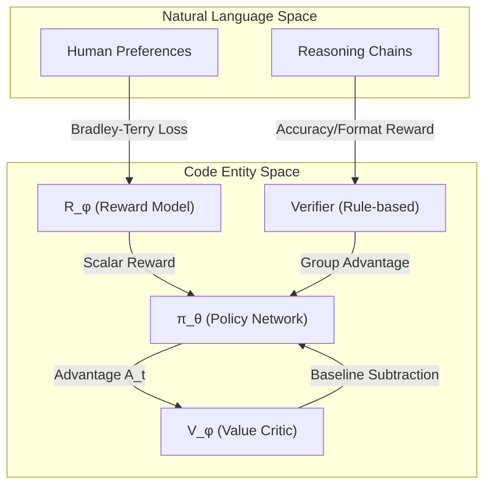

<!-- source: DeepWiki mcp.deepwiki.com · repo rohitg00/ai-engineering-from-scratch · page 11 Phase 9: Reinforcement Learning · fetched 2026-10-30 -->

# Phase 9: Reinforcement Learning

<details>
<summary>Relevant source files</summary>

The following files were used as context for generating this wiki page:

- [phases/09-reinforcement-learning/06-policy-gradients-reinforce/assets/policy-gradient.svg](phases/09-reinforcement-learning/06-policy-gradients-reinforce/assets/policy-gradient.svg)
- [phases/09-reinforcement-learning/06-policy-gradients-reinforce/code/main.py](phases/09-reinforcement-learning/06-policy-gradients-reinforce/code/main.py)
- [phases/09-reinforcement-learning/06-policy-gradients-reinforce/docs/en.md](phases/09-reinforcement-learning/06-policy-gradients-reinforce/docs/en.md)
- [phases/09-reinforcement-learning/06-policy-gradients-reinforce/notebook/.gitkeep](phases/09-reinforcement-learning/06-policy-gradients-reinforce/notebook/.gitkeep)
- [phases/09-reinforcement-learning/06-policy-gradients-reinforce/outputs/skill-policy-gradient-trainer.md](phases/09-reinforcement-learning/06-policy-gradients-reinforce/outputs/skill-policy-gradient-trainer.md)
- [phases/09-reinforcement-learning/07-actor-critic-a2c-a3c/docs/en.md](phases/09-reinforcement-learning/07-actor-critic-a2c-a3c/docs/en.md)
- [phases/09-reinforcement-learning/08-ppo/docs/en.md](phases/09-reinforcement-learning/08-ppo/docs/en.md)
- [phases/09-reinforcement-learning/09-reward-modeling-rlhf/docs/en.md](phases/09-reinforcement-learning/09-reward-modeling-rlhf/docs/en.md)
- [phases/09-reinforcement-learning/12-rl-for-games/docs/en.md](phases/09-reinforcement-learning/12-rl-for-games/docs/en.md)

</details>


Phase 9 covers the transition from classical control to modern Large Language Model (LLM) alignment. This 12-lesson phase progresses from foundational Markov Decision Processes (MDPs) to the sophisticated Reinforcement Learning from Human Feedback (RLHF) and Group Relative Policy Optimization (GRPO) pipelines used in production reasoning models like DeepSeek-R1.

### RL Lifecycle and Alignment Stack

The reinforcement learning curriculum is structured to bridge the gap between "Natural Language Space" (instructions and responses) and "Code Entity Space" (reward functions and policy updates). 

The following diagram illustrates the relationship between the core components implemented in this phase:

**RL Entity Mapping: Policy to Reward**

Sources: [phases/09-reinforcement-learning/09-reward-modeling-rlhf/docs/en.md:20-55](), [phases/09-reinforcement-learning/12-rl-for-games/docs/en.md:53-77]()

---

## 11.1 RL Foundations: MDPs, Q-Learning & Policy Gradients

This section covers the transition from tabular RL to Deep RL. It establishes the mathematical bedrock of states, actions, and rewards, leading into the foundational algorithms that underpin modern AI agents.

### Key Concepts
*   **MDPs & Dynamic Programming:** Defining environments through states, actions, and transition probabilities.
*   **Temporal Difference (TD) Learning:** Combining Monte Carlo sampling with Bellman bootstrapping.
*   **Policy Gradients:** Directly parameterizing the policy `π_θ(a | s)` and using the **REINFORCE** theorem [phases/09-reinforcement-learning/06-policy-gradients-reinforce/docs/en.md:14-16]() to perform gradient ascent on expected returns.
*   **Actor-Critic Architectures:** Reducing variance by introducing a critic `V_φ(s)` that learns a baseline to compute the **Advantage** `A(s, a) = G - V̂(s)` [phases/09-reinforcement-learning/07-actor-critic-a2c-a3c/docs/en.md:14-18]().

**Core Algorithm Components**
| Component | Implementation Entity | Role |
| :--- | :--- | :--- |
| **Policy** | `softmax(logits(theta, x))` | Probability distribution over actions [phases/09-reinforcement-learning/06-policy-gradients-reinforce/code/main.py:42-46]() |
| **Baseline** | `baseline = 0.95 * b + 0.05 * returns[0]` | Simple variance reduction in `reinforce()` [phases/09-reinforcement-learning/06-policy-gradients-reinforce/code/main.py:92-93]() |
| **Advantage** | `A_t^{GAE}` | Generalized Advantage Estimation for stability [phases/09-reinforcement-learning/07-actor-critic-a2c-a3c/docs/en.md:40-45]() |

For details, see [RL Foundations: MDPs, Q-Learning & Policy Gradients](#11.1).

Sources: [phases/09-reinforcement-learning/06-policy-gradients-reinforce/docs/en.md:1-50](), [phases/09-reinforcement-learning/07-actor-critic-a2c-a3c/docs/en.md:1-55]()

---

## 11.2 PPO, RLHF & Modern Alignment

This section covers the algorithms used to align Large Language Models with human values and the specific techniques used to train reasoning models.

### Key Architectures
*   **Proximal Policy Optimization (PPO):** The industry standard for on-policy RL. It uses a **clipped surrogate objective** [phases/09-reinforcement-learning/08-ppo/docs/en.md:30-41]() to prevent the policy from changing too drastically in a single update, allowing for multiple epochs of training on the same rollout data.
*   **RLHF Pipeline:** The three-stage process of **SFT (Supervised Fine-Tuning)** → **RM (Reward Modeling)** → **PPO** [phases/09-reinforcement-learning/09-reward-modeling-rlhf/docs/en.md:22-48]().
*   **GRPO (Group Relative Policy Optimization):** A modern alternative to PPO that eliminates the need for a critic network by calculating advantages relative to a group of samples from the same prompt [phases/09-reinforcement-learning/12-rl-for-games/docs/en.md:53-63]().

**The Alignment Workflow**
```mermaid
graph LR
    subgraph "RLHF Stack"
        SFT["SFT Model (π_SFT)"]
        RM["Reward Model (R_φ)"]
        PPO["PPO Trainer"]
    end

    subgraph "Reasoning Stack (GRPO)"
        BASE["Base Model"]
        VER["Verifier (Rule-based)"]
        GRP["Group Samples"]
    end

    SFT --> PPO
    RM -- "Scalar Head" --> PPO
    PPO --> "Aligned LLM"

    BASE --> GRP
    GRP -- "Group Advantage" --> VER
    VER --> "Reasoning LLM (R1-style)"
```
Sources: [phases/09-reinforcement-learning/09-reward-modeling-rlhf/docs/en.md:16-18](), [phases/09-reinforcement-learning/12-rl-for-games/docs/en.md:65-74]()

### Reward Modeling
Reward models are typically initialized from the SFT model with a single linear layer outputting a scalar. They are trained using the **Bradley-Terry pairwise logistic loss** [phases/09-reinforcement-learning/09-reward-modeling-rlhf/docs/en.md:30-34]():
`L(φ) = -E[ log σ(R_φ(x, y_+) - R_φ(x, y_-)) ]`

For details, see [PPO, RLHF & Modern Alignment](#11.2).

Sources: [phases/09-reinforcement-learning/08-ppo/docs/en.md:1-60](), [phases/09-reinforcement-learning/09-reward-modeling-rlhf/docs/en.md:1-55](), [phases/09-reinforcement-learning/12-rl-for-games/docs/en.md:53-82]()

---

