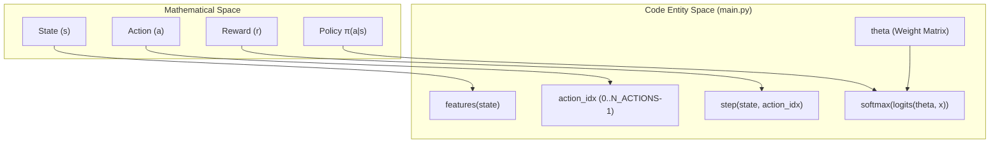

<!-- source: DeepWiki mcp.deepwiki.com · repo rohitg00/ai-engineering-from-scratch · page 11.1 RL Foundations: MDPs, Q-Learning & Policy Gradients · fetched 2026-10-30 -->

# RL Foundations: MDPs, Q-Learning & Policy Gradients

<details>
<summary>Relevant source files</summary>

The following files were used as context for generating this wiki page:

- [phases/09-reinforcement-learning/06-policy-gradients-reinforce/assets/policy-gradient.svg](phases/09-reinforcement-learning/06-policy-gradients-reinforce/assets/policy-gradient.svg)
- [phases/09-reinforcement-learning/06-policy-gradients-reinforce/code/main.py](phases/09-reinforcement-learning/06-policy-gradients-reinforce/code/main.py)
- [phases/09-reinforcement-learning/06-policy-gradients-reinforce/docs/en.md](phases/09-reinforcement-learning/06-policy-gradients-reinforce/docs/en.md)
- [phases/09-reinforcement-learning/06-policy-gradients-reinforce/notebook/.gitkeep](phases/09-reinforcement-learning/06-policy-gradients-reinforce/notebook/.gitkeep)
- [phases/09-reinforcement-learning/06-policy-gradients-reinforce/outputs/skill-policy-gradient-trainer.md](phases/09-reinforcement-learning/06-policy-gradients-reinforce/outputs/skill-policy-gradient-trainer.md)
- [phases/09-reinforcement-learning/07-actor-critic-a2c-a3c/docs/en.md](phases/09-reinforcement-learning/07-actor-critic-a2c-a3c/docs/en.md)
- [phases/09-reinforcement-learning/08-ppo/docs/en.md](phases/09-reinforcement-learning/08-ppo/docs/en.md)
- [phases/09-reinforcement-learning/09-reward-modeling-rlhf/docs/en.md](phases/09-reinforcement-learning/09-reward-modeling-rlhf/docs/en.md)
- [phases/09-reinforcement-learning/12-rl-for-games/docs/en.md](phases/09-reinforcement-learning/12-rl-for-games/docs/en.md)

</details>


This section covers the transition from tabular Reinforcement Learning (RL) to Deep RL, spanning Phase 9 lessons 01–07. It establishes the mathematical framework of Markov Decision Processes (MDPs), the mechanics of temporal difference learning (Q-Learning/SARSA), and the policy gradient methods (REINFORCE, Actor-Critic) that underpin modern Large Language Model (LLM) alignment techniques like RLHF and GRPO.

## Markov Decision Processes (MDPs) & Tabular RL

Reinforcement Learning is framed as an agent interacting with an environment defined by a tuple $(S, A, P, R, \gamma)$.
*   **States ($S$):** The set of all possible configurations.
*   **Actions ($A$):** The set of choices available to the agent.
*   **Rewards ($R$):** Scalar feedback signal $r_{t+1}$ received after taking action $a_t$ in $s_t$.
*   **Transitions ($P$):** The probability $P(s_{t+1} | s_t, a_t)$ of landing in a new state.

The goal is to find a policy $\pi(a|s)$ that maximizes the expected discounted return $G_t = \sum_{k=0}^{\infty} \gamma^k r_{t+k+1}$ [phases/09-reinforcement-learning/06-policy-gradients-reinforce/docs/en.md:26-28]().

### Transition to Code Entities
The following diagram bridges the mathematical MDP concepts to the specific implementation structures used in the codebase.

**MDP to Code Mapping**

Sources: [phases/09-reinforcement-learning/06-policy-gradients-reinforce/code/main.py:17-46]()

## Policy Gradients: REINFORCE

Policy gradients parameterize the policy directly as $\pi_\theta(a|s)$, typically using a neural network. Unlike Q-learning, which uses an `argmax` over values, policy gradients use stochastic sampling, making them suitable for continuous action spaces and preventing deterministic "traps" [phases/09-reinforcement-learning/06-policy-gradients-reinforce/docs/en.md:12-14]().

### The REINFORCE Theorem
The gradient of the expected return $J(\theta)$ is given by:
$$\nabla J(\theta) = E_{\pi_\theta} [ \sum_{t=0}^{T} G_t \cdot \nabla_\theta \log \pi_\theta(a_t | s_t) ]$$
[phases/09-reinforcement-learning/06-policy-gradients-reinforce/docs/en.md:26-27]().

### Implementation Mechanics
1.  **Rollout:** Run an episode and store $(s, a, r, \pi(a|s))$ [phases/09-reinforcement-learning/06-policy-gradients-reinforce/code/main.py:59-71]().
2.  **Returns-to-go:** Calculate $G_t$ by iterating backwards through the trajectory [phases/09-reinforcement-learning/06-policy-gradients-reinforce/code/main.py:74-81]().
3.  **Log-Derivative Trick:** For a softmax policy, the gradient $\nabla_\theta \log \pi_\theta(a|s)$ simplifies to $(e_a - \pi(s))$, where $e_a$ is a one-hot vector of the taken action [phases/09-reinforcement-learning/06-policy-gradients-reinforce/docs/en.md:49-51]().
4.  **Update:** $\theta \leftarrow \theta + \alpha \cdot G_t \cdot \nabla_\theta \log \pi_\theta(a_t | s_t)$ [phases/09-reinforcement-learning/06-policy-gradients-reinforce/code/main.py:94-99]().

Sources: [phases/09-reinforcement-learning/06-policy-gradients-reinforce/docs/en.md:24-51](), [phases/09-reinforcement-learning/06-policy-gradients-reinforce/code/main.py:59-101]()

## Actor-Critic (A2C/A3C)

Vanilla REINFORCE suffers from high variance because raw returns $G_t$ can vary wildly. Actor-Critic methods reduce this variance by introducing a **Critic** $V_\phi(s)$ to estimate the expected return [phases/09-reinforcement-learning/07-actor-critic-a2c-a3c/docs/en.md:12-18]().

### Advantage Estimation
Instead of multiplying the gradient by $G_t$, we use the **Advantage** $A_t$:
$$A_t = G_t - V_\phi(s_t)$$
[phases/09-reinforcement-learning/07-actor-critic-a2c-a3c/docs/en.md:14-16]().

The codebase implements **Generalized Advantage Estimation (GAE)**, which blends Temporal Difference (TD) and Monte Carlo (MC) returns using a parameter $\lambda$ [phases/09-reinforcement-learning/07-actor-critic-a2c-a3c/docs/en.md:40-44]().

**Actor-Critic Data Flow**
```mermaid
sequenceDiagram
    participant Env as Environment (step)
    participant Actor as Actor π_θ (policy)
    participant Critic as Critic V_φ (value)
    participant GAE as compute_advantages

    Env->>Actor: state (s)
    Actor->>Env: action (a)
    Env->>GAE: rewards (r)
    Critic->>GAE: values (V)
    GAE->>Actor: advantages (A)
    GAE->>Critic: returns (target_V)
    Note over Actor, Critic: Shared Update Loop
```
Sources: [phases/09-reinforcement-learning/07-actor-critic-a2c-a3c/docs/en.md:78-107]()

## Deep Q-Networks (DQN) & PPO

The transition to Deep RL involves handling stability issues when using function approximators (Neural Networks).

### Proximal Policy Optimization (PPO)
PPO is the industry standard for RLHF. It addresses the "on-policy" constraint of A2C (where data is discarded after one update) by using a **Clipped Surrogate Objective** [phases/09-reinforcement-learning/08-ppo/docs/en.md:12-18]().

*   **Importance Ratio:** $r_t(\theta) = \frac{\pi_\theta(a_t | s_t)}{\pi_{\theta_{old}}(a_t | s_t)}$ [phases/09-reinforcement-learning/08-ppo/docs/en.md:26]().
*   **Clipping:** If $r_t(\theta)$ drifts too far from 1.0 (typically $\pm 0.2$), the gradient is clipped to prevent catastrophic policy collapse [phases/09-reinforcement-learning/08-ppo/docs/en.md:32-41]().

### RLHF Pipeline
Reinforcement Learning from Human Feedback (RLHF) applies these foundations to LLMs in three stages:
1.  **SFT:** Supervised Fine-Tuning on demonstrations [phases/09-reward-modeling-rlhf/docs/en.md:24]().
2.  **RM:** Training a Reward Model $R_\phi(x, y)$ using Bradley-Terry pairwise loss: $L(\phi) = -\log \sigma(R_\phi(x, y_+) - R_\phi(x, y_-))$ [phases/09-reward-modeling-rlhf/docs/en.md:26-34]().
3.  **PPO:** Optimizing the LM against the RM with a KL-divergence penalty to prevent "reward hacking" [phases/09-reward-modeling-rlhf/docs/en.md:38-48]().

Sources: [phases/09-reinforcement-learning/08-ppo/docs/en.md:12-47](), [phases/09-reinforcement-learning/09-reward-modeling-rlhf/docs/en.md:20-48]()

## Modern Evolution: GRPO
In 2025, **Group Relative Policy Optimization (GRPO)** (introduced by DeepSeek) simplified the Actor-Critic architecture for reasoning tasks. It removes the Critic network entirely, instead using the mean reward of a group of samples as the baseline:
$$A_i = \frac{r_i - \text{mean}(r)}{\text{std}(r)}$$
This reduces memory overhead and handles sparse rewards in math and coding tasks effectively [phases/09-reinforcement-learning/12-rl-for-games/docs/en.md:53-63]().

Sources: [phases/09-reinforcement-learning/12-rl-for-games/docs/en.md:53-78]()

---

