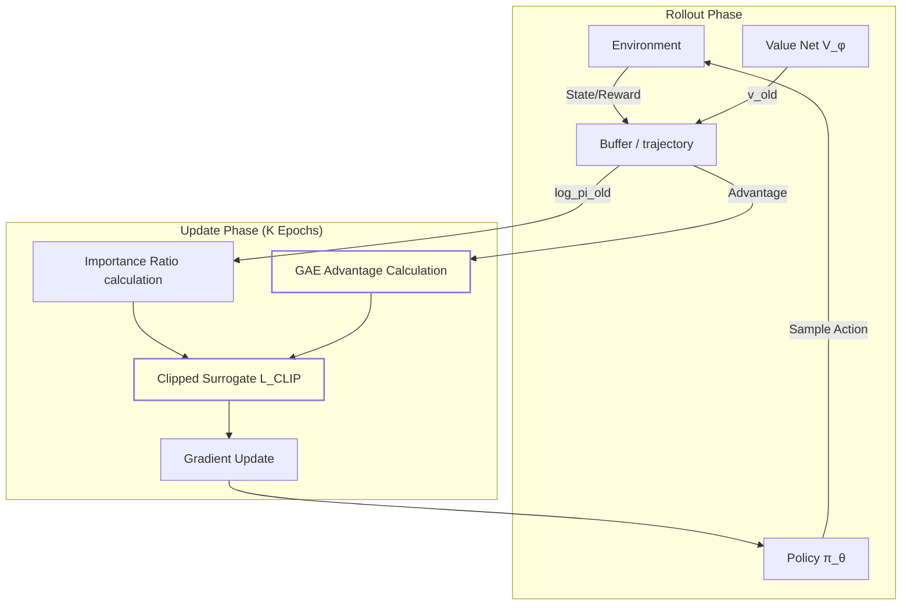
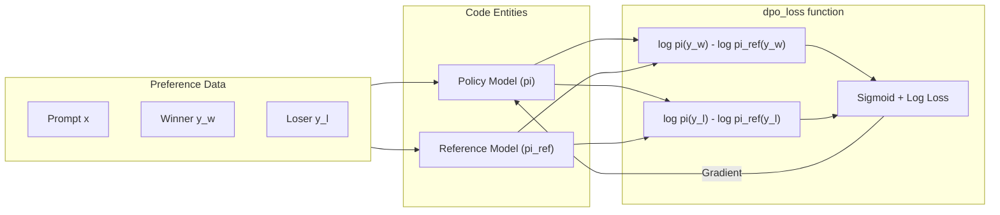

<!-- source: DeepWiki mcp.deepwiki.com · repo rohitg00/ai-engineering-from-scratch · page 11.2 PPO, RLHF & Modern Alignment · fetched 2026-10-30 -->

# PPO, RLHF & Modern Alignment

Relevant source files

The following files were used as context for generating this wiki page:

- [phases/09-reinforcement-learning/06-policy-gradients-reinforce/assets/policy-gradient.svg](phases/09-reinforcement-learning/06-policy-gradients-reinforce/assets/policy-gradient.svg)
- [phases/09-reinforcement-learning/06-policy-gradients-reinforce/code/main.py](phases/09-reinforcement-learning/06-policy-gradients-reinforce/code/main.py)
- [phases/09-reinforcement-learning/06-policy-gradients-reinforce/docs/en.md](phases/09-reinforcement-learning/06-policy-gradients-reinforce/docs/en.md)
- [phases/09-reinforcement-learning/06-policy-gradients-reinforce/notebook/.gitkeep](phases/09-reinforcement-learning/06-policy-gradients-reinforce/notebook/.gitkeep)
- [phases/09-reinforcement-learning/06-policy-gradients-reinforce/outputs/skill-policy-gradient-trainer.md](phases/09-reinforcement-learning/06-policy-gradients-reinforce/outputs/skill-policy-gradient-trainer.md)
- [phases/09-reinforcement-learning/07-actor-critic-a2c-a3c/docs/en.md](phases/09-reinforcement-learning/07-actor-critic-a2c-a3c/docs/en.md)
- [phases/09-reinforcement-learning/08-ppo/docs/en.md](phases/09-reinforcement-learning/08-ppo/docs/en.md)
- [phases/09-reinforcement-learning/09-reward-modeling-rlhf/docs/en.md](phases/09-reinforcement-learning/09-reward-modeling-rlhf/docs/en.md)
- [phases/09-reinforcement-learning/12-rl-for-games/docs/en.md](phases/09-reinforcement-learning/12-rl-for-games/docs/en.md)
- [phases/10-llms-from-scratch/07-rlhf/code/main.py](phases/10-llms-from-scratch/07-rlhf/code/main.py)
- [phases/10-llms-from-scratch/07-rlhf/docs/en.md](phases/10-llms-from-scratch/07-rlhf/docs/en.md)
- [phases/10-llms-from-scratch/07-rlhf/outputs/prompt-reward-model-designer.md](phases/10-llms-from-scratch/07-rlhf/outputs/prompt-reward-model-designer.md)
- [phases/10-llms-from-scratch/08-dpo/code/main.py](phases/10-llms-from-scratch/08-dpo/code/main.py)
- [phases/10-llms-from-scratch/08-dpo/docs/en.md](phases/10-llms-from-scratch/08-dpo/docs/en.md)
- [phases/10-llms-from-scratch/08-dpo/outputs/prompt-alignment-method-selector.md](phases/10-llms-from-scratch/08-dpo/outputs/prompt-alignment-method-selector.md)

This page covers the transition from foundational reinforcement learning to modern LLM alignment. It details the mechanics of **Proximal Policy Optimization (PPO)**, the multi-stage **RLHF** (Reinforcement Learning from Human Feedback) pipeline, and modern alternatives like **DPO** (Direct Preference Optimization) and **GRPO** (Group Relative Policy Optimization).

## Overview of the Alignment Stack

Alignment ensures that models trained on next-token prediction behave according to human intent (helpfulness, honesty, harmlessness). The process evolved from complex, unstable RL loops to more robust, closed-form optimizations.

### The Alignment Evolution
| Method | Era | Key Innovation | Role in 2026 |
| :--- | :--- | :--- | :--- |
| **PPO** | 2017 | Clipped surrogate objective to allow multiple epochs per rollout. | Default RL engine for general tasks. |
| **RLHF** | 2022 | SFT → Reward Model → PPO pipeline. | The "ChatGPT" recipe; used for complex multi-objective alignment. |
| **DPO** | 2023 | Closed-form loss over preference pairs (no RM/PPO needed). | Dominant for alignment tuning due to stability. |
| **GRPO** | 2024 | Group-relative advantage (no critic needed) + Verifiers. | Standard for Reasoning Models (DeepSeek-R1 style). |

Sources: [phases/09-reinforcement-learning/09-reward-modeling-rlhf/docs/en.md:3-18](), [phases/09-reinforcement-learning/12-rl-for-games/docs/en.md:53-63](), [phases/10-llms-from-scratch/08-dpo/docs/en.md:25-28]()

---

## Proximal Policy Optimization (PPO)

PPO addresses the sample inefficiency of vanilla Policy Gradients (REINFORCE). While REINFORCE requires new data for every update, PPO uses **Importance Sampling** and a **Clipped Surrogate Objective** to perform multiple gradient steps on the same data without the policy collapsing.

### The Clipped Objective
The core of PPO is the ratio $r_t(\theta) = \frac{\pi_\theta(a_t|s_t)}{\pi_{\theta_{old}}(a_t|s_t)}$. To prevent the policy from moving too far from the data collection policy, the objective is clipped:

$$L^{CLIP}(\theta) = \mathbb{E}_t [ \min(r_t(\theta) \hat{A}_t, \text{clip}(r_t(\theta), 1-\epsilon, 1+\epsilon) \hat{A}_t) ]$$

### PPO Data Flow
The diagram below maps the PPO components to their implementation in the codebase.

Sources: [phases/09-reinforcement-learning/08-ppo/docs/en.md:24-48](), [phases/09-reinforcement-learning/08-ppo/docs/en.md:89-112]()

---

## RLHF: The Three-Stage Pipeline

Reinforcement Learning from Human Feedback (RLHF) converts human preferences into a scalar reward signal.

1.  **SFT (Supervised Fine-Tuning):** The base model is trained on high-quality demonstrations.
2.  **Reward Modeling (RM):** A model is trained to predict human preferences using the **Bradley-Terry loss**.
3.  **RL Fine-Tuning (PPO):** The SFT model is optimized against the Reward Model, using a **KL Divergence** penalty to prevent "reward hacking."

### Reward Model Training
The Reward Model `R_φ(x, y)` is trained on pairs $(y_+, y_-)$ where $y_+$ is preferred.
$$L(\phi) = -\mathbb{E}[ \log \sigma(R_\phi(x, y_+) - R_\phi(x, y_-)) ]$$

### Code Implementation: Reward Modeling & PPO
The implementation uses a `RewardModel` class with a scalar head and a training loop that processes `PREFERENCE_DATA`.

| Code Entity | File Path | Role |
| :--- | :--- | :--- |
| `RewardModel` | [phases/10-llms-from-scratch/07-rlhf/code/main.py:48-77]() | Transformer with a scalar `reward_head` instead of a vocab head. |
| `bradley_terry_loss` | [phases/10-llms-from-scratch/07-rlhf/code/main.py:92-95]() | Pairwise logistic loss for preference learning. |
| `compute_kl_divergence`| [phases/10-llms-from-scratch/07-rlhf/code/main.py:163-175]() | Regularizer to keep the policy near the reference model. |
| `train_reward_model` | [phases/10-llms-from-scratch/07-rlhf/code/main.py:98-160]() | Iterates through preference pairs to update the RM head. |

Sources: [phases/09-reinforcement-learning/09-reward-modeling-rlhf/docs/en.md:24-48](), [phases/10-llms-from-scratch/07-rlhf/docs/en.md:73-91]()

---

## DPO: Direct Preference Optimization

DPO removes the need for an explicit Reward Model and the unstable PPO loop. It derives a closed-form solution where the optimal policy can be found by directly optimizing the log-probabilities of preferred vs. rejected responses relative to a reference model.

### DPO Loss Function
$$L_{DPO} = -\log \sigma (\beta \log \frac{\pi_\theta(y_w|x)}{\pi_{ref}(y_w|x)} - \beta \log \frac{\pi_\theta(y_l|x)}{\pi_{ref}(y_l|x)})$$

### DPO System Architecture
This diagram illustrates how the `dpo_train` function interacts with the `MiniGPT` models.

Sources: [phases/10-llms-from-scratch/08-dpo/docs/en.md:66-82](), [phases/10-llms-from-scratch/08-dpo/code/main.py:94-118](), [phases/10-llms-from-scratch/08-dpo/code/main.py:141-205]()

---

## GRPO & Reasoning Alignment

**Group Relative Policy Optimization (GRPO)** is the technique used in models like DeepSeek-R1. It replaces the PPO critic with a group-relative baseline.

### Key Characteristics
*   **No Critic:** Instead of a `ValueModel`, it samples a group of completions for each prompt and uses their mean reward as the baseline.
*   **Rule-Based Rewards:** For reasoning, rewards come from verifiers (e.g., does the code pass unit tests?) rather than a neural Reward Model.
*   **Efficiency:** Halves memory requirements by eliminating the value network tower.

### The DeepSeek-R1 "Zero" Recipe
1.  **Base Model:** No SFT.
2.  **GRPO:** Apply with accuracy rewards (math/code verification) and format rewards (using `<think>` tags).
3.  **Result:** Emergent reasoning, though often stylistically inconsistent.

Sources: [phases/09-reinforcement-learning/12-rl-for-games/docs/en.md:53-77]()

---

## Comparison of Alignment Techniques

| Feature | PPO-RLHF | DPO | GRPO |
| :--- | :--- | :--- | :--- |
| **Models in RAM** | 4 (Policy, Ref, RM, Critic) | 2 (Policy, Ref) | 2 (Policy, Ref) |
| **Reward Signal** | Neural Reward Model | Implicit (from Prob Ratio) | Rule-based Verifier / Group Mean |
| **Stability** | Low (sensitive to hyperparams) | High (Supervised-like) | Medium |
| **Primary Use** | General Chat / Safety | Alignment Tuning | Math / Code Reasoning |

Sources: [phases/10-llms-from-scratch/08-dpo/docs/en.md:119-128](), [phases/10-llms-from-scratch/08-dpo/outputs/prompt-alignment-method-selector.md:28-49](), [phases/09-reinforcement-learning/12-rl-for-games/docs/en.md:76-77]()

---

